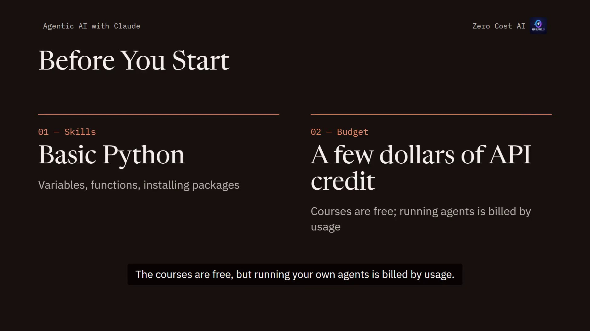
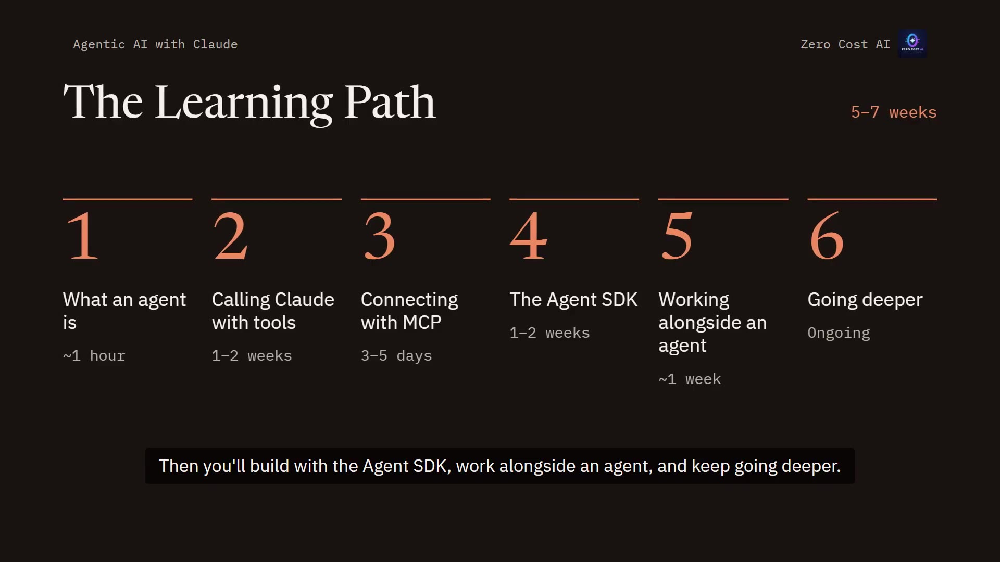
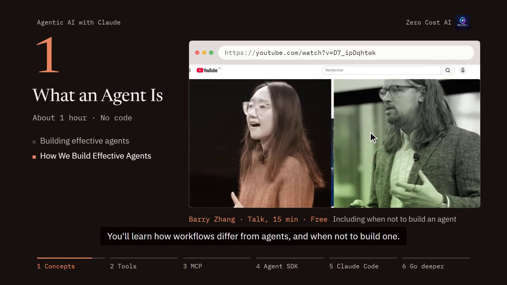
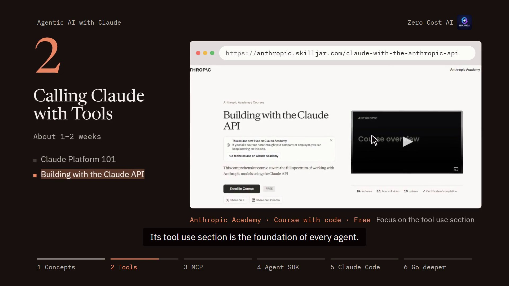
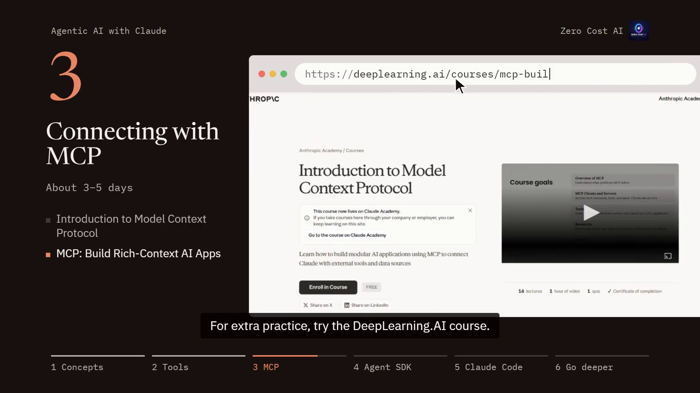
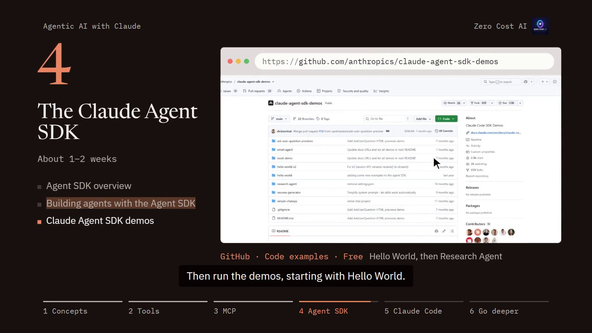
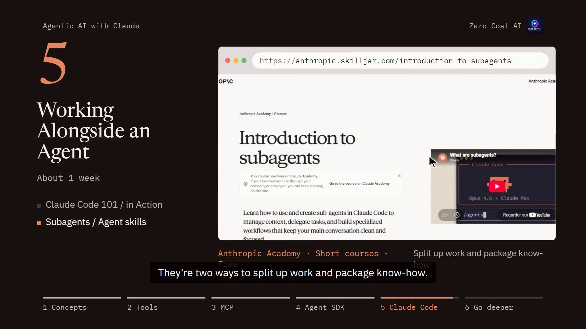
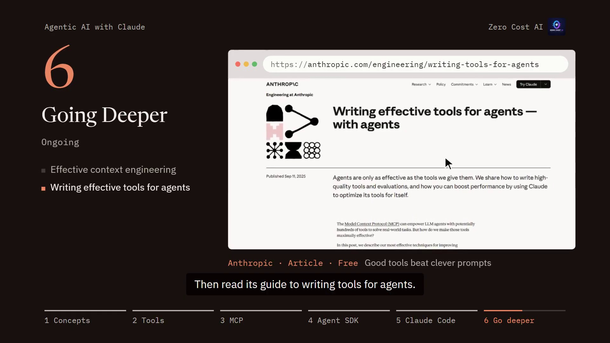
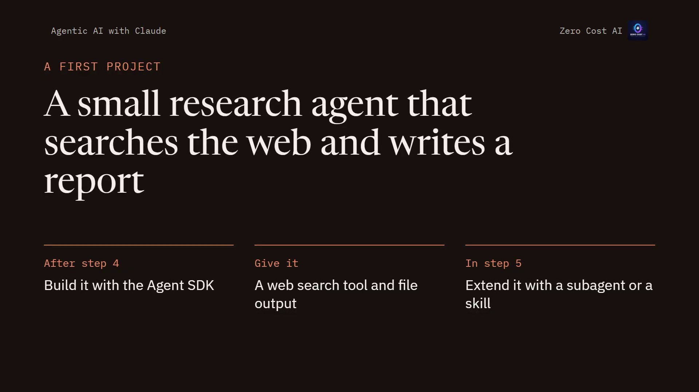

Want to build AI agents but don't know where to start?

Here's a **free path for learning agentic AI with Claude**. It takes you from first concepts to your first working agent, in six steps and about 5 to 7 weeks. Every course on it is free.

🎥 **Prefer video?** Watch the full walkthrough here:

{VIDEO}

---

## Before you start

You need two things:

1. **Basic Python:** variables, functions, and installing packages.
2. **A few dollars of API credit.** The courses are free, but running your own agents is billed by usage.

## The learning path

The path has six steps and takes about **5 to 7 weeks**:

1. **What an agent is**: about 1 hour
2. **Calling Claude with tools**: 1 to 2 weeks
3. **Connecting with MCP**: 3 to 5 days
4. **The Agent SDK**: 1 to 2 weeks
5. **Working alongside an agent**: about 1 week
6. **Going deeper**: ongoing

You'll learn what agents are, call Claude with tools, and connect them with MCP. Then you'll build with the Agent SDK, work alongside an agent, and keep going deeper.

## Step 1: What an agent is (about 1 hour, no code)

Read Anthropic's article **Building Effective Agents**, or watch the 15-minute talk that covers the same ideas. You'll learn how workflows differ from agents, and when *not* to build one.

- Building effective agents (Anthropic): https://www.anthropic.com/engineering/building-effective-agents
- How We Build Effective Agents (Barry Zhang, talk): https://www.youtube.com/watch?v=D7_ipDqhtwk

## Step 2: Calling Claude with tools (1 to 2 weeks)

Start with **Claude Platform 101** on Anthropic Academy. Then take **Building with the Claude API**. Its tool use section is the foundation of every agent. Practice with the free notebooks on GitHub.

- Claude Platform 101: https://anthropic.skilljar.com/claude-platform-101
- Building with the Claude API: https://anthropic.skilljar.com/claude-with-the-anthropic-api
- Anthropic courses on GitHub: https://github.com/anthropics/courses
- Claude API, get started: https://platform.claude.com/docs/en/get-started

## Step 3: Connecting with MCP (3 to 5 days)

Step three is the **Model Context Protocol**, or MCP: the standard way to plug tools and data into Claude agents. Take the free introduction on Anthropic Academy, and for extra practice, try the DeepLearning.AI course.

- Introduction to Model Context Protocol: https://anthropic.skilljar.com/introduction-to-model-context-protocol
- MCP: Build Rich-Context AI Apps (DeepLearning.AI): https://www.deeplearning.ai/courses/mcp-build-rich-context-ai-apps-with-anthropic

## Step 4: The Claude Agent SDK (1 to 2 weeks)

This is where you build real agents. Read the **Agent SDK overview**, then follow the quickstart. Learn the loop it's designed around: **gather context → take action → verify**. Then run the demos, starting with Hello World.

- Agent SDK overview: https://code.claude.com/docs/en/agent-sdk/overview
- Building agents with the Claude Agent SDK: https://claude.com/resources/articles/building-agents-with-the-claude-agent-sdk
- Claude Agent SDK demos: https://github.com/anthropics/claude-agent-sdk-demos

## Step 5: Working alongside an agent (about 1 week)

**Claude Code 101** and **Claude Code in Action** show an agent in daily use. Then learn **subagents** and **agent skills**: two ways to split up work and package know-how.

- Claude Code 101: https://anthropic.skilljar.com/claude-code-101
- Claude Code in Action: https://anthropic.skilljar.com/claude-code-in-action
- Introduction to subagents: https://anthropic.skilljar.com/introduction-to-subagents
- Introduction to agent skills: https://anthropic.skilljar.com/introduction-to-agent-skills

## Step 6: Going deeper (ongoing)

Read Anthropic's article on **context engineering**, then its guide to **writing tools for agents**. Run the agent patterns in the **Claude Cookbooks**. For a framework-neutral view, take the free **Hugging Face Agents Course**.

- Effective context engineering for AI agents: https://www.anthropic.com/engineering/effective-context-engineering-for-ai-agents
- Writing effective tools for agents: https://www.anthropic.com/engineering/writing-tools-for-agents
- Claude Cookbooks: https://github.com/anthropics/claude-cookbooks
- Hugging Face AI Agents Course: https://huggingface.co/learn/agents-course/unit0/introduction

## Your first project: a small research agent

- **After step 4**, build a small research agent with the Agent SDK.
- **Give it** a web search tool, and have it write a short report to a file.
- **In step 5**, extend it with a subagent or a skill.

## Want to go further? (paid books)

These two aren't free, but they're good next reads:

- AI Engineering (O'Reilly): https://www.oreilly.com/library/view/ai-engineering/9781098166298/
- AI Agents in Action, 2nd edition (Manning): https://www.manning.com/books/ai-agents-in-action-second-edition

## Recap

- You need basic Python and a few dollars of API credit; every course is free.
- Six steps: what an agent is, tools, MCP, the Agent SDK, working alongside an agent, and going deeper.
- Build a small research agent after step 4, and extend it in step 5.

Start with step one today.

🎥 **Watch the video:** {VIDEO_URL}

---

*I'm Zero Cost AI: I build free AI tools and write beginner-friendly guides. Follow me here on Medium and subscribe on YouTube for more.*
