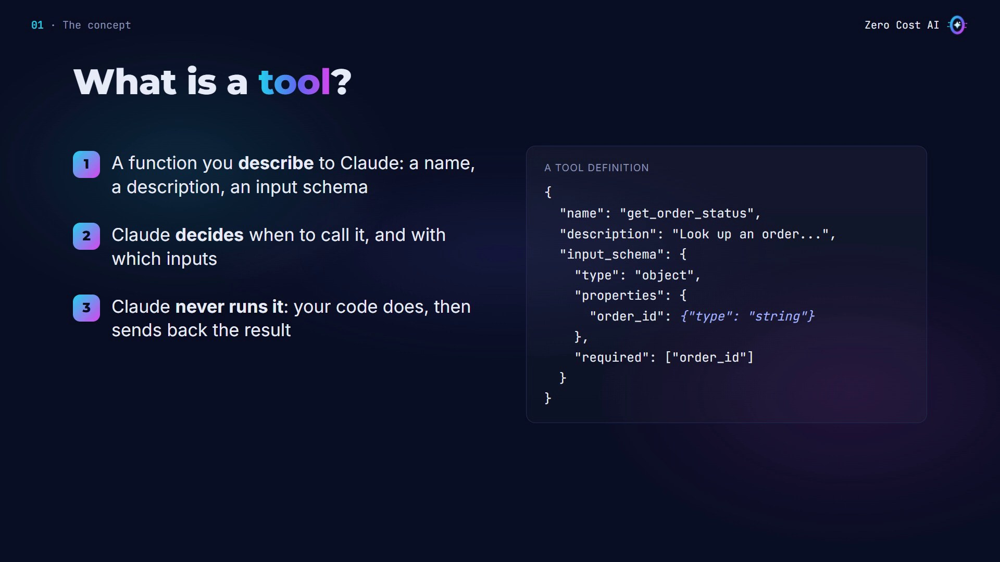
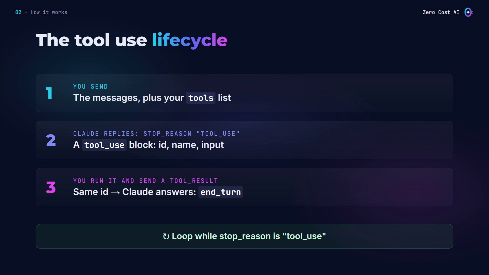
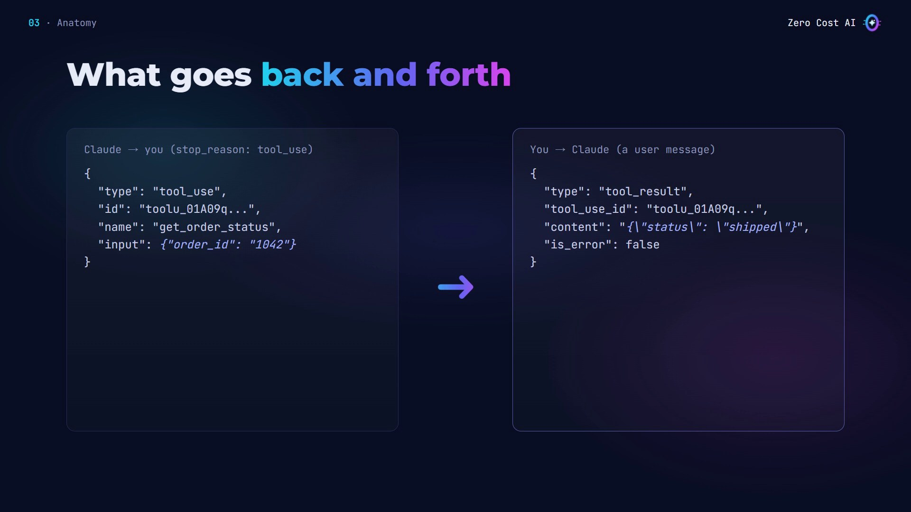
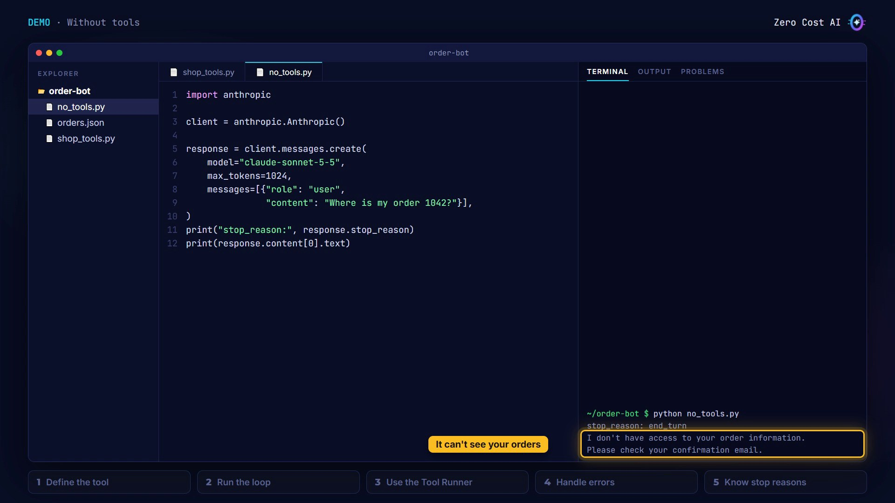
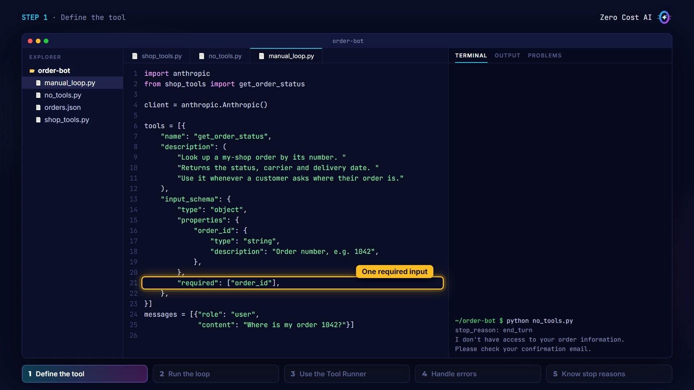
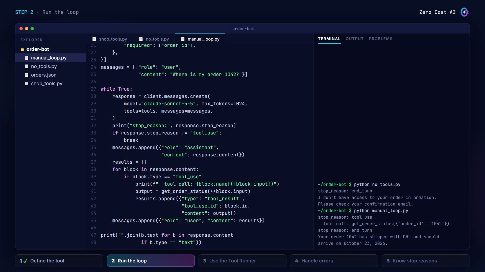
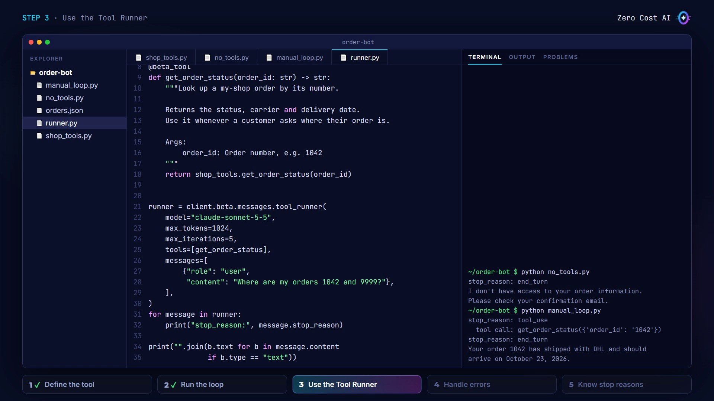
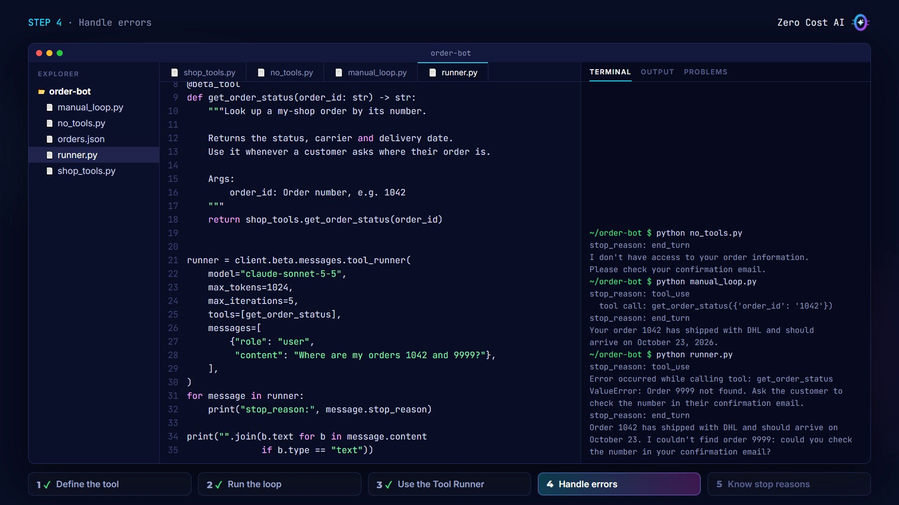
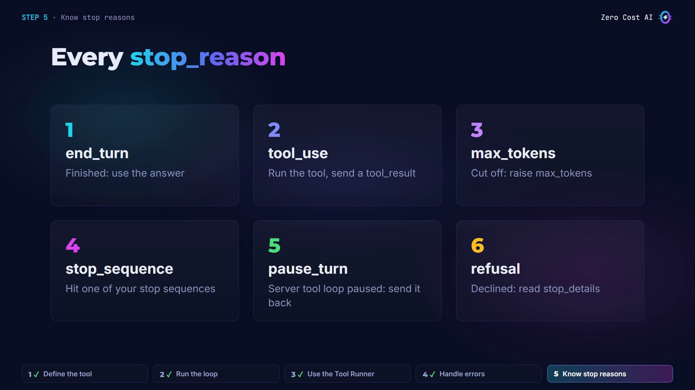
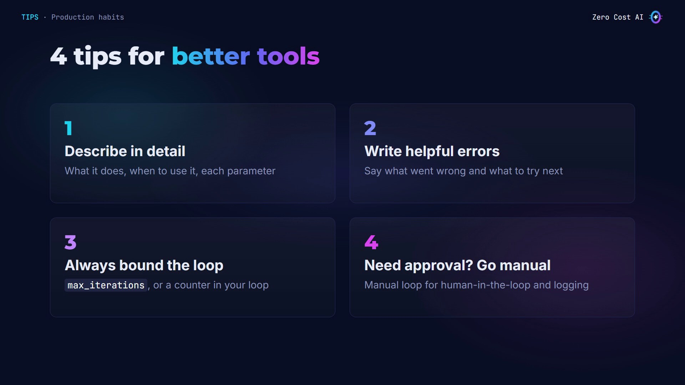

Claude is great with words. But on its own, it can't check your database, call your API, or look up a customer's order.

**Tools** fix that. In this article you'll learn how tools work, the full **tool use lifecycle** with stop reasons, and how the SDK's **Tool Runner** handles the loop for you.

We'll build a real example step by step in Python: an order status assistant for a small online shop.

🎥 **Prefer video?** Watch the full tutorial here:

{VIDEO}

---

## What is a tool?

A tool is a **function you describe to Claude**, with three parts: a **name**, a **description**, and an **input schema** (a JSON schema for its parameters).

- Claude reads that description and **decides** when to call the tool, and with which inputs.
- **Claude never runs anything itself.** It asks. Your code runs the function and sends the result back.

(Some tools, like web search, run on Anthropic's servers instead. Today: your own tools.)



## The tool use lifecycle

Every tool call is a round trip:

1. **You send** the conversation, plus your list of tools.
2. **Claude replies with `stop_reason: "tool_use"`**: the response contains a `tool_use` block with an id, the tool name and the input.
3. **You run the tool and send back a `tool_result`** with the same id. Then Claude writes its answer, with `stop_reason: "end_turn"`.

Claude may call tools several times in a row, so the rule is simple: **keep looping while the stop reason is `tool_use`**.



## What goes back and forth

On the left, Claude's request: the tool name, the input it chose, and a unique id. On the right, your answer, sent as a **user** message:

- `tool_use_id` links the result to the request.
- `is_error` tells Claude if the tool failed.

Two rules: the tool result must come **right after** Claude's tool use message, and tool results go **first** in the message content.



## When to use tools

Use a tool when Claude needs to:

- **do** something, like send or update,
- get **fresh or private data**, like your orders,
- return a **guaranteed JSON shape**.

Skip tools when Claude can answer from text alone, like a summary or a translation. Every tool call is an extra round trip.

## Our use case: an order status assistant

Without a tool, Claude can't see the orders: it can only apologize. With a `get_order_status` tool, Claude asks for the data, our code reads it, and the answer is based on real data.

Here's the function (`shop_tools.py`). It reads the orders from a JSON file, and if the order doesn't exist, it raises an error with a clear message:

```python
import json
import pathlib

HERE = pathlib.Path(__file__).parent
ORDERS = json.loads((HERE / "orders.json").read_text())


def get_order_status(order_id: str) -> str:
    """Return the order as JSON, or raise a helpful error."""
    order = ORDERS.get(order_id)
    if order is None:
        raise ValueError(
            f"Order {order_id} not found. Ask the customer to "
            "check the number in their confirmation email.")
    return json.dumps(order)
```

## The problem: no tools

First, I ask Claude about an order with no tools at all. Stop reason: `end_turn`. Claude finished, but it simply can't know.



## Step 1: Define the tool

Import the SDK and the function, then describe the tool in a list (`manual_loop.py`):

```python
import anthropic
from shop_tools import get_order_status

client = anthropic.Anthropic()

tools = [{
    "name": "get_order_status",
    "description": (
        "Look up a my-shop order by its number. "
        "Returns the status, carrier and delivery date. "
        "Use it whenever a customer asks where their order is."
    ),
    "input_schema": {
        "type": "object",
        "properties": {
            "order_id": {
                "type": "string",
                "description": "Order number, e.g. 1042",
            },
        },
        "required": ["order_id"],
    },
}]
messages = [{"role": "user",
             "content": "Where is my order 1042?"}]
```

The **description** matters most: Claude reads it to decide when to call the tool. The docs recommend three or four sentences: what it does, and when to use it. The input schema says the tool takes one required string: the order id.



## Step 2: Run the lifecycle loop

```python
while True:
    response = client.messages.create(
        model="claude-sonnet-5-5", max_tokens=1024,
        tools=tools, messages=messages,
    )
    print("stop_reason:", response.stop_reason)
    if response.stop_reason != "tool_use":
        break
    messages.append({"role": "assistant",
                     "content": response.content})
    results = []
    for block in response.content:
        if block.type == "tool_use":
            print(f"  tool call: {block.name}({block.input})")
            output = get_order_status(**block.input)
            results.append({"type": "tool_result",
                            "tool_use_id": block.id,
                            "content": output})
    messages.append({"role": "user", "content": results})

print("".join(b.text for b in response.content
              if b.type == "text"))
```

Inside the loop: call the API with the tools and print the stop reason. If it's not `tool_use`, Claude is done, so break. Otherwise, append Claude's message, run each `tool_use` block, and send back a `tool_result` with the same id. Then the loop calls Claude again.

Run it and watch the stop reasons: first `tool_use`, the code runs the function, then `end_turn`, with an answer based on real data.



## Step 3: Use the Tool Runner

That loop works, but you'd write it in every project. The SDK can do it for you (`runner.py`):

```python
import anthropic
from anthropic import beta_tool
import shop_tools

client = anthropic.Anthropic()


@beta_tool
def get_order_status(order_id: str) -> str:
    """Look up a my-shop order by its number.

    Returns the status, carrier and delivery date.
    Use it whenever a customer asks where their order is.

    Args:
        order_id: Order number, e.g. 1042
    """
    return shop_tools.get_order_status(order_id)


runner = client.beta.messages.tool_runner(
    model="claude-sonnet-5-5",
    max_tokens=1024,
    max_iterations=5,
    tools=[get_order_status],
    messages=[
        {"role": "user",
         "content": "Where are my orders 1042 and 9999?"},
    ],
)
for message in runner:
    print("stop_reason:", message.stop_reason)

print("".join(b.text for b in message.content
              if b.type == "text"))
```

- With the `@beta_tool` decorator, a plain Python function becomes a tool. The SDK builds the schema from the type hints and the docstring.
- The **Tool Runner** (in beta in the official SDKs) runs the tools, appends the messages, and loops until Claude stops calling tools.
- `max_iterations` puts a safety limit on the loop. And you still get each message, to print its stop reason.



## Step 4: Handle errors

This time I ask about two orders: 1042, and 9999, which doesn't exist. Claude calls the tool twice in one turn.

For 9999, the function raises an error. The Tool Runner catches it and sends it to Claude as a tool result with `is_error: true`. The script doesn't crash. And because the error message says what to do next, Claude answers the first order and asks the customer to check the second number.

In the manual loop, you'd catch the exception yourself and set `is_error` in the tool result.



## Step 5: Know every stop_reason

Your code should check the stop reason on every response:

- **end_turn**: Claude finished. Use the answer.
- **tool_use**: run the tool and send the result back.
- **max_tokens**: the answer hit your `max_tokens` limit, so it's cut off. Raise the limit, or continue the response.
- **stop_sequence**: Claude wrote one of your custom stop sequences.
- **pause_turn**: a server tool, like web search, hit its loop limit. Send the conversation back, and Claude continues.
- **refusal**: Claude declined to respond. Check the stop details.
- There's also **model_context_window_exceeded**, when the response fills the context window.



## 4 tips before you ship



1. **Write detailed descriptions.** It's the biggest factor in how well Claude uses your tools.
2. **Write helpful error messages.** Say what went wrong and what to try next, so Claude can recover.
3. **Always bound the loop**, with `max_iterations` or a counter in your own loop.
4. **The Tool Runner is the easy default.** When you need human approval before a tool runs, custom logging, or conditional execution, use the manual loop.

## Recap

- A tool is a name, a description and an input schema. Claude asks, and your code runs it.
- The lifecycle: loop while the stop reason is `tool_use`, and send back a `tool_result` with the same id.
- The Tool Runner runs that loop for you, and turns your exceptions into `is_error` results.

## Get the files

All the code, an offline test you can run **without an API key** (it simulates the API), and a stop reason cheat sheet are free on GitHub:

👉 **Files:** https://github.com/NEDBS12/youtube-tuto/tree/main/claude-api-tools

🎥 **Watch the video tutorial:** {VIDEO_URL}

**Official docs:**

- How tool use works: https://platform.claude.com/docs/en/agents-and-tools/tool-use/how-tool-use-works
- Tool Runner (SDK): https://platform.claude.com/docs/en/agents-and-tools/tool-use/tool-runner
- Stop reasons: https://platform.claude.com/docs/en/build-with-claude/handling-stop-reasons

*Screenshots are from the Zero Cost AI video. The code was tested with the anthropic SDK 1.15.0 against a simulated API; Claude's wording in your own runs will differ.*

---

*I'm Zero Cost AI: I build free AI tools and write beginner-friendly guides. Follow me here on Medium and subscribe on YouTube for more.*
