Are you preparing for the Claude Certified Architect, Foundations exam (CCA-F) and wondering where to start?

I put together three free files to help you prepare: a **study guide** in PDF, a **mock exam workbook** in PDF, and a **Windows practice app**. In this article I'll show you what's inside each one, and how to use them together to get ready for exam day.

But first, one important note.

🎥 **Prefer video?** Watch the full walkthrough here:

{VIDEO}

## ⚠️ Not official, not provided by Anthropic

These files are **not official**, and they are **not provided by Anthropic**.

- They are independent study material. Anthropic did not make them, review them or endorse them, and they are not affiliated with Anthropic.
- The questions are **original practice questions**, written to match the published exam domains. They are not real exam questions.
- Exam details, like the format or the pass mark, can change. Always confirm them on the official exam page before you book.

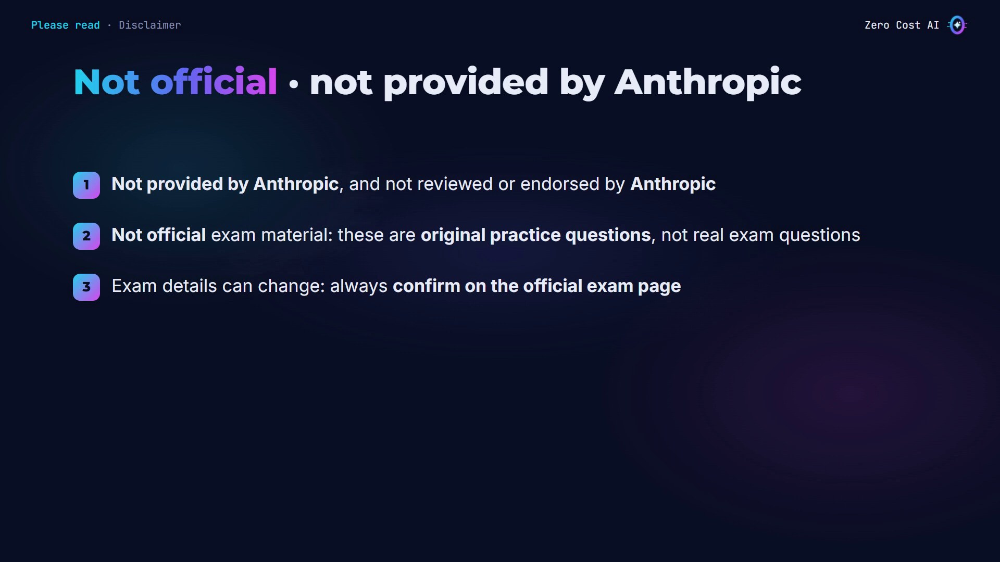

## The exam at a glance

Here's what the exam looks like, based on the published exam guide:

- **Format:** 60 multiple-choice questions in 120 minutes. That's about two minutes per question.
- **Scenarios:** every question sits inside a realistic production scenario. You get 4 scenarios, drawn at random from a bank of 6.
- **Scoring:** scaled from 100 to 1,000. The pass mark is 720.
- **Domains:** agent architecture, tool design and MCP, Claude Code, prompt engineering, and context management.

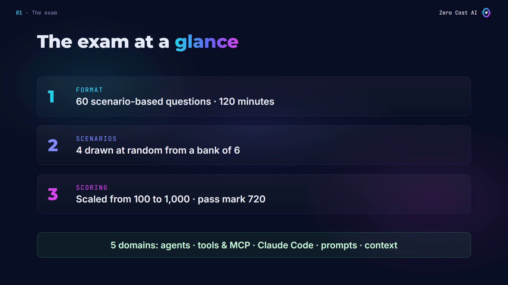

## The 3 files

- **Study guide (PDF):** 57 pages that teach every domain, written for beginners.
- **Mock exams (PDF):** a printable workbook with 10 exams and 200 questions, with answer sheets and full answer keys.
- **Practice app (.exe):** the same 10 exams for Windows, in practice and timed modes.

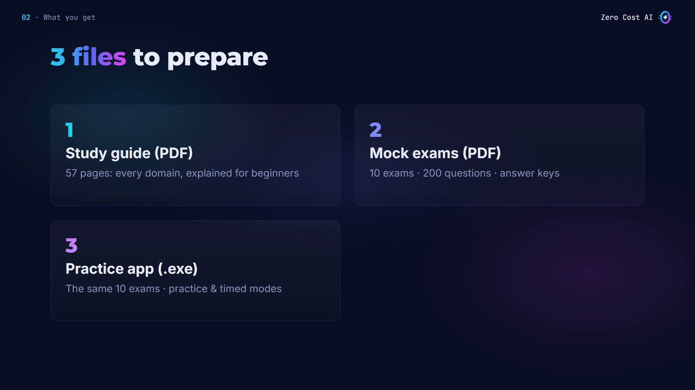

## File 1: The study guide PDF

The study guide is written for beginners. Chapter 0 explains the exam, and chapter 1 covers the basics, like what an API call and a tool are.

Then there's one chapter per domain, so you can see exactly how much each one is worth. Each chapter explains the ideas with real code, annotated line by line, like the agent loop.

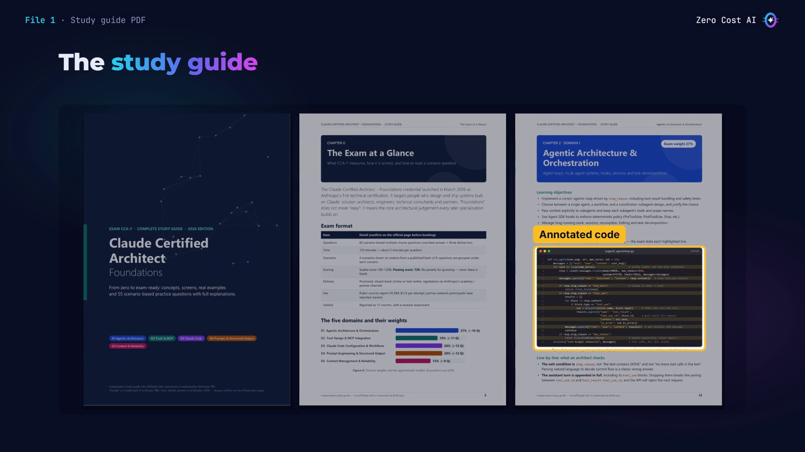

Inside, you'll also find:

- **Comparison tables**, like the workflow patterns and when to use each one.
- **Diagrams**, like a coordinator and its subagents.
- **Real configuration files** for Claude Code, such as permission rules and hooks.

Every chapter ends with a lab exercise and a short quiz. Later chapters solve all six exam scenarios, and the guide finishes with a four-week study plan and a glossary.

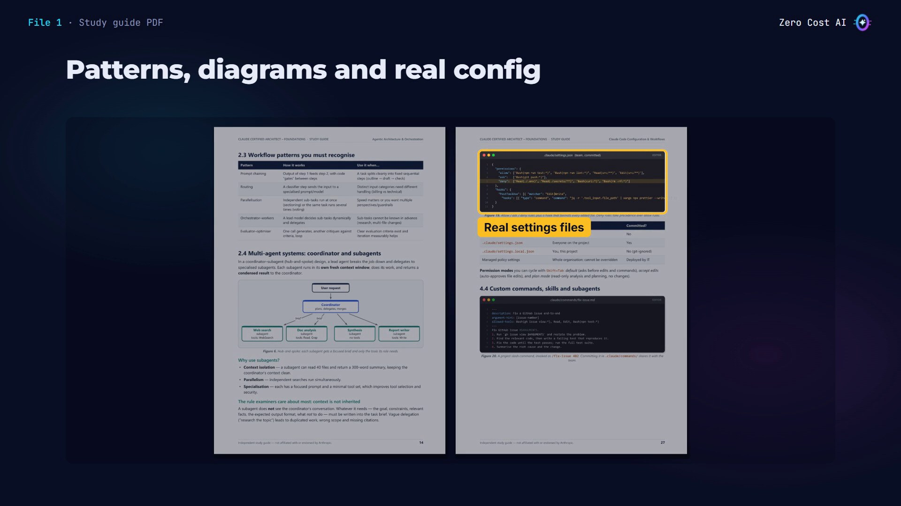

## File 2: The mock exams PDF

The second file is the mock exam workbook: ten exams in a 96-page PDF, from Foundation level up to exam level.

- Each exam has **20 questions**, grouped under their scenario like on the real exam.
- Each exam has an **answer sheet** you can print.
- After each exam, the **answer key** explains the correct answer and why every other option is wrong.
- At the end, a score table and a master answer grid help you track all ten attempts.

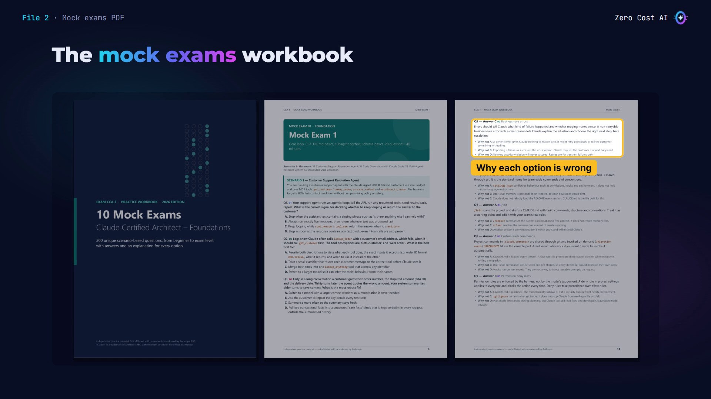

## File 3: The practice app (.exe)

The third file is a Windows app. It's a single file, so there's nothing to install.

1. Double-click `CCA-F_Mock_Exams.exe`.
2. Choose **Start the practice app**. It opens in its own window.
3. Or choose **Open the PDF workbook** to open the mock exams PDF.

Everything is bundled inside, so it works offline too.

⚠️ Windows may warn you the first time, because the file isn't signed. Choose **More info**, then **Run anyway**.

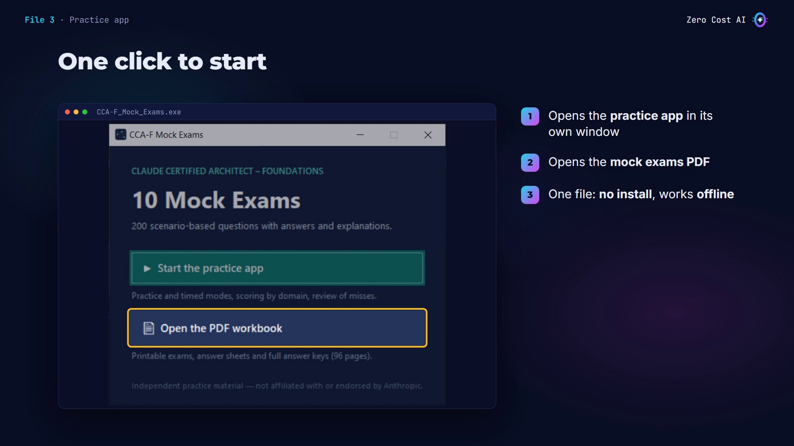

The home page of the practice app sums up the exam format and the five domain weights, so you know where to focus. Below, you'll find the ten mock exams. Each one has twenty questions across four scenarios, and two modes: **Practice** and **Timed**.

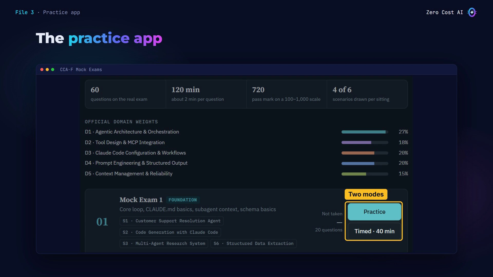

### Practice mode: learn from every answer

In practice mode, you pick an answer and check it right away. If you're wrong, the app tells you why your answer is wrong, highlights the correct answer, and explains the reasoning behind it.

Every wrong option has its own note too, because understanding the traps is how you pass a scenario exam.

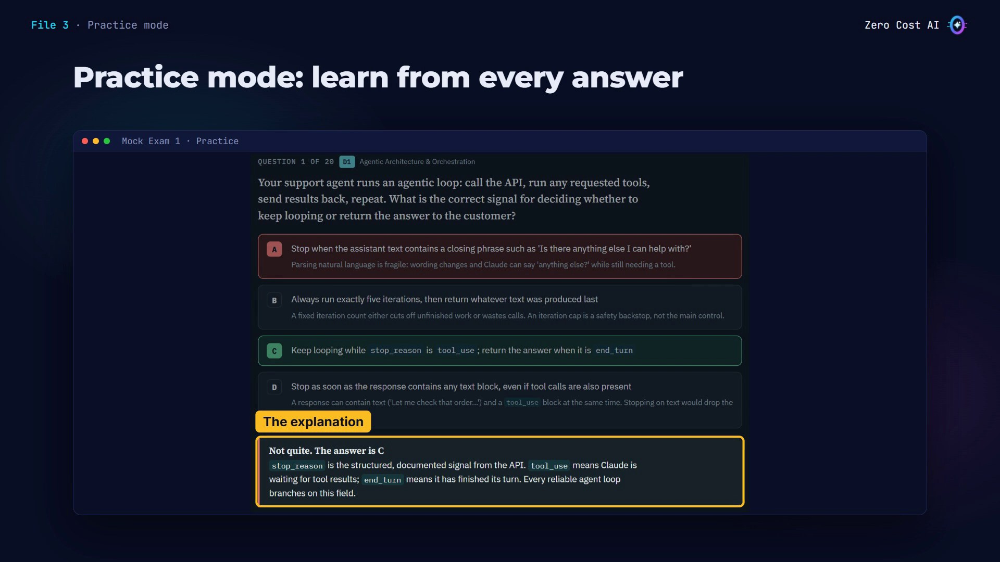

### Timed mode: exam conditions

Timed mode puts you under exam conditions: two minutes per question, so forty minutes for the whole exam. You can flag a question, move on, and come back to it later from the navigator, just as you would on exam day.

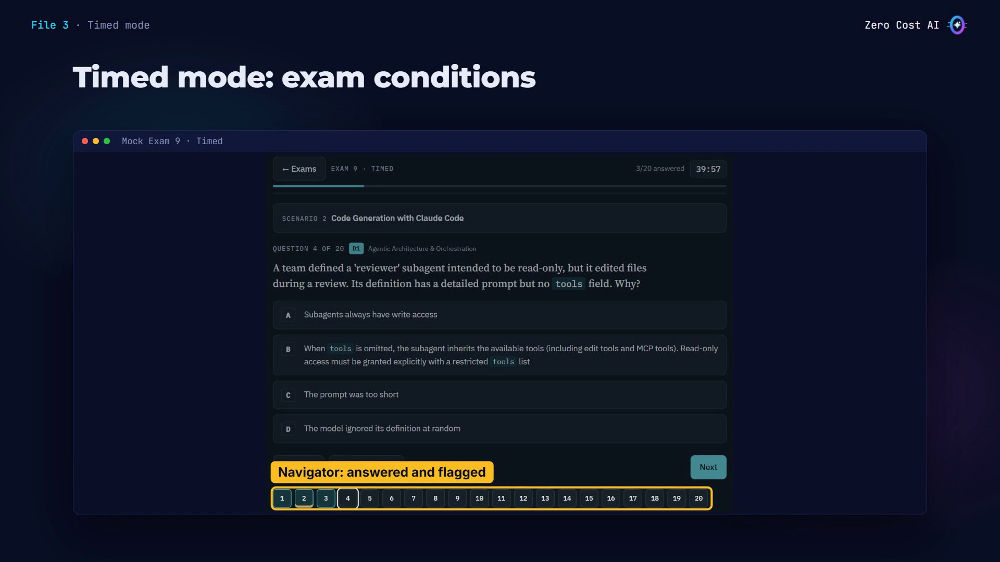

### Results by domain

When you finish, you get:

- Your score and an **estimated scaled score**. It's a simple estimate, not the official formula.
- Your **score in each domain**, so your weak spots are obvious.
- A **review of every question you missed**, with your answer, the correct one and the explanation.

Your best score for each exam is saved, so you can track your progress.

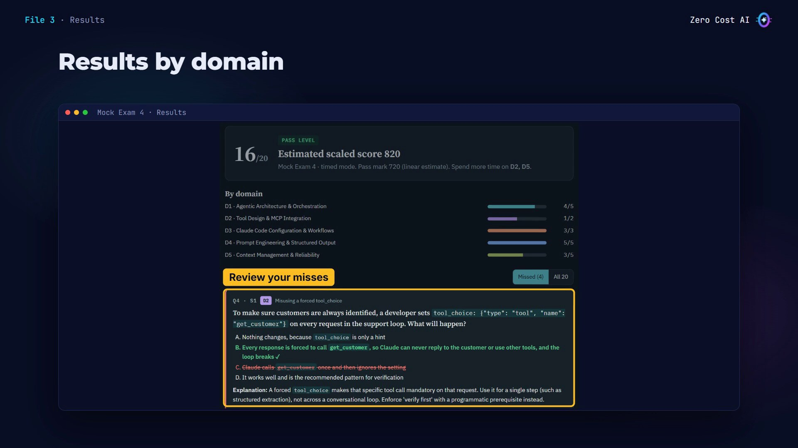

## How to study with the files

1. **Learn:** read the study guide one domain at a time, and do the lab at the end of each chapter.
2. **Practise (exams 1 to 5):** use practice mode. Read every explanation, even when you're right.
3. **Test (exams 6 to 10):** use timed mode. No notes, forty minutes each.
4. **Review:** re-read your misses. Aim for 16 out of 20, or better, before you book the real exam.

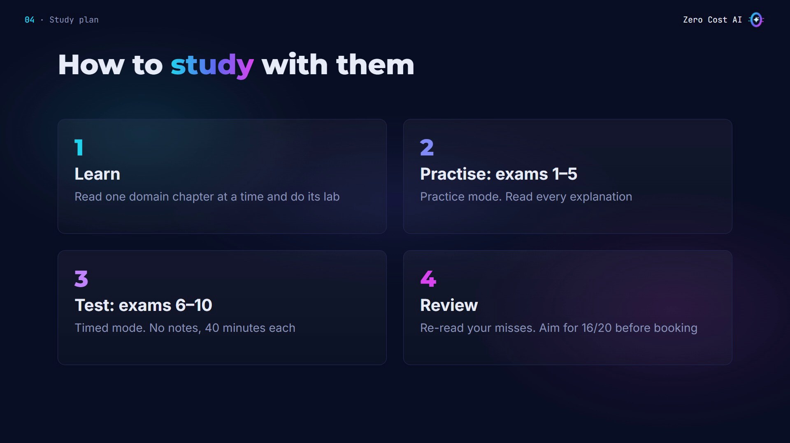

## Recap

- The **study guide PDF** teaches all five domains, starting from the basics.
- **200 original questions** with explanations, in the mock exams PDF and in the practice app.
- These files are **not official and not provided by Anthropic**. Always confirm the exam details on the official exam page.

## Get the 3 files

All three files are free, with a short README: [github.com/NEDBS12/youtube-tuto/claude-certification-prep-kit](https://github.com/NEDBS12/youtube-tuto/tree/main/claude-certification-prep-kit)

- Study guide PDF: `Claude_Certified_Architect_Foundations_Study_Guide.pdf`
- Mock exams PDF: `CCA-F_Mock_Exams.pdf`
- Practice app (Windows): `CCA-F_Mock_Exams.exe`

🎥 **Watch the video walkthrough:** {VIDEO_URL}

*Disclaimer: this is independent, unofficial study material. It is not provided by, affiliated with, or endorsed by Anthropic. "Claude" is a trademark of Anthropic. The practice questions are original and are not real exam questions.*

*I'm Zero Cost AI: I build free AI tools and beginner-friendly guides. Follow me on Medium, and subscribe on YouTube for more.*
