Do you keep copying things from your other apps into Claude? A bug report from Notion, an email, a meeting from your calendar?

**Connectors** fix that. You connect an app once, and Claude can read it and act in it, everywhere you use Claude, including Claude Code.

In this article you'll learn what connectors are, when to use them, and how to set one up and use it, step by step: Claude Code will read a bug list in Notion, fix the bug, and update the page.

🎥 **Prefer video?** Watch the full tutorial here:

{VIDEO}

---

## What is a connector?

- A **link between Claude and an outside app**: your documents, your calendar, your email, your issue tracker.
- Once it's connected, Claude can **find information there and take actions** for you.
- It's built on **MCP**, the Model Context Protocol: the service runs an MCP server, and the connector links Claude to it.

Think of it like signing in to an app on your phone: you do it once, and it's saved to your Claude account, on the web, desktop, mobile, and in Claude Code.

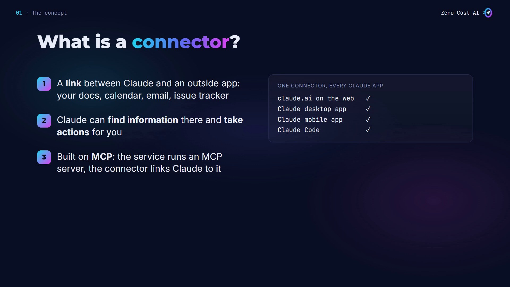

## How connectors work

1. **The service runs an MCP server.** Notion, Gmail, Google Drive and many others already have one.
2. **You connect it once in claude.ai.** Pick it in the connectors directory and sign in to the service. No API keys to copy.
3. **Every Claude app can use it.** It's saved to your account, so every Claude app you sign in to can use it, including Claude Code.

Connect once, use it everywhere.

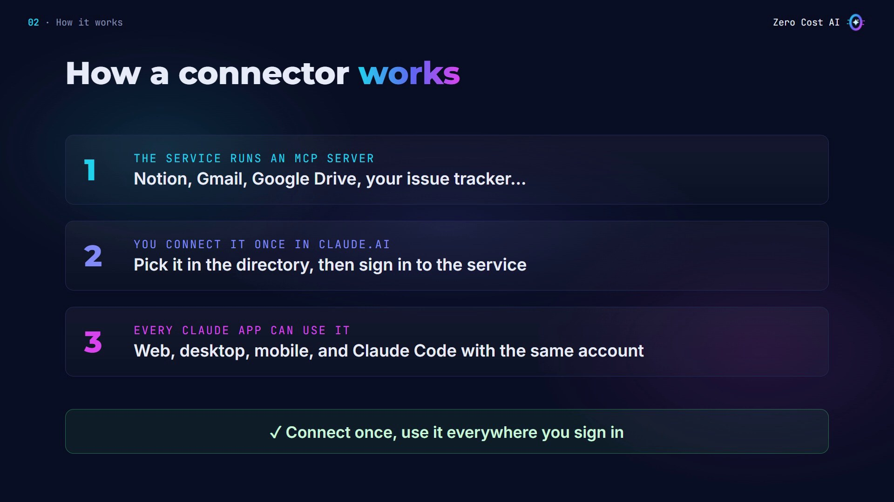

## Connector or claude mcp add?

**Use a connector** for online apps you sign in to, like Notion or Gmail, that you want in every Claude app.

**Use `claude mcp add`** for things that stay on one machine: local tools like a test browser, or servers you share with your team in the project's `.mcp.json` file. (I covered that in my MCP video.)

Today, we'll do the connector way.

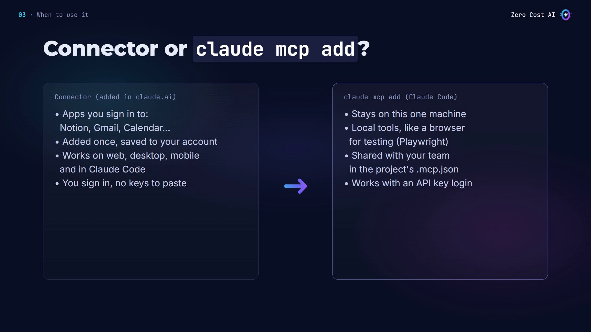

## Our use case: a bug list in Notion

I run a small online shop, and I keep my bug list in a Notion page.

**Before:** for every bug, I open Notion, copy the report, paste it into Claude Code, then go back to update the page.

**After:** I just say *"fix the top bug from our list"*. Claude reads Notion itself, fixes the code, runs the tests, and asks before it marks the bug as fixed.

## The copy-paste problem

Here's my shop project: the cart code and its tests. I start Claude Code and ask it to fix the top bug from my Notion bug list.

Claude can't see Notion from here, so it asks me to paste the bug report. That's the copy-and-paste loop, for every single bug.

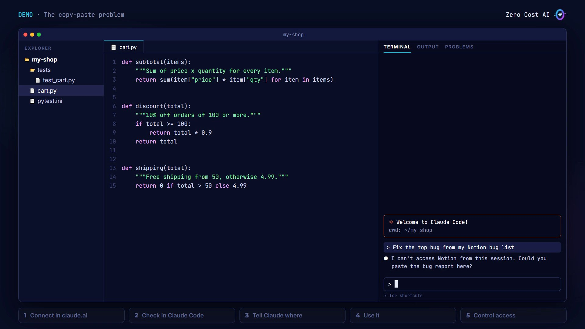

## Step 1: Connect Notion in claude.ai

1. Go to **Customize → Connectors**. The **Discover** tab is the connectors directory: it lists connectors from Anthropic and from other companies.
2. Search for **Notion**, open it, and click **Connect to Claude**.
3. Claude sends you to Notion's own sign-in page. Sign in, review what Claude can access, and approve it.

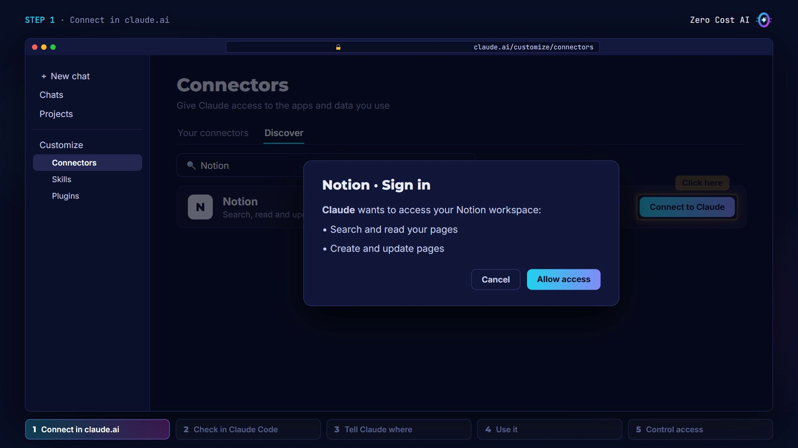

Back on the Connectors page, Notion is under **Your connectors**, with the status **Connected**. I never copied a key or a token, and the connector is now saved to my Claude account.

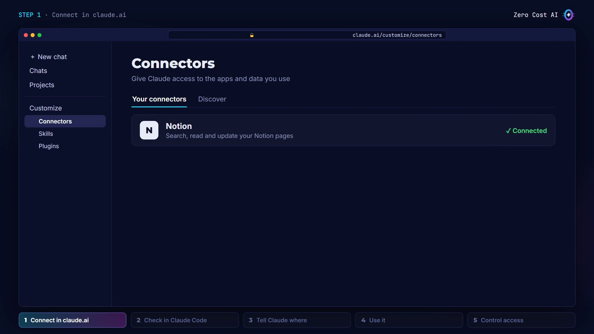

## Step 2: Check it in Claude Code

Claude Code loads your connectors when a session starts. Start a new session, signed in with the **same claude.ai account**, and type:

```
/mcp
```

There it is: **claude.ai Notion**, in its own claude.ai section. I didn't run a single command to add it.

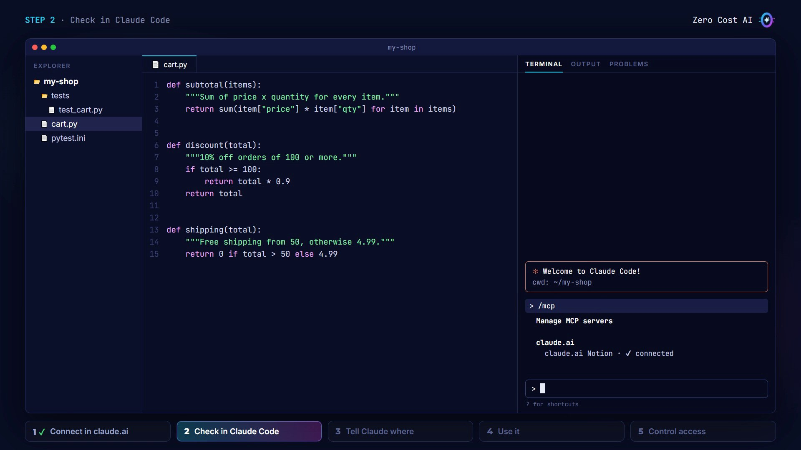

⚠️ If you don't see it, run `/status`. Connectors only load when you're signed in with a claude.ai subscription, not with an API key or a cloud provider. Then run `/login`.

## Step 3: Tell Claude where things are

Claude can use Notion now, but it doesn't know which page holds my bugs. So I add it to `CLAUDE.md`, the file Claude reads at the start of every session:

```
# my-shop

## Where things are
- Bug reports live in Notion, on the page "my-shop bugs".
  Read them with the Notion connector.
- Tests: python -m pytest -q

## Rules
- Fix one bug at a time, then run the tests.
- Ask before you change anything in Notion.
```

Reading is fine, but changes need my OK.

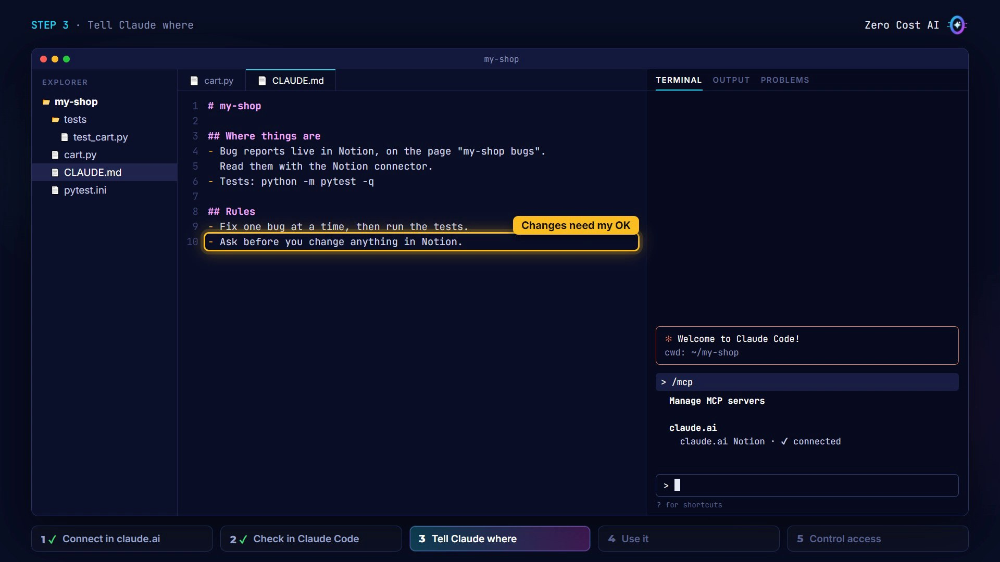

## Step 4: Use it

Same request as before:

```
Fix the top bug from our bug list
```

This time, Claude calls the Notion connector: it searches for the page, then reads it. The top bug: no free shipping at exactly 50. Claude reads the cart code and finds the cause: `total > 50` instead of `total >= 50`.

Following my `CLAUDE.md`, it runs the tests: all 8 pass. And it asks before touching Notion, just like my rule says. I say yes, and Claude updates the bug in Notion.

No copy, no paste, no switching apps.

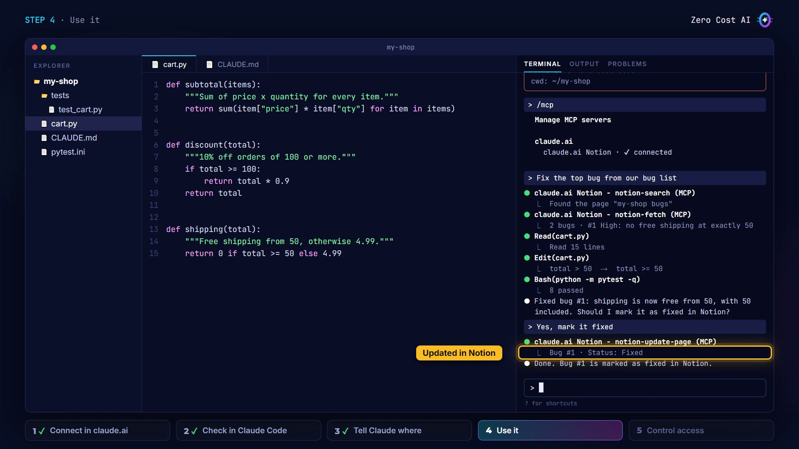

## Step 5: Control what the connector can do

**In claude.ai**, open the connector's page. For each group of tools, choose: **always allow**, **needs approval**, or **blocked**. Here, Claude can read freely, but every change needs my approval. **Disconnect** signs Claude out of the service, everywhere.

**In Claude Code**, you have two more switches:

- In `/mcp`, turn one connector off **for this project only**.
- The setting `disableClaudeAiConnectors` turns them **all off**, for example in a repo that should never touch your apps:

```json
{ "disableClaudeAiConnectors": true }
```

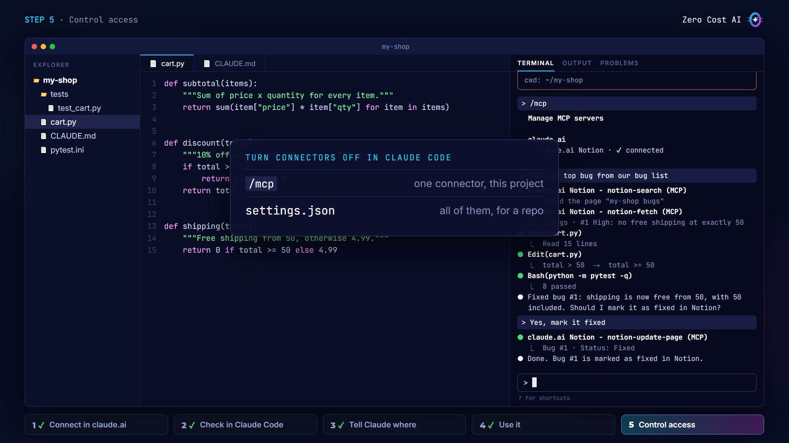

## 4 tips before you connect more apps

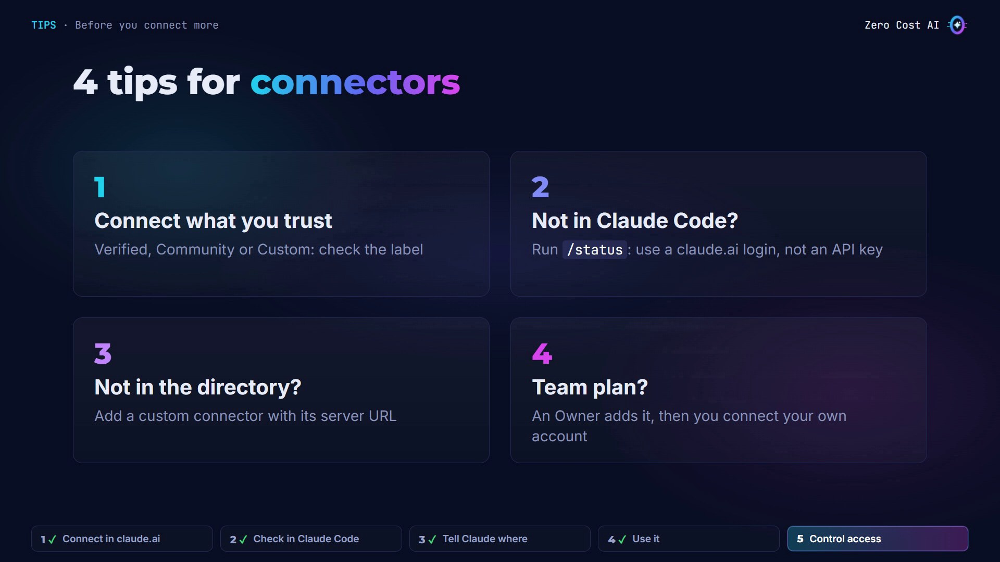

1. **Only connect services you trust.** The label shows how much Anthropic reviewed a connector: Verified, Community, or Custom (you added it yourself).
2. **Not showing in Claude Code?** Run `/status` and make sure you're signed in with your claude.ai account.
3. **Not in the directory?** If the app has a remote MCP server, add it as a custom connector with its URL.
4. **On a Team or Enterprise plan**, an Owner adds the connector for everyone, then each person connects their own account.

## Recap

- A connector links Claude to an outside app, so it can find information there and act for you.
- You connect it once in claude.ai, and it works in every Claude app, including Claude Code.
- Tell Claude where your data lives in `CLAUDE.md`, and choose which tools need your approval.

## Get the files

The demo project, the Notion bug page to paste, and a one-page cheat sheet are free on GitHub:

👉 **Files:** https://github.com/NEDBS12/youtube-tuto/tree/main/claude-code-connectors

🎥 **Watch the video tutorial:** {VIDEO_URL}

**Official docs:**

- Get started with connectors: https://claude.com/docs/connectors/getting-started
- Use MCP servers from claude.ai in Claude Code: https://code.claude.com/docs/en/mcp#use-mcp-servers-from-claude-ai
- Connector verification labels: https://claude.com/docs/connectors/verification

*Screenshots are from the Zero Cost AI video. The claude.ai pages and Claude Code sessions on screen are simplified recreations; your screens and Claude's wording will differ.*

---

*I'm Zero Cost AI: I build free AI tools and write beginner-friendly guides. Follow me here on Medium and subscribe on YouTube for more.*
