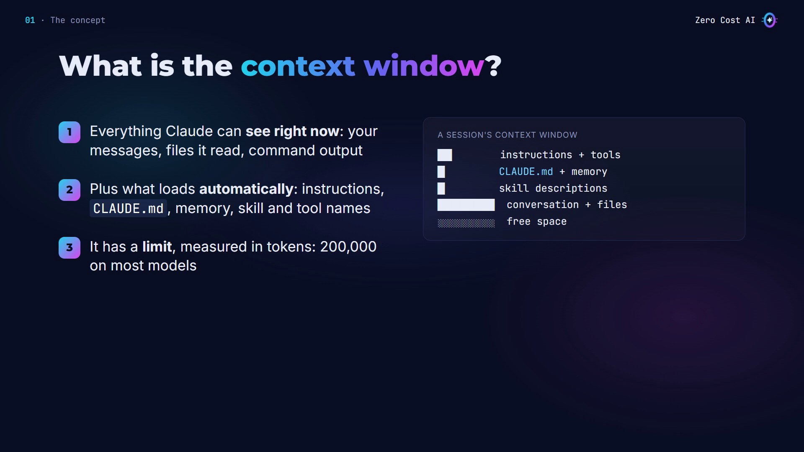
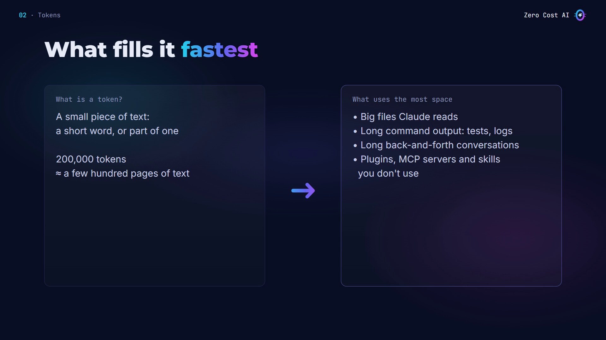
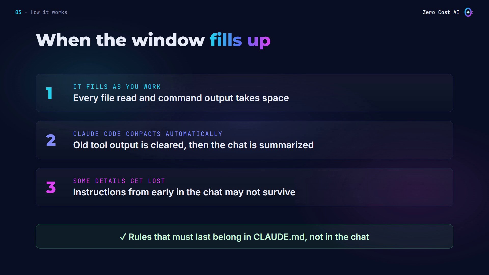
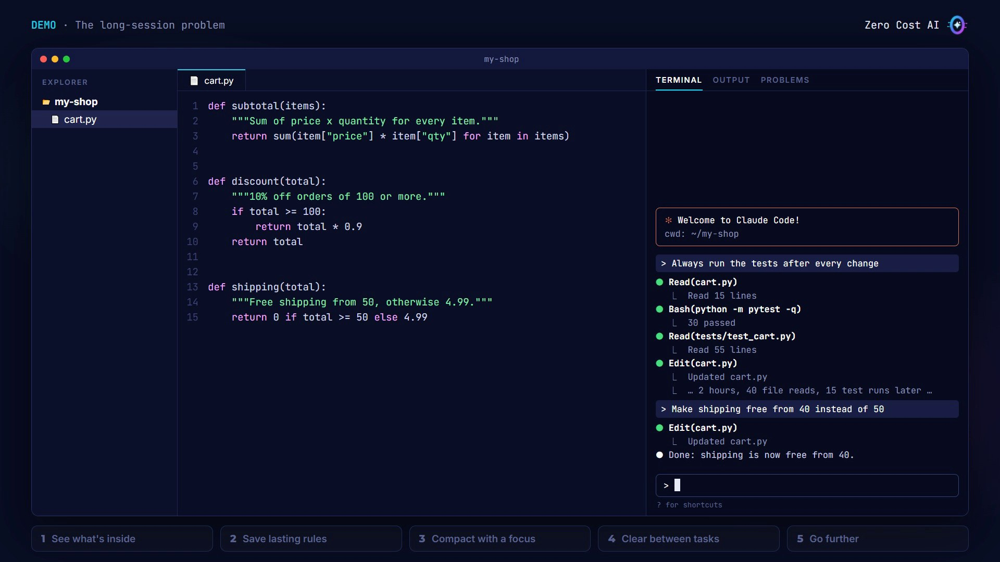
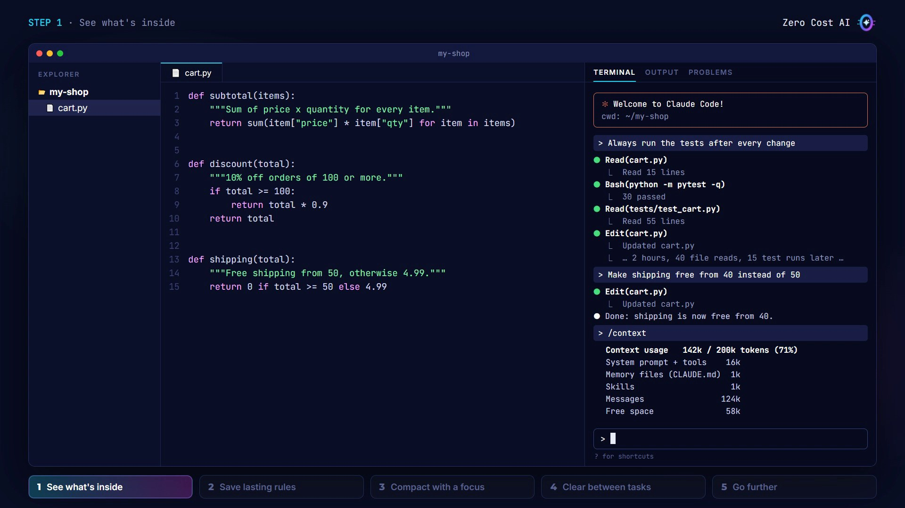
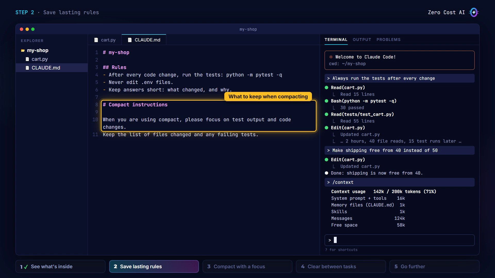
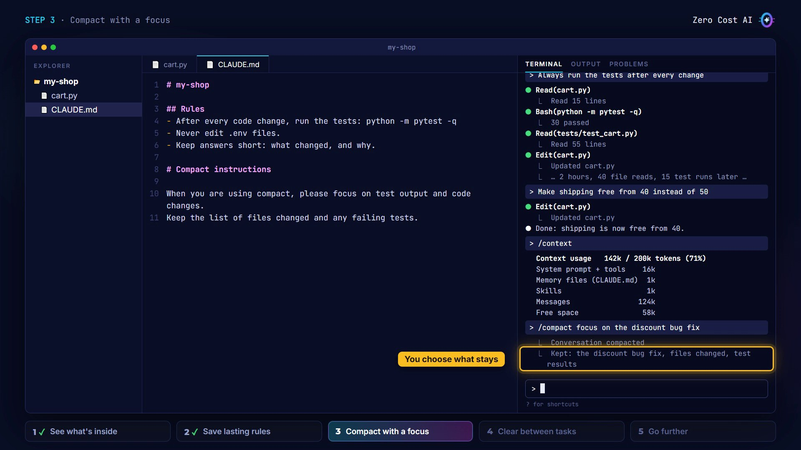
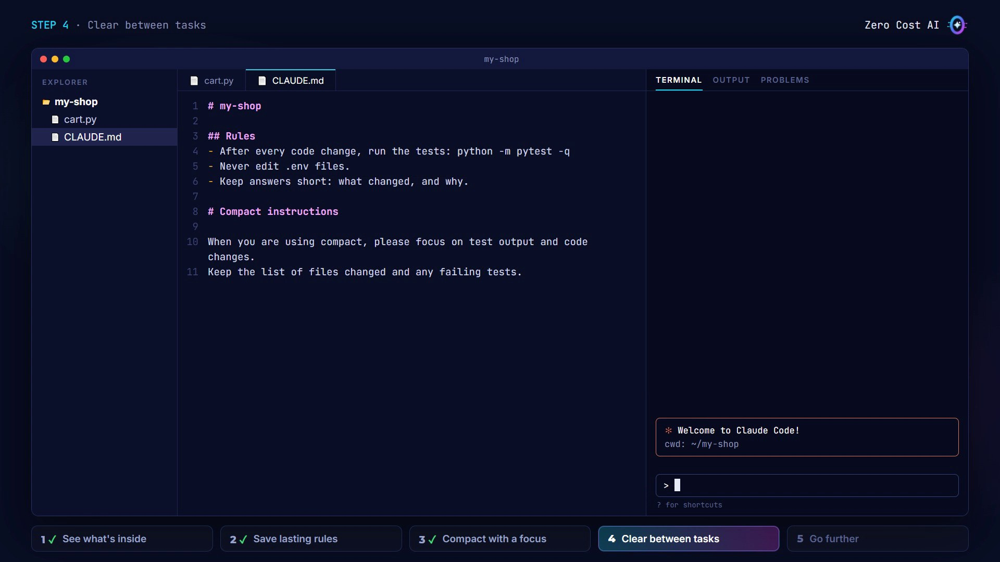
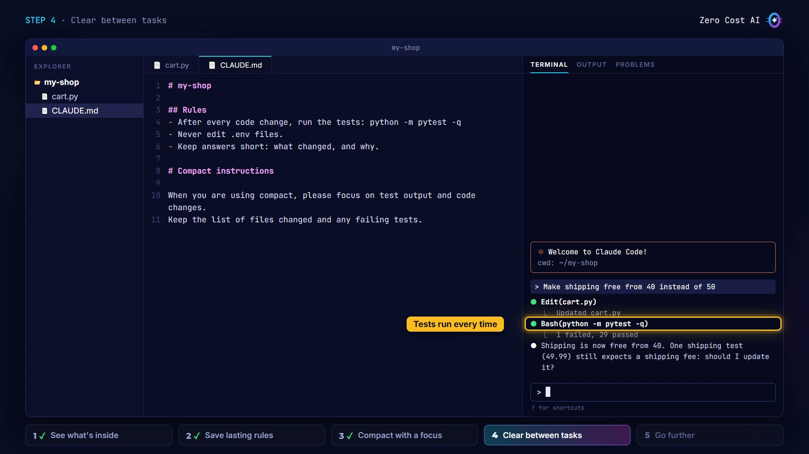
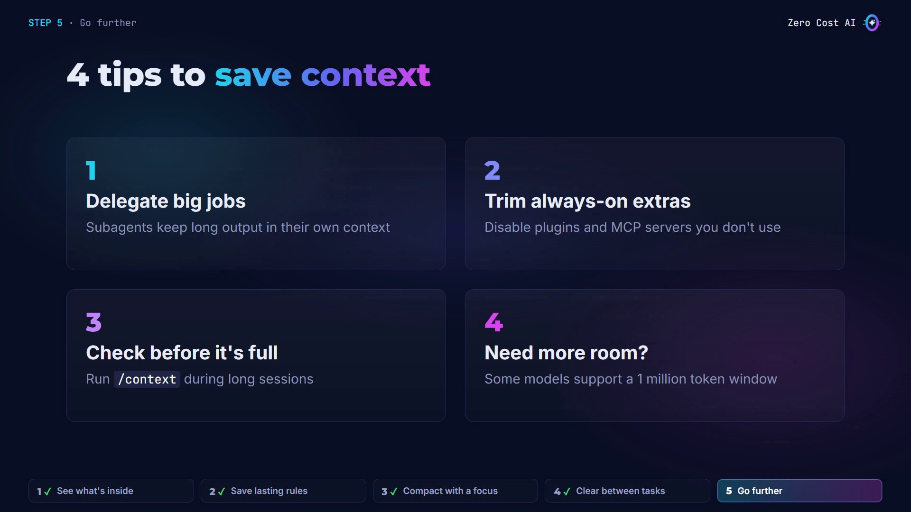

Have you ever had a long Claude Code session where Claude suddenly forgot something you told it at the start?

That's the **context window** at work. Once you understand it, you can stop it from happening.

In this article you'll learn what the context window is, when it causes problems, and four practical habits to manage it like a pro, step by step.

🎥 **Prefer video?** Watch the full tutorial here:

{VIDEO}

---

## What is the context window?

It's **Claude's working memory**: everything Claude can see right now.

- **Your session:** your messages, the files it read, and the output of the commands it ran.
- **What loads automatically**, before you even type: Claude Code's instructions, your `CLAUDE.md` file, memory, and the names of your skills and tools.
- **A limit**, measured in tokens. Most models give you 200,000 tokens; some offer up to a million.



## What is a token?

A token is a small piece of text: a short word, or part of a longer one. 200,000 tokens is roughly a few hundred pages.

That sounds like a lot, but these fill it up surprisingly fast:

- big files Claude reads,
- long command output, like tests and logs,
- long back-and-forth conversations,
- plugins, MCP servers and skills you don't use.



## What happens when it fills up

1. **It fills as you work.** Every file read and every command output takes space.
2. **Claude Code compacts automatically.** Near the limit, it clears older tool output first, then summarizes the conversation, so your session keeps going.
3. **Some details get lost.** A summary is shorter than the original, so detailed instructions from early in the chat may not survive.

That's why rules that must last belong in a `CLAUDE.md` file, not just in the chat.



## The long-session problem

At the start of a session, I told Claude: *"Always run the tests after every change."*

Two hours later, after dozens of file reads and test runs, the context window is getting full. I ask for another change: make shipping free from 40 instead of 50. Claude edits the file and stops. No tests. After compaction, my early instruction didn't survive.



Let's fix that with four simple habits.

## Habit 1: See what's inside

Type:

```
/context
```

You get a live breakdown of what's using space, by category, with suggestions. Here, the conversation itself is by far the biggest part: all those file reads and test runs.

The numbers in your own session will be different. The point is to check before the window fills up.



## Habit 2: Save lasting rules in CLAUDE.md

`CLAUDE.md` is loaded at the start of every session, and after compaction Claude Code reloads it from disk. So rules here don't get lost.

I move my test rule here, plus a couple of others I always want, and add a **Compact instructions** section that tells Claude what to keep when it summarizes:

```
# my-shop

## Rules
- After every code change, run the tests: python -m pytest -q
- Never edit .env files.
- Keep answers short: what changed, and why.

# Compact instructions

When you are using compact, please focus on test output and code changes.
Keep the list of files changed and any failing tests.
```



## Habit 3: Compact with a focus

Claude Code compacts on its own near the limit. But before a big new step, you can do it yourself and say what matters:

```
/compact focus on the discount bug fix
```

The summary keeps what you chose, instead of what the automatic pass guesses is important. And you get lots of free space back.



## Habit 4: Clear between tasks

When you switch to unrelated work, the old conversation just gets in the way, and costs tokens on every message.

```
/rename discount-fix
/clear
```

Give the session a name with `/rename`, then `/clear` to start fresh with a clean context window. You can come back to the old session any time with `/resume`.



Now, with the rule in `CLAUDE.md`, the same request ends the right way: Claude edits the file **and runs the tests**.



## Go further (4 tips)



1. **Delegate big jobs**, like test runs or research, to a subagent. The long output stays in its own context window, not yours.
2. **Trim always-on extras.** Disable plugins and MCP servers you don't use: their descriptions load into every session.
3. **Check before it's full.** Run `/context` during long sessions.
4. **Need more room?** Some models support a one-million-token context window.

## Recap

- The context window is Claude's working memory: everything it can see right now.
- When it fills up, Claude Code compacts the conversation, and early details can get lost.
- Check it with `/context`, keep lasting rules in `CLAUDE.md`, compact with a focus, and clear between tasks.

## Get the files

The `CLAUDE.md` example and a one-page cheat sheet (which command to use when) are free on GitHub:

👉 **Files:** https://github.com/NEDBS12/youtube-tuto/tree/main/claude-code-context-window

🎥 **Watch the video tutorial:** {VIDEO_URL}

**Official docs:**

- Explore the context window: https://code.claude.com/docs/en/context-window
- How Claude Code works: https://code.claude.com/docs/en/how-claude-code-works
- Reduce token usage: https://code.claude.com/docs/en/costs

*Screenshots are from the Zero Cost AI video. The Claude Code sessions and /context numbers on screen are recreations; yours will differ.*

---

*I'm Zero Cost AI: I build free AI tools and write beginner-friendly guides. Follow me here on Medium and subscribe on YouTube for more.*
