What if you could fix a bug just by writing a comment on GitHub?

With the **Claude Code GitHub Action**, you type `@claude` in an issue, and Claude reads your code, fixes it, and pushes the change. No laptop, no terminal.

This article is a lab. First you'll learn what the action is, what it can do and when to use it. Then you'll set it up on a real repository and watch Claude fix a real bug. Every file is free to copy, so you can follow along.

🎥 **Prefer video?** Watch the full tutorial here:

{VIDEO}

---

## What is the Claude Code Action?

It's a **GitHub Action** (an automated job that GitHub runs for you) that starts Claude Code inside your repository's workflows.

- You mention `@claude` in an issue or a pull request.
- Claude reads the code, makes changes, commits them, and replies in a comment.
- It all runs on GitHub's servers. Your laptop can be closed.

The setup is just three pieces: **a workflow file, the Claude GitHub App, and one secret.**

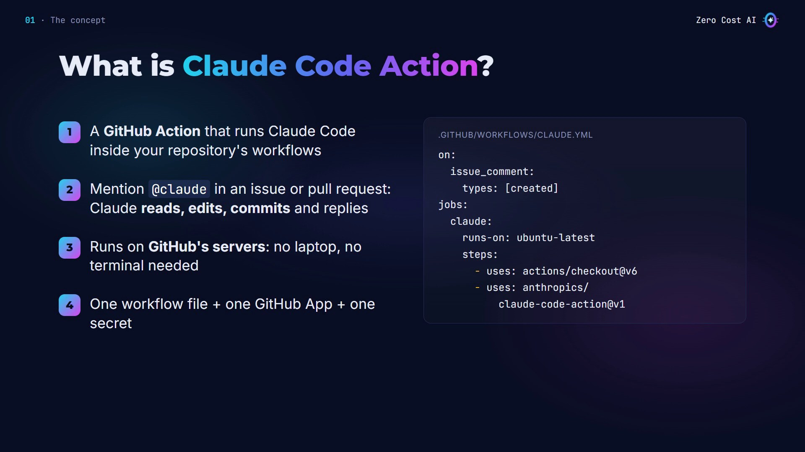

## How it works: two modes

The action picks its mode from your workflow file:

- **Interactive mode:** if you don't give it a `prompt` input, Claude waits for someone to write `@claude` in a comment, then answers that request.
- **Automation mode:** if you give it a `prompt`, it runs on its own on any event, for example on every new pull request, or every morning on a schedule.

In both modes, only people with **write access** to the repository can trigger it, and bots are blocked. Under the hood, it's the same Claude Code you use in your terminal.

## What you can ask it to do

- **Answer questions:** "@claude how does login work here?"
- **Fix bugs:** from an issue to a branch with the fix
- **Build features:** implement what the issue describes
- **Review pull requests:** comment on the code
- **Scheduled jobs:** a daily summary of commits, with a cron trigger
- **Run skills:** your own `.claude/skills` or a plugin

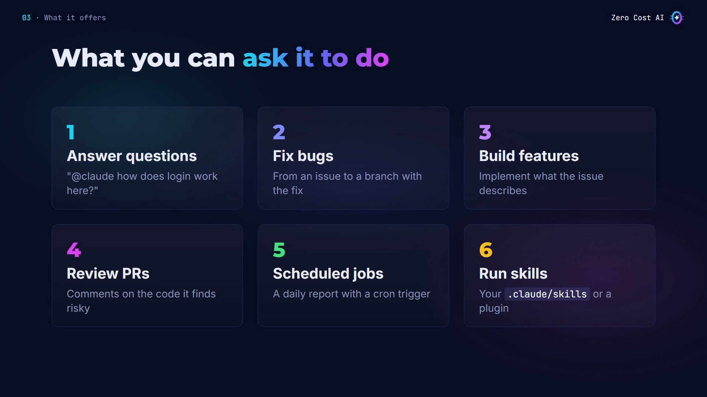

### When to use it (and when not)

Use the GitHub Action for:

- small, clearly described bugs and tasks in issues
- reviews on every pull request
- recurring jobs like reports and triage
- teams that already live in GitHub

Stay in your terminal for big, open-ended changes, when you want to steer every step, or when you need to run the app and look at it.

## The lab: fix a bug from an issue

Without the action, every bug goes the same way: read the issue, pull the code, find the bug, fix it, commit, push, open a pull request. By hand.

With the action, you write one comment. Claude finds the cause and pushes the fix. You review it.

### The starter project

The lab is a tiny shop project. `shipping.py` has one rule: orders of $50 or more ship free. But look at line 7:

```python
FREE_SHIPPING_FROM = 50  # orders of 50 or more ship free
STANDARD_RATE = 4.99


def shipping_cost(order_total):
    """Return the shipping cost for an order total."""
    if order_total > FREE_SHIPPING_FROM:
        return 0
    return STANDARD_RATE
```

It uses `>` instead of `>=`, so an order of exactly $50 is still charged shipping. One of the three tests proves it:

```bash
python -m pytest -q
# 1 failed, 2 passed
```

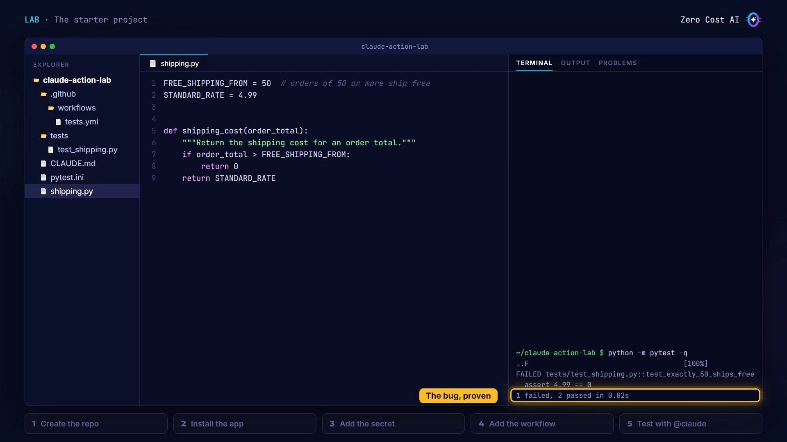

The project also has two files that matter for the lab:

- **`.github/workflows/tests.yml`** runs the tests on every push and pull request. That's how we'll prove Claude's fix works.
- **`CLAUDE.md`** holds the project rules. The action reads it on every run, just like Claude Code does locally:

```markdown
# Project rules

- Python 3.12. Tests live in tests/ and run in CI (the Tests workflow).
- Keep fixes small: change only what the issue asks for.
- Never edit a test to make it pass. Fix the code instead.
- In your reply, explain the cause of the bug in one sentence.
```

**What you need:** a GitHub account, Git, the [GitHub CLI](https://cli.github.com) (`gh auth login` once), Python with `pytest`, and either a Claude Pro/Max/Team/Enterprise plan or an API key from the Claude Console.

## Step 1: Create the repo

Copy the starter project (link at the end), then commit it and create a new repository with the GitHub CLI:

```bash
git init && git add . && git commit -m "Starter"
gh repo create claude-action-lab --public --source=. --push
```

You need to be an admin of the repo for the next steps. On your own repo, you are.

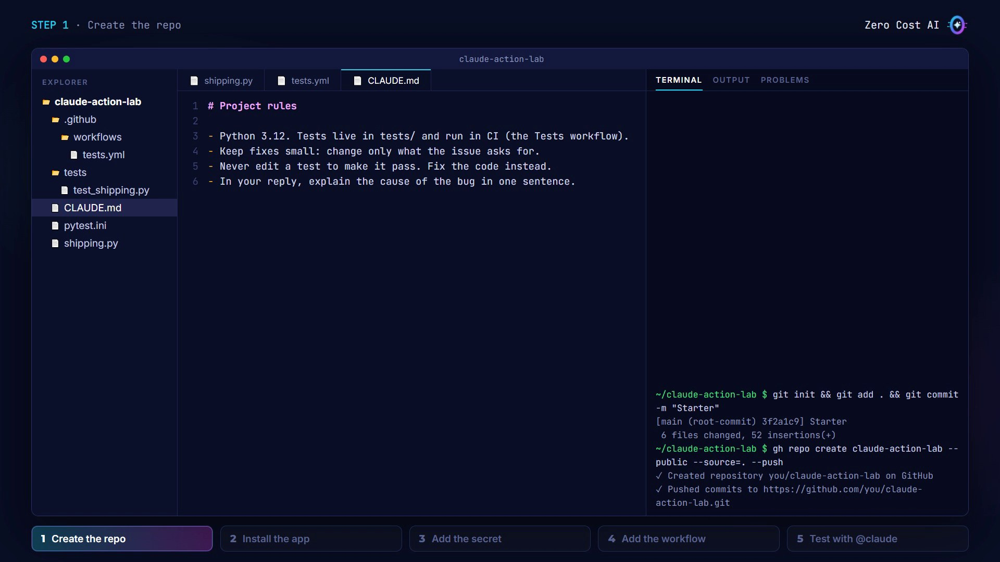

## Step 2: Install the Claude GitHub App

Open **github.com/apps/claude**, click **Install**, and choose **Only select repositories** → `claude-action-lab`.

The app lets Claude comment, push branches and work with pull requests. The action relies on its **Contents**, **Issues** and **Pull requests** read and write permissions. The app asks for a few more, used by other Claude features.

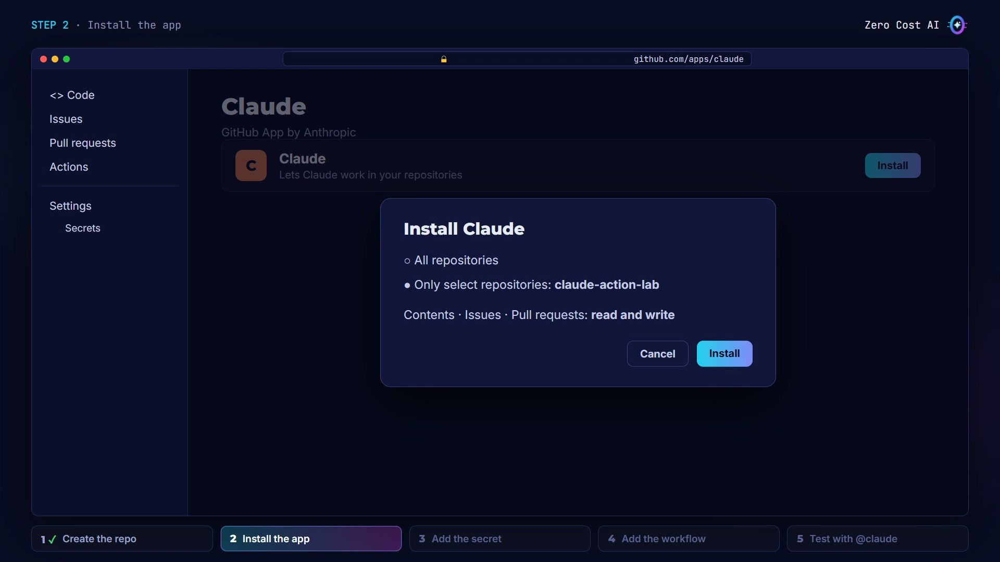

**Shortcut:** run `/install-github-app` inside Claude Code and it does steps 2 to 4 for you: it installs the app, saves the secret, and opens a pull request with the workflow. Here we do it by hand, so you see every piece.

## Step 3: Add the secret

The action needs to log in to Claude. With a Pro or Max subscription, create a long-lived token, then save it as a repository secret (paste the token when asked):

```bash
claude setup-token
gh secret set CLAUDE_CODE_OAUTH_TOKEN
```

Prefer a pay-as-you-go API key from the Claude Console? Name the secret `ANTHROPIC_API_KEY` instead, and use `anthropic_api_key: ${{ secrets.ANTHROPIC_API_KEY }}` in the workflow.

GitHub encrypts secrets. The workflow can use them, but nobody can read them back.

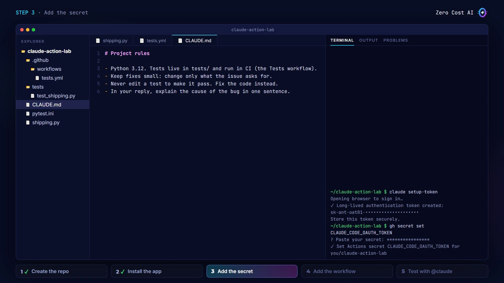

⚠️ Never paste a token or API key into a file you commit.

## Step 4: Add the workflow

This is the heart of the setup. Create `.github/workflows/claude.yml`:

```yaml
name: Claude Code
on:
  issue_comment:
    types: [created]
  pull_request_review_comment:
    types: [created]
jobs:
  claude:
    if: contains(github.event.comment.body, '@claude')
    runs-on: ubuntu-latest
    permissions:
      contents: write
      pull-requests: write
      issues: write
      id-token: write
      actions: read
    steps:
      - uses: actions/checkout@v6
        with:
          fetch-depth: 1
      - uses: anthropics/claude-code-action@v1
        with:
          claude_code_oauth_token: ${{ secrets.CLAUDE_CODE_OAUTH_TOKEN }}
          claude_args: "--max-turns 10"
```

Here's what each part does:

- **`on`:** when it runs: every new comment on an issue, or on a pull request review.
- **`if`:** skips every comment that doesn't mention `@claude`, so you don't waste runner minutes.
- **`permissions`:** write access to contents, pull requests and issues, so Claude can push and comment. `id-token: write` is needed to log in as the Claude app, and `actions: read` lets Claude see your CI results.
- **`actions/checkout`:** gives Claude a copy of your code to work on.
- **`anthropics/claude-code-action@v1`:** the action itself. It reads the token from the secret.
- **`claude_args`:** normal Claude Code options. `--max-turns 10` caps how much work one run can do, which keeps costs under control.

There's no `prompt` line, so this is **interactive mode**: it waits for `@claude`.

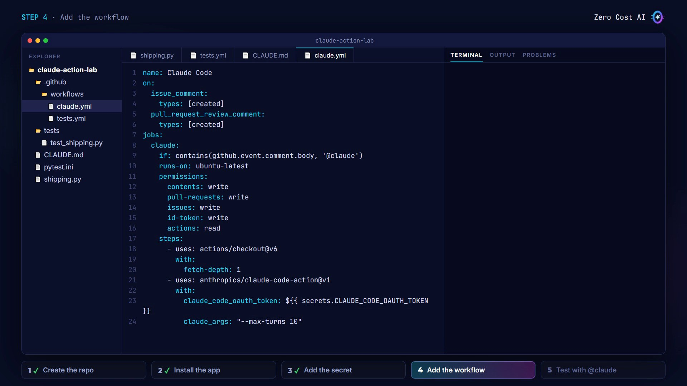

Commit and push it. Workflows only run once they're on GitHub:

```bash
git add . && git commit -m "Add Claude workflow" && git push
```

## Step 5: Test it with @claude

On GitHub, open a new issue describing the bug, like a customer report:

- **Title:** Orders of exactly $50 still pay shipping
- **Body:** A customer with a $50.00 order was charged $4.99 shipping. Free shipping should start at $50.

Then add a comment: `@claude please fix this bug.`

This workflow listens to comments, so put `@claude` in a comment, not in the issue body.

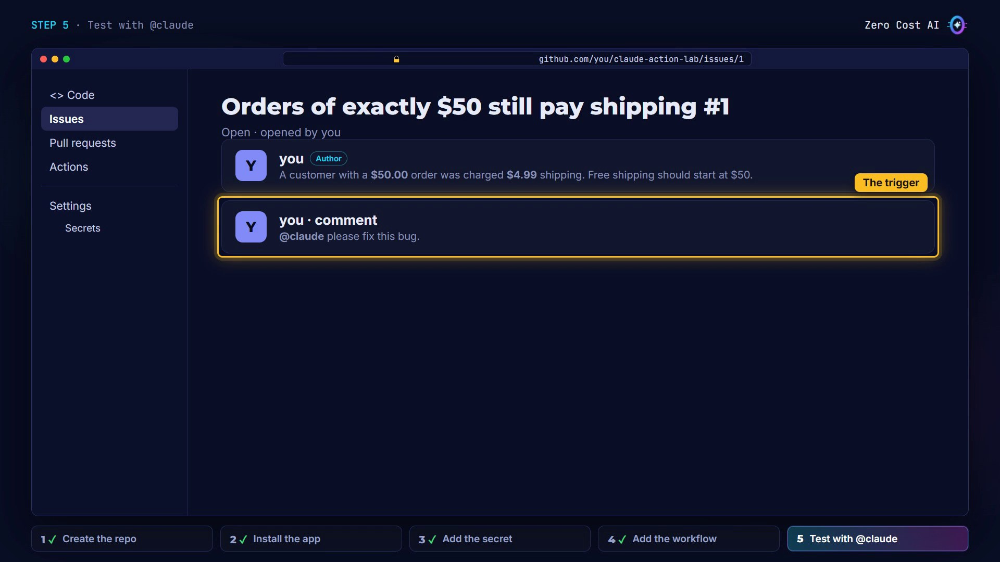

Within seconds, Claude replies with a progress comment and a link to the running job. In the **Actions** tab you can watch the Claude Code workflow run, while the Tests workflow on `main` is still red.

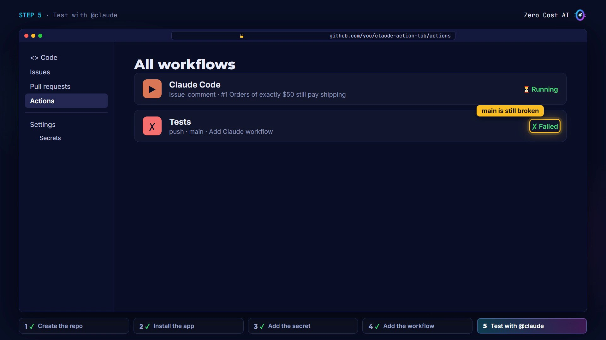

A minute or so later, the comment updates. Claude explains the cause in one sentence, as `CLAUDE.md` asked, and pushes the fix to a new branch. Its reply links to that branch, so you create the pull request in one click.

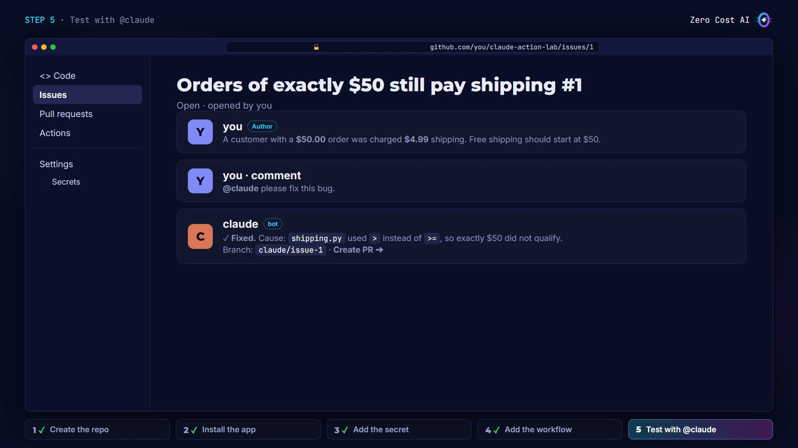

And here's the proof. The pull request changes one character, `>` becomes `>=`, and the Tests workflow is green. Claude fixed the code, not the test, as the rules said. Review it and merge.

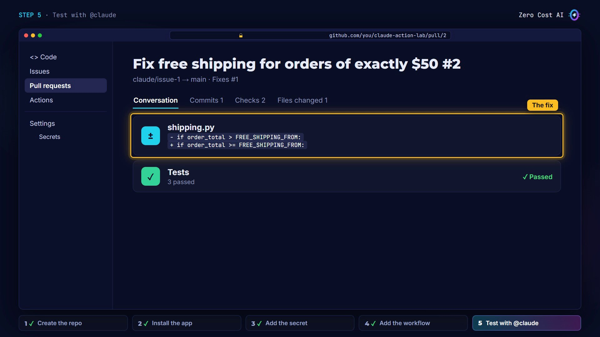

You can keep talking to Claude inside the pull request, for example `@claude review this change` or `@claude add a test for an order of 49.99`.

Finally, pull the merged fix and run the tests on your computer:

```bash
git pull
python -m pytest -q
# 3 passed
```

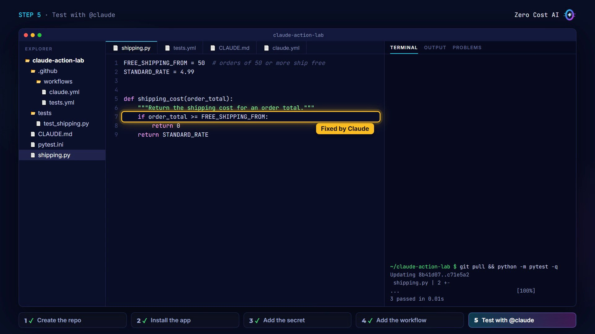

Bug reported, fixed and verified, without opening an editor.

## 5 tips for the Claude Code Action

1. **Write a CLAUDE.md.** Claude reads it on every run, so keep it short and specific.
2. **Cap every run** with `--max-turns` and a job `timeout-minutes`. Each run uses GitHub Actions minutes and Claude usage.
3. **Keep tokens and keys in secrets**, never in the workflow file.
4. **Add a `prompt` input** and the same action runs on its own: on every pull request, or on a schedule. The action's examples folder has ready-made workflows.
5. **Review before you merge.** Claude pushes to branches; you decide what lands.

### Troubleshooting

- **Nothing happens after @claude:** check the app is installed on the repo, Actions are enabled, the secret name matches the workflow, and `@claude` is a whole word.
- **The commenter isn't allowed:** only users with write access can trigger Claude.

## Recap

- The Claude Code Action runs **Claude Code inside your GitHub workflows**.
- You set it up with the **GitHub App, one secret, and a `claude.yml`** workflow file.
- Then you comment **@claude**, review what it pushes, and merge.

## Get the files and run the lab

The starter project and a step-by-step lab guide (with Windows commands, troubleshooting and clean-up) are on GitHub:

👉 **Lab starter project:** https://github.com/NEDBS12/youtube-tuto/tree/main/claude-code-github-action/example-files/claude-action-lab

👉 **Lab guide and all files:** https://github.com/NEDBS12/youtube-tuto/tree/main/claude-code-github-action

🎥 **Watch the video tutorial:** {VIDEO_URL}

**Official docs:**

- Claude Code GitHub Actions: https://code.claude.com/docs/en/github-actions
- anthropics/claude-code-action: https://github.com/anthropics/claude-code-action

*Screenshots are from the Zero Cost AI video. The GitHub pages and the run results are simplified recreations; Claude's exact wording and branch name will differ on your run. I ran the lab's tests for real: 1 failed before the fix, 3 passed after.*

---

*I'm Zero Cost AI: I build free AI tools and write beginner-friendly guides. Follow me here on Medium and subscribe on YouTube for more.*
