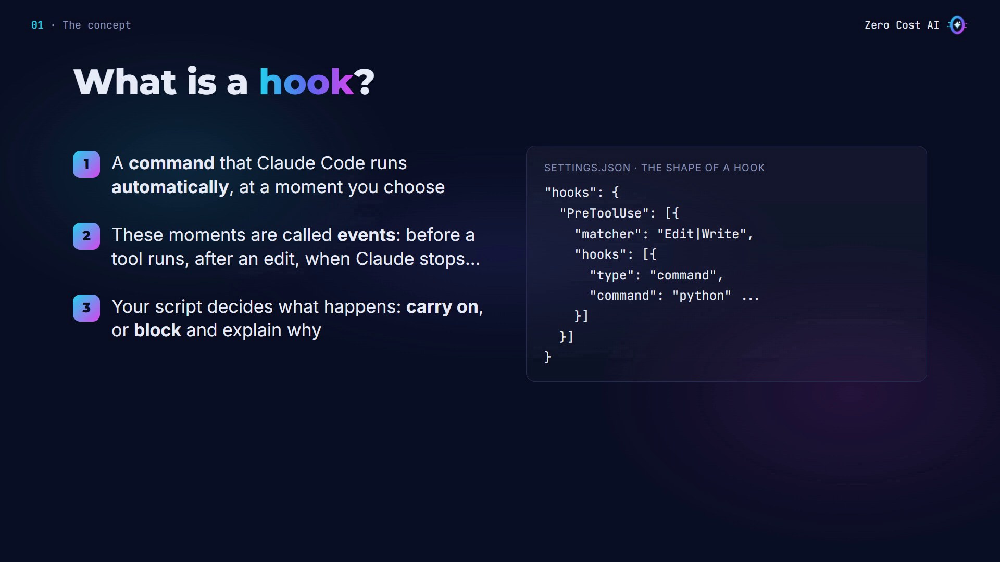
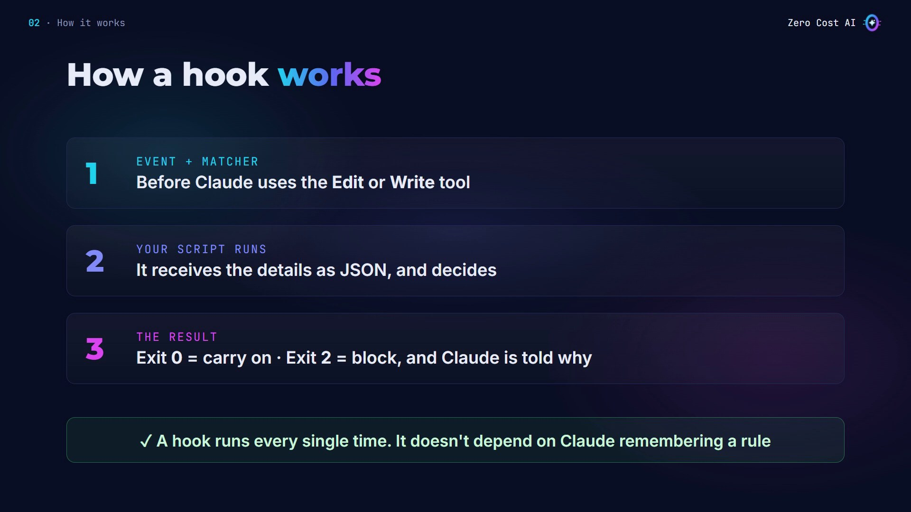
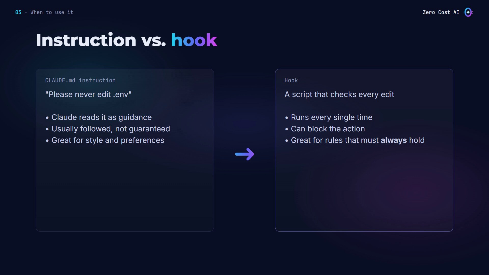
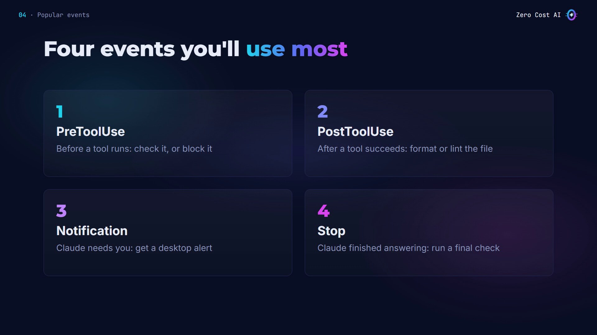
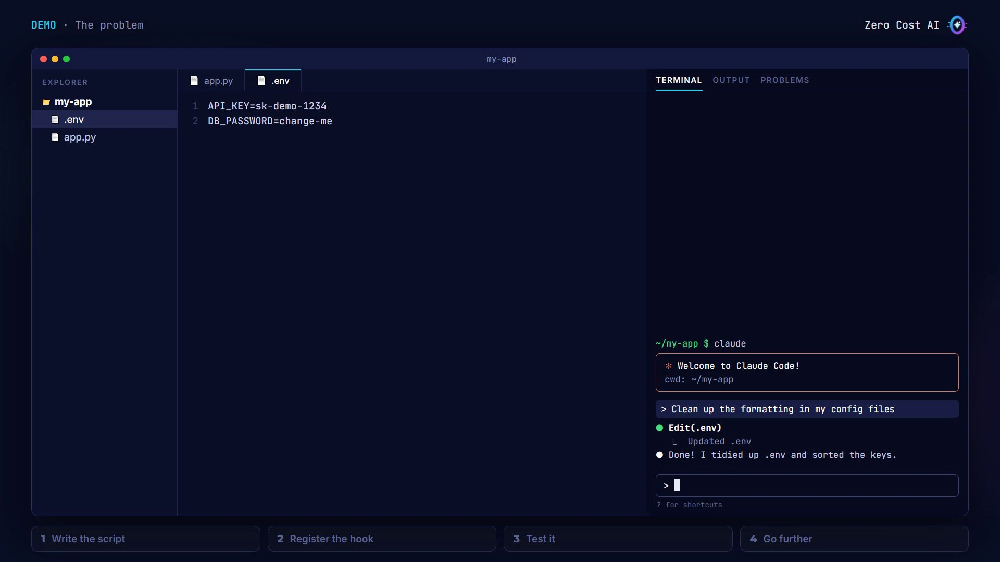
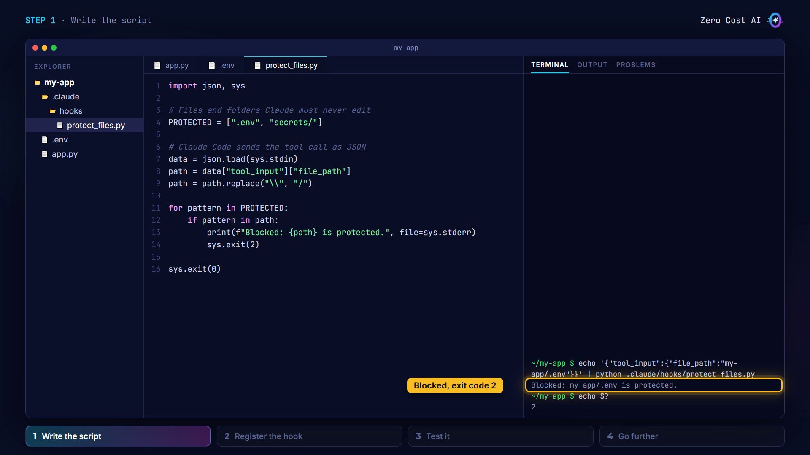
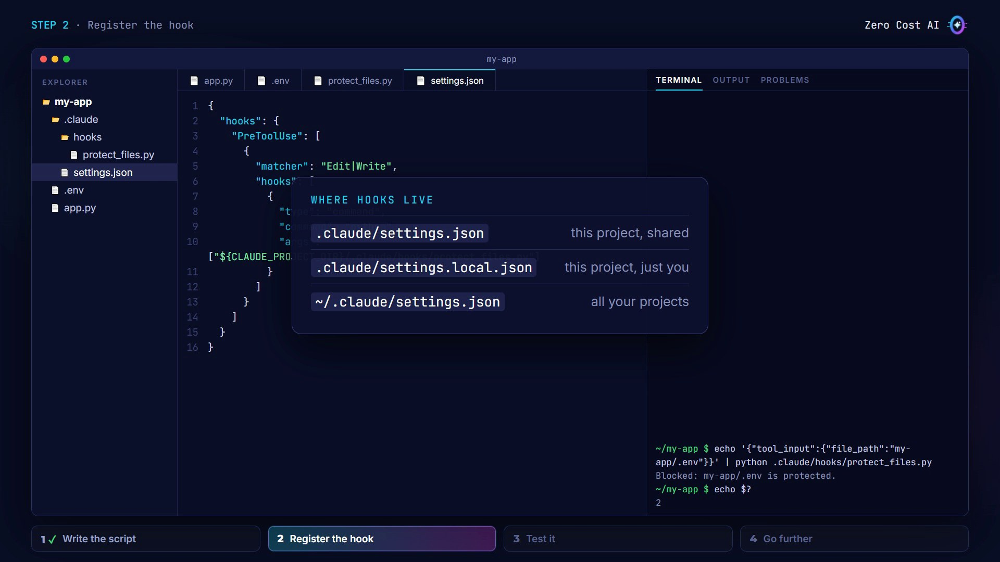
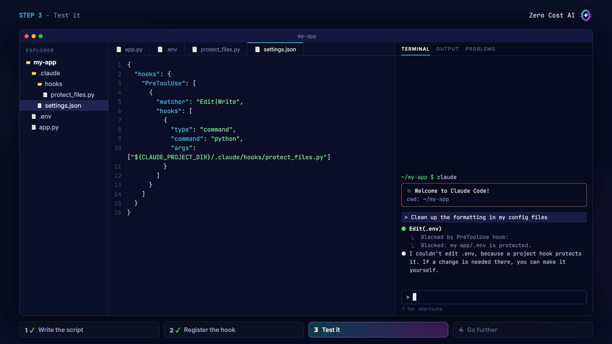
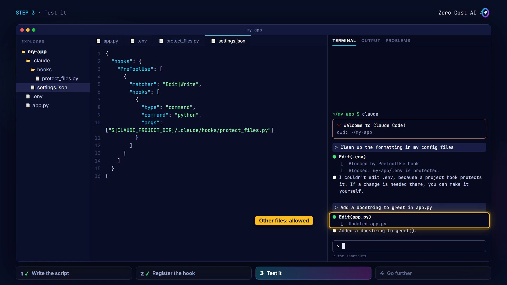
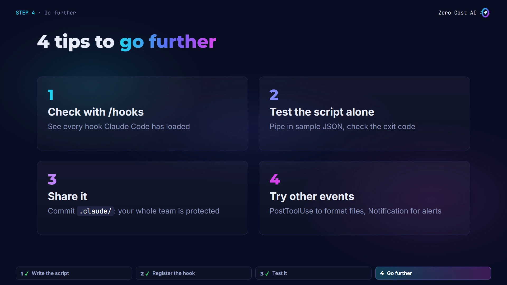

What if Claude edited a file you never wanted it to touch, like the file with your passwords and API keys?

**Claude Code hooks** stop that for good. A hook is a small command that runs every single time, at a moment you choose, and it can block an action before it happens.

In this article you'll learn what a hook is, when to use one instead of an instruction, and then we'll build a real one together, step by step: a hook that protects your `.env` file.

🎥 **Prefer video?** Watch the full tutorial here:

{VIDEO}

---

## What is a hook?

A hook is a **command that Claude Code runs automatically**, at a moment you choose.

- Those moments are called **events**: for example, just before Claude uses a tool, right after it edits a file, or when it finishes answering.
- Your command can simply let things carry on, or it can **block the action and tell Claude why**.
- You set hooks up in a settings file, with a few lines of JSON.



## How a hook works

A hook has three parts:

1. **An event and a matcher**: for example, just before Claude uses the Edit or Write tool.
2. **Your script runs**: Claude Code sends it the details as JSON, like which file Claude wants to change.
3. **The result**: exit with code **0** and Claude carries on. Exit with code **2** and the action is blocked, and Claude reads your reason.

And here's the key point: a hook runs every single time. It doesn't depend on Claude remembering a rule.



## When to use a hook

So when should you use a hook instead of just writing an instruction?

- **An instruction in CLAUDE.md is guidance.** Claude usually follows it, but it's not guaranteed. That's perfect for style and preferences.
- **A hook is code that runs every time.** Use it for rules that must always hold, or actions that must always happen.



## Four events you'll use most

- **PreToolUse** runs before a tool, so it can check the action, or block it.
- **PostToolUse** runs after a tool succeeds: for example, to format a file Claude just edited.
- **Notification** runs when Claude needs your attention, so you can get a desktop alert.
- **Stop** runs when Claude finishes answering.



## Our example: protecting your secrets

Most projects have a `.env` file with passwords and API keys. Claude should never change it.

With a **PreToolUse** hook, any attempt to edit it is blocked, Claude explains why, and every other file works as normal.

## The problem without a hook

Here's a small Python project, with my secrets in a `.env` file. I've turned on auto-accept for edits, so Claude can work without asking me each time.

I ask: *"Clean up the formatting in my config files"*. Claude edited the `.env` file too, where my secret keys live. It was trying to help, but I didn't want that.



Let's make sure this can never happen again.

## Step 1: Write the hook script

Create a `hooks` folder inside `.claude`, with a small Python file, `.claude/hooks/protect_files.py`:

```python
import json, sys

# Files and folders Claude must never edit
PROTECTED = [".env", "secrets/"]

# Claude Code sends the tool call as JSON
data = json.load(sys.stdin)
path = data["tool_input"]["file_path"]
path = path.replace("\\", "/")

for pattern in PROTECTED:
    if pattern in path:
        print(f"Blocked: {path} is protected.", file=sys.stderr)
        sys.exit(2)

sys.exit(0)
```

How it works:

- At the top, list what Claude must never edit: the `.env` file and a `secrets/` folder.
- When the hook runs, Claude Code sends the details of the tool call as JSON. The script reads the file path Claude wants to change.
- The `replace` line turns Windows backslashes into forward slashes, so the check works on every computer.
- If the path matches a protected pattern, print a reason and **exit with code 2**. Otherwise **exit with code 0**, and Claude carries on as usual.

Before wiring it up, test it by hand with a fake tool call:

```bash
echo '{"tool_input":{"file_path":"my-app/.env"}}' | python .claude/hooks/protect_files.py
echo $?
```

It prints the reason, and the exit code is 2. The script works.



## Step 2: Register the hook

In the project's `.claude` folder, open `settings.json` and add a `hooks` section:

```json
{
  "hooks": {
    "PreToolUse": [
      {
        "matcher": "Edit|Write",
        "hooks": [
          {
            "type": "command",
            "command": "python",
            "args": ["${CLAUDE_PROJECT_DIR}/.claude/hooks/protect_files.py"]
          }
        ]
      }
    ]
  }
}
```

- The event is **PreToolUse**, so it runs just before Claude uses a tool.
- The **matcher** says which tools: only `Edit` and `Write`, the tools Claude uses to change files.
- The **command** runs the script with Python. `${CLAUDE_PROJECT_DIR}` always points to the project folder. On a Mac or Linux, you might need `python3` instead.

Where you save the hook decides who it protects:

- `.claude/settings.json`: this project, shared with your team (commit it).
- `.claude/settings.local.json`: this project, just you.
- `~/.claude/settings.json`: all your projects.



## Step 3: Test it

Start Claude Code again, still with auto-accept on, and repeat the same request.

Claude tries to edit `.env`, and the hook blocks it before anything changes. Claude reads the reason, explains it, and moves on. Even with auto-accept turned on, the hook still has the final word.



And normal files still work: I ask for a docstring in `app.py`, and the edit goes through.



## Step 4: Go further (4 tips)



1. **Check with `/hooks`.** Type it in Claude Code to see every hook it has loaded.
2. **Test the script alone first**, like we did: pipe in sample JSON and check the exit code.
3. **Share it.** Commit the `.claude` folder to git, and your whole team is protected.
4. **Try other events.** A PostToolUse hook can format every file Claude edits, and a Notification hook can alert you when Claude needs you.

## Recap

- A hook is a command that Claude Code runs automatically, at an event you choose.
- Exit with code 0 to carry on, or code 2 to block the action and tell Claude why.
- Use instructions for preferences, and hooks for rules that must always hold.

## Get the files

The hook script and settings from this tutorial are free on GitHub, with a demo project (its `.env` holds fake values only).

👉 **Files:** https://github.com/NEDBS12/youtube-tuto/tree/main/claude-code-hooks

🎥 **Watch the video tutorial:** {VIDEO_URL}

**Official docs:**

- Claude Code hooks guide: https://code.claude.com/docs/en/hooks-guide
- Hooks reference: https://code.claude.com/docs/en/hooks

*Screenshots are from the Zero Cost AI video. The Claude Code sessions on screen are recreations; your Claude's wording will differ.*

---

*I'm Zero Cost AI: I build free AI tools and write beginner-friendly guides. Follow me here on Medium and subscribe on YouTube for more.*
