You've built great tools for Claude Code: a hook, a subagent, a skill. Now your teammate wants them too. Copying files into every project by hand?

There's a better way: **plugins**. A plugin packages your tools into one unit that anyone can install with one command.

In this article you'll learn what a plugin is, when to use one, and then we'll build one and share it through a marketplace, step by step.

🎥 **Prefer video?** Watch the full tutorial here:

{VIDEO}

---

## What is a plugin?

- A **plugin** bundles skills, subagents, hooks and MCP servers into **one package** that installs as one unit.
- A small **manifest**, `plugin.json`, gives it a name and a description.
- A **marketplace** is a catalog, usually a Git repository, where people find your plugin and install it **by name**.

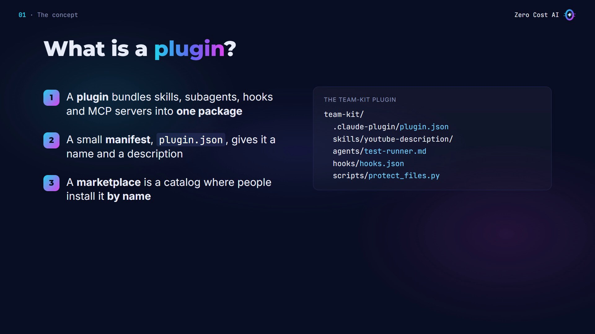

## How plugins work

1. **Build:** put your components in one folder, with a manifest.
2. **List:** add it to a marketplace, a small catalog file in a Git repository.
3. **Install:** one command, and every component in the plugin loads in Claude Code.

Each skill and subagent gets the plugin's name as a prefix, like `/team-kit:youtube-description`, so nothing clashes with your own tools.

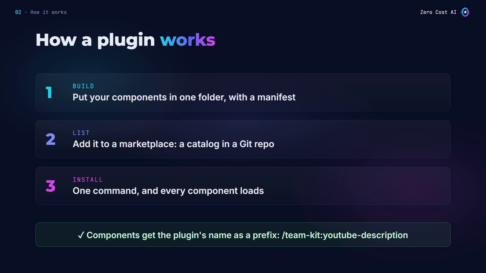

## When to use a plugin

Skills, subagents, hooks and MCP servers all work on their own.

- **One tool, just for you?** You don't need a plugin.
- **Several pieces, many people?** Use a plugin: to share with teammates, reuse in many projects, or ship updates.

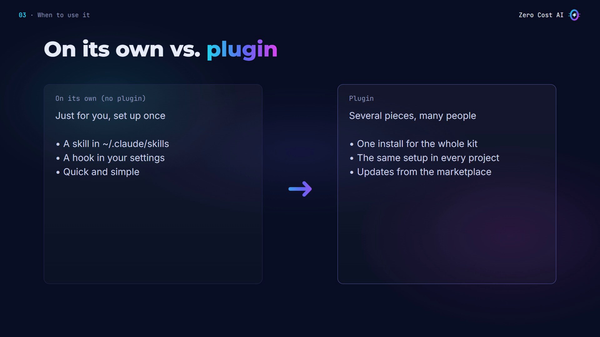

## Our example: a team kit

In earlier videos, we built three tools:

- a **hook** that protects your `.env` file,
- a **test-runner subagent**,
- a **YouTube description skill**.

Sharing them means copying files, project by project. We'll pack all three into one plugin, called `team-kit`, so anyone can install everything with a single command.

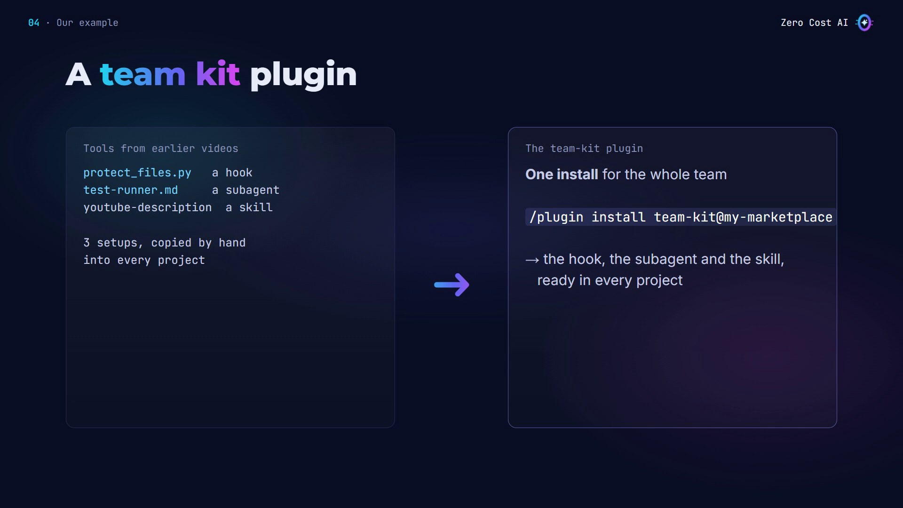

## Step 1: Create the plugin

In the project, create a folder called `team-kit` with a `.claude-plugin` folder inside it:

```bash
mkdir -p team-kit/.claude-plugin
```

Inside, the manifest, `team-kit/.claude-plugin/plugin.json`:

```json
{
  "name": "team-kit",
  "description": "Protects .env files, runs tests, writes YouTube descriptions",
  "version": "1.0.0",
  "author": {
    "name": "Zero Cost AI"
  }
}
```

- The **name** is required. It becomes the prefix on every skill and subagent in the plugin. No spaces.
- The **description** is what people see when they browse plugins.
- The **version** lets you release updates.

⚠️ Only `plugin.json` goes in the hidden `.claude-plugin` folder. Everything else goes next to it.

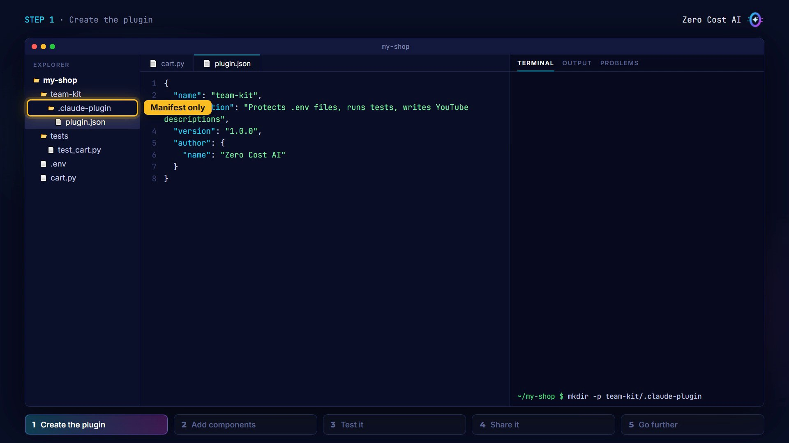

## Step 2: Add the components

Each type has its own folder: `agents`, `hooks`, `scripts` and `skills`. Copy in the three tools from the earlier videos: the subagent, the hook script and the skill.

```
team-kit/
├── .claude-plugin/plugin.json
├── agents/test-runner.md
├── hooks/hooks.json
├── scripts/protect_files.py
└── skills/youtube-description/SKILL.md
```

The hook needs one file, `hooks/hooks.json`. It's the same format as the hooks section in a settings file:

```json
{
  "hooks": {
    "PreToolUse": [
      {
        "matcher": "Edit|Write",
        "hooks": [
          {
            "type": "command",
            "command": "python",
            "args": ["${CLAUDE_PLUGIN_ROOT}/scripts/protect_files.py"]
          }
        ]
      }
    ]
  }
}
```

One difference: the script path starts with `${CLAUDE_PLUGIN_ROOT}`. It always points to wherever the plugin is installed.

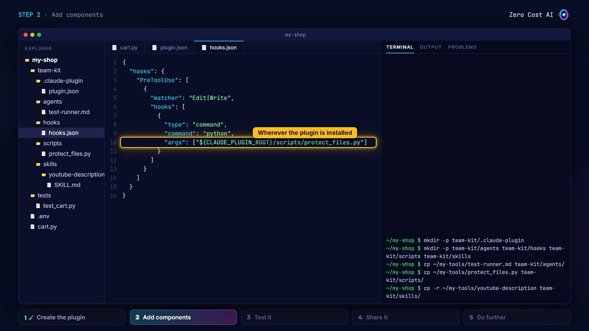

## Step 3: Test it

Before sharing, check the manifest and every component, then load the plugin for one session. No install needed while you're building:

```bash
claude plugin validate ./team-kit
claude --plugin-dir ./team-kit
```

Let's try the hook: I ask Claude to add a comment to my `.env` file. Blocked, by the hook inside the plugin.

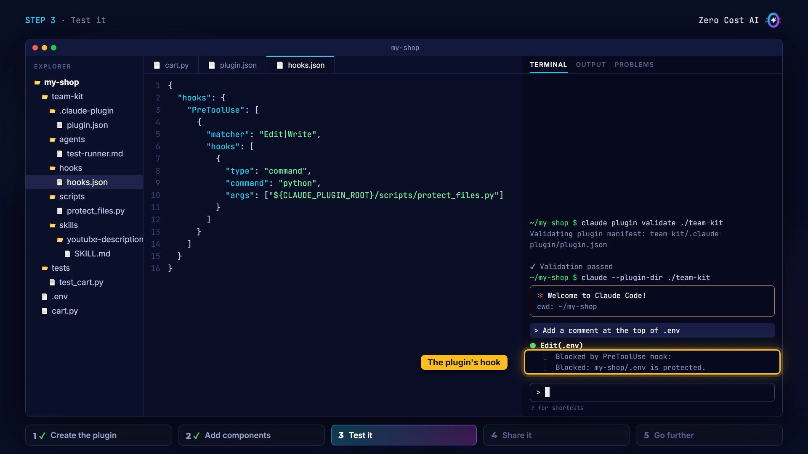

Now the subagent: *"Run the tests"*. Claude delegates to `team-kit:test-runner`. Notice the plugin's name as a prefix. And the skill is ready too, as `/team-kit:youtube-description`. Everything works.

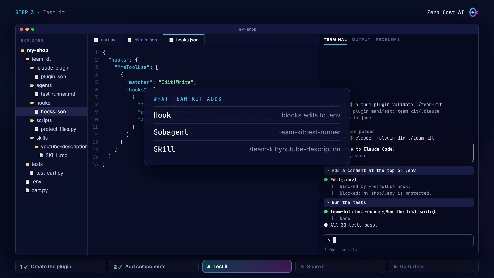

## Step 4: Share it with a marketplace

A marketplace is just a folder with a catalog file and your plugins inside. Create one and copy `team-kit` into it:

```bash
mkdir -p my-marketplace/.claude-plugin my-marketplace/plugins
cp -r team-kit my-marketplace/plugins/
```

The catalog is `my-marketplace/.claude-plugin/marketplace.json`: a name, an owner, and the list of plugins. Each plugin entry has a name and a **source**, the path to the plugin from the marketplace folder:

```json
{
  "name": "my-marketplace",
  "description": "Plugins for my team",
  "owner": {
    "name": "Zero Cost AI"
  },
  "plugins": [
    {
      "name": "team-kit",
      "source": "./plugins/team-kit",
      "description": "Protects .env files, runs tests, writes YouTube descriptions"
    }
  ]
}
```

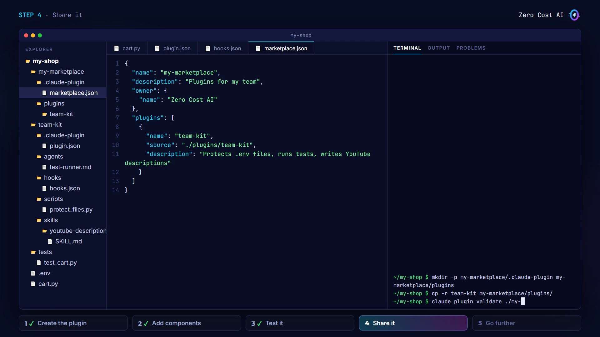

Validate it, then push the `my-marketplace` folder to GitHub as its own repository. Now any teammate runs two commands: add the marketplace (GitHub owner and repository name), then install the plugin (its name, at, the marketplace name):

```bash
claude plugin marketplace add your-name/my-marketplace
claude plugin install team-kit@my-marketplace
```

That's it: the hook, the subagent and the skill, in every project, from one install.

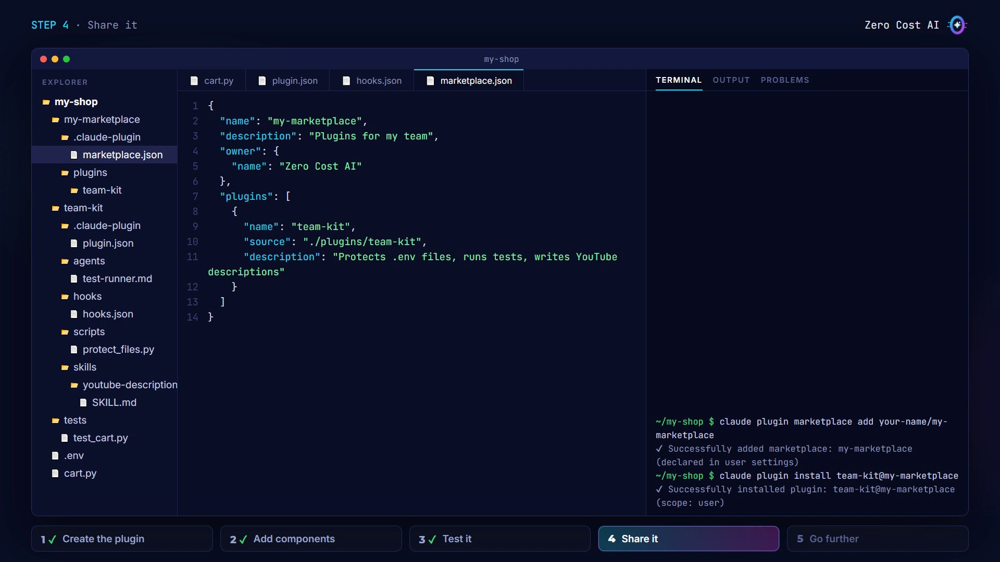

## Step 5: Go further (4 tips)

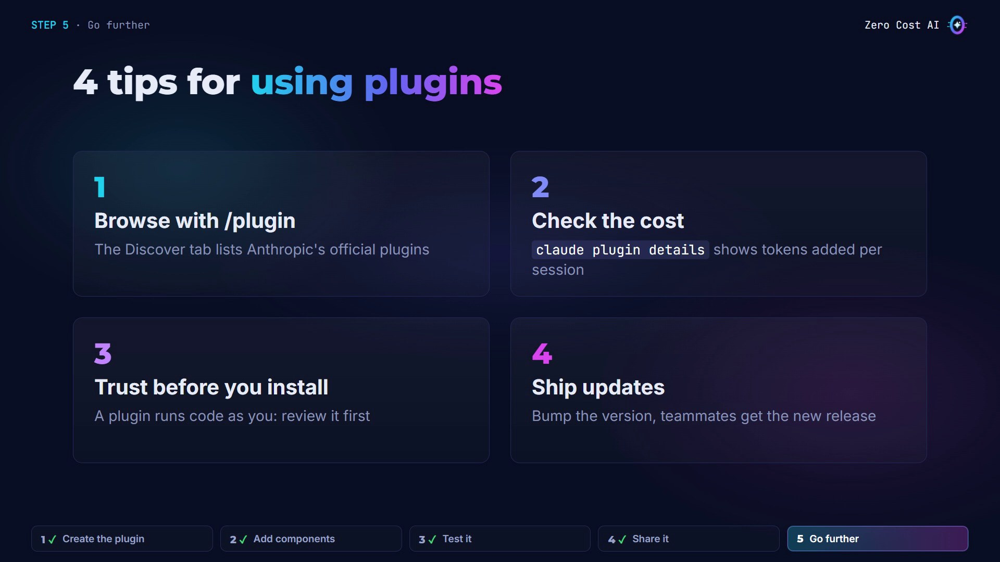

1. **Browse with `/plugin`.** The Discover tab lists plugins from Anthropic's official marketplace, ready to install.
2. **Check the cost.** An enabled plugin adds its descriptions to every session. `claude plugin details` shows how many tokens. Our team-kit adds about 90.
3. **Only install plugins you trust.** A plugin runs code with your permissions, so review it first.
4. **Ship updates.** When you improve your plugin, bump the version in the manifest, and your teammates get the update.

## Recap

- A plugin packages skills, subagents, hooks and MCP servers into one unit.
- You build it with a `plugin.json` manifest and a folder per component, and test it with `--plugin-dir`.
- You share it through a marketplace, so anyone can install the whole kit with one command.

## Get the files

The `team-kit` plugin and the marketplace from this tutorial are free on GitHub. Copy them and make them yours:

👉 **Files:** https://github.com/NEDBS12/youtube-tuto/tree/main/claude-code-plugins

🎥 **Watch the video tutorial:** {VIDEO_URL}

**Official docs:**

- Plugins overview: https://code.claude.com/docs/en/plugins
- Create a plugin: https://code.claude.com/docs/en/plugins/create
- Create a marketplace: https://code.claude.com/docs/en/plugins/create-marketplace

*Screenshots are from the Zero Cost AI video. The Claude Code sessions on screen are recreations; your Claude's wording will differ.*

---

*I'm Zero Cost AI: I build free AI tools and write beginner-friendly guides. Follow me here on Medium and subscribe on YouTube for more.*
