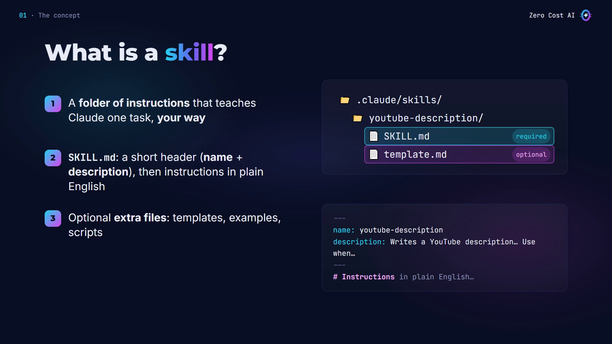
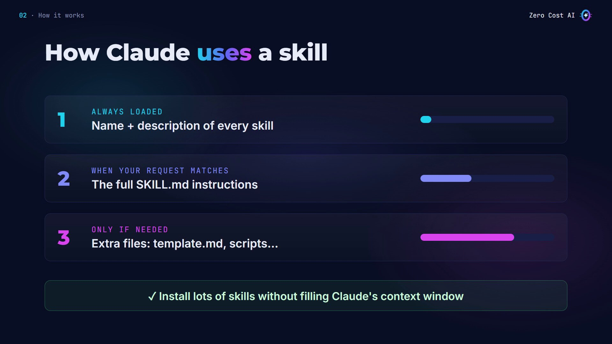
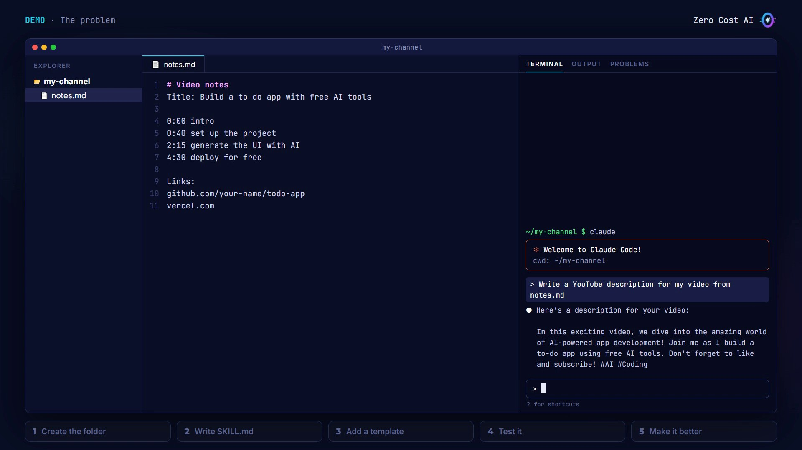
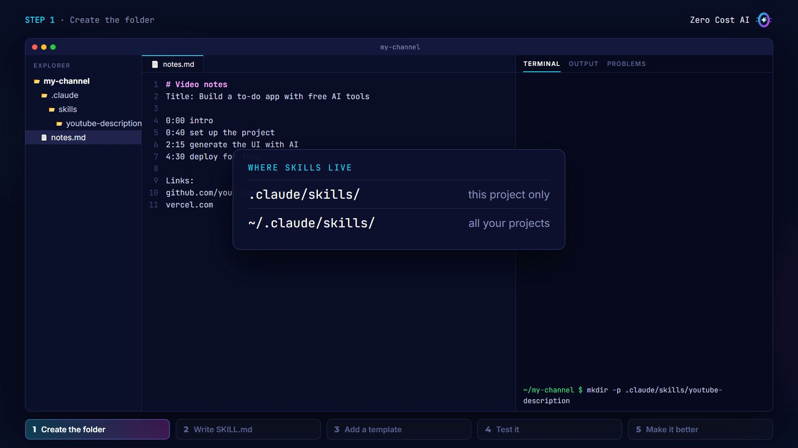
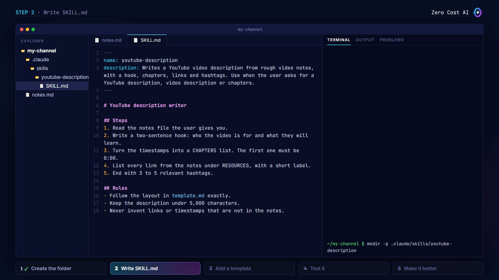
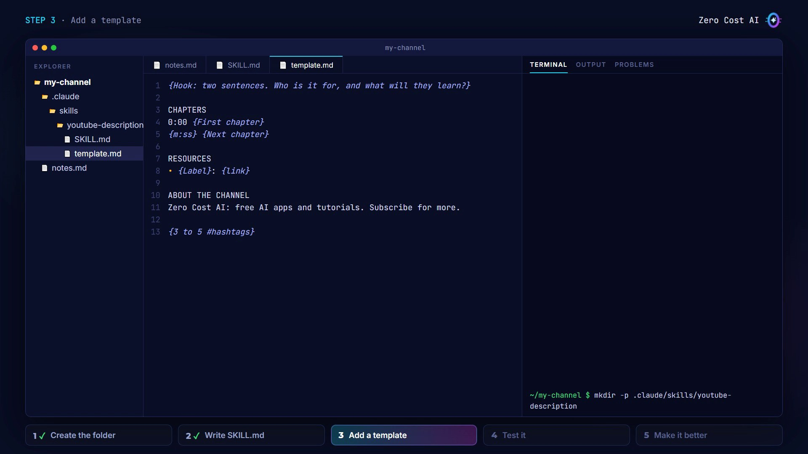
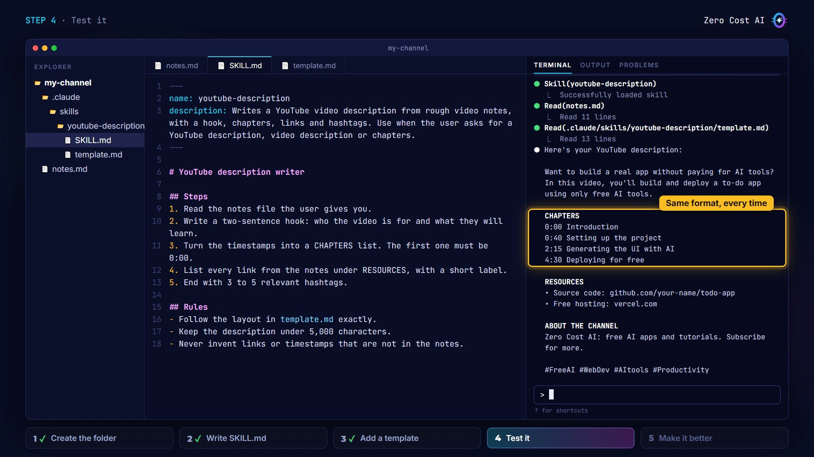
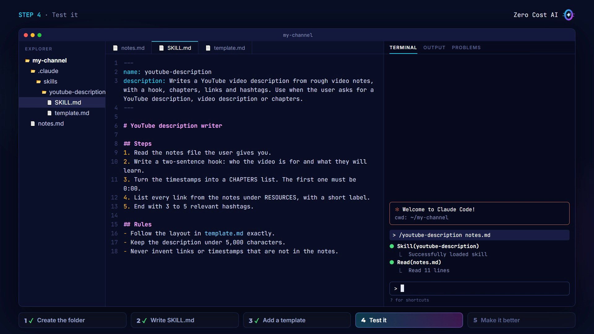
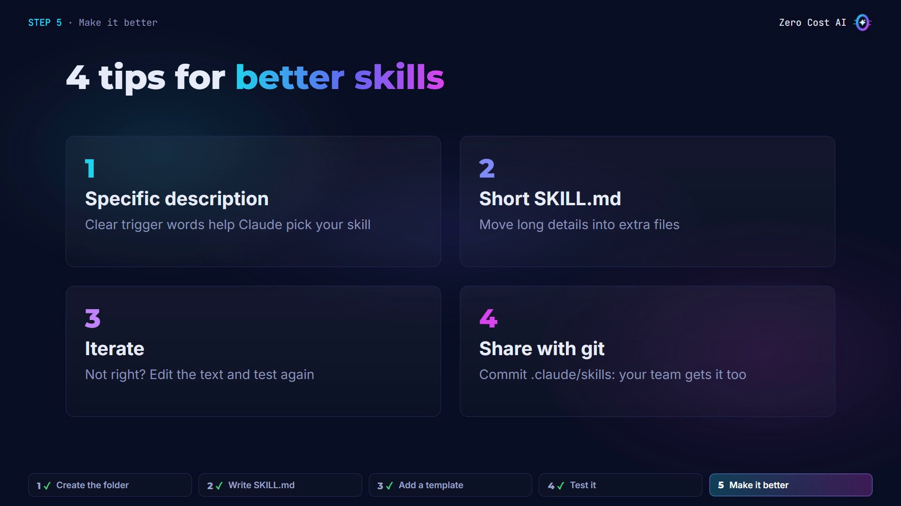

Have you ever typed the same long prompt into Claude, over and over again?

**Claude Code skills** fix that. You teach Claude a task once, in a small text file, and it does it your way every time, either when your request matches, or when you call it with a slash command.

In this article you'll learn what a skill is and how Claude uses it. Then we'll build a real one together, step by step: a **YouTube description writer** that turns rough video notes into a polished description, in the same format every time.

🎥 **Prefer video?** Watch the full tutorial here:

{VIDEO}

---

## What is a skill?

A skill is a **folder of instructions** that teaches Claude how to do one specific task, your way.

- At its heart is one file, called **SKILL.md**.
- It starts with a short header with a **name** and a **description**, followed by instructions in plain English.
- You can add **extra files** next to it, like templates, examples or scripts.



## How Claude uses a skill

Here's the clever part: Claude doesn't read every skill all the time.

1. **Always loaded:** at the start of a session, Claude only sees each skill's name and description.
2. **When your request matches a description:** Claude loads that skill's full SKILL.md instructions.
3. **Only if needed:** it opens extra files, like a template, only when the instructions need them.

So you can install lots of skills without filling up Claude's context window.



## Our example: a YouTube description writer

Every creator needs this one. You give it rough video notes, and it returns a polished description with a hook, chapters, links and hashtags, in the same format every time.

Here are the notes for my next video (`notes.md`):

```
# Video notes
Title: Build a to-do app with free AI tools

0:00 intro
0:40 set up the project
2:15 generate the UI with AI
4:30 deploy for free

Links:
github.com/your-name/todo-app
vercel.com
```

## The problem without a skill

I start Claude Code and ask: *"Write a YouTube description for my video from notes.md"*.

The answer is okay, but it's generic: no chapters, no links section. And next time, the format will be different again.



I could paste a long prompt every single time. Or I can teach Claude once, with a skill.

## Step 1: Create the skill folder

Skills for a project live in `.claude/skills`, and each skill gets its own folder:

```bash
mkdir -p .claude/skills/youtube-description
```

The folder name is the skill's name: lowercase words joined by hyphens.

- `.claude/skills/` in your project: the skill works in **this project only**.
- `~/.claude/skills/` in your home folder: the skill works in **all your projects**.



## Step 2: Write SKILL.md

Create `.claude/skills/youtube-description/SKILL.md`. It starts with a header between two lines of dashes:

```
---
name: youtube-description
description: Writes a YouTube video description from rough video notes, with a hook, chapters, links and hashtags. Use when the user asks for a YouTube description, video description or chapters.
---
```

- The **name** matches the folder. It also becomes a slash command: `/youtube-description`.
- The **description** is the most important line. It tells Claude what the skill does and when to use it. Claude reads it to decide whether the skill fits your request, so include the words people will actually say, like "YouTube description" or "chapters".

Below the header, write the instructions, just like you'd brief a colleague: the steps, then a few rules.

```
# YouTube description writer

## Steps
1. Read the notes file the user gives you.
2. Write a two-sentence hook: who the video is for and what they will learn.
3. Turn the timestamps into a CHAPTERS list. The first one must be 0:00.
4. List every link from the notes under RESOURCES, with a short label.
5. End with 3 to 5 relevant hashtags.

## Rules
- Follow the layout in template.md exactly.
- Keep the description under 5,000 characters.
- Never invent links or timestamps that are not in the notes.
```



## Step 3: Add a template

A supporting file shows the exact layout I want for every description. Create `template.md` in the same folder:

```
{Hook: two sentences. Who is it for, and what will they learn?}

CHAPTERS
0:00 {First chapter}
{m:ss} {Next chapter}

RESOURCES
• {Label}: {link}

ABOUT THE CHANNEL
Zero Cost AI: free AI apps and tutorials. Subscribe for more.

{3 to 5 #hashtags}
```



The first rule in SKILL.md points to it. Claude only opens the template when the skill actually runs, so it costs nothing until then.

## Step 4: Test it

Start a **new** Claude Code session, so it picks up the new skill, and simply ask:

```
Write a YouTube description for my video from notes.md
```

Claude recognizes the request and loads the `youtube-description` skill on its own. It reads the notes and the template, and follows every rule. Now the description has a hook, chapters starting at 0:00, the links and hashtags. Exactly my format.



You can also run it directly: type a slash, the skill name, then the file.

```
/youtube-description notes.md
```



## Step 5: Make it better (4 tips)



1. **Write a specific description** with clear trigger words. That's what makes Claude pick your skill.
2. **Keep SKILL.md short and focused.** Move long details into extra files.
3. **Iterate.** If the result isn't right, edit the instructions and test again. A skill is just a text file.
4. **Share it with git.** Commit the `.claude` folder, and everyone on your team gets the same skill.

## Recap

- A skill is a folder with a **SKILL.md** file: a name, a description and instructions.
- Claude loads it only when your request matches, or when you call it with a slash command.
- You can build your first one in about five minutes.

## Learn more

🎥 **Watch the video tutorial:** {VIDEO_URL}

All the files from this tutorial are in this article: copy `SKILL.md` and `template.md` into `.claude/skills/youtube-description/` and try it yourself.

- Claude Code skills documentation: https://code.claude.com/docs/en/skills
- Agent Skills explained (Anthropic): https://www.anthropic.com/engineering/equipping-agents-for-the-real-world-with-agent-skills

*Screenshots are from the Zero Cost AI video. The Claude Code sessions on screen are recreations; your Claude's wording will differ.*

---

*I'm Zero Cost AI: I build free AI tools and write beginner-friendly guides. Follow me here on Medium and subscribe on YouTube for more.*
