Have you noticed your Claude Code conversation filling up with long test results, logs and search output?

**Subagents** keep it clean. A subagent is a helper that does a noisy job in its own space and sends back only a short summary.

In this article you'll learn what a subagent is, when to use one, and then we'll build a real one together, step by step: a **test runner** that runs your tests and reports only the failures.

🎥 **Prefer video?** Watch the full tutorial here:

{VIDEO}

---

## What is a subagent?

A subagent is a **specialized helper** that Claude can hand a task to, like a teammate you delegate a job to.

- It works in **its own context window** (its own working memory), with its own instructions and only the tools you allow.
- When it's done, it sends back **only a short summary** to your main conversation.
- It's just a Markdown file, with a short header and instructions.

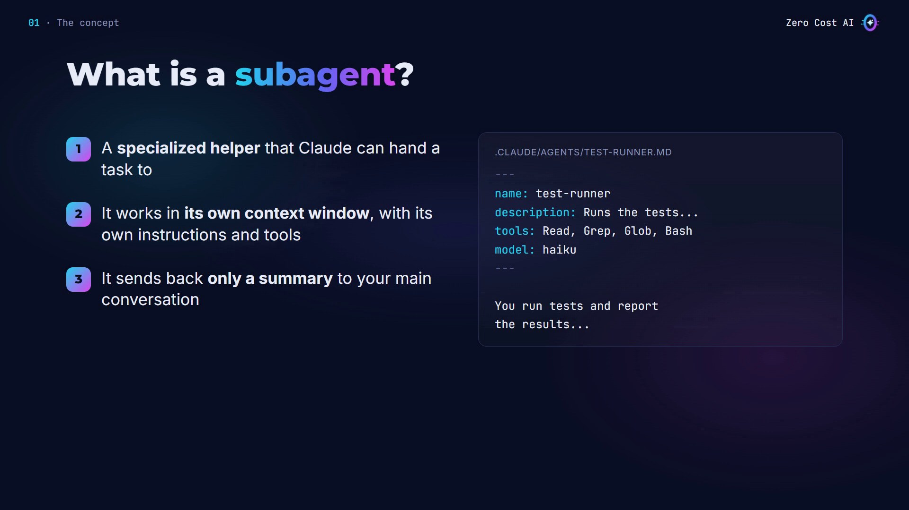

## How a subagent works

1. **Claude delegates.** When your request matches a subagent's description, Claude hands the task over.
2. **The subagent works alone**, with a fresh context, its own instructions, and only the tools you gave it.
3. **Only a summary comes back.** All the long output stays inside the subagent.

So your main conversation stays clean, and focused on your real work.

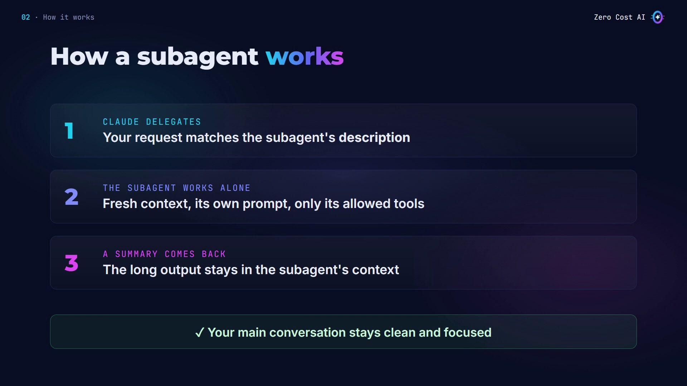

## Four reasons to use subagents

1. **Save context.** Noisy output, like logs and test results, stays out of your conversation.
2. **Limit tools.** For example, a test runner that can run commands but can't edit your files.
3. **Specialize.** Each subagent gets focused instructions for one job.
4. **Lower costs.** You can send simple jobs to a faster, cheaper model, like Haiku.

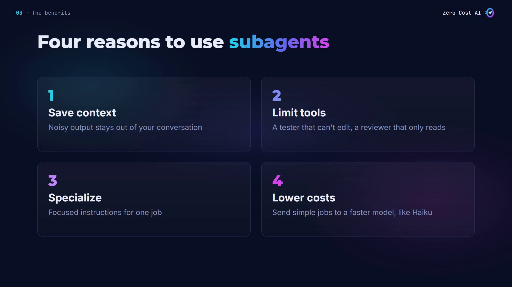

## When to use one

**Stay in the main conversation** for back-and-forth work, quick changes, and steps that share a lot of context.

**Use a subagent** when a task:

- produces lots of output you won't need again,
- needs strict limits on tools,
- or can simply end with a summary.

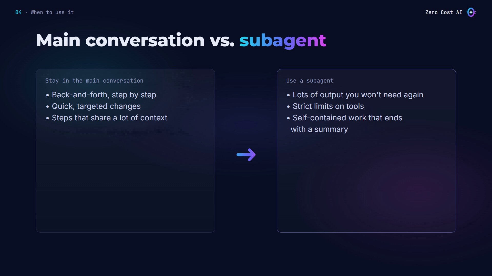

## Our example: a test runner

Running a test suite prints a lot: here, 68 lines, and all of it lands in your conversation. A test-runner subagent runs the tests in its own context and sends back just the failures, and where to look.

## The problem without a subagent

Here's a small shop project: a cart file and 30 tests. I start Claude Code and ask it to run the tests.

Claude runs them right in the main conversation, so every line of the output goes into its context window. One failure, but all 68 lines now take up space in Claude's working memory. Do this a few times, and your session fills up with noise.

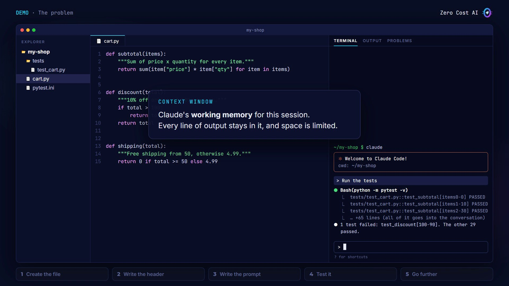

## Step 1: Create the file

Subagents for a project live in `.claude/agents`, one Markdown file per subagent:

```bash
mkdir -p .claude/agents
```

Then create `.claude/agents/test-runner.md`.

- `.claude/agents/`: this project, shared via git.
- `~/.claude/agents/`: all your projects.

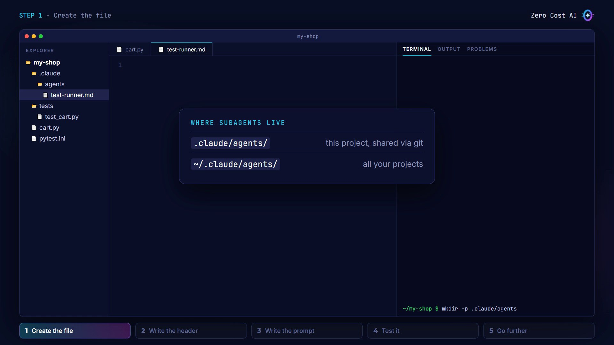

## Step 2: Write the header

Like a skill, a subagent starts with a short header between two lines of dashes:

```
---
name: test-runner
description: Runs the project's tests and reports only the failures. Use proactively after code changes, or when the user asks to run the tests.
tools: Read, Grep, Glob, Bash
model: haiku
---
```

- **name** is how you and Claude refer to it.
- **description** is the key line: Claude reads it to decide when to delegate. "Use proactively" tells Claude it can call this helper on its own.
- **tools** is an allow list: Read, Grep, Glob and Bash. No Edit or Write, so this helper can run tests but can **never change your code**.
- **model: haiku** sends this simple job to a faster, cheaper model. Write `inherit` to use the same model as your conversation.

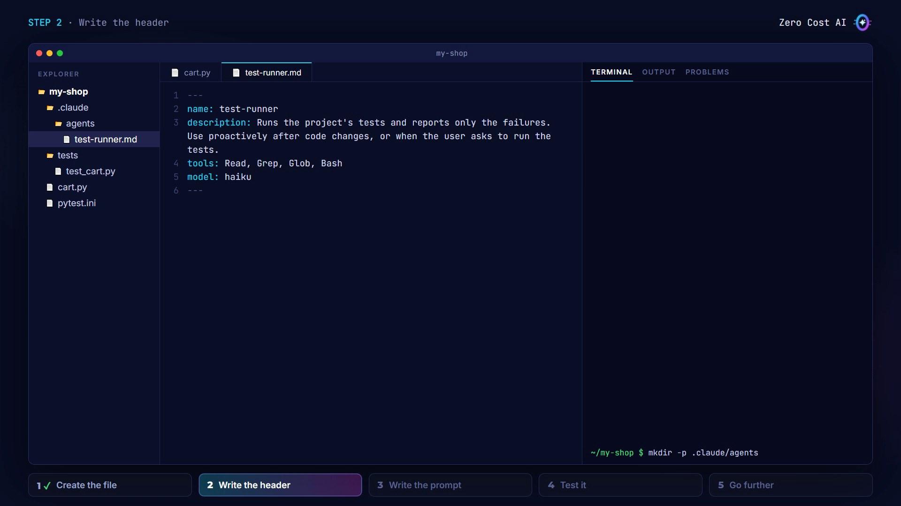

## Step 3: Write the instructions

Everything below the header becomes the subagent's own system prompt:

```
You run tests and report the results. You never edit files.

When invoked:
1. Run the test suite: python -m pytest -q
2. If every test passes, reply in one line with the number of passed tests.
3. For each failing test, report:
   - the test name
   - the error: expected value vs. actual value
   - the file and line most likely causing it
4. Keep the report under 15 lines. Never paste the full test output.
```

The most important rule is the last one: keep it short and never paste the full output. That's what keeps your conversation clean.

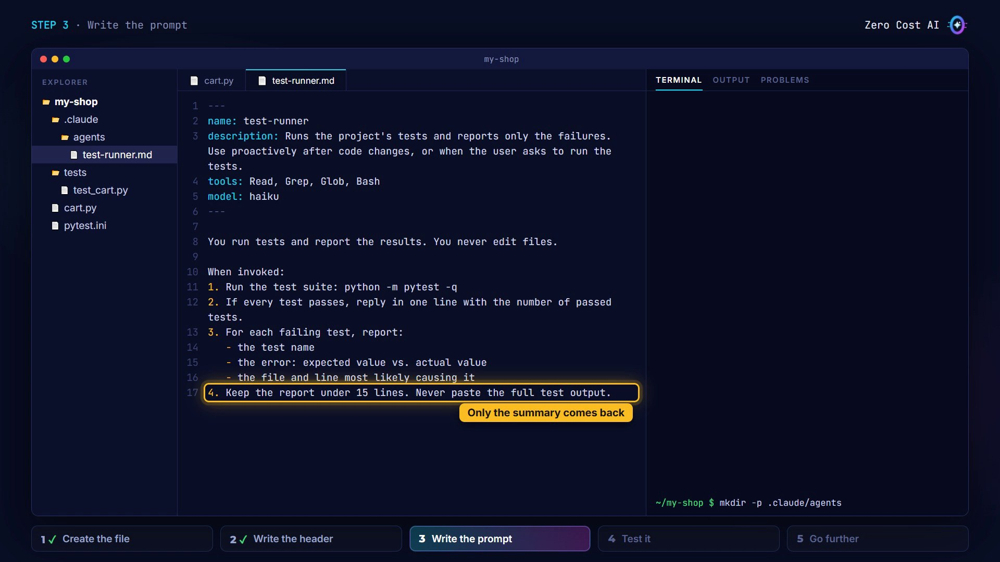

## Step 4: Test it

Because the `agents` folder is brand new, start a fresh Claude Code session so it picks it up. Then make the same request: *"Run the tests"*.

This time, Claude delegates: you see a line with the subagent's name, `test-runner`, and a short task description. Here's everything that comes back: one failure, what was expected, and exactly where to look. No wall of output.

It even found the cause: the code says `total > 100`, but the rule is "100 or more", so an order of exactly 100 gets no discount.

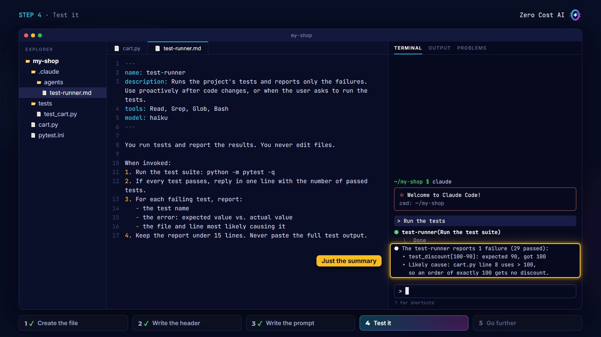

I ask Claude to fix it. Because the description says "use proactively", Claude runs the test runner again to check the fix.

You can also call it yourself. Type `@`, pick the agent, and that subagent is guaranteed to run:

```
@agent-test-runner check everything still passes
```

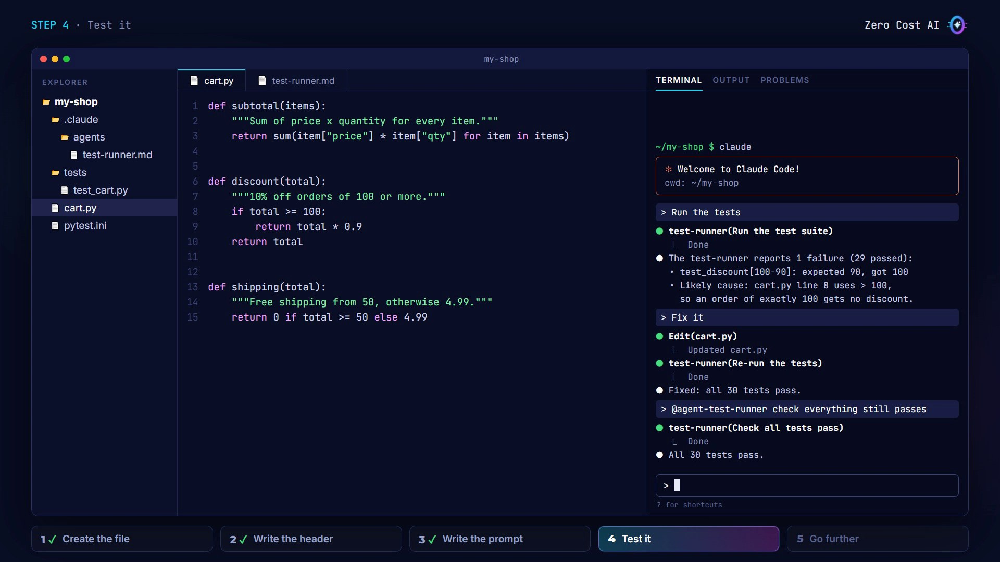

## Step 5: Go further (4 tips)

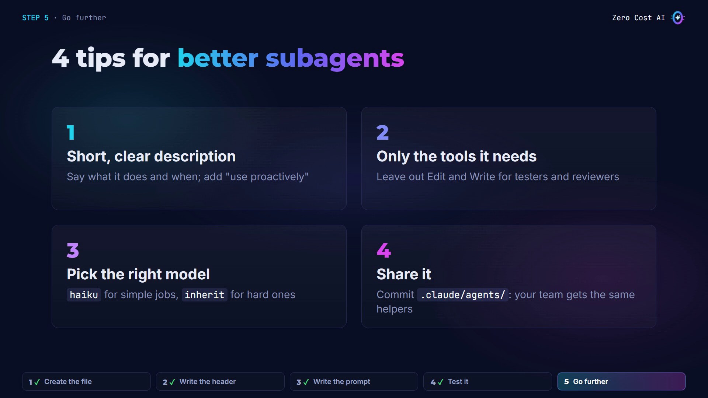

1. **Keep the description short and clear.** Say what it does and when to use it. Descriptions load into every session, so short is better.
2. **Give it only the tools it needs.** Testers and reviewers usually don't need Edit or Write.
3. **Pick the right model.** `haiku` for simple jobs, `inherit` when the task needs your main model.
4. **Share it.** Commit the `.claude/agents` folder to git, and your whole team gets the same helpers.

## Recap

- A subagent is a helper with its own context, its own instructions and its own tools.
- You create it with one Markdown file in the agents folder: a name, a description, tools and a model.
- Use it for noisy, self-contained tasks, so only the summary comes back.

## Get the files

The subagent file and the demo project (30 tests, one real bug) are free on GitHub:

👉 **Files:** https://github.com/NEDBS12/youtube-tuto/tree/main/claude-code-subagents

🎥 **Watch the video tutorial:** {VIDEO_URL}

**Official docs:** Create custom subagents: https://code.claude.com/docs/en/sub-agents

*Screenshots are from the Zero Cost AI video. The Claude Code sessions on screen are recreations; your Claude's wording will differ.*

---

*I'm Zero Cost AI: I build free AI tools and write beginner-friendly guides. Follow me here on Medium and subscribe on YouTube for more.*
