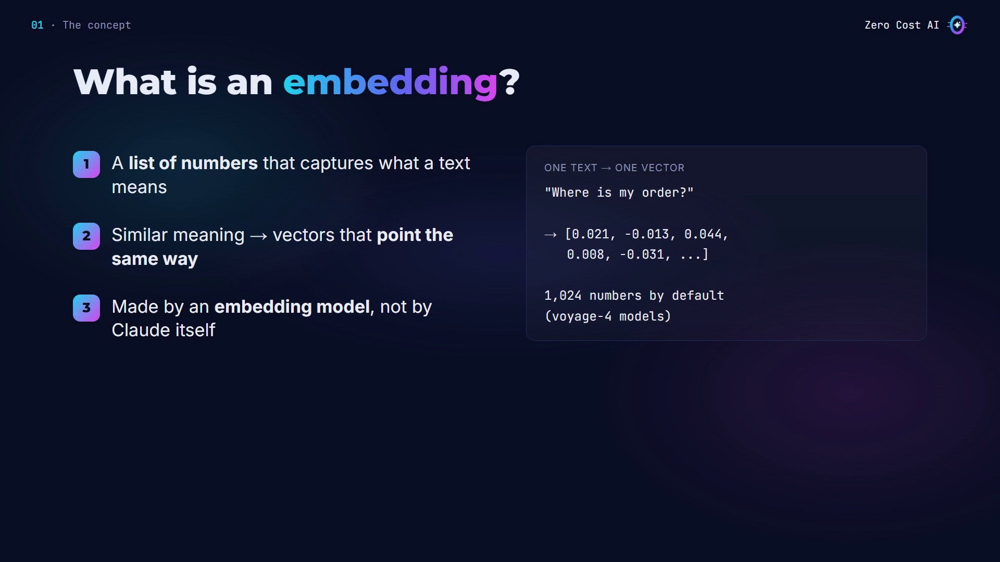
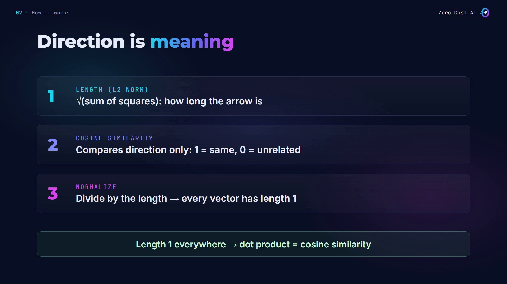
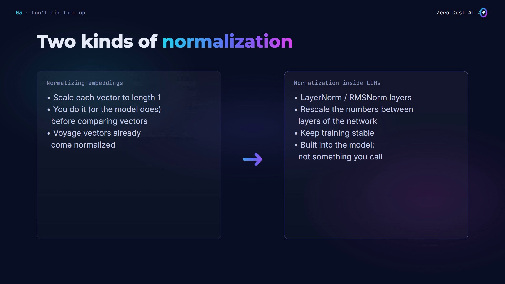
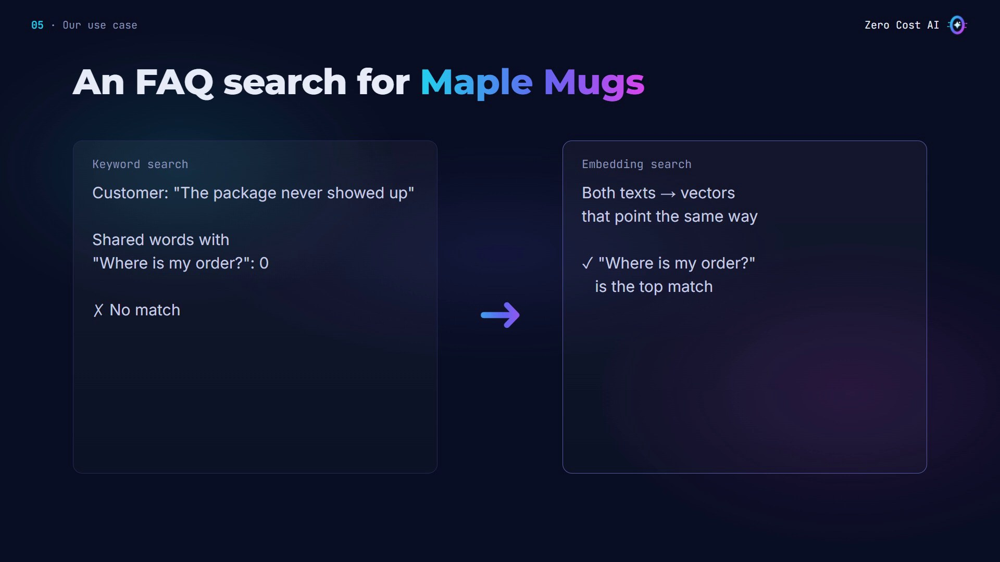
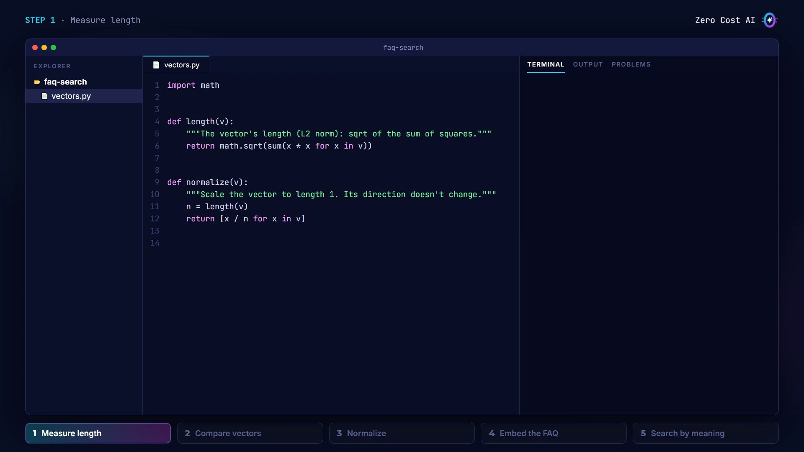
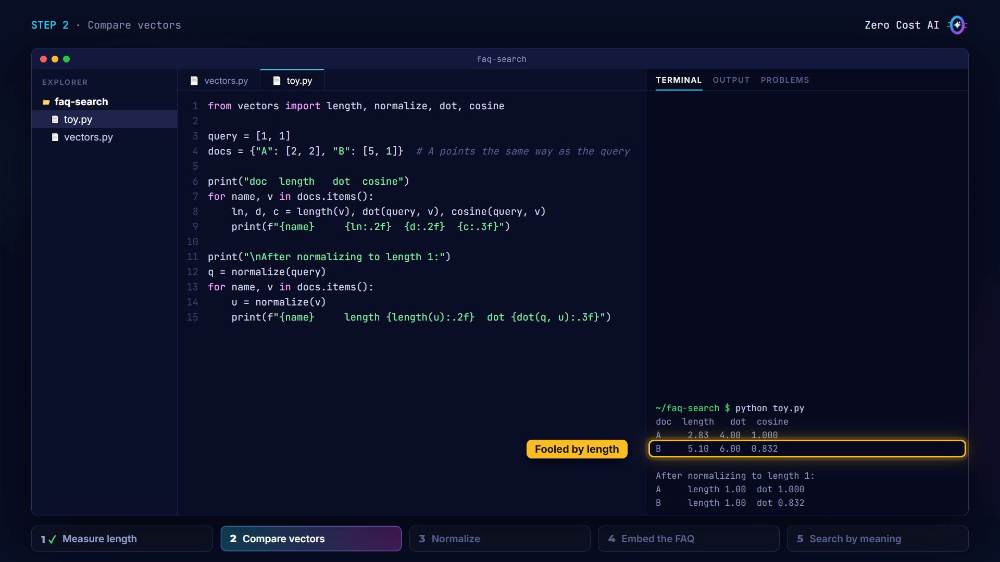
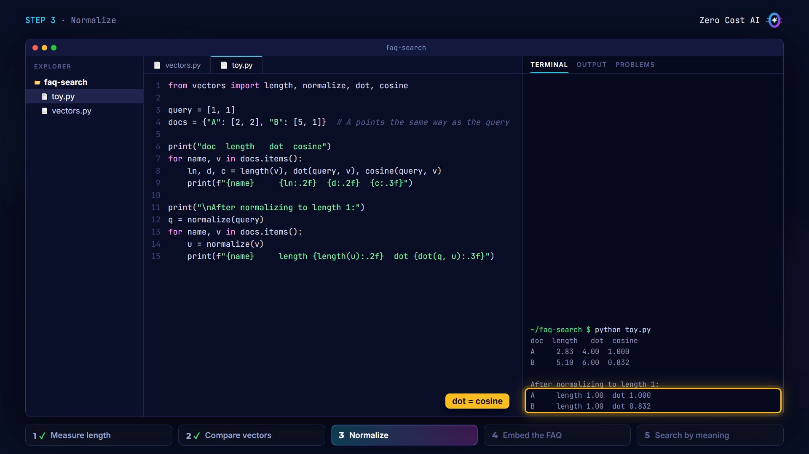
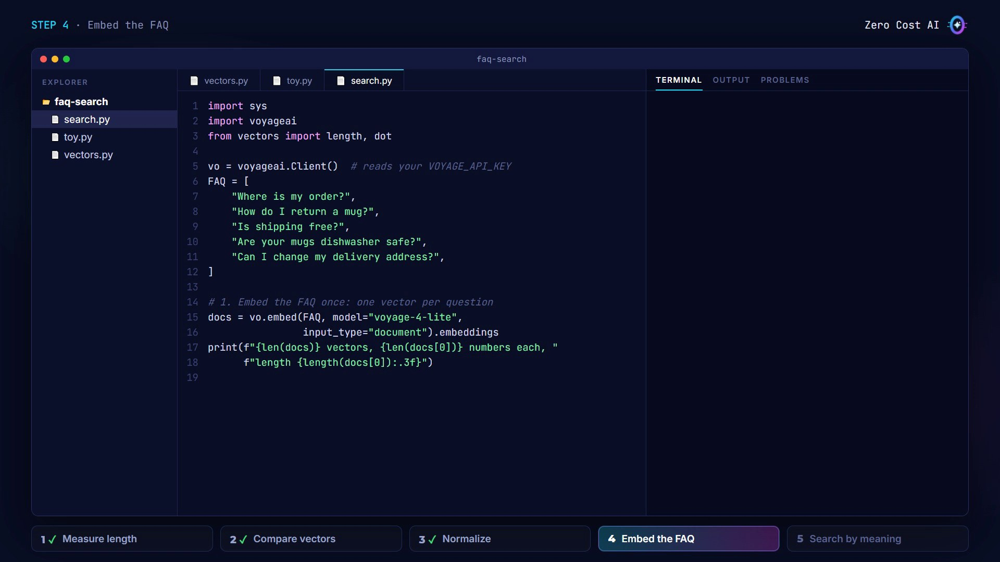
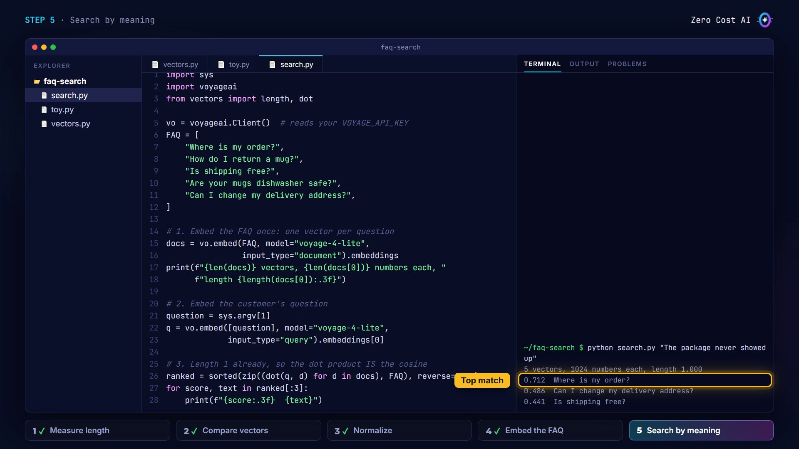
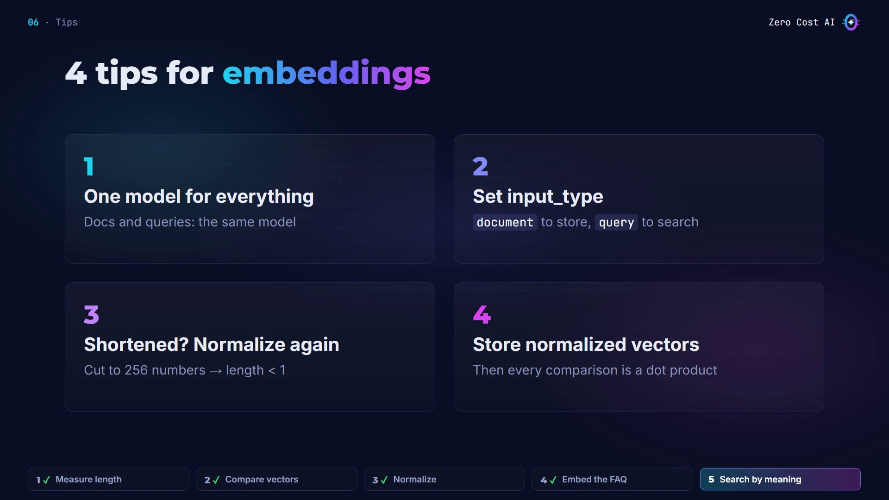

A customer writes: *"The package never showed up."* Your FAQ says: *"Where is my order?"* Not one word in common.

Keyword search misses it. **Embeddings** find it. In this article you'll learn what an embedding is, what normalizing a vector means, why it matters, and how to build a small FAQ search in Python, step by step.

🎥 **Prefer video?** Watch the full tutorial here:

{VIDEO}

---

## What is an embedding?

An **embedding** is a list of numbers that captures what a text means. A list of numbers like this is called a **vector**.

- Texts with similar meaning get vectors that **point in a similar direction**, even when they use different words.
- Embeddings come from an **embedding model**, not from Claude itself. Anthropic doesn't make one; its docs point to Voyage AI.
- Voyage's latest models (voyage-4) return **1,024 numbers** per text by default.



## Direction is meaning: length, cosine and normalization

Picture each vector as an arrow. Two things matter: its **direction** and its **length**.

- **Length (the L2 norm):** the square root of the sum of the squares of its numbers.
- **Cosine similarity:** compares only the direction. 1 means the same direction, 0 means unrelated.
- **Normalizing:** dividing a vector by its length. The direction stays the same, but the length becomes exactly 1.

The payoff: **when every vector has length 1, the plain dot product gives the same number as cosine similarity**, and it's faster to compute.



## Two kinds of normalization (don't mix them up)

- **Normalizing embeddings** (this article): scale each vector to length 1 before comparing vectors. Voyage vectors already come normalized.
- **Normalization inside LLMs:** layers like LayerNorm and RMSNorm rescale the numbers between the layers of the network, to keep training stable. They're built into the model; you never call them yourself.



## When to use embeddings

**Use embeddings for:** search by meaning, finding the right chunks for RAG, spotting duplicates, recommendations, and grouping similar texts.

**Keyword search is better for:** exact codes, IDs and rare names, like "order 1042". Real systems often combine both.

## Our use case: an FAQ search for Maple Mugs

Maple Mugs is the small (made-up) online shop from my RAG tutorial. With keyword search, *"The package never showed up"* shares zero words with *"Where is my order?"*, so there's no match. With embeddings, both questions become vectors that point the same way, so the right answer comes first.



## Step 1: Measure length (and normalize)

Start with the math, in plain Python, no libraries (`vectors.py`):

```python
import math


def length(v):
    """The vector's length (L2 norm): sqrt of the sum of squares."""
    return math.sqrt(sum(x * x for x in v))


def normalize(v):
    """Scale the vector to length 1. Its direction doesn't change."""
    n = length(v)
    return [x / n for x in v]
```

A vector like `[3, 4]` has length 5. Normalized, it becomes `[0.6, 0.8]`: same direction, length 1.



## Step 2: Compare vectors

Add the dot product and cosine similarity to the same file:

```python
def dot(a, b):
    """Dot product: multiply number by number, then add it all up."""
    return sum(x * y for x, y in zip(a, b))


def cosine(a, b):
    """Cosine similarity: 1 = same direction, 0 = unrelated."""
    return dot(a, b) / (length(a) * length(b))
```

The **dot product** multiplies the numbers pair by pair and adds them up. **Cosine** divides that by both lengths, so only the direction counts.

Now a tiny example with arrows of just two numbers (`toy.py`). A points the same way as the query. B points elsewhere, but it's longer:

```python
from vectors import length, normalize, dot, cosine

query = [1, 1]
docs = {"A": [2, 2], "B": [5, 1]}  # A points the same way as the query

print("doc  length   dot  cosine")
for name, v in docs.items():
    ln, d, c = length(v), dot(query, v), cosine(query, v)
    print(f"{name}     {ln:.2f}  {d:.2f}  {c:.3f}")

print("\nAfter normalizing to length 1:")
q = normalize(query)
for name, v in docs.items():
    u = normalize(v)
    print(f"{name}     length {length(u):.2f}  dot {dot(q, u):.3f}")
```

```text
$ python toy.py
doc  length   dot  cosine
A     2.83  4.00  1.000
B     5.10  6.00  0.832

After normalizing to length 1:
A     length 1.00  dot 1.000
B     length 1.00  dot 0.832
```

Look at the first table: **the raw dot product prefers B, only because B is longer.** Cosine gets it right: A is a perfect match, 1.0.



## Step 3: Normalize

The second half of the output does the same comparison, but normalizes the query and both documents first. Every length is now 1, and **the dot product gives exactly the cosine values**. No division needed when you compare.

That's why embedding providers normalize their vectors: you store them once, and every comparison is a fast dot product.



## Step 4: Embed the FAQ

Now real embeddings with Voyage AI (`pip install -U voyageai`, and a Voyage API key in `VOYAGE_API_KEY`). Here's the first part of `search.py`:

```python
import sys
import voyageai
from vectors import length, dot

vo = voyageai.Client()  # reads your VOYAGE_API_KEY
FAQ = [
    "Where is my order?",
    "How do I return a mug?",
    "Is shipping free?",
    "Are your mugs dishwasher safe?",
    "Can I change my delivery address?",
]

# 1. Embed the FAQ once: one vector per question
docs = vo.embed(FAQ, model="voyage-4-lite",
                input_type="document").embeddings
print(f"{len(docs)} vectors, {len(docs[0])} numbers each, "
      f"length {length(docs[0]):.3f}")
```

- `embed` sends the five FAQ questions and gets back five vectors.
- Note `input_type="document"`: what you store is a document; what you search with is a query.
- The print line shows the size of each vector, and its length.



## Step 5: Search by meaning

```python
# 2. Embed the customer's question
question = sys.argv[1]
q = vo.embed([question], model="voyage-4-lite",
             input_type="query").embeddings[0]

# 3. Length 1 already, so the dot product IS the cosine
ranked = sorted(zip((dot(q, d) for d in docs), FAQ), reverse=True)
for score, text in ranked[:3]:
    print(f"{score:.3f}  {text}")
```

I embed the customer's question with `input_type="query"`, score every FAQ with a dot product, and print the top three. Why a dot product and not cosine? **Voyage vectors already have length 1, so the dot product *is* the cosine.**

```text
$ python search.py "The package never showed up"
5 vectors, 1024 numbers each, length 1.000
0.712  Where is my order?
0.486  Can I change my delivery address?
0.441  Is shipping free?
```

Five vectors of 1,024 numbers, each with length 1: already normalized. And the top match is "Where is my order?", with zero words in common. That's search by meaning. (Your exact scores will differ.)



The files also include an offline test you can run without an API key: `python -m pytest -q` (5 passed).

## 4 tips for embeddings

1. **One model for everything.** Embed your documents and your queries with the same model. Vectors from different models can't be compared.
2. **Set `input_type`.** Voyage's docs say to use `document` for what you store and `query` for what you search with. Don't leave it out.
3. **Shortened? Normalize again.** If you shorten vectors you already stored (for example to 256 numbers), their length drops below 1. Normalize them again.
4. **Store normalized vectors,** so every comparison is a fast dot product.



## Recap

- An embedding is a vector of numbers, and its **direction carries the meaning**.
- Normalizing divides a vector by its length, so it has **length 1**.
- With length 1 everywhere, the **dot product is the cosine similarity**: simple, and fast.

## Get the files

The code, a cheat sheet, and an offline test you can run **without an API key** are free on GitHub:

👉 **Files:** https://github.com/NEDBS12/youtube-tuto/tree/main/claude-embeddings

🎥 **Watch the video tutorial:** {VIDEO_URL}

**Docs:**

- Embeddings (Claude docs): https://platform.claude.com/docs/en/build-with-claude/embeddings
- Voyage AI models: https://www.mongodb.com/docs/voyageai/models/

*Screenshots are from the Zero Cost AI video. The math scripts and their output are real; the Voyage AI search run on screen is a recreation (the code was tested offline with a simulated API), and your scores will differ.*

---

*I'm Zero Cost AI: I build free AI tools and write beginner-friendly guides. Follow me here on Medium and subscribe on YouTube for more.*
