You want Claude to do real work: run code, create files, and keep going for minutes. Should you build the agent yourself, or let Anthropic run it for you?

In this article you'll learn the difference between **your own agent** and **Claude Managed Agents**, when to choose each one, and how to build a Managed Agent step by step: one that turns a month of shop orders into a sales report and a chart.

🎥 **Prefer video?** Watch the full tutorial here:

{VIDEO}

---

## What is an agent?

An agent is **Claude + tools + a loop**: Claude acts, looks at the result, and acts again, until the task is done.

- **Your own agent:** you write that loop. You call the API, run each tool yourself, and keep the history.
- **A Managed Agent:** Anthropic runs the loop for you, with built-in tools, inside a secure cloud sandbox. It's in **beta** today.

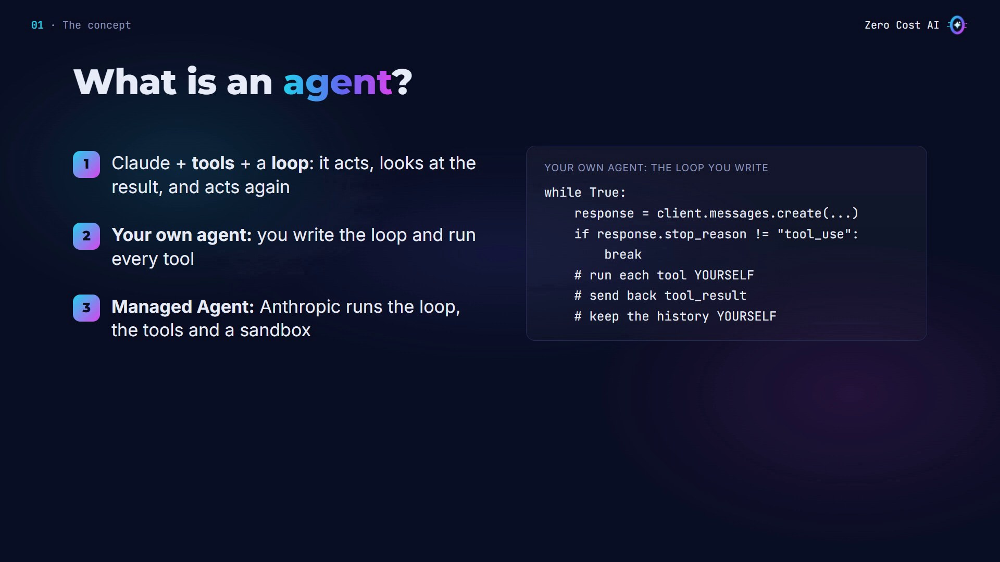

## The four building blocks of Managed Agents

1. **Agent:** the model, the system prompt and the tools. You create it once and reuse it by its ID.
2. **Environment:** where the agent runs: a cloud sandbox, with the network rules you choose.
3. **Session:** one running agent doing one task, with its own sandbox and files.
4. **Events:** you send messages as events, and the session streams back everything the agent does.

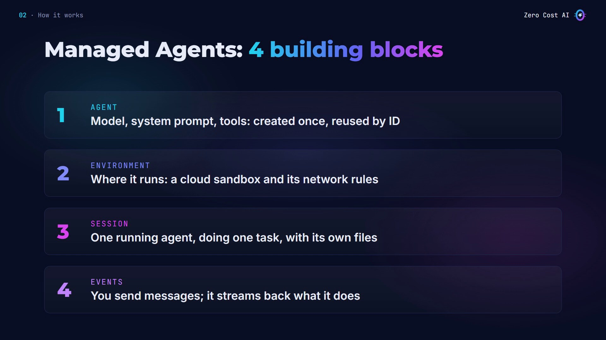

## Who does what?

**With your own agent, you do everything:** the loop, running every tool on your machine, the message history, retries and the context. In return, you control every step.

**With Managed Agents, Anthropic runs the loop.** Claude gets built-in tools (bash, file tools, web search and web fetch) inside a cloud sandbox. Sessions keep the history and the files, and caching and compaction are built in.

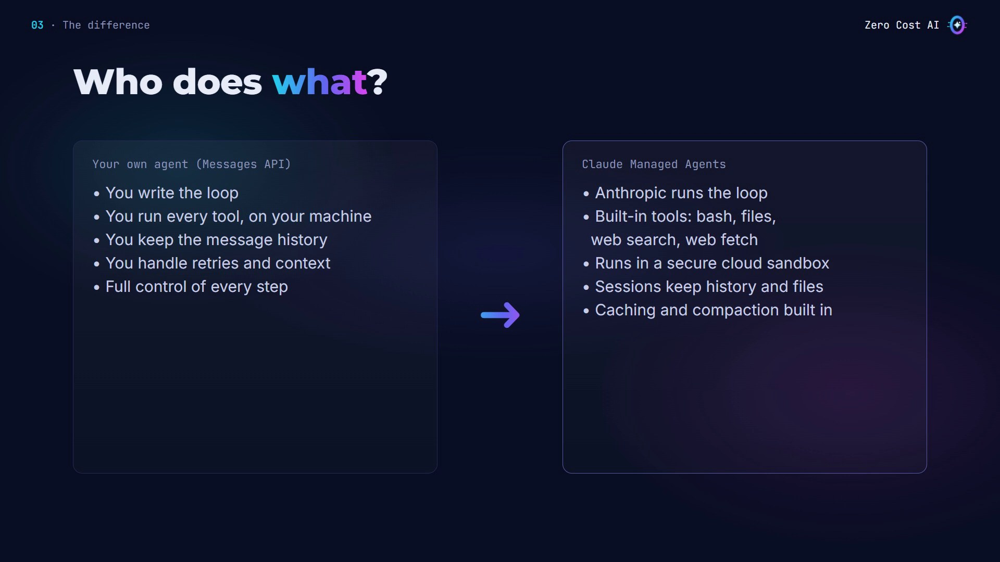

## When to choose each one

**Build your own agent when:**

- tasks are short: ask, answer,
- you need a custom loop, or approval at every step,
- tools must run inside your own systems,
- you need **Zero Data Retention** (Managed Agents isn't eligible for it today, because sessions are stored server-side).

**Choose a Managed Agent when:**

- tasks run for minutes or hours,
- Claude must run code or create files safely,
- the work is async or scheduled,
- you don't want to build the loop, the sandbox and the tools.

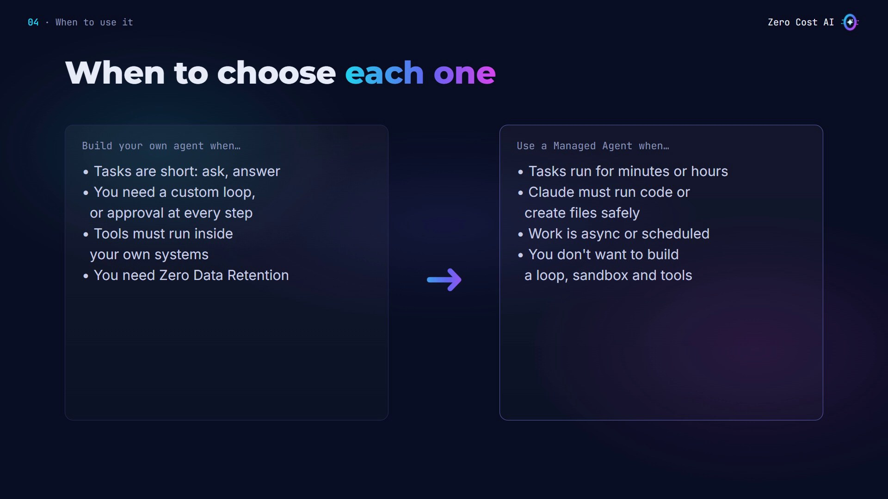

## Our use case: a monthly sales report

In my last tutorial, an order bot answered one quick question with one tool. Your own agent is perfect for that.

Now I want a **monthly sales report**: analyze October's orders, write a report, and draw a chart. Claude has to write and run Python and create files. That's a job for a Managed Agent.

Here's the data: 24 orders from October in a CSV file. To do this with your own agent, you'd have to build a lot first: a bash tool, a safe place to run Claude's code (you don't want it running on your laptop), file tools, a loop that keeps going for minutes, history, retries, and somewhere to keep the files. Managed Agents gives you all of that.

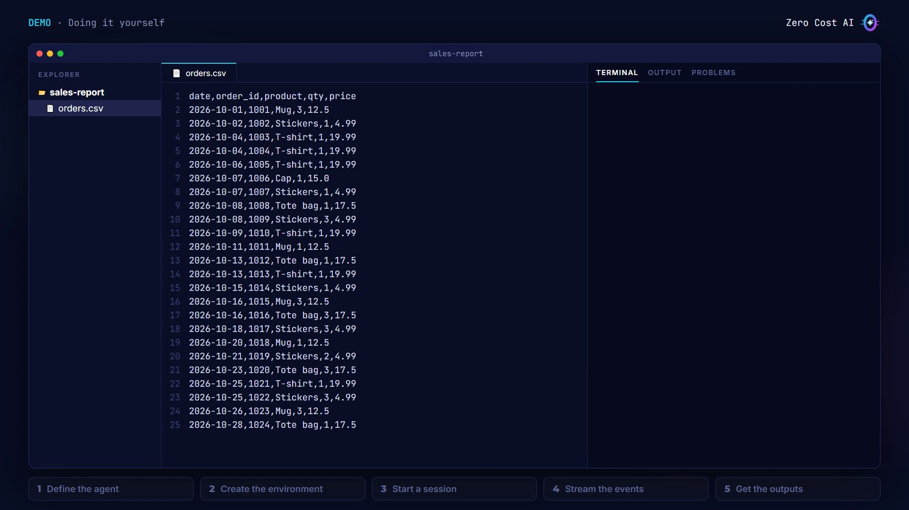

## Step 1: Define the agent

Create `setup_agent.py`:

```python
import json
from anthropic import Anthropic

client = Anthropic()

# The agent: model, instructions and tools (created once)
agent = client.beta.agents.create(
    name="Sales Analyst",
    model="claude-sonnet-5-5",
    system=(
        "You are a data analyst for a small online shop. "
        "Analyze the data you get with Python, and save "
        "every output in /mnt/session/outputs/."
    ),
    tools=[{"type": "agent_toolset_20260401"}],
)
```

- `client.beta.agents.create` takes a name, the model, a system prompt and the tools.
- The system prompt says where to save outputs: `/mnt/session/outputs/`. That folder matters later.
- The single `agent_toolset_20260401` line gives Claude the full agent toolset: bash, read, write, edit, glob, grep, web search and web fetch.

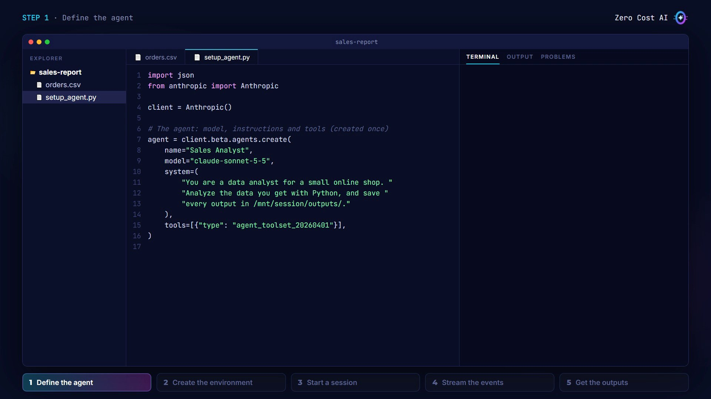

## Step 2: Create the environment

In the same file, create the environment where sessions run, and save both IDs:

```python
# The environment: where sessions run (a cloud sandbox)
environment = client.beta.environments.create(
    name="sales-report-env",
    config={
        "type": "cloud",
        "networking": {"type": "limited"},
    },
)

ids = {"agent": agent.id, "environment": environment.id}
with open("ids.json", "w") as f:
    json.dump(ids, f)
print("Agent:", agent.id)
print("Environment:", environment.id)
```

It's a cloud sandbox with Python, pandas and Matplotlib already installed. Networking is set to **limited**: ⚠️ if you leave it out, you get unrestricted network access. My agent doesn't need the internet, so I keep it closed.

Run the setup **once**. You create the agent and the environment once, and reuse them for every task.

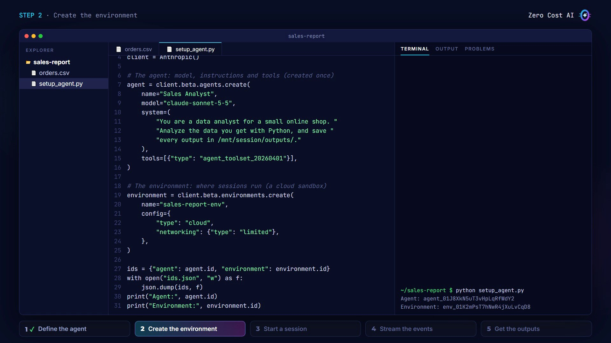

## Step 3: Start a session

This is the part you run for each task (`run_report.py`). Upload the CSV with the Files API, create a session with your agent and environment, and mount the file in the sandbox. Then write the task in plain English:

```python
import json
import time
from pathlib import Path
from anthropic import Anthropic

client = Anthropic()
ids = json.loads(Path("ids.json").read_text())

# 1. Upload the data, start a session with it mounted
data = client.files.upload(file=Path("orders.csv"))
session = client.beta.sessions.create(
    agent=ids["agent"],
    environment_id=ids["environment"],
    title="October sales report",
    resources=[{"type": "file", "file_id": data.id,
                "mount_path": "/orders.csv"}],
)

TASK = (
    "Analyze /mnt/session/uploads/orders.csv. Write "
    "report.md with the total revenue, revenue per week "
    "and the top 3 products, and save a chart of weekly "
    "revenue as weekly.png. Save both in "
    "/mnt/session/outputs/."
)
```

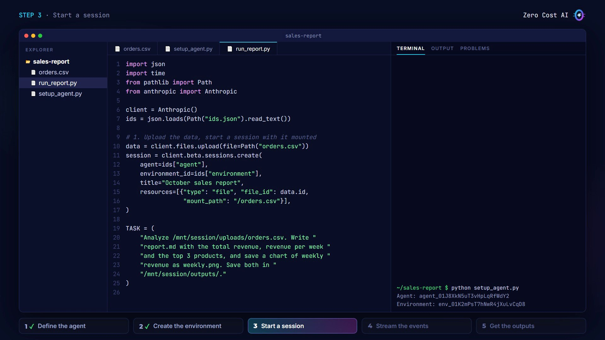

## Step 4: Send the task and stream the events

Open the stream first, then send a `user.message` event. For each event, print the tools Claude uses and its messages:

```python
# 2. Send the task, then stream what the agent does
with client.beta.sessions.events.stream(session.id) as stream:
    client.beta.sessions.events.send(session.id, events=[
        {"type": "user.message",
         "content": [{"type": "text", "text": TASK}]},
    ])
    for event in stream:
        if event.type == "agent.tool_use":
            print(f"[tool] {event.name}")
        elif event.type == "agent.message":
            for block in event.content:
                if block.type == "text":
                    print(block.text)
        elif event.type == "session.status_idle":
            print("Idle:", event.stop_reason.type)
            break
```

When the session goes idle, the agent has stopped. Like `stop_reason` in the Messages API, the idle event says why: `end_turn` means it's done.

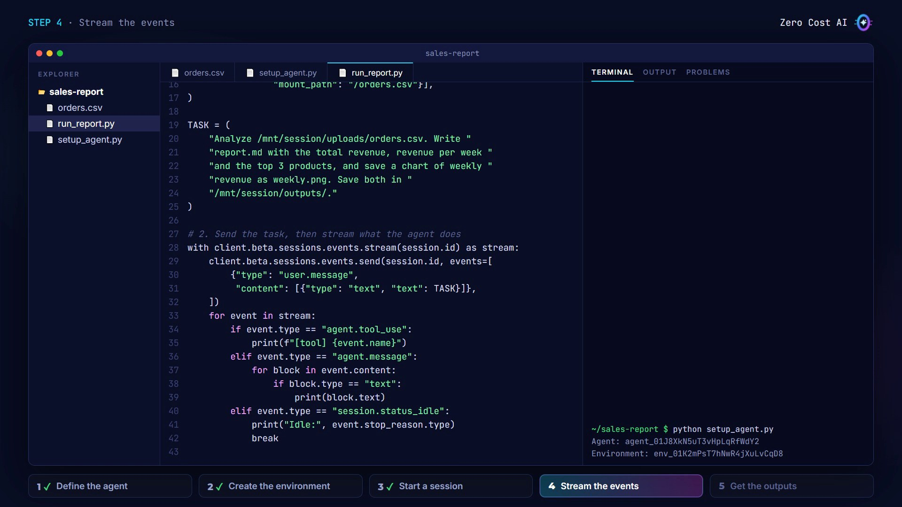

## Step 5: Get the outputs

Files the agent saves in the outputs folder can be listed for this session and downloaded:

```python
# 3. Download what the agent saved in outputs/
time.sleep(5)  # outputs can appear a few seconds after idle
files = client.beta.files.list(
    scope_id=session.id,
    betas=["managed-agents-2026-04-01"],
)
for f in files:
    if f.id != data.id:
        client.files.download(f.id).write_to_file(f.filename)
        print("Downloaded", f.filename)
```

Skip the CSV you uploaded, and wait a few seconds first: the docs say outputs can appear just after the session goes idle.

Run it, and watch the agent work: Claude writes and runs Python in the sandbox, saves the report and the chart, and goes idle with `end_turn`. Then the script downloads both files. For this data the real numbers are: total revenue **$499.80**, best week **Oct 12–18 ($147.45)**, top products **Tote bag, Mug, T-shirt**.

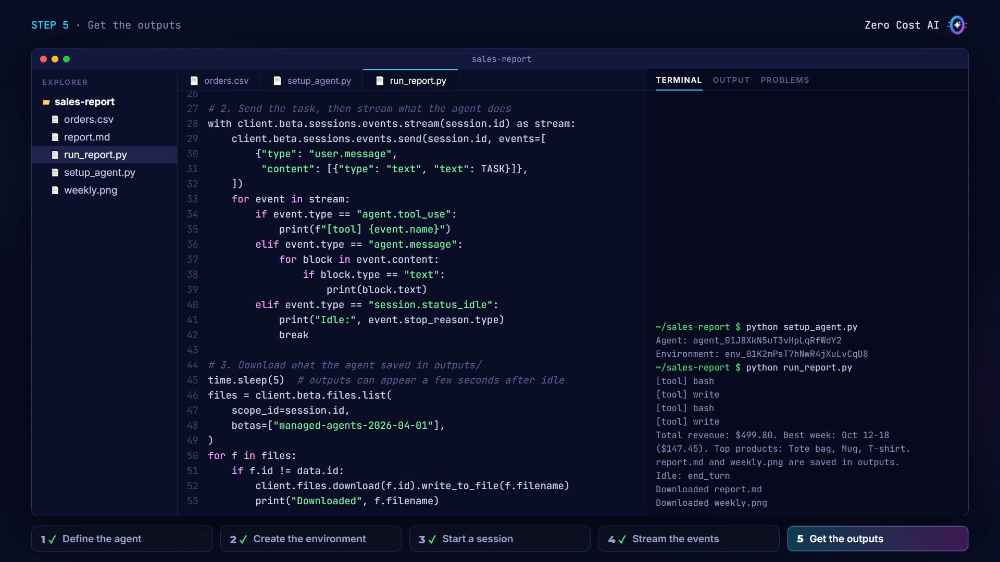

## 4 tips before production

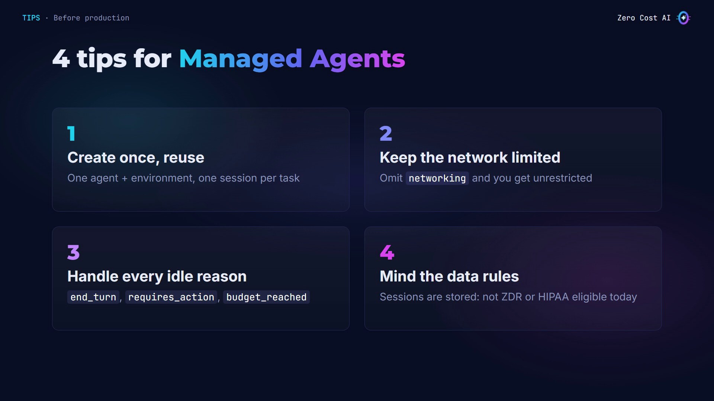

1. **Create once, reuse.** Create the agent and the environment once, then start one session per task.
2. **Always set networking.** `limited` is safer; if you leave it out, the sandbox gets unrestricted access.
3. **Handle every idle reason.** `end_turn` means done. `requires_action` means a custom tool or a confirmation needs your answer. `budget_reached` means the session hit its budget.
4. **Mind the data rules.** Sessions are stored server-side, so Managed Agents isn't eligible for Zero Data Retention or HIPAA today. You can delete sessions and files at any time.

## Recap

- **Your own agent:** you run the loop and the tools, and you control every step. Great for short, custom tasks.
- **A Managed Agent:** Anthropic runs the loop, the tools and a sandbox. Great for long tasks that run code and create files.
- Create the agent and environment once, then start a session for each task, stream its events, and download the outputs.

## Get the files

All the code, an offline test you can run **without an API key** (it simulates the API), and a comparison cheat sheet are free on GitHub:

👉 **Files:** https://github.com/NEDBS12/youtube-tuto/tree/main/claude-managed-agents

🎥 **Watch the video tutorial:** {VIDEO_URL}

**Official docs:**

- Claude Managed Agents overview: https://platform.claude.com/docs/en/managed-agents/overview
- Quickstart: https://platform.claude.com/docs/en/managed-agents/quickstart
- Attach and download files: https://platform.claude.com/docs/en/managed-agents/files

*Screenshots are from the Zero Cost AI video. The code was tested with the anthropic SDK 1.15.0 against a simulated API; the agent run on screen is a recreation, and your agent's tool calls and wording will differ. Managed Agents usage is billed to your API account.*

---

*I'm Zero Cost AI: I build free AI tools and write beginner-friendly guides. Follow me here on Medium and subscribe on YouTube for more.*
