Ask Claude about your shop's return policy, and it has no idea. It has never seen your documents.

**RAG** fixes that. In this article you'll learn what RAG is, how it works, when to use it (and when you don't need it), and how to build a small help desk in Python that answers from real documents and cites them.

🎥 **Prefer video?** Watch the full tutorial here:

{VIDEO}

---

## What is RAG?

RAG stands for **retrieval-augmented generation**. It's three steps, and the name tells you all three:

1. **Retrieve:** when a question comes in, your code searches your documents for the passages that match.
2. **Augment:** you put those passages in the prompt, next to the question.
3. **Generate:** Claude writes the answer from those passages, and cites them.

Think of it as an open-book exam: Claude doesn't memorize your documents. It looks up the right page, then answers.

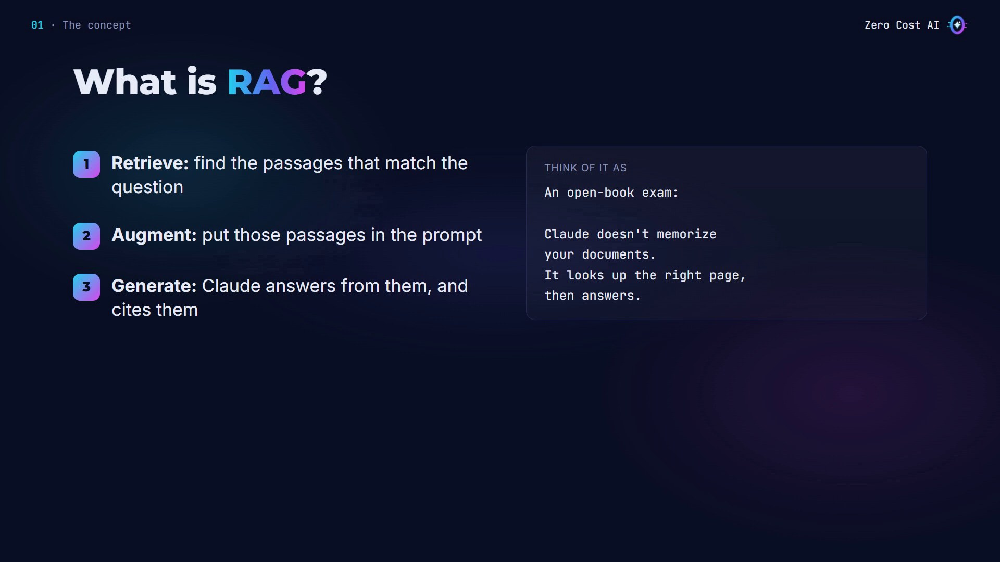

## How RAG works

- **Once, ahead of time:** split your documents into small pieces called **chunks**. A chunk is a section or a paragraph.
- **For each question:** search the chunks and keep the best few, the top results.
- **Then:** send the chunks and the question to Claude, and get an answer with its sources.

Big systems search by meaning, with **embeddings**. Anthropic doesn't make an embedding model; its docs point to Voyage AI. In this tutorial we use simple keyword search: it's free, and you can read every line.

The key idea: **search finds the facts, and Claude writes the answer.**

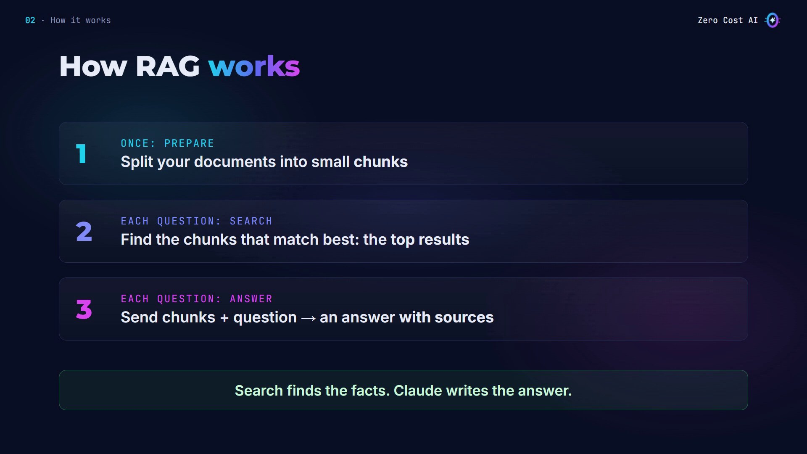

## When to use RAG (and when you don't need it)

**Use RAG when:**

- your documents are too big for one prompt,
- they change often,
- answers must show their sources,
- the data is private: policies, wikis, tickets.

**You may not need it when your documents are small.** Anthropic says that if your knowledge base is under about **200,000 tokens (around 500 pages)**, you can put all of it in the prompt. With prompt caching, that's faster and cheaper on repeat questions. RAG is for when it doesn't fit.

And if Claude needs to *do* something rather than look something up, use tools instead.

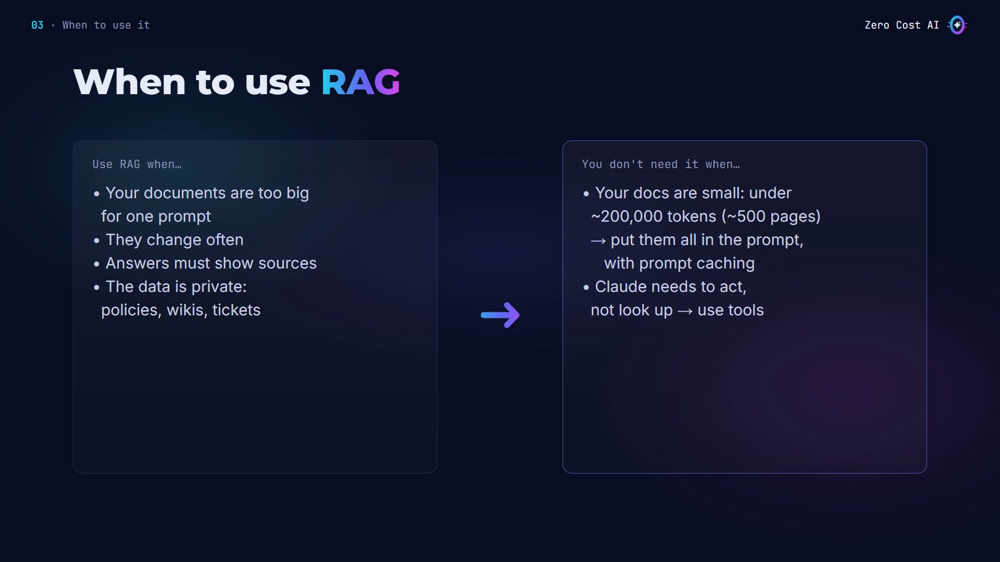

## Our use case: a help desk for Maple Mugs

Maple Mugs is a small (made-up) online shop. Its policies are three short Markdown documents: `returns.md`, `shipping.md` and `care.md`. Each one has sections with a `##` heading, like this:

```markdown
# Returns

## Return window
You can return a mug within 30 days of delivery.
It must be unused and in its original box.

## Damaged items
Got a broken or chipped mug? Send us a photo within 7 days of delivery.
We'll ship a free replacement. You don't need to send it back.

## Refunds
Refunds go back to your original payment method.
They take 5 to 10 business days after we receive the return.
Personalised mugs can't be returned unless they arrive damaged.
```

A customer asks: *"Can I return a mug after 40 days?"* Without RAG, Claude has never seen the policy. With RAG, our search finds the "Return window" section, and Claude answers from it, with the source.

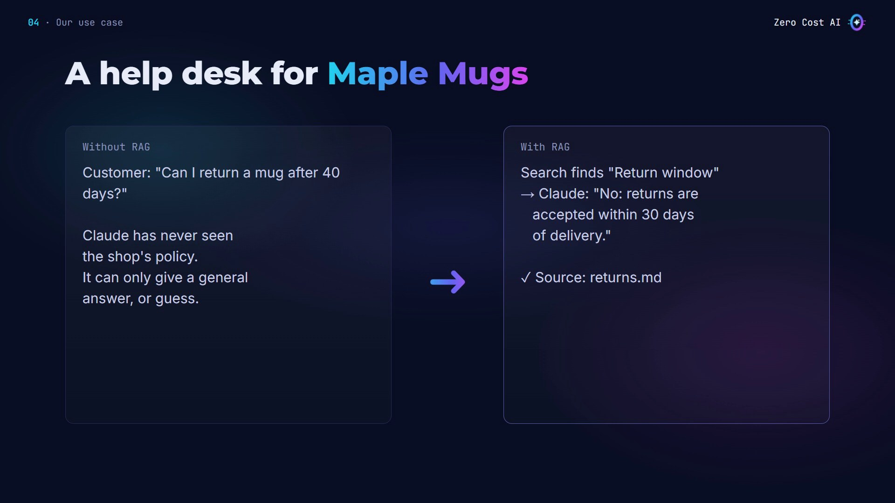

## The problem: Claude without RAG

First, I ask Claude with just the question (`no_rag.py`):

```python
import sys
import anthropic

client = anthropic.Anthropic()

response = client.messages.create(
    model="claude-sonnet-5-5",
    max_tokens=1024,
    system="You answer customer questions for Maple Mugs.",
    messages=[{"role": "user", "content": sys.argv[1]}],
)
print(response.content[0].text)
```

Claude is honest, but it can't help: it doesn't know the policy, so it gives a general answer and sends the customer elsewhere.

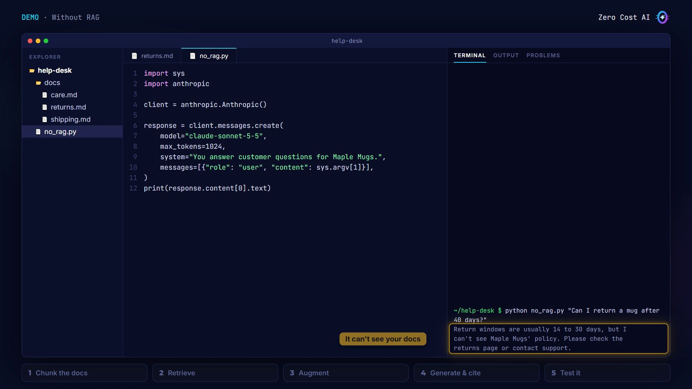

Let's give it the documents, with RAG. Everything goes in one file, `rag.py`.

## Step 1: Chunk the documents

```python
import pathlib
import re
import sys
import anthropic

client = anthropic.Anthropic()
DOCS = pathlib.Path(__file__).parent / "docs"
STOP = {"a", "an", "the", "i", "my", "is", "can", "do", "you",
        "to", "of", "and", "or", "it", "in", "for", "what", "how"}


# 1. Chunk: split every doc into its ## sections
def load_chunks():
    chunks = []
    for path in sorted(DOCS.glob("*.md")):
        text = path.read_text(encoding="utf-8")
        for section in text.split("\n## ")[1:]:
            title, _, body = section.partition("\n")
            chunks.append({"source": path.name, "title": title,
                           "text": body.strip()})
    return chunks
```

- I create the client, and a short list of **stop words**: common words we'll ignore when searching.
- `load_chunks` reads every Markdown file and splits it at each `##` heading, so **each section becomes one chunk**.
- Each chunk keeps its file name and title. That's what we'll show as the source.

Why small chunks? So we only send Claude what's relevant, not every document.

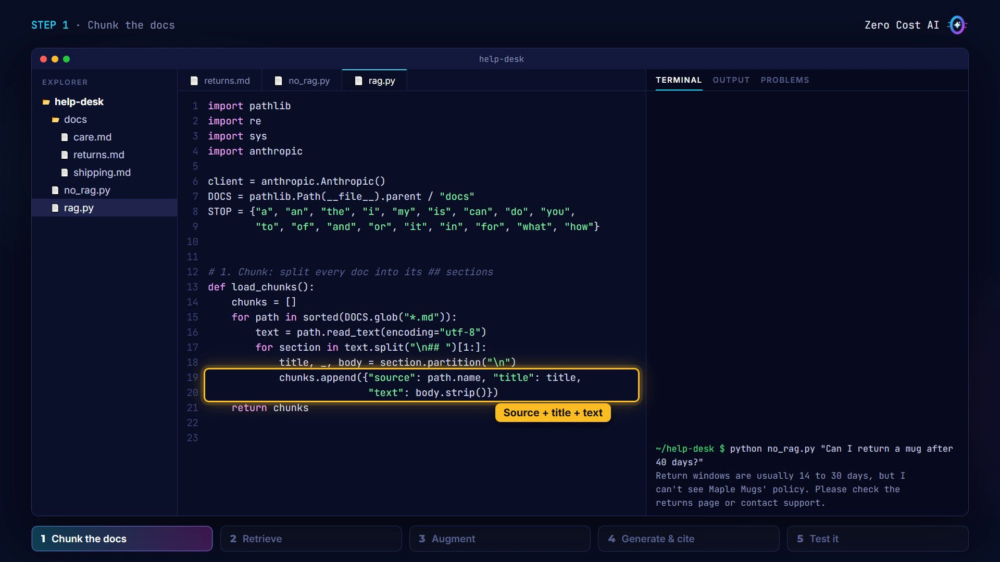

## Step 2: Retrieve

```python
# 2. Retrieve: rank chunks by the words they share with the question
def words(text):
    found = re.findall(r"[a-z0-9]+", text.lower())
    return {w.removesuffix("s") for w in found} - STOP


def search(question, chunks, k=3):
    q = words(question)
    scored = [(len(q & words(c["title"] + " " + c["text"])), c)
              for c in chunks]
    scored.sort(key=lambda pair: pair[0], reverse=True)
    return [c for score, c in scored[:k] if score > 0]
```

- `words` lowercases the text, splits it into words, drops a final "s", and removes the stop words.
- `search` scores each chunk by **how many words it shares with the question**, sorts them, and keeps the top three.
- Chunks with a score of zero are dropped. If nothing matches, we send nothing. That matters later.

This is basic keyword search. Real systems use better scoring, or embeddings. The rest of the pipeline stays the same.

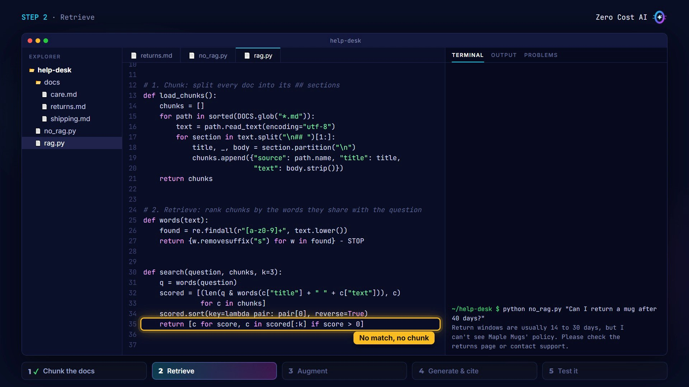

## Step 3: Augment the prompt

```python
# 3. Augment: send the chunks as search results, citations on
def ask(question):
    found = search(question, load_chunks())
    for c in found:
        print(f"[retrieved] {c['source']} > {c['title']}")
    results = [{
        "type": "search_result",
        "source": c["source"],
        "title": c["title"],
        "content": [{"type": "text", "text": c["text"]}],
        "citations": {"enabled": True},
    } for c in found]
    if not results:
        results = [{"type": "text", "text": "No results found."}]
```

- `ask` runs the search, prints what it found, and turns each chunk into a **search result block**.
- A `search_result` is a content block made for RAG. It needs a `source`, a `title`, and the `content` as text blocks.
- With `citations` enabled, Claude cites these blocks automatically. ⚠️ All search results in a request must use the same citation setting.
- If nothing was found, we send a plain text block: "No results found." The docs recommend that over raising an error.

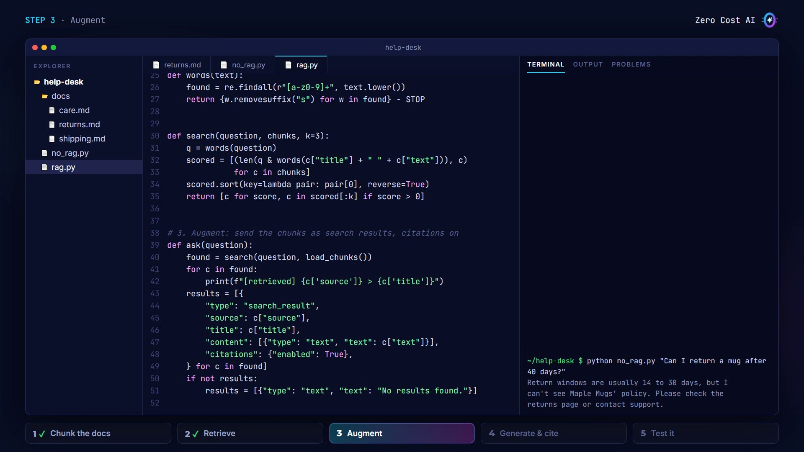

## Step 4: Generate and cite

```python
    # 4. Generate: Claude answers from the results and cites them
    response = client.messages.create(
        model="claude-sonnet-5-5",
        max_tokens=1024,
        system=("You answer customer questions for Maple Mugs. "
                "Use only the search results. If they don't contain "
                "the answer, say you don't know."),
        messages=[{"role": "user", "content": results + [
            {"type": "text", "text": question}]}],
    )
    sources = set()
    for block in response.content:
        if block.type == "text":
            print(block.text, end="")
            for cite in block.citations or []:
                sources.add(f"{cite.source} > {cite.title}")
    print("\n\nSources:", "; ".join(sorted(sources)) or "none")


if __name__ == "__main__":
    ask(sys.argv[1])
```

- The system prompt says: use only the search results, and if the answer isn't there, say you don't know.
- The search results go in the user message, **before the question**.
- Then I print each text block and collect its citations. Each citation has the `source` and `title` we passed in.

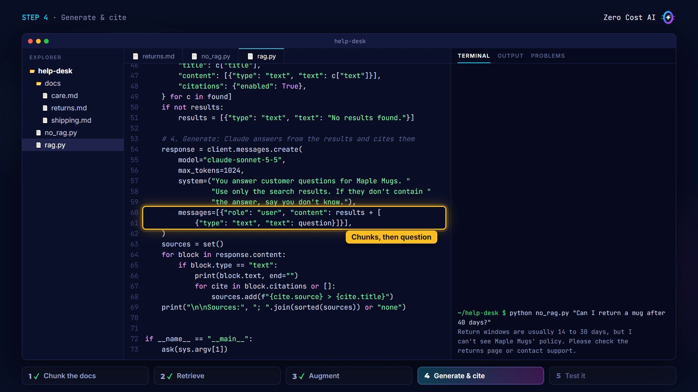

## Step 5: Test it

Same question as before:

```text
$ python rag.py "Can I return a mug after 40 days?"
[retrieved] returns.md > Refunds
[retrieved] returns.md > Return window
[retrieved] returns.md > Damaged items
No, sorry. Mugs can be returned within 30 days of
delivery, so 40 days is past the return window.

Sources: returns.md > Return window
```

Search found three chunks from the returns file, including the return window. Claude answers from it (30 days, so 40 is too late), and the source is right there. A question about a gold rim mug in the dishwasher pulls the answer from `care.md` instead.

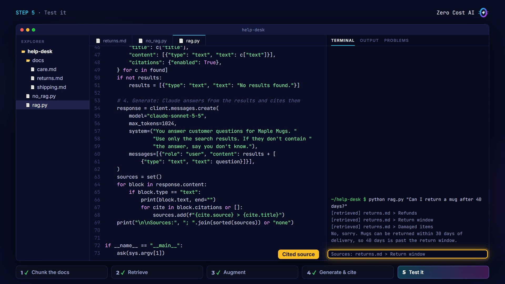

Now a question the documents don't answer:

```text
$ python rag.py "Do you sell gift cards?"
Sorry, I don't know. I couldn't find anything
about gift cards in our documents.

Sources: none
```

Nothing was retrieved, so Claude says it doesn't know, instead of inventing a gift card policy. That's what you want.

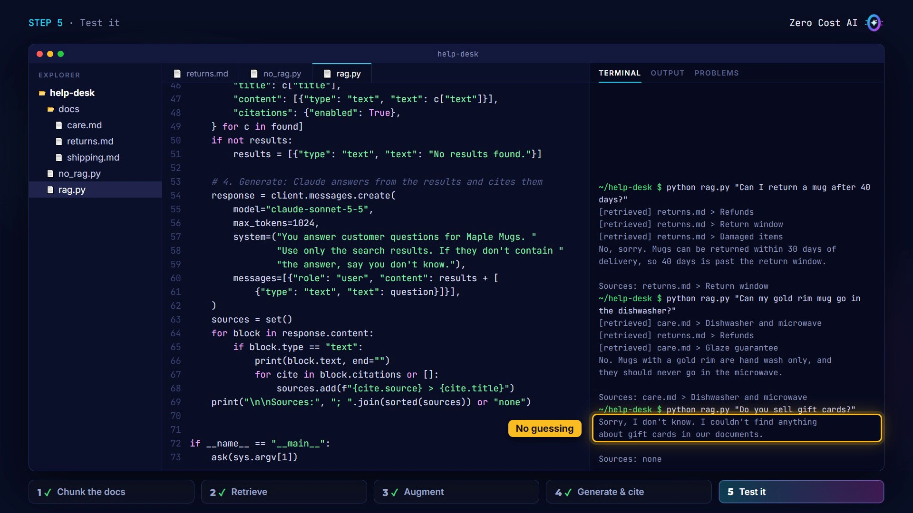

Claude's wording will differ for you. The files also include an offline test you can run without an API key: `python -m pytest -q` (5 passed).

## 4 tips for better RAG

1. **Chunk by meaning.** Split at sections or paragraphs, so each chunk makes sense on its own.
2. **Mix keyword search and meaning.** Keywords catch exact terms like product codes; embeddings catch different wording. Anthropic's research found combining both retrieves better.
3. **Don't retrieve too little.** In Anthropic's tests, passing the top 20 chunks beat 5 or 10. We used three because our docs are tiny.
4. **Allow "I don't know".** Tell Claude to answer only from the results, and show the sources, so people can check the answer.

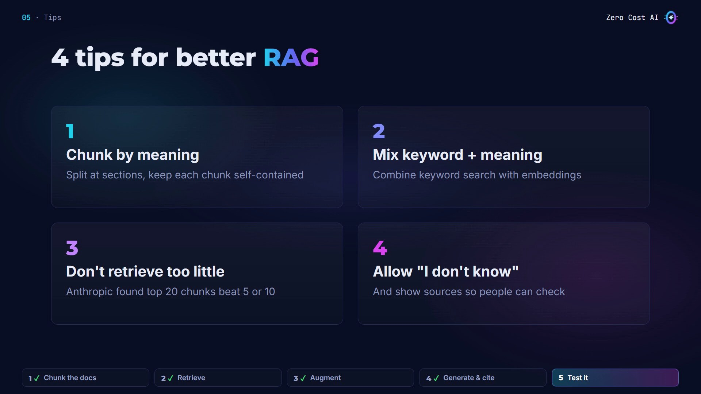

## Recap

- RAG means: **retrieve** the right chunks, **augment** the prompt with them, and let Claude **generate** the answer.
- If your documents are small (under ~200,000 tokens), you may not need it: put them all in the prompt.
- Send your chunks as `search_result` blocks with citations on, so every answer shows its source.

## Get the files

The help desk code, the policy documents, an offline test you can run **without an API key**, and a RAG cheat sheet are free on GitHub:

👉 **Files:** https://github.com/NEDBS12/youtube-tuto/tree/main/claude-rag

🎥 **Watch the video tutorial:** {VIDEO_URL}

**Official docs:**

- Search results: https://platform.claude.com/docs/en/build-with-claude/search-results
- Citations: https://platform.claude.com/docs/en/build-with-claude/citations
- Embeddings: https://platform.claude.com/docs/en/build-with-claude/embeddings
- Introducing Contextual Retrieval (Anthropic): https://www.anthropic.com/news/contextual-retrieval

*Screenshots are from the Zero Cost AI video. The code was tested offline with the anthropic SDK 1.15.0 (real retrieval, simulated API); the terminal runs on screen are recreations, and Claude's wording will differ for you.*

---

*I'm Zero Cost AI: I build free AI tools and write beginner-friendly guides. Follow me here on Medium and subscribe on YouTube for more.*
