Do you have a sentence you've been saying for years? For a lot of people, it's this one: *"One day, I'll start my YouTube channel."*

This article tells the story of someone who said it for three years, and shows how Claude can take the heavy lifting off your plate while you keep the fun part. No hype, no magic button: just a teammate for the boring parts, and five clear steps.

🎥 **Prefer video?** Watch the full story here:

{VIDEO}

---

## Meet Lina

Lina is a nurse. She loves technology, and for three years she's been saying the same sentence: *one day, I'll start my YouTube channel.*

She isn't short on ideas. She has a whole notebook of them: tech tips for nurses, AI explained simply, apps that save time, her first coding project… and forty more.

*(Lina is an illustrative character. Her story is the story of a lot of people who keep saying "one day". Maybe it's yours too.)*

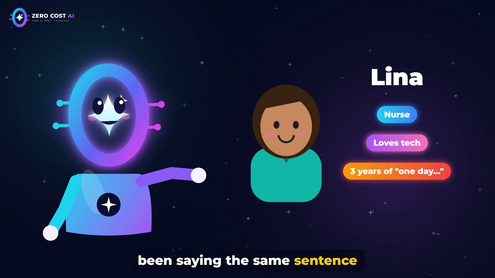

## The mountain

Every time Lina sat down to start, the list of jobs looked like a mountain:

- find a topic and write a script
- check the facts
- build an example
- record the voice and edit the video
- write the title and the description
- upload, and share it

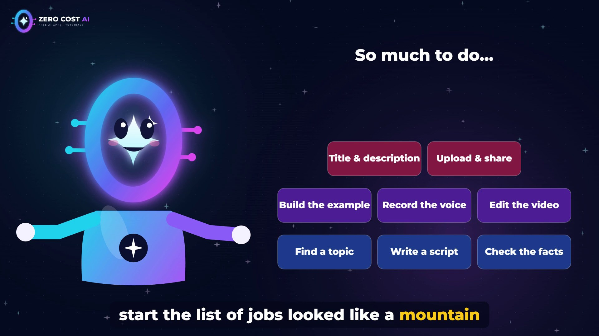

And after a twelve-hour shift, there was simply no time left. So the notebook stayed closed. 2024. 2025. 2026. Lots of ideas, zero videos.

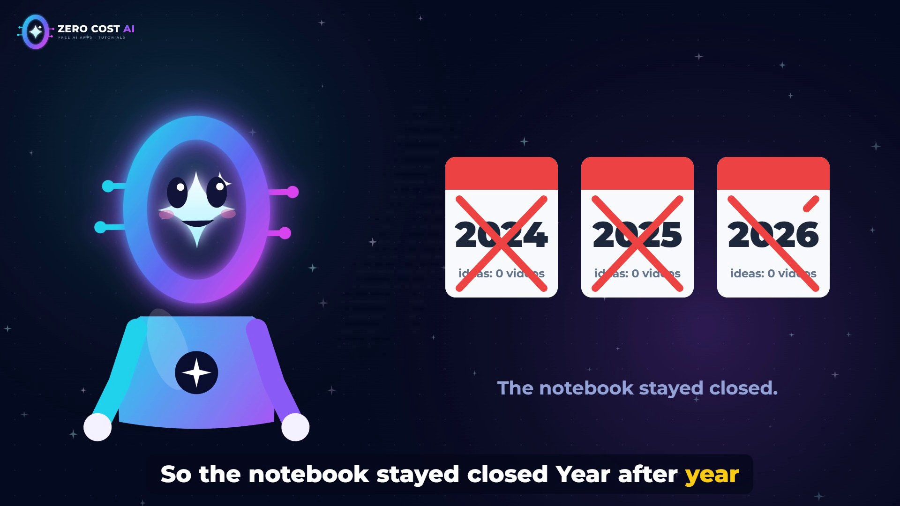

If that sounds familiar, the problem was never your ideas. It was the mountain.

## The turning point: a teammate, not a magic button

Then a friend showed Lina **Claude**, and more precisely **Claude Code**, which can read files, write code, run commands and follow step-by-step instructions on your computer.

The important idea isn't that Claude does everything. It's how the work gets split:

- **Lina keeps the fun part:** picking the ideas, reviewing everything, and saying the final yes.
- **Claude does the heavy lifting:** research and script, code and video, and the YouTube page, links and sharing.

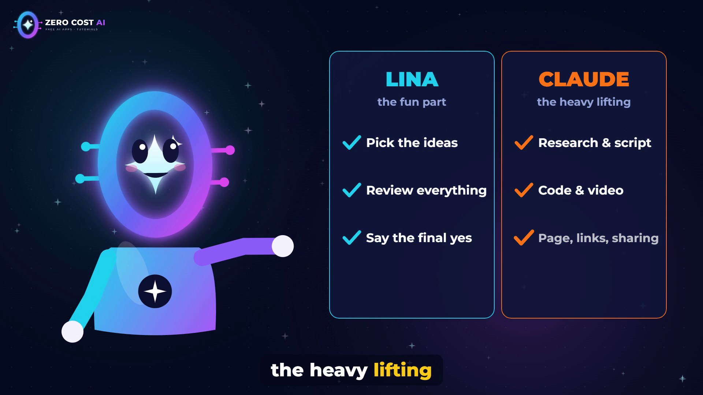

Here's what that looks like, in five steps.

## Step 1: The idea

Lina types one sentence, for example: *"Create a video explaining prompt caching."*

Before writing anything, Claude reads the **official documentation**, so the facts are checked against the source. Then it writes a friendly script: short sentences, one idea per line, every new word explained.

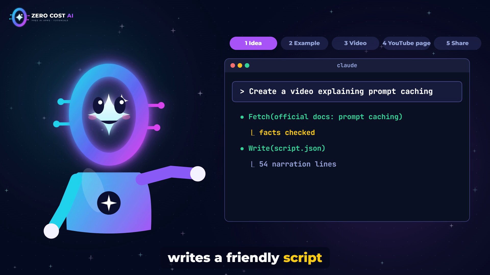

Why this matters: a script that sounds good but gets the facts wrong will cost you trust. Checking the docs first is the habit that keeps a channel credible.

## Step 2: A real example

Tutorials are better with something real to show. So Claude builds the code that appears in the video, and **tests it**, so viewers can copy it and it actually works.

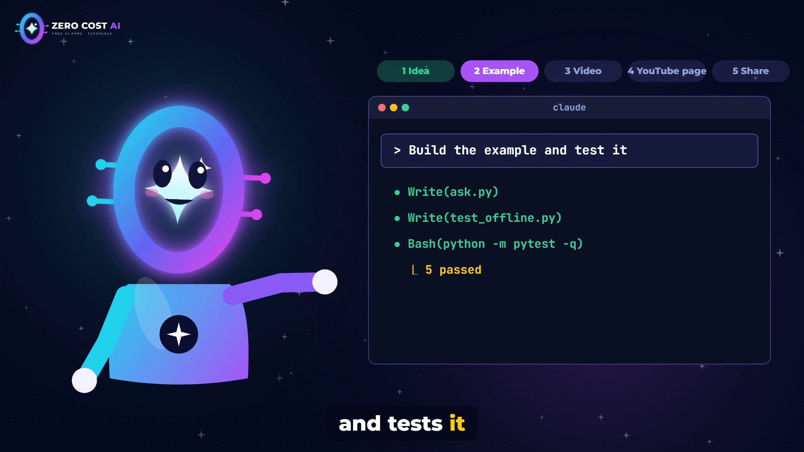

## Step 3: The video

Next comes the video itself: a natural narration voice, branded slides, the code typed on screen step by step, and even original background music that gets quieter while the narrator speaks. Subtitles and chapters come out of the same build.

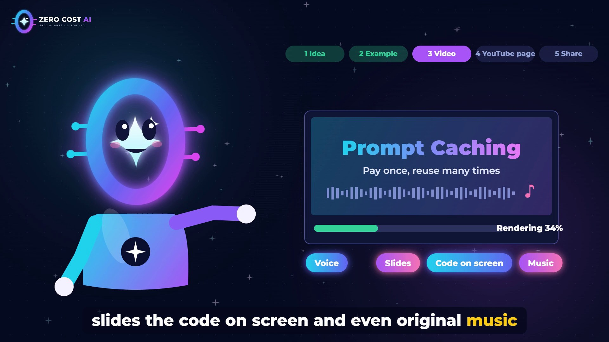

Rendering takes a while, and that's the nice part: **it runs on its own.** Lina goes to work. Or to sleep.

## Step 4: The YouTube page

A video needs a good page to be found. Claude prepares:

- a clear **title** (with two alternatives)
- a **description** with a hook in the first two lines
- **chapters** with real timestamps
- **short links** to the files
- and **tags**

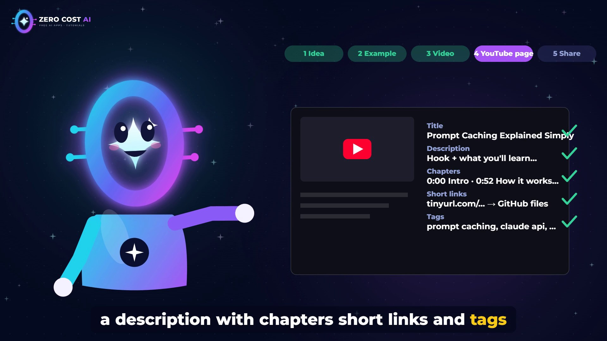

## Step 5: Sharing

Finally, the example files go to **GitHub**, so viewers can download them, and the video becomes a **Medium article** with screenshots, saved as a draft. (Yes, like this one.)

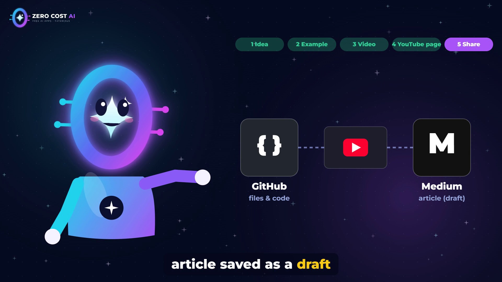

## The most important step: your yes

Then comes the step that matters most. **Lina watches the video and decides.** Nothing goes public without her yes.

She also logs in to YouTube and Medium **herself**, in her own browser window. Claude never needs her password.

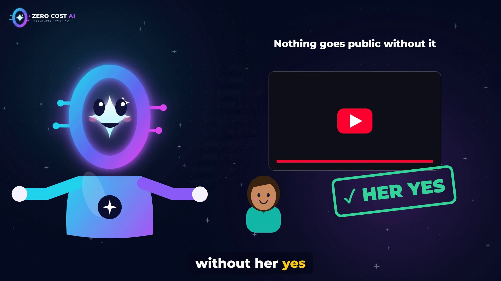

This is what makes the whole thing work. Claude is fast, but it's not the editor. You are.

## A few months later

A few months later, Lina's channel is real. Not perfect. But real. And her notebook is finally open.

Her secret isn't more time. It's spending her time on the part only she can do: choosing what's worth making, and deciding when it's good enough.

## Full honesty: this channel works this way

That's exactly how the Zero Cost AI channel works, including the video for this story. The tutorials, the example code, the descriptions and these Medium drafts are made with Claude Code, using a few reusable instructions ("skills") I wrote for each step: one to make a tutorial video, one to prepare the YouTube page, and one to turn a video into an article.

**Claude does the heavy lifting. I choose, I check, and I say yes.**

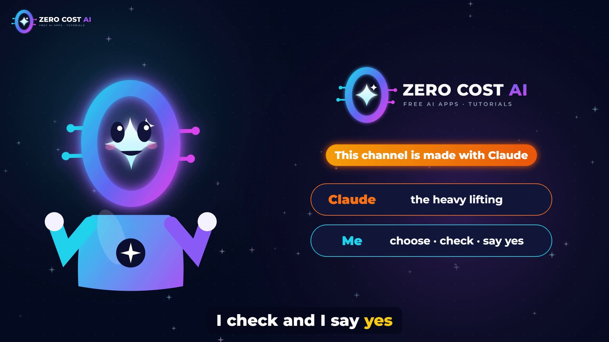

## 4 friendly tips to start

1. **Start small.** One video, about one topic you love. You don't need a full plan to begin.
2. **Always review.** Claude is fast, but you're the editor. Watch every video before it goes out.
3. **Be honest.** Check the facts, and tell your viewers that AI helps you. People trust creators who are open about their process.
4. **Keep your passwords to yourself.** You log in; Claude does the rest.

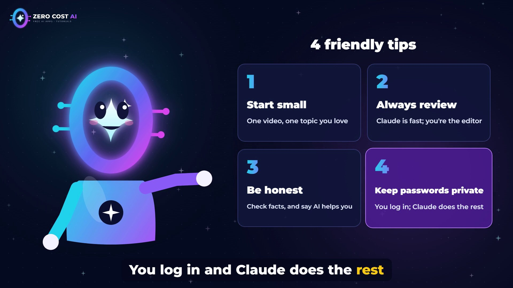

## Recap

- The hard part of starting a channel usually isn't the ideas. It's the **mountain of jobs** around them.
- With Claude, you keep the fun part (**ideas, review, the final yes**) and hand over the heavy lifting (**research, script, code, video, page, sharing**).
- Five steps: **idea → example → video → YouTube page → share**, and nothing goes public without your yes.

Your notebook of ideas deserves to be opened. Maybe today is the day.

## See each step in detail

Every step in this story has its own tutorial on the channel, and the code from each one is free on GitHub:

👉 **Files from every tutorial:** https://github.com/NEDBS12/youtube-tuto

🎥 **Watch the video:** {VIDEO_URL}

*The screens in the video are simplified animations of each step, not exact screenshots of the tools.*

---

*I'm Zero Cost AI: I build free AI tools and write beginner-friendly guides. Follow me here on Medium and subscribe on YouTube for more.*
