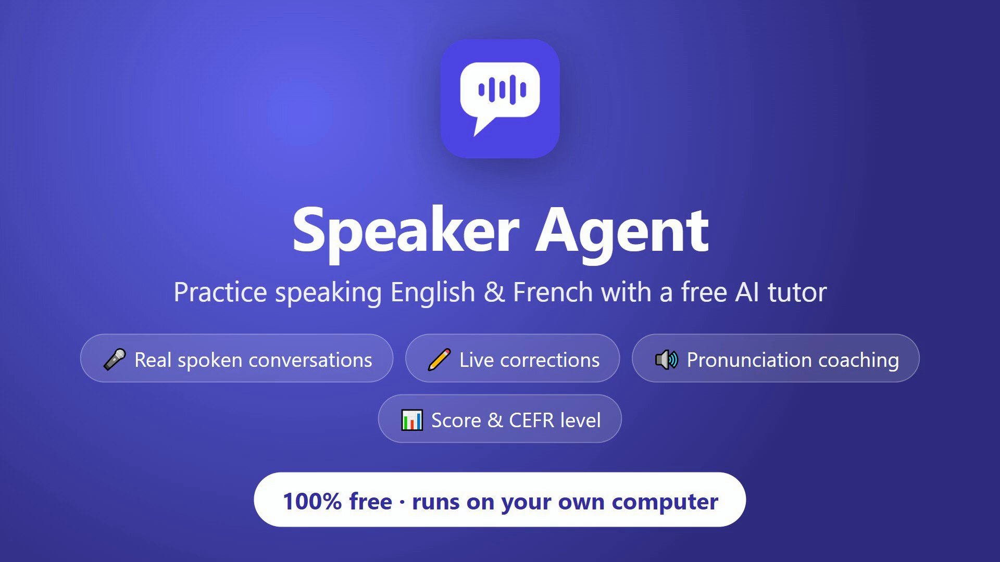
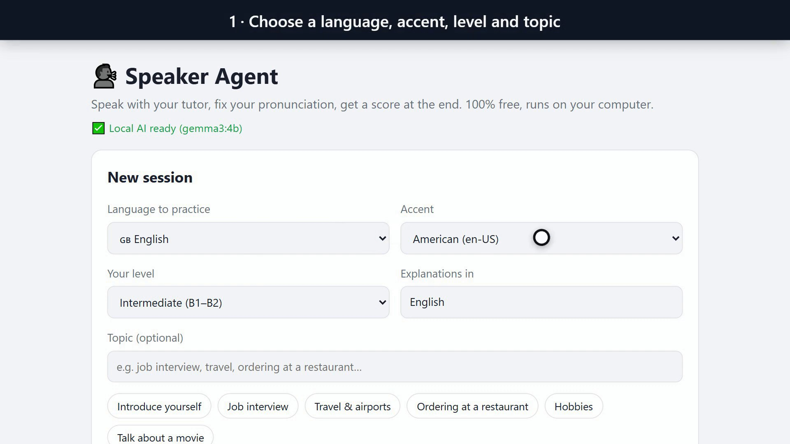
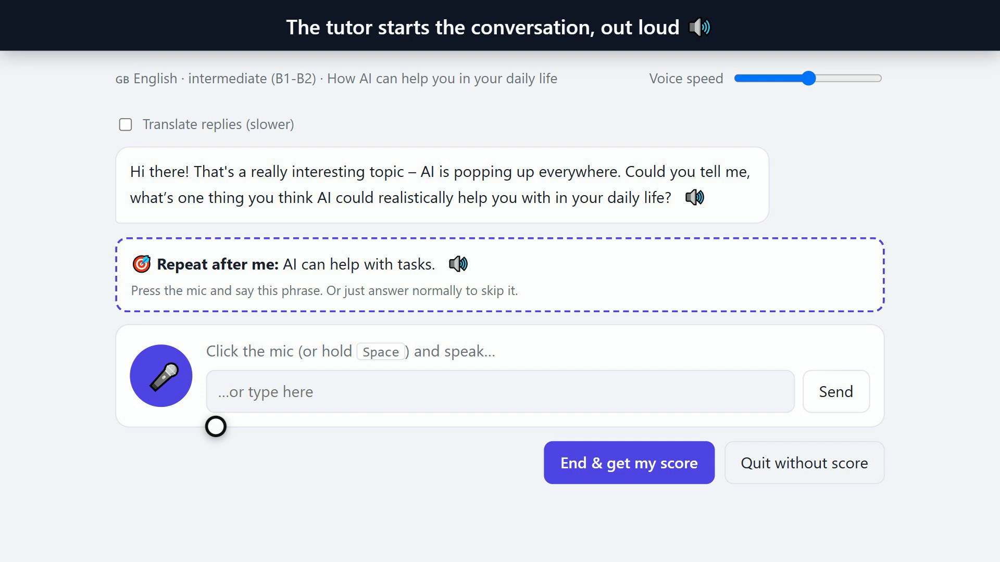
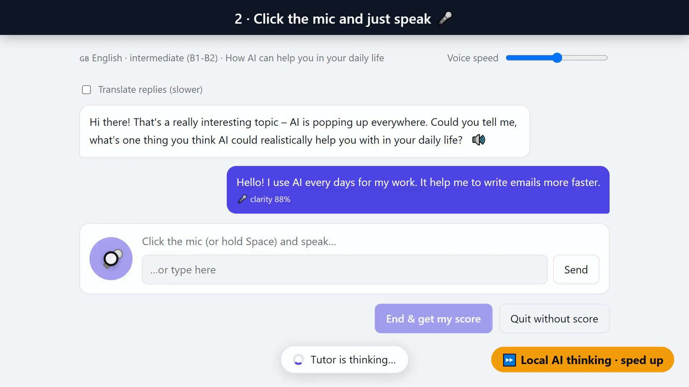
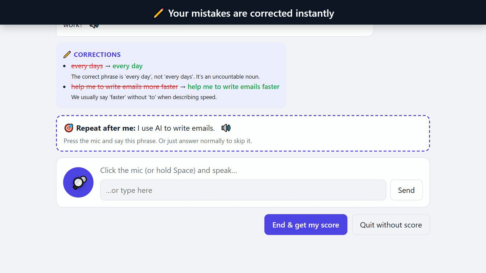
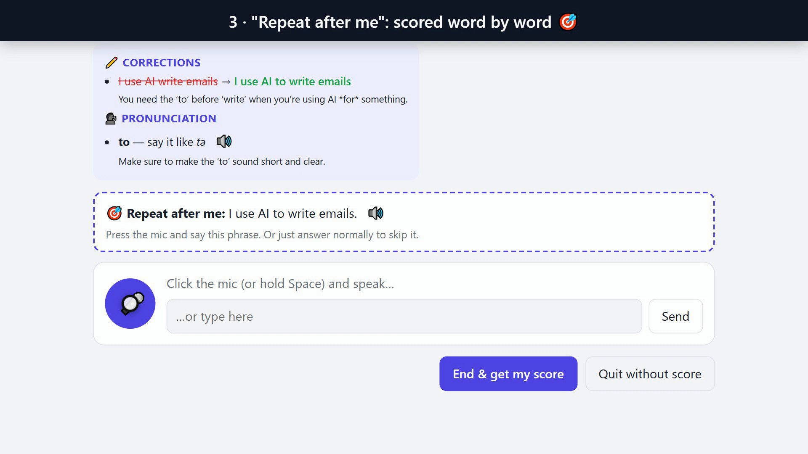
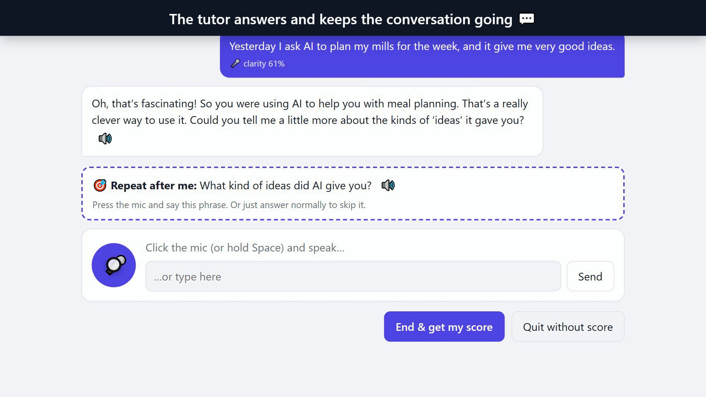
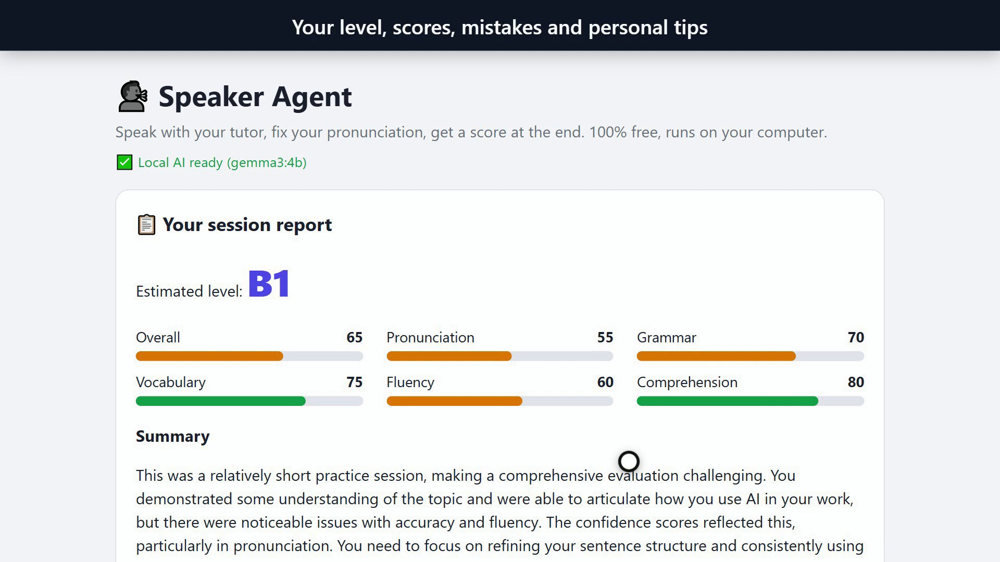
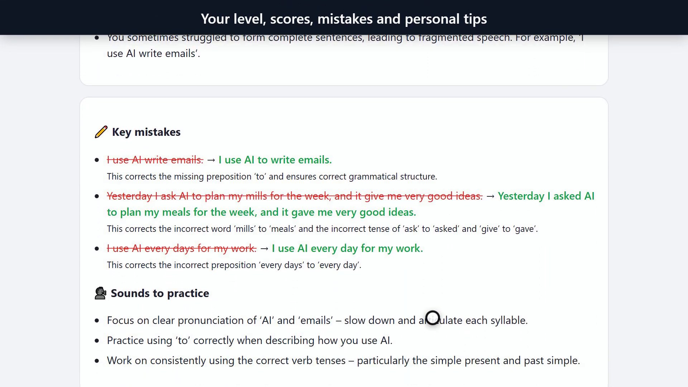
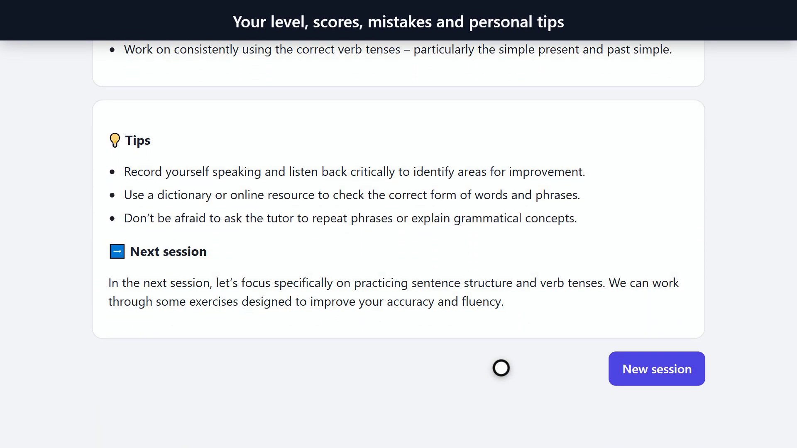

Speaking is the hardest part of learning a language. You can read and write for years, then freeze when you have to talk. Practicing with a real person isn't always possible, and most AI tutors need a paid subscription.

So I built **Speaker Agent**: a free AI tutor to practice speaking **English and French**. The AI model runs on your own computer.

🎥 **See it in action** (2 minutes):

{VIDEO}

---

## What Speaker Agent does

- 🎤 **You talk, it talks back.** A real spoken conversation on the topic you choose: job interview, travel, introducing yourself, or anything else.
- ✏️ **Live corrections.** After each answer you see what you said, a better way to say it, and why.
- 🔊 **Pronunciation coaching.** It spots words you probably mispronounced, shows how to say them, and lets you hear them.
- 🎯 **"Repeat after me" exercises.** You get a word-by-word score on phrases built around the sounds you struggle with.
- 📊 **A final report.** Your estimated level (A1 to C2), scores for pronunciation, grammar, vocabulary and fluency, your strengths, your key mistakes, and tips for next time.

## Why it's free

- **No subscription and no API key.**
- The AI model, **Google's Gemma 3 (4B)**, runs locally through **Ollama**, so your conversations with the model stay on your computer.
- Speech recognition and the voice are built into **Chrome and Edge**. (Chrome's speech recognition is free but needs an internet connection.)

## Step 1: Choose your session

Pick the language to practice, the accent, your level, the language for explanations, and a topic (or type your own). Then click **Start conversation**.

The tutor starts the conversation, out loud, and suggests a first "repeat after me" phrase.

## Step 2: Click the mic and just speak

Click 🎤 (or hold **Space**) and answer. In the demo, I say: *"Hello! I use AI every days for my work. It help me to write emails more faster."* The app shows what it heard, with a clarity score.

## Your mistakes are corrected instantly

Under the reply, the tutor shows each mistake, a better way to say it, and why:

- "every days" → **"every day"**: it's an uncountable noun.
- "help me to write emails more faster" → **"help me to write emails faster"**.

## Step 3: "Repeat after me", scored word by word

You get a practice phrase built around your mistakes, like *"I use AI to write emails."* Say it, and you get a word-by-word match score, plus pronunciation tips for the words you struggled with, with a 🔊 button to hear them.

Then keep talking, just like a real conversation. The tutor answers and keeps the conversation going.

## Step 4: End the session and get your score

Click **End & get my score** for the report: your estimated level, scores for pronunciation, grammar, vocabulary, fluency and comprehension, and a summary.

It also lists your strengths, your **key mistakes** with corrections, and the **sounds to practice**:

And it ends with personal tips and a plan for your next session. Past scores are saved in your browser under "Your progress".

## How to try it

1. Install **Ollama** first (free): https://ollama.com
2. Download and run the app: https://github.com/NEDBS12/ai-speaker/blob/main/SpeakerAgent.exe
3. It downloads the model on first launch. Use **Chrome or Edge** for the speech features.

## What I learned building it

Small local models are good enough for conversation practice, but getting them fast and accurate on a modest GPU took real work. Tuning the context size and trimming what the model generates made replies much faster.

Be aware of the limits:

- On my PC (RTX 2050, 4 GB), the first reply takes about 7 seconds, normal replies about 20–30 seconds, and the final report about a minute.
- A 4B model is small: its corrections and scores are sometimes wrong, so double-check anything that looks surprising. You can switch to a bigger Ollama model for better corrections, at the cost of speed.
- The pronunciation feedback is based on what the browser heard and its confidence, not on phoneme-level audio analysis.

## Recap

- Speaker Agent is a free tutor to practice **speaking** English and French: you talk, it talks back.
- It corrects you live, coaches your pronunciation, and gives you a CEFR level and tips at the end.
- No subscription, no API key: the AI runs locally with Ollama.

🎥 **Watch the demo:** {VIDEO_URL}

📥 **Download:** https://github.com/NEDBS12/ai-speaker

---

*I'm Zero Cost AI: I build free AI tools and write beginner-friendly guides. Follow me here on Medium and subscribe on YouTube for more.*
