Have you ever wondered how sharp your mind really is? Not on a quick online quiz full of ads, but in a focused, timed test that covers the different ways you reason.

**Adult IQ Test** is a free Windows app that challenges your reasoning in just 25 minutes. The moment you finish, it shows your estimated IQ, where you stand against everyone else, and where your strengths are.

In this article I'll walk you through what it tests, let you try a real question, show you every screen, and explain how to get it running in a few seconds.

🎥 **Prefer video?** Watch the full presentation here:

{VIDEO}

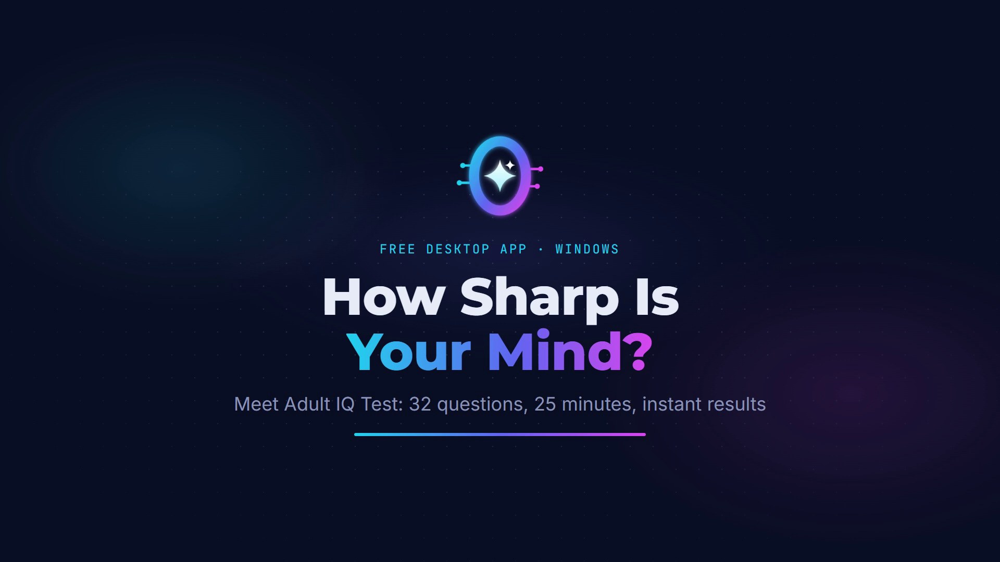

## What does the test measure?

The test has **32 questions**, covering four ways of thinking:

- **Numerical**: number sequences and sneaky math traps
- **Verbal**: analogies, vocabulary and odd-one-out
- **Logical**: deduction and lateral thinking, where you follow the clues to the only possible answer
- **Pattern & Spatial**: letter patterns, cubes and mirrors, where you turn shapes around in your head

Each question has a difficulty from 1 to 3, and harder questions are worth more points. So a careful answer on a hard question counts for more than a quick one on an easy question.

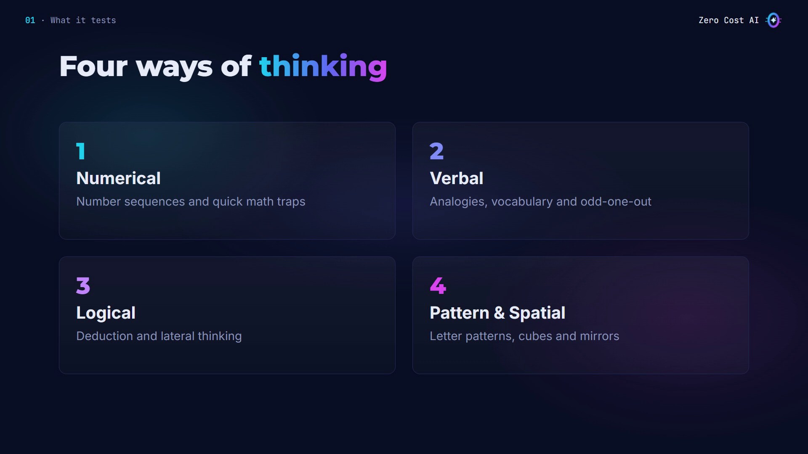

## Try one now

Here's a real question from the test. Take a moment before you read the answer.

> A bat and a ball cost **$1.10** in total. The bat costs **$1.00 more** than the ball. How much does the ball cost?

Most people say 10 cents. But then the bat would cost $1.10, and the total would be $1.20.

The right answer is **5 cents**:

```
Ball = x, bat = x + $1.00
2x + $1.00 = $1.10
x = $0.05
```

That's the kind of trap the test is full of: questions where the first answer that pops into your head isn't the right one.

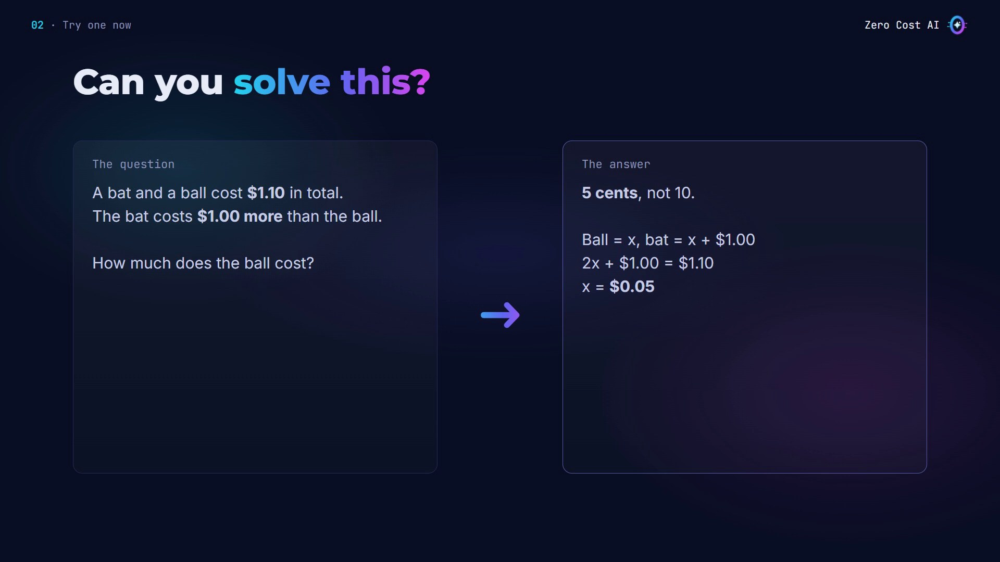

## Taking the test

### A clean, calm start

When you open the app, you're welcomed by a clean start screen. It tells you what to expect: 32 questions, 25 minutes, and harder questions worth more points.

Just type your name (it's optional, it only appears on your results), press **Start**, and the clock begins.

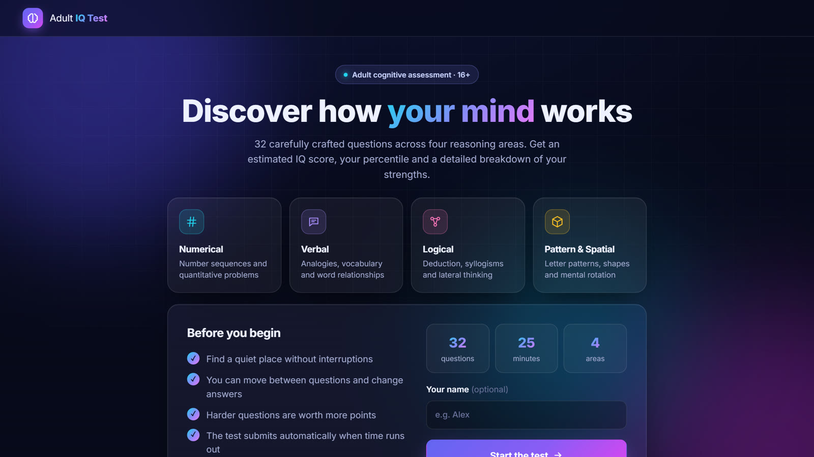

### One question at a time

Each question has its own card, so you can focus on one thing at a time. A few details make it easy to pace yourself:

- **Live timer**: it stays in the corner and turns red in the final minute.
- **Difficulty bars**: show how hard the current question is, from 1 to 3.
- **Question map**: if you get stuck, skip ahead and come back to any question whenever you like. You can change your answers until you submit.

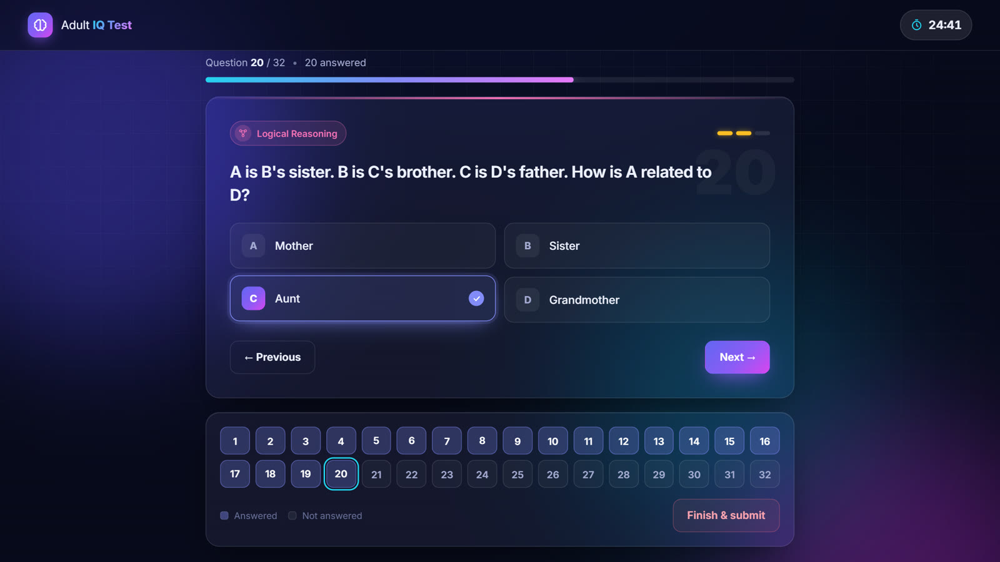

### From numbers to 3D thinking

The questions get more interesting as you go, all the way to spatial puzzles like this painted cube: a cube painted red on all sides is cut into 27 smaller cubes. How many have exactly two red faces?

Take your time on these. They're the ones that turn a good score into a great one.

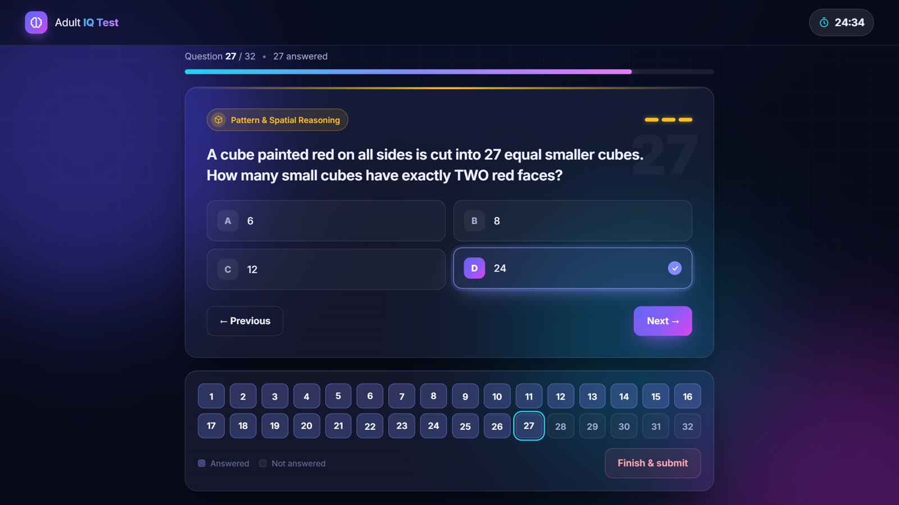

## Your results

### Your estimated IQ

Your results appear instantly. You get:

- Your **estimated IQ** on a gauge from 55 to 145
- Your **percentile**, so you know how you compare with everyone else
- A **classification**, how many questions you got right, and how long you took

Behind the score: each correct answer earns 1 to 3 points depending on its difficulty, your points become a share of the maximum, and that share is placed on a bell curve where 100 is average.

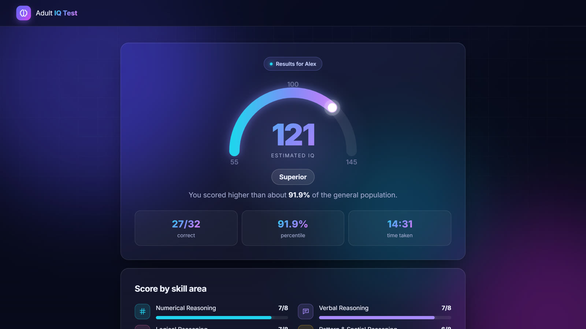

### Your strengths at a glance

Scroll down, and your score is broken down by skill area, with one bar each for numerical, verbal, logical and pattern/spatial reasoning. You can see exactly where you shine, and where there's room to grow.

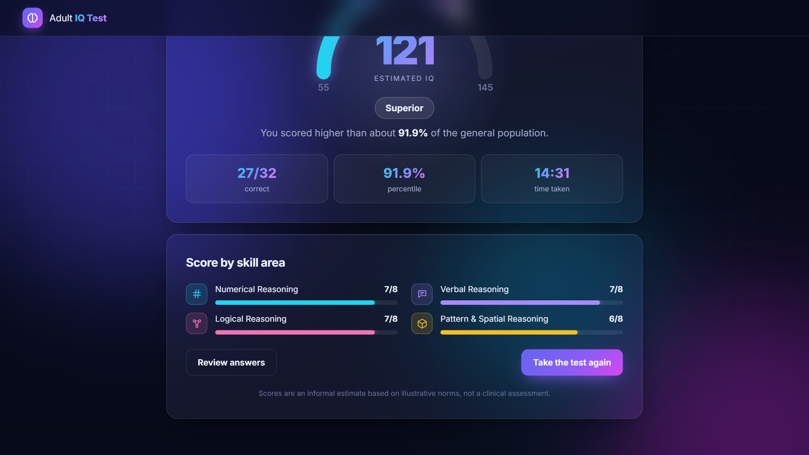

### Learn from every mistake

This is what makes the app special: the **answer review**. For every question, you see your answer, the correct one, and a short explanation of why.

So it's not just a score. It's practice that makes you sharper every time you take it.

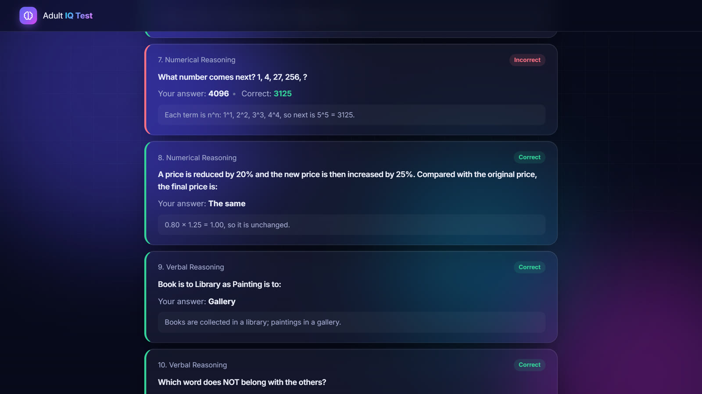

## Get started in seconds

The app runs on Windows. There's nothing to install and you don't need Java: the folder includes everything it needs.

1. **Download** the zip: [IQTest-1.0.0-windows.zip](https://github.com/NEDBS12/youtube-tuto/raw/main/iq-test-promo/download/IQTest-1.0.0-windows.zip) (about 75 MB).
2. **Unzip** the IQTest folder anywhere on your PC.
3. **Open** the folder and double-click `IQTest.exe`.
4. **Play**: a small window opens, and the test appears right in your browser. Close the window (or click Exit) to stop the app.

⚠️ Keep the files together: `IQTest.exe` won't start if you move it out of its folder. Windows may also show "Windows protected your PC" because the app isn't signed. Click **More info**, then **Run anyway**.

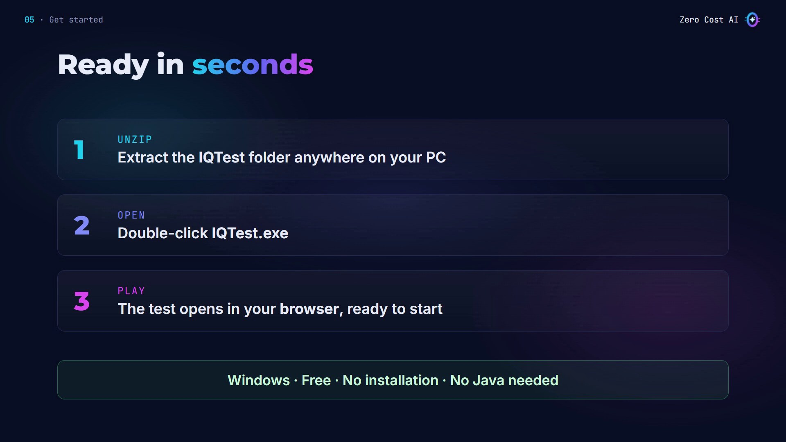

## Tips for your best score

- **Find a quiet spot**: give yourself 25 minutes without interruptions.
- **Don't rush**: the hardest questions are worth three times as much.
- **Skip and return**: if a question stops you, skip it and come back with the question map.
- **Read the review**: the explanations are where the real progress happens.

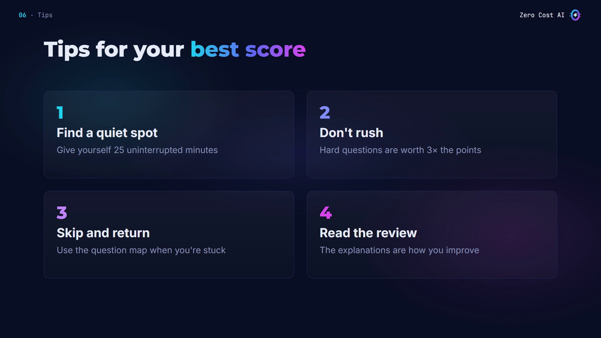

## Recap

- **32 questions** across four reasoning areas
- An instant **IQ estimate**, with your percentile and a breakdown by skill
- An **answer review** that helps you get better every time
- A free Windows app: unzip, double-click, play

Just remember: it's a fun estimate for self-assessment, not a clinical IQ test.

## Get the app

- **Download for Windows**: [IQTest-1.0.0-windows.zip](https://github.com/NEDBS12/youtube-tuto/raw/main/iq-test-promo/download/IQTest-1.0.0-windows.zip)
- **Setup steps and tips**: [the app's GitHub folder](https://github.com/NEDBS12/youtube-tuto/tree/main/iq-test-promo)
- 🎥 **Watch the video:** {VIDEO_URL}

Now it's your turn. Take the test, and share your score in the comments!

*The results screenshots come from a sample run of the app.*

*I'm Zero Cost AI: I build free apps and AI tools and share them with beginner-friendly guides. Follow me here on Medium and subscribe on YouTube for more.*
