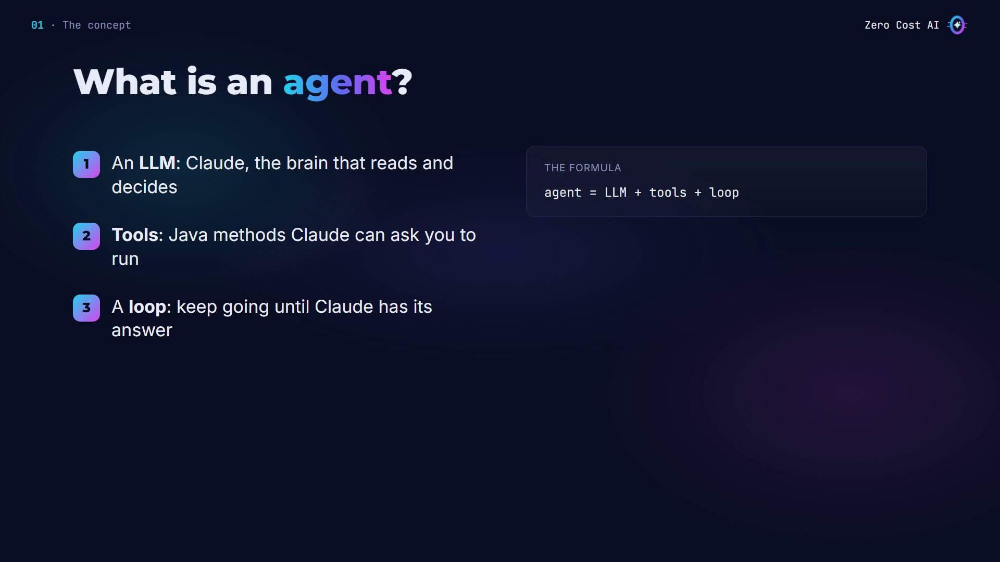
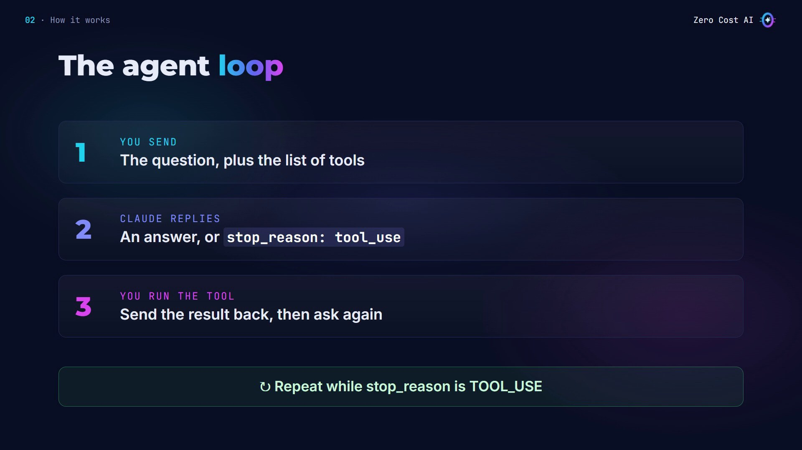
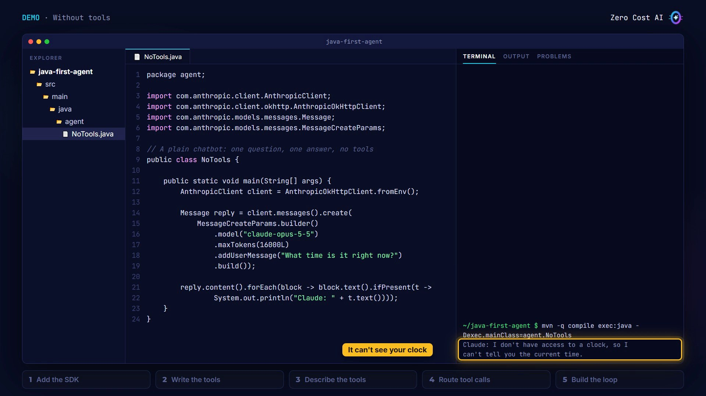
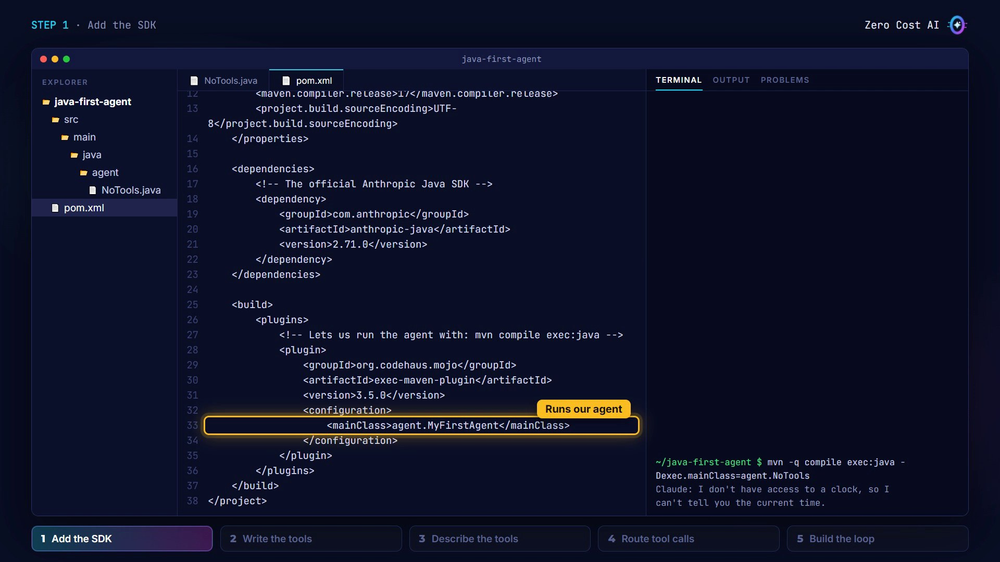
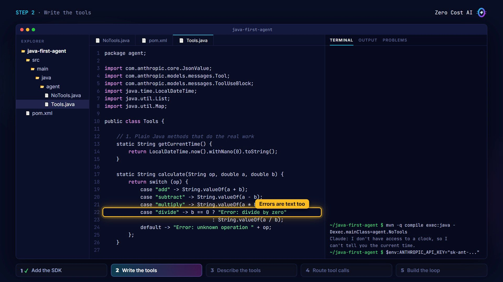
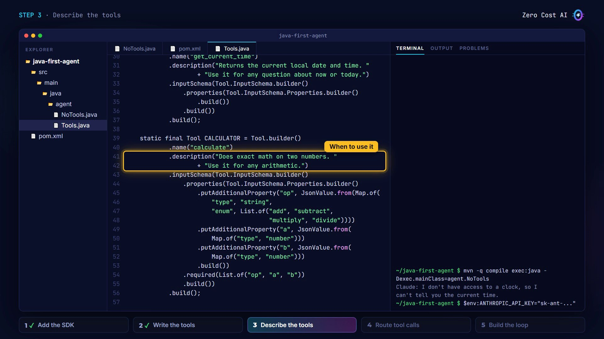
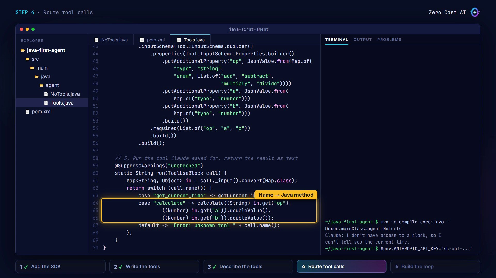
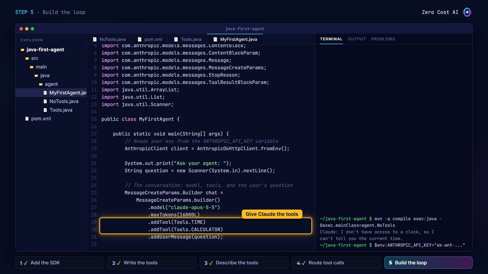
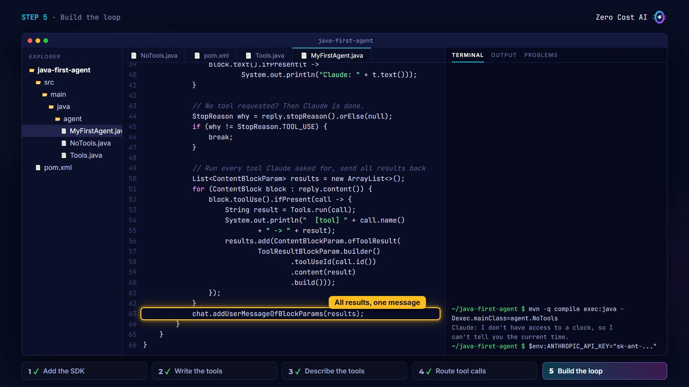
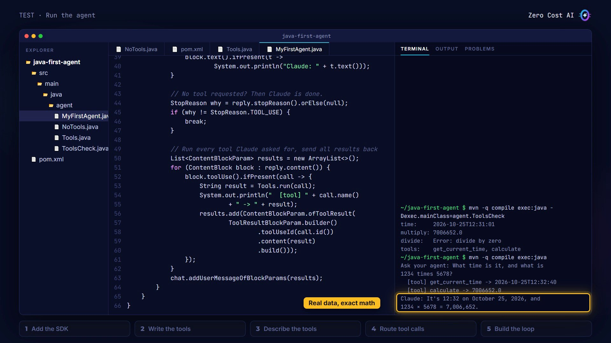

Everyone talks about AI agents. But if you're a Java developer, most tutorials you'll find are in Python.

In this article, you'll build your first agent in plain Java, with the official Anthropic Java SDK. There's no framework and no magic, just about a hundred lines of code you'll understand completely.

By the end, you'll have a small agent that reads your computer's clock and does exact math. More importantly, you'll understand the loop at the heart of every agent.

🎥 **Prefer video?** Watch the full tutorial here:

{VIDEO}

---

## What is an agent?

An **agent** is three things:

- **An LLM:** Claude, the brain that reads and decides.
- **Tools:** normal Java methods that Claude is allowed to ask for.
- **A loop:** your program keeps talking to Claude until the job is done.

Think of Claude as a smart manager with no hands. It decides what to do. Your code does it.



## How the agent loop works

Every agent repeats the same three moves:

1. **You send** Claude the question, plus a list of the tools it may use.
2. **Claude replies** with either an answer, or `stop_reason: tool_use`, which means "please run this tool for me".
3. **You run the tool** in Java, send the result back, and ask again.

You repeat while the stop reason is `TOOL_USE`. That's the whole agent.



### When to build an agent (and when not)

Build an agent when:

- Claude needs live data: the time, files, your database
- it must act: calculate, send, update
- the steps aren't known in advance

If Claude can answer from text alone, like a summary or a translation, one simple API call is enough. Start simple.

## Our use case: a time and math helper

The example is small on purpose. A plain chatbot can't see your computer's clock. And with big numbers, it's better to compute than to guess.

So our agent gets two tools: one reads the clock, and one does the math in Java. Claude decides when to use each.

Here's the "before": a plain chatbot with one question, one answer, and no tools.

```java
Message reply = client.messages().create(
    MessageCreateParams.builder()
        .model("claude-opus-5-5")
        .maxTokens(16000L)
        .addUserMessage("What time is it right now?")
        .build());
```

Claude answers that it can't see the current time. It's honest, but not helpful. Let's fix that with an agent.



## Step 1: Add the SDK

It's a normal Maven project. The only dependency is `anthropic-java`, the official SDK:

```xml
<dependency>
    <groupId>com.anthropic</groupId>
    <artifactId>anthropic-java</artifactId>
    <version>2.71.0</version>
</dependency>
```

The project also uses the `exec-maven-plugin`, so you can run the agent with one Maven command.

The SDK reads your API key from an environment variable called `ANTHROPIC_API_KEY`. Never put the key in your code.

```
$env:ANTHROPIC_API_KEY="sk-ant-..."      # Windows PowerShell
export ANTHROPIC_API_KEY="sk-ant-..."    # macOS / Linux
```



## Step 2: Write the tools

A tool is just a Java method. In a class called `Tools`, one method returns the current date and time, and the other does exact math on two numbers:

```java
    // 1. Plain Java methods that do the real work
    static String getCurrentTime() {
        return LocalDateTime.now().withNano(0).toString();
    }

    static String calculate(String op, double a, double b) {
        return switch (op) {
            case "add" -> String.valueOf(a + b);
            case "subtract" -> String.valueOf(a - b);
            case "multiply" -> String.valueOf(a * b);
            case "divide" -> b == 0 ? "Error: divide by zero"
                                    : String.valueOf(a / b);
            default -> "Error: unknown operation " + op;
        };
    }
```

Notice they return text. Claude reads the result as text, even errors like "divide by zero".

And remember: Claude never runs these methods itself. It can only ask. Your program runs them.



## Step 3: Describe the tools

Claude can't read your Java code, so each tool gets a **name**, a **description**, and an **input schema** (the inputs it takes). Here's the calculator:

```java
    static final Tool CALCULATOR = Tool.builder()
            .name("calculate")
            .description("Does exact math on two numbers. "
                    + "Use it for any arithmetic.")
            .inputSchema(Tool.InputSchema.builder()
                .properties(Tool.InputSchema.Properties.builder()
                    .putAdditionalProperty("op", JsonValue.from(Map.of(
                        "type", "string",
                        "enum", List.of("add", "subtract",
                                        "multiply", "divide"))))
                    .putAdditionalProperty("a", JsonValue.from(
                        Map.of("type", "number")))
                    .putAdditionalProperty("b", JsonValue.from(
                        Map.of("type", "number")))
                    .build())
                .required(List.of("op", "a", "b"))
                .build())
            .build();
```

The calculator takes an operation and two numbers, `a` and `b`. All three are required. The `TIME` tool is the same idea, with no inputs.

The description is the most important part. Claude reads it to decide **when** to use the tool, so say what it does, and when to use it.



## Step 4: Route tool calls

When Claude asks for a tool, your program has to run the right method. The `run` method takes Claude's tool call, reads its inputs, and picks the method by name:

```java
    // 3. Run the tool Claude asked for, return the result as text
    @SuppressWarnings("unchecked")
    static String run(ToolUseBlock call) {
        Map<String, Object> in = call._input().convert(Map.class);
        return switch (call.name()) {
            case "get_current_time" -> getCurrentTime();
            case "calculate" -> calculate((String) in.get("op"),
                    ((Number) in.get("a")).doubleValue(),
                    ((Number) in.get("b")).doubleValue());
            default -> "Error: unknown tool " + call.name();
        };
    }
```

Claude sends the inputs as JSON. We convert them to a map, then call `calculate` with the operation and the numbers. An unknown tool name returns an error message instead of crashing.



## Step 5: Build the loop

This is the heart of every agent. In `MyFirstAgent`, we create the client (it reads the API key), read the user's question, and build the conversation: the model, the two tools, and the question.

```java
        // The conversation: model, tools, and the user's question
        MessageCreateParams.Builder chat =
            MessageCreateParams.builder()
                .model("claude-opus-5-5")
                .maxTokens(16000L)
                .addTool(Tools.TIME)
                .addTool(Tools.CALCULATOR)
                .addUserMessage(question);
```



Now the loop itself:

```java
        // The agent loop
        while (true) {
            Message reply = client.messages().create(chat.build());
            chat.addMessage(reply); // no memory: keep the history

            for (ContentBlock block : reply.content()) {
                block.text().ifPresent(t ->
                        System.out.println("Claude: " + t.text()));
            }

            // No tool requested? Then Claude is done.
            StopReason why = reply.stopReason().orElse(null);
            if (why != StopReason.TOOL_USE) {
                break;
            }

            // Run every tool Claude asked for, send all results back
            List<ContentBlockParam> results = new ArrayList<>();
            for (ContentBlock block : reply.content()) {
                block.toolUse().ifPresent(call -> {
                    String result = Tools.run(call);
                    System.out.println("  [tool] " + call.name()
                            + " -> " + result);
                    results.add(ContentBlockParam.ofToolResult(
                            ToolResultBlockParam.builder()
                                    .toolUseId(call.id())
                                    .content(result)
                                    .build()));
                });
            }
            chat.addUserMessageOfBlockParams(results);
        }
```

Three details matter here:

- **Keep the history.** Claude has no memory between calls, so we save every reply with `chat.addMessage(reply)` and send the full history every time.
- **The exit.** If the stop reason isn't `TOOL_USE`, Claude is done, so we break out of the loop.
- **All results, one message.** We run every tool Claude asked for and send all the results back together, in one message. Each result carries the id of the call it answers (`toolUseId`).

Then the loop starts again, and Claude sees the results.



## Test it

First, an offline check of the tools, with no API key needed:

```
mvn -q compile exec:java -Dexec.mainClass=agent.ToolsCheck
```

Both tools work, and the errors come back as text. Now the real agent:

```
mvn -q compile exec:java
```

Ask it: *"What time is it, and what is 1234 times 5678?"*

Claude asks for both tools. Our Java code runs them and sends back the results. Then Claude uses the real time and the exact number in one clear answer. That's your first agent.



## 4 tips for your next agent

- **Describe tools well:** say what each tool does and when to use it. The descriptions decide when Claude uses each tool.
- **Return errors as text:** instead of throwing, return a message. Claude reads it and can try again.
- **Limit the loop:** in a real app, stop after a maximum number of turns, so it can never run forever.
- **Keep tools small:** one job per tool, with clear inputs.

## Recap

- An agent = **LLM + tools + a loop**.
- Tools are plain Java methods. Claude **asks**, your code **runs** them.
- The loop continues while `stop_reason` is `TOOL_USE`, sending the full history every time.

## Get the files

The full Java project (with the offline tool check and a step-by-step README) is free on GitHub: https://github.com/NEDBS12/youtube-tuto/tree/main/java-first-agent

Try adding your own tool, like a weather tool: write the method and its description in `Tools.java`, add a `case` in `run()`, and `.addTool(...)` it in `MyFirstAgent.java`.

🎥 **Watch the video tutorial:** {VIDEO_URL}

Learn more:

- Tool use with Claude (official docs): https://platform.claude.com/docs/en/agents-and-tools/tool-use/overview
- Anthropic Java SDK: https://github.com/anthropics/anthropic-sdk-java

*The editor and terminal screenshots come from the video and are simplified recreations; the run results are illustrative.*

*I'm Zero Cost AI: I build free AI apps and beginner-friendly tutorials. Follow me here on Medium and subscribe on YouTube for more.*
