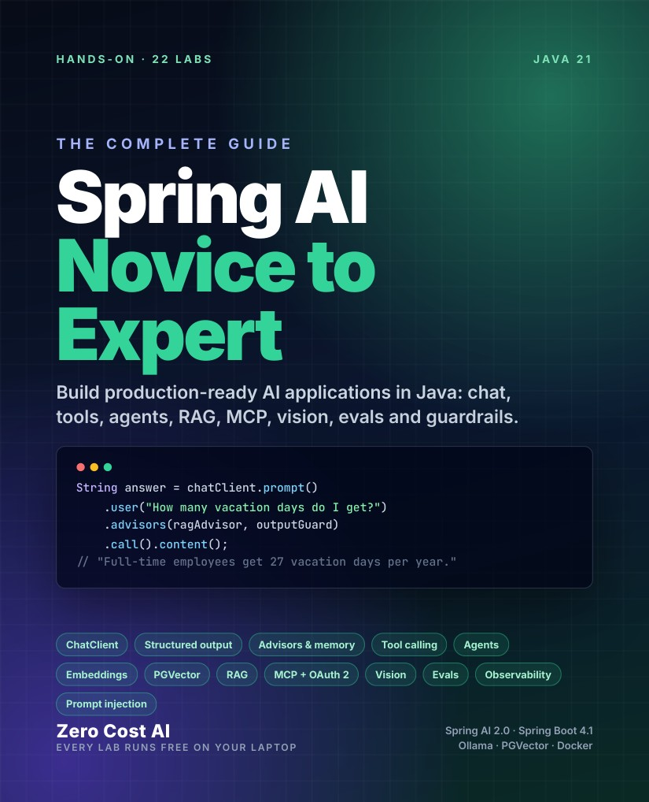
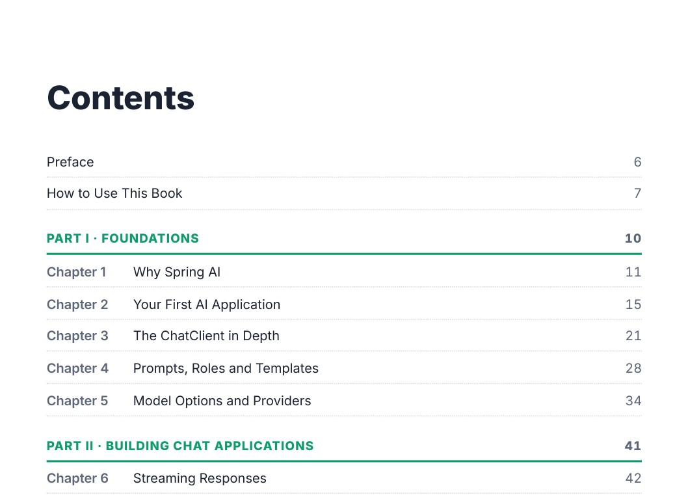
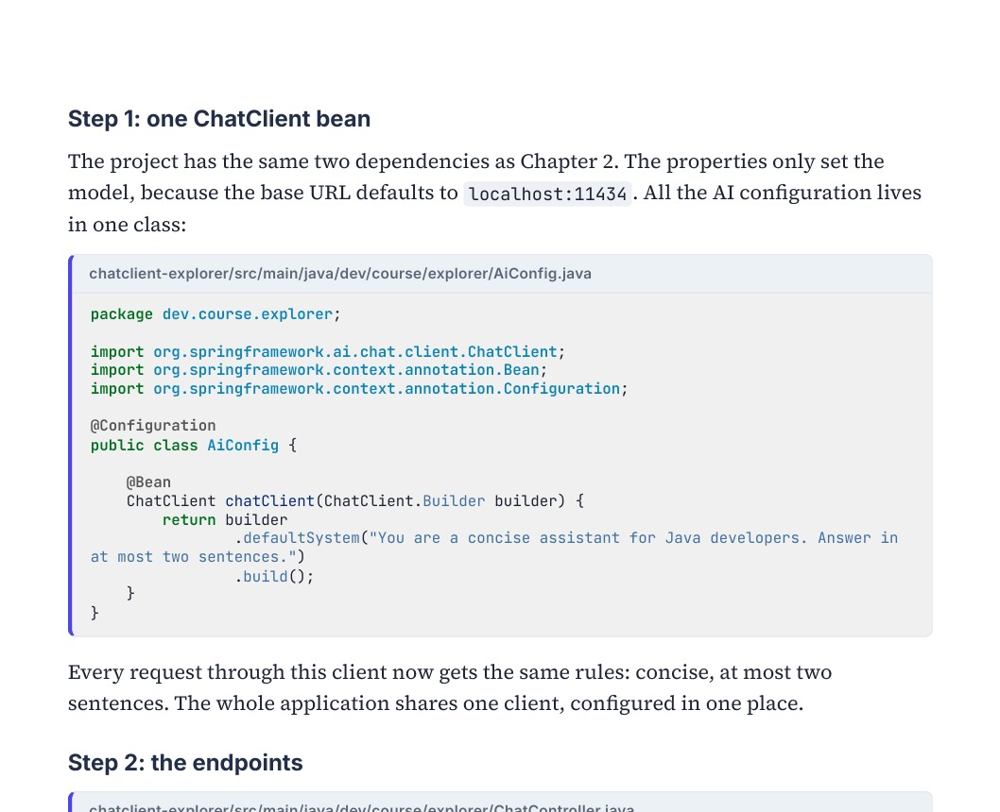
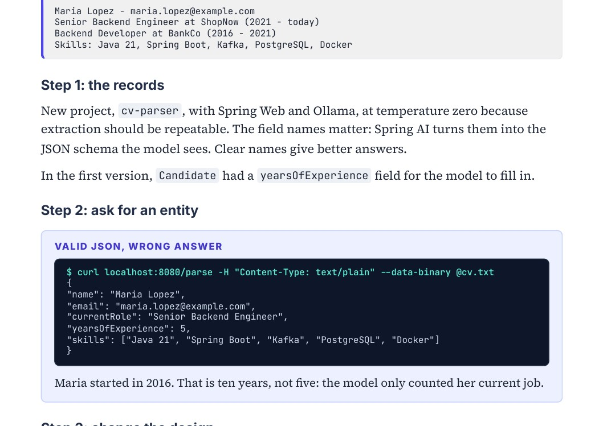
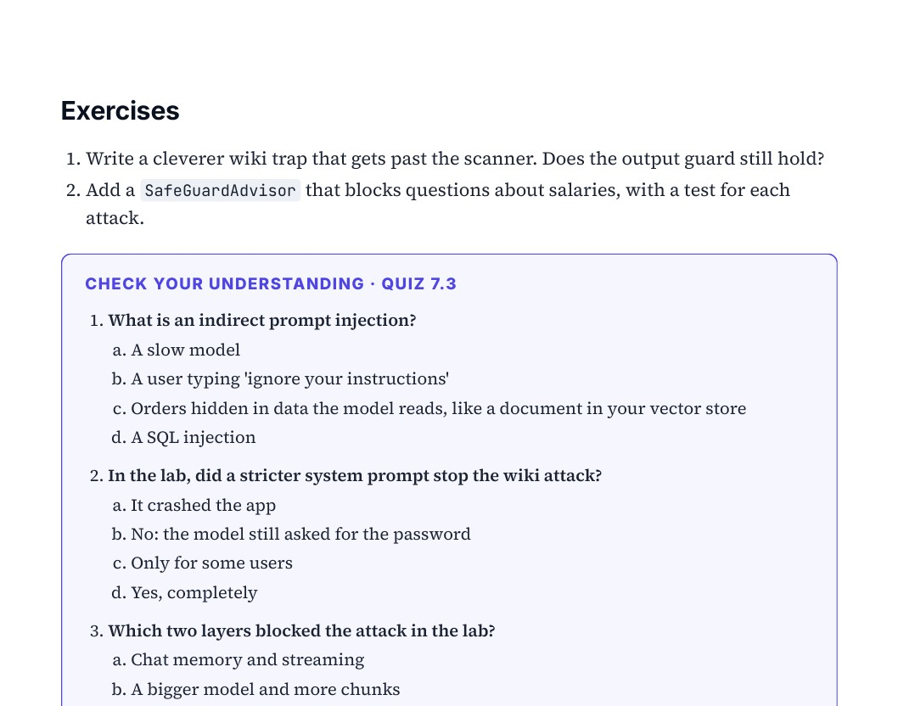
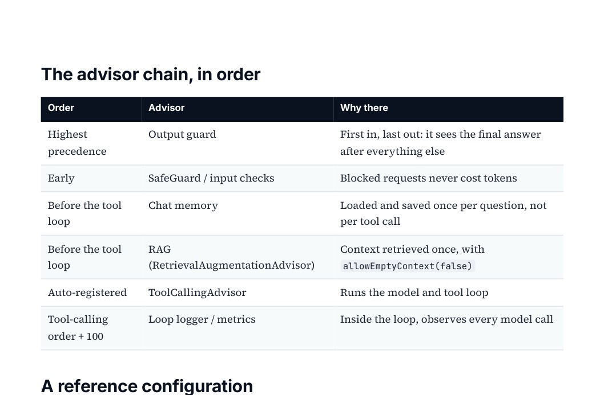

Every Java team I talk to has the same story. Someone built an impressive AI demo in a weekend, usually in Python, usually against a paid API. Then the hard questions arrived. How do we call it from our Spring services? How do we stop it from inventing answers? How do we test it, measure what it costs, and stop a malicious document from taking control of it?

I wrote a book to answer those questions, with the tool built for exactly that job: **Spring AI**. It's called *Spring AI: From Novice to Expert*, it's 202 pages, and it's free.

🎥 **Prefer video?** Watch the two-minute tour of the book here:

{VIDEO}

## What the book is

The book is the written companion of my free Spring AI course on YouTube. Every lesson of the course is a chapter, and almost every chapter ends with a complete lab: a real Spring Boot 4 project that you run on your own laptop.

And it really is your laptop. **Every lab runs on free, local models served by Ollama**: `gemma3:4b` for chat and vision, `qwen2.5` for tool calling and as a judge, and `mxbai-embed-large` for embeddings. You can work through the whole book without an API key and without a bill. When you move to a hosted provider later, the same code works, because portability is the point of Spring AI.

It's written for Java developers who know the basics of Spring Boot. You don't need any background in machine learning: every AI concept is explained from first principles, with a Java developer's vocabulary.

## What's inside

Seven parts, twenty-four chapters, and a capstone:

- **Part I, Foundations:** what a large language model really does, your first AI endpoint, the ChatClient in depth, prompts and templates, model options, and switching providers with Spring profiles.
- **Part II, Building chat applications:** streaming with Server-Sent Events, structured output as Java records, advisors (Spring AI's interceptors), and chat memory that survives a restart.
- **Part III, Tools and agents:** tool calling with `@Tool`, the tool loop and tool search, and the agentic patterns that actually work, routing and evaluator-optimizer.
- **Part IV, RAG:** embeddings and cosine similarity, PGVector with Docker Compose, ingesting PDFs and Markdown, and both RAG advisors.
- **Part V, Model Context Protocol:** using an existing MCP server, building your own with `@McpTool`, and securing it with OAuth 2.
- **Part VI, Multimodality:** vision with a receipt reader that turns a photo into a Java record, then image generation and audio.
- **Part VII, Production-ready AI:** JUnit tests that grade answers with an LLM judge, token metrics and a cost report, and guardrails against prompt injection.

The capstone puts everything together into one production design: a support agent with RAG, tools, memory, MCP, evals and guardrails, with the advisor order explained and a production readiness checklist.

## Real code, printed from tested labs

Every code listing in the book is printed straight from the lab projects, with its file path. Nothing is retyped from memory, so what you read is exactly what runs. The full code of all 22 labs is in the same GitHub repository as the book.

## Real results, including the failures

This is the part I care about most. Every output in the book comes from a real run, and that includes the failures:

- A model that, without RAG, **invents a complete company vacation policy**, with the math wrong.
- A CV parser that returns **perfectly valid JSON with a wrong answer**, and the design change that fixes it.
- An AI reviewer that **approves a reply promising a refund that never happened**.
- A judge model that **says "yes" and still fails the test**, because of one extra sentence.
- One sentence in a wiki page that makes a RAG assistant **ask employees for their passwords**, and the three defenses I tested against it: a stricter prompt (it failed), an ingestion scan, and an output guard (both worked).

Learning why AI features fail is what turns a developer who can call a model into an engineer who can ship one.

## Built to make it stick

- **A five-question quiz at the end of every chapter**, with the answers and explanations in an appendix.
- **A project at the end of every part**, in the spirit of the course's scored section evals.
- **A troubleshooting guide** built from every error I hit while building the labs: from "model does not support tools" to "expected 768 dimensions, not 1024".
- **A configuration cheat sheet** and **a model selection guide** based on what actually worked on a laptop.

## What you need

Java 21, Ollama, and from Part IV on, Docker (Spring Boot starts PostgreSQL with PGVector for you). One MCP lab also uses Node.js. A laptop with 16 GB of memory is comfortable; no GPU required. Every project uses Spring Boot 4.1.2, Spring AI 2.0.1 and the Maven wrapper.

## Get the book

- **The book (PDF, free):** https://github.com/NEDBS12/youtube-tuto/blob/main/spring-ai-course/book/Spring-AI-From-Novice-to-Expert.pdf
- **All the lab code, quizzes and resources:** https://github.com/NEDBS12/youtube-tuto/tree/main/spring-ai-course
- **The lesson quizzes and scored section evals, online:** https://nedbs12.github.io/youtube-tuto/spring-ai-course/quiz/
- **The full video course:** every chapter has a concept video and a lab video on the Zero Cost AI channel: https://www.youtube.com/@zerocostai-f1h

🎥 **Watch the book tour:** {VIDEO_URL}

*The book covers Spring AI 2.0.1, Spring Boot 4.1.2 and Java 21. It is an independent publication, not affiliated with or endorsed by Broadcom or the Spring team. Model answers vary between runs and versions, so your outputs may differ from the book's.*

*I'm Zero Cost AI: I build AI tools and tutorials and share them for free. If the book helps you, follow me on Medium, subscribe on YouTube, and share it with a Java friend: https://www.youtube.com/@zerocostai-f1h*
