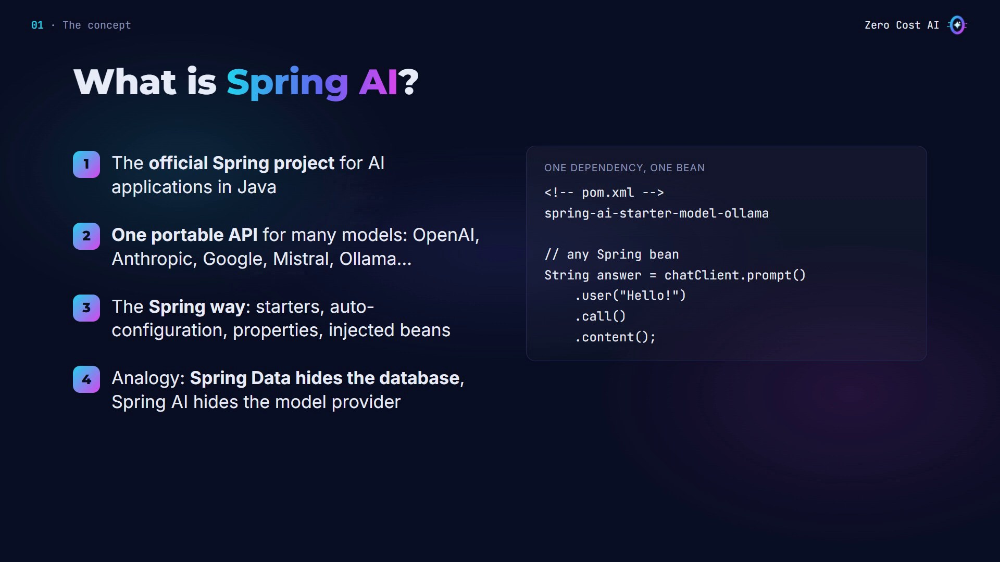
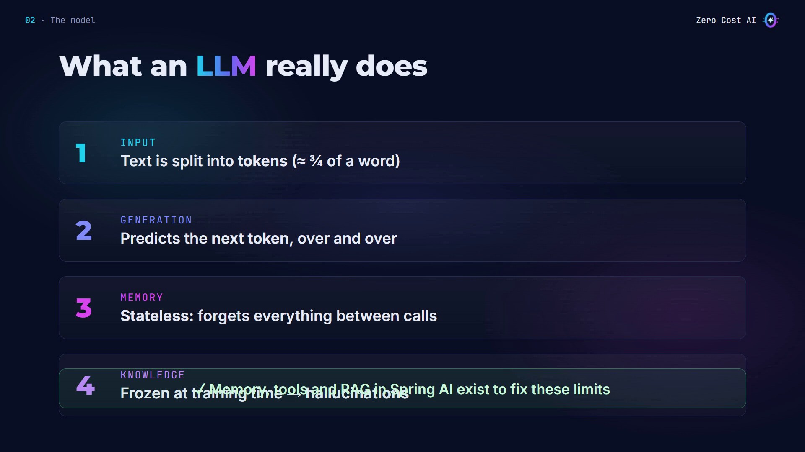
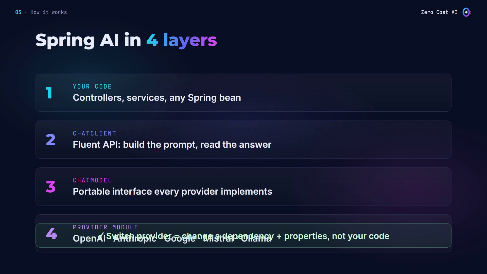
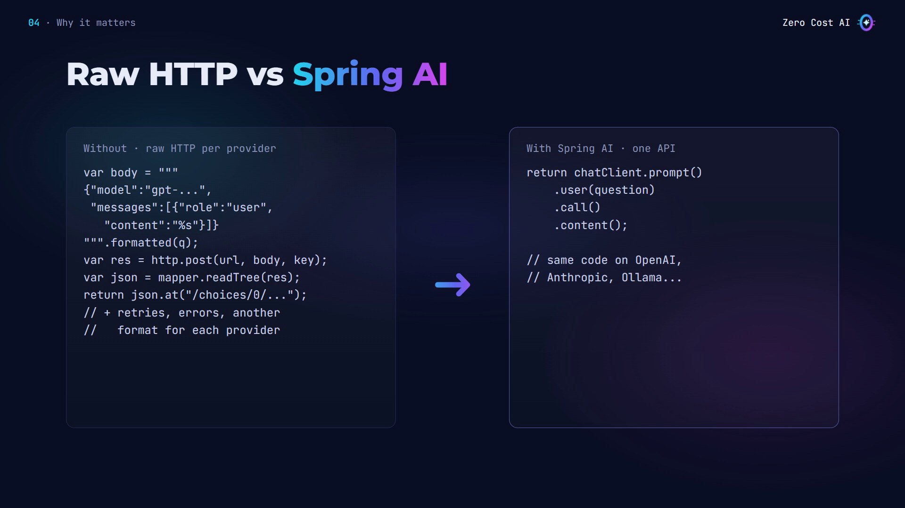
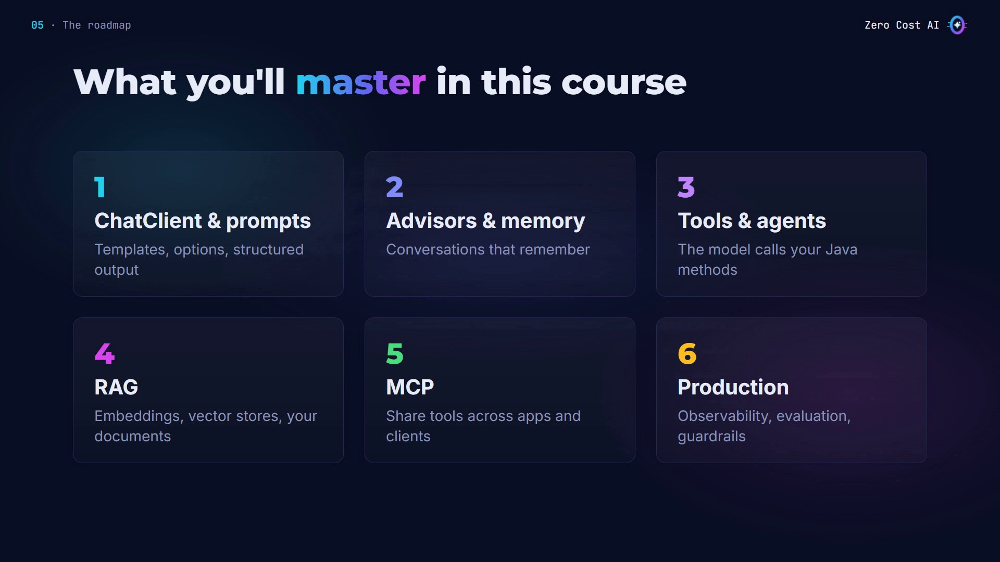
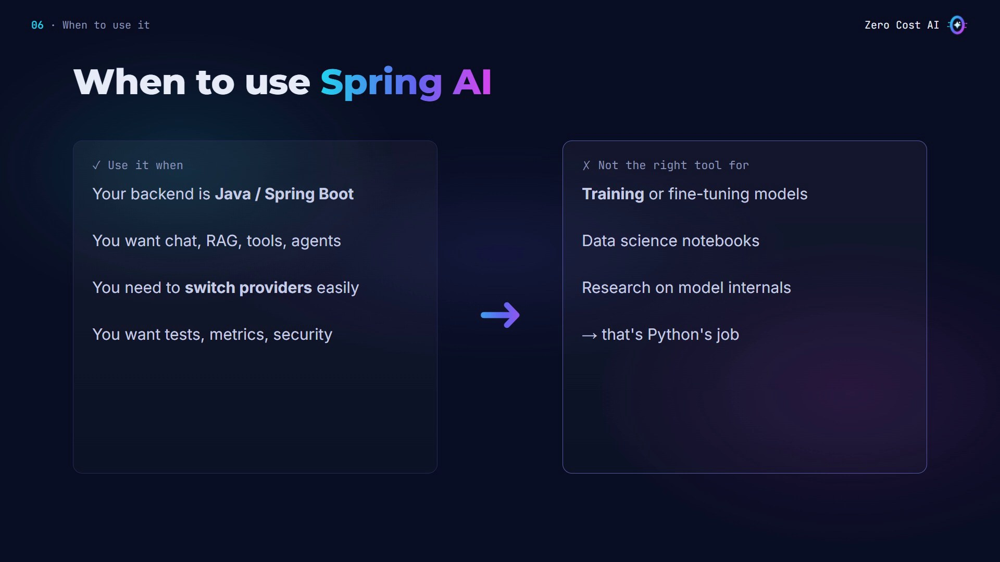

You know Java. You know Spring Boot. But every company now wants AI features in their apps.

The good news? You don't need to switch to Python to build them.

Welcome to Spring AI, from novice to expert. In this first lesson, you'll learn what Spring AI is, how it works, and when to use it.

It's lesson 1.1 of my free **Spring AI: Novice to Expert** course, where every lesson has a concept part and a hands-on lab, and everything runs on a free local model with Ollama.

🎥 **Prefer video?** Watch the full tutorial here:

{VIDEO}

## What is Spring AI?

So, what is Spring AI?

Spring AI is the official Spring project for building AI applications in Java.

It gives you one portable API to talk to large language models, like OpenAI, Anthropic, Google, Mistral, or a free local model with Ollama.

And it works the Spring way: starters, auto-configuration, properties, and beans you inject.

Think of it like Spring Data, but for AI. Spring Data hides the database. Spring AI hides the model provider.

- The **official Spring project** for AI applications in Java
- **One portable API** for many models: OpenAI, Anthropic, Google, Mistral, Ollama…
- The **Spring way**: starters, auto-configuration, properties, injected beans
- Analogy: **Spring Data hides the database**, Spring AI hides the model provider

In code:

```java
<!-- pom.xml -->
spring-ai-starter-model-ollama

// any Spring bean
String answer = chatClient.prompt()
    .user("Hello!")
    .call()
    .content();
```



## What an LLM really does

Before we go further, let's agree on what a large language model, or LLM, really does.

It reads your text as tokens. A token is a small piece of a word, roughly three quarters of a word in English.

Then it predicts the next token, again and again, until the answer is complete. That's all it does.

It is stateless. It doesn't remember your last request unless you send the conversation again.

And it only knows what it saw during training. So it can be out of date, or confidently wrong. We call that a hallucination.

Every advanced Spring AI feature you'll learn in this course exists to fix one of these limits.

- **Input**: Text is split into **tokens** (≈ ¾ of a word)
- **Generation**: Predicts the **next token**, over and over
- **Memory**: **Stateless**: forgets everything between calls
- **Knowledge**: Frozen at training time → **hallucinations**

**✓ Memory, tools and RAG in Spring AI exist to fix these limits**



## Spring AI in 4 layers

Now, how does Spring AI sit between your code and the model? In layers.

At the top is your code: a controller, a service, any Spring bean.

You talk to the ChatClient. It's a fluent API, like WebClient or RestClient, that builds the prompt and reads the answer.

Underneath, the ChatClient uses a ChatModel. That's the portable interface every provider implements.

And at the bottom, a provider module turns the call into the real HTTP request for OpenAI, Anthropic, or Ollama.

So switching providers means changing a dependency and a few properties. Your business code stays the same.

- **Your code**: Controllers, services, any Spring bean
- **ChatClient**: Fluent API: build the prompt, read the answer
- **ChatModel**: Portable interface every provider implements
- **Provider module**: OpenAI · Anthropic · Google · Mistral · Ollama

**✓ Switch provider = change a dependency + properties, not your code**



## Raw HTTP vs Spring AI

Here's what that abstraction saves you.

Without Spring AI, you write HTTP calls by hand, with a different JSON format for every provider, and your own retries and parsing.

With Spring AI, it's one fluent call. The same code runs on any provider.

### Without · raw HTTP per provider

```text
var body = """
{"model":"gpt-...",
 "messages":[{"role":"user",
   "content":"%s"}]}
""".formatted(q);
var res = http.post(url, body, key);
var json = mapper.readTree(res);
return json.at("/choices/0/...");
// + retries, errors, another
//   format for each provider
```

### With Spring AI · one API

```text
return chatClient.prompt()
    .user(question)
    .call()
    .content();

// same code on OpenAI,
// Anthropic, Ollama...
```



## What you'll master in this course

And chatting is only the beginning. Spring AI covers the whole journey of this course.

The ChatClient, prompts, and structured output, where the answer comes back as a Java record.

Advisors and chat memory, to give your app a conversation.

Tool calling and agents, so the model can call your Java methods.

Embeddings, vector stores and RAG, to answer from your own documents.

The Model Context Protocol, or MCP, to share tools between apps.

And observability and evaluation, to run all of it safely in production.

- **ChatClient & prompts**: Templates, options, structured output
- **Advisors & memory**: Conversations that remember
- **Tools & agents**: The model calls your Java methods
- **RAG**: Embeddings, vector stores, your documents
- **MCP**: Share tools across apps and clients
- **Production**: Observability, evaluation, guardrails



## When to use Spring AI

So when should you use Spring AI?

Use it when your app is already in Java and Spring, and you want AI features that are testable, configurable and easy to switch between providers.

Don't use it to train models or do data science. That's still Python's world. Spring AI is for using models inside your applications.

### ✓ Use it when

- Your backend is **Java / Spring Boot**
- You want chat, RAG, tools, agents
- You need to **switch providers** easily
- You want tests, metrics, security

### ✗ Not the right tool for

- **Training** or fine-tuning models
- Data science notebooks
- Research on model internals
- → that's Python's job



## Recap

- Spring AI = **one portable API** for AI models, the Spring way
- LLMs predict tokens, are **stateless** and can **hallucinate**
- You code against **ChatClient**; the provider is just configuration

## Quick quiz

Test yourself before you read the answers.

1. **The API**: Which Spring AI API do you call from your code?
2. **Memory**: Does an LLM remember your previous request?
3. **Switching**: How do you switch from Ollama to OpenAI?

**Answers:**

1. The **ChatClient** (fluent API on top of ChatModel)
2. **No**: LLMs are stateless, your app adds memory
3. Change the **starter + properties**, not your code

The full five-question quiz for this lesson is free on the course quiz page: https://nedbs12.github.io/youtube-tuto/spring-ai-course/quiz/

## Get the code and the quiz

- **Lab code for this lesson**: https://github.com/NEDBS12/youtube-tuto/tree/main/spring-ai-course/labs/hello-spring-ai
- **All course code, quizzes and resources**: https://github.com/NEDBS12/youtube-tuto/tree/main/spring-ai-course
- **Lesson quiz (5 questions) and section evals**: https://nedbs12.github.io/youtube-tuto/spring-ai-course/quiz/
- **Spring AI reference docs**: https://docs.spring.io/spring-ai/reference/
- **Ollama (free local models)**: https://ollama.com

🎥 **Watch the video tutorial:** {VIDEO_URL}

*I'm Zero Cost AI: I build AI tools and tutorials and share them for free. Follow me on Medium for the next lessons, and subscribe on YouTube: https://www.youtube.com/@zerocostai-f1h*
