Welcome to the first lab. Today, you'll build your first Spring AI application, from an empty folder to a working AI endpoint.

And it costs nothing. We'll run a free model on your own machine, with Ollama.

It's lab 1.1 of my free **Spring AI: Novice to Expert** course, where every lesson has a concept part and a hands-on lab, and everything runs on a free local model with Ollama.

🎥 **Prefer video?** Watch the full tutorial here:

{VIDEO}

## What we'll build

Here's the plan, in five steps.

Run a local model with Ollama.

Create a Spring Boot project with the Spring AI starter.

Configure Ollama in application properties.

Write a REST controller that uses the ChatClient.

And finally, run it and test it with curl. You'll need Java 21, and that's about it.

1. **Run a local model**: Ollama + gemma3:4b, free
2. **Create the project**: start.spring.io: Web + Ollama
3. **Configure Ollama**: Three lines of properties
4. **Write the controller**: ChatClient in a REST endpoint
5. **Run and test**: curl it, read the answer

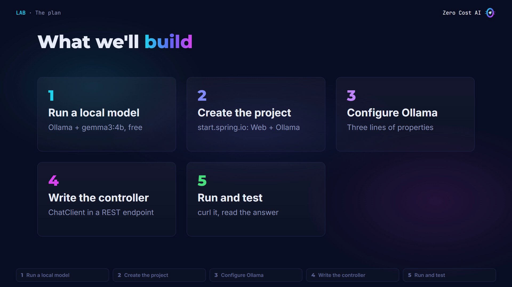

## Step 1: Run a local model

Install Ollama from ollama.com. Then, in a terminal, pull a small model.

```bash
$ ollama pull gemma3:4b
pulling manifest
pulling 68ceab7e468a... 100% 3.4 GB
success
```

I'm using Gemma 3, 4 billion parameters. It's about three gigabytes and runs on a normal laptop.

```bash
$ ollama list
NAME         ID              SIZE
gemma3:4b    68ceab7e468a    3.4 GB
```

Ollama now serves this model on localhost, port 11434. That's where Spring AI will connect.

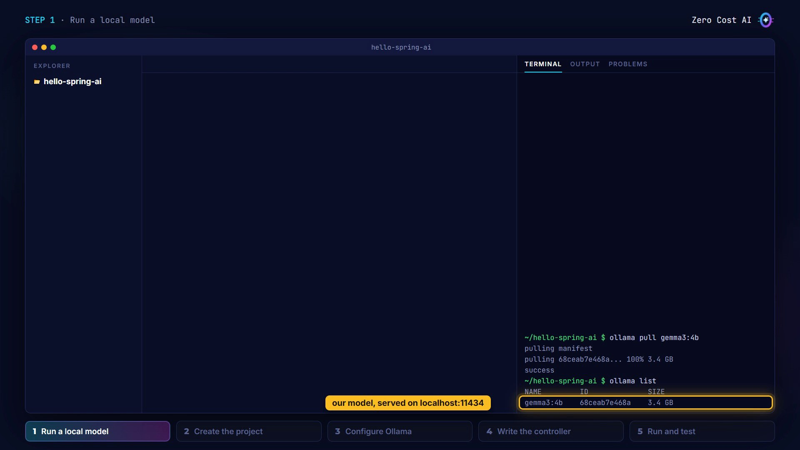

## Step 2: Create the project

Go to start.spring.io.

**start.spring.io**

- **Project**: Maven · Java 21
- **Spring Boot**: 4.1.2
- **Group / Artifact**: dev.course / hello-spring-ai
- **Dependencies**: Spring Web + Ollama

Choose Maven, Java 21, Spring Boot 4.1. Add two dependencies: Spring Web, and Ollama. Then generate, unzip, and open it.

Here's the project. Let's open the pom, and look at the important part.

**`pom.xml`** (`pom.xml`):

```xml
<!-- pom.xml (excerpt) -->
<properties>
    <java.version>21</java.version>
    <spring-ai.version>2.0.1</spring-ai.version>
</properties>

<dependency>
    <groupId>org.springframework.boot</groupId>
    <artifactId>spring-boot-starter-webmvc</artifactId>
</dependency>
<dependency>
    <groupId>org.springframework.ai</groupId>
    <artifactId>spring-ai-starter-model-ollama</artifactId>
</dependency>

<!-- dependencyManagement -->
<artifactId>spring-ai-bom</artifactId>
<version>${spring-ai.version}</version>
```

The Spring AI BOM manages the versions. We're on Spring AI 2.0.

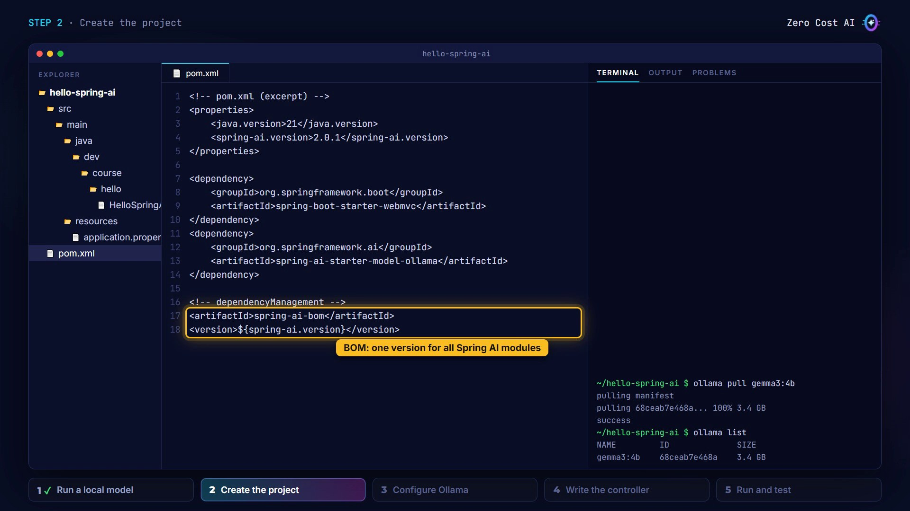

And this is the starter for Ollama. It auto-configures a ChatModel and a ChatClient builder for you. No code needed.

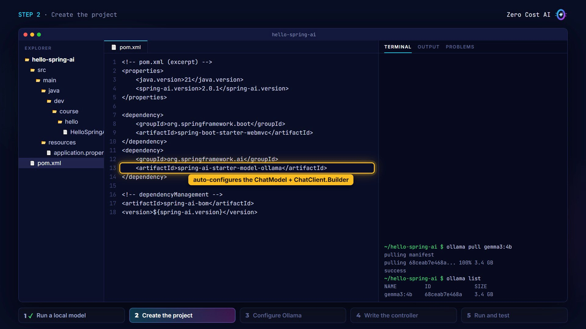

## Step 3: Configure Ollama

Open `application.properties`.

I'll add the base URL of Ollama, the model name, and a temperature.

**`application.properties`**:

```properties
spring.ai.ollama.base-url=http://localhost:11434
spring.ai.ollama.chat.model=gemma3:4b
spring.ai.ollama.chat.temperature=0.7
```

The model must match the name you pulled. `gemma3:4b`.


Temperature controls creativity. Zero is focused and repeatable. Higher values give more varied answers. We'll explore this in lesson 1.4.

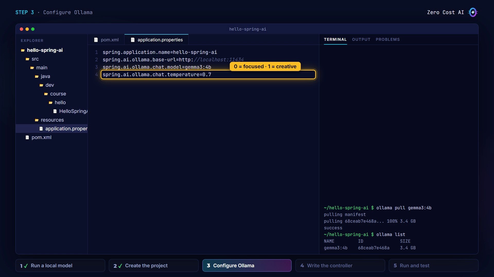

## Step 4: Write the controller

I'll create ChatController, next to the application class.

**`ChatController.java`**:

```java
package dev.course.hello;

import org.springframework.ai.chat.client.ChatClient;
import org.springframework.web.bind.annotation.GetMapping;
import org.springframework.web.bind.annotation.RequestParam;
import org.springframework.web.bind.annotation.RestController;

@RestController
public class ChatController {
```

I inject a `ChatClient.Builder`. Spring AI created it for us, already wired to Ollama. I build the ChatClient once, in the constructor.

**`ChatController.java`** (continued):

```java
    private final ChatClient chatClient;

    public ChatController(ChatClient.Builder builder) {
        this.chatClient = builder.build();
    }
```

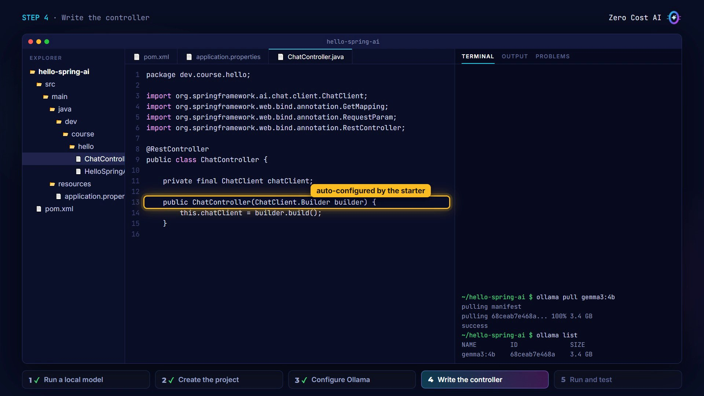

Now the endpoint. GET `/chat` takes a message parameter.

**`ChatController.java`** (continued):

```java
    @GetMapping("/chat")
    public String chat(@RequestParam String message) {
        return chatClient.prompt()
                .user(message)
                .call()
                .content();
    }
}
```

And this is the whole AI call. prompt, add the user message, call the model, and get the content as a String.

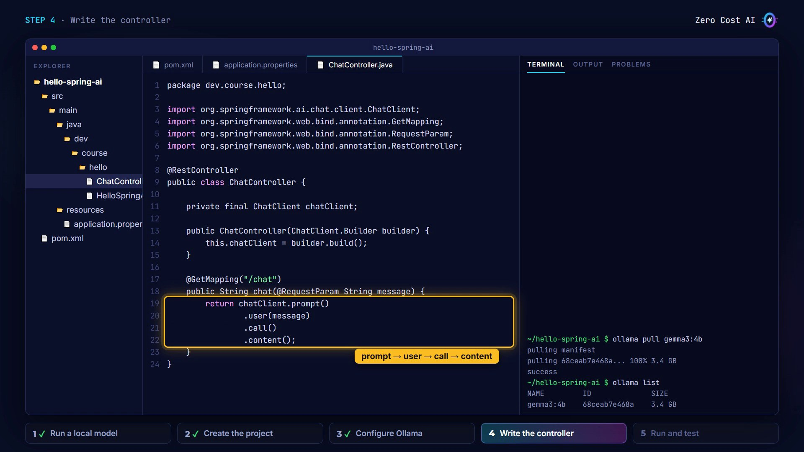

Notice: nothing in this class mentions Ollama. That's the portable API from the concept video.

## Step 5: Run and test

I'll start the app with the Maven wrapper.

```bash
$ ./mvnw spring-boot:run
...
Tomcat started on port 8080 (http)
Started HelloSpringAiApplication in 7.6 seconds
```

In a second terminal, I'll ask it a Java question.

```bash
$ curl "localhost:8080/chat?message=Explain+dependency+injection+in+one+short+sentence"
Dependency injection is a design pattern where an object
receives its dependencies from outside, rather than
creating them itself, promoting loose coupling and
testability.
```

And here's the answer, generated by Gemma, on my machine, through Spring AI. Your first AI endpoint is working!

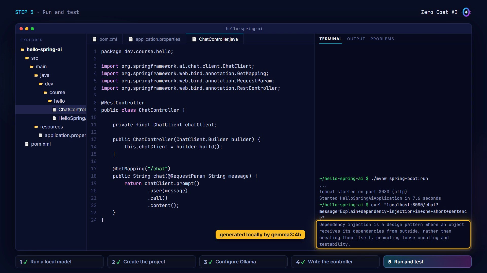

Now let's ask it about Spring AI itself.

```bash
$ curl "localhost:8080/chat?message=In+one+sentence,+what+is+Spring+AI%3F"
Spring AI is a conversational AI platform built on top
of Google's PaLM 2 model, designed to help businesses
quickly build and deploy custom chatbots and virtual
assistants with minimal coding.
```

Look closely. Built on Google's PaLM 2? For chatbots for businesses? That's wrong. The model is guessing, very confidently.

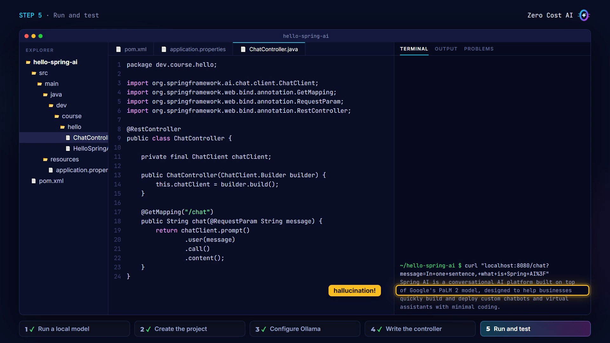

Run it again and you may get a different answer, because of the temperature. Remember this moment: system prompts, and later RAG, are how we'll fix it.

## Switch provider, keep your code

One bonus. Want to use OpenAI instead of Ollama? You don't touch the controller.

Swap the starter for `spring-ai-starter-model-openai`, set your API key and model in the properties, and restart. Same code, different provider.

### Ollama (this lab)

```text
spring-ai-starter-model-ollama

spring.ai.ollama.chat.model=
    gemma3:4b
```

### OpenAI

```text
spring-ai-starter-model-openai

spring.ai.openai.api-key=
    ${OPENAI_API_KEY}
spring.ai.openai.chat.model=
    gpt-5-mini
```

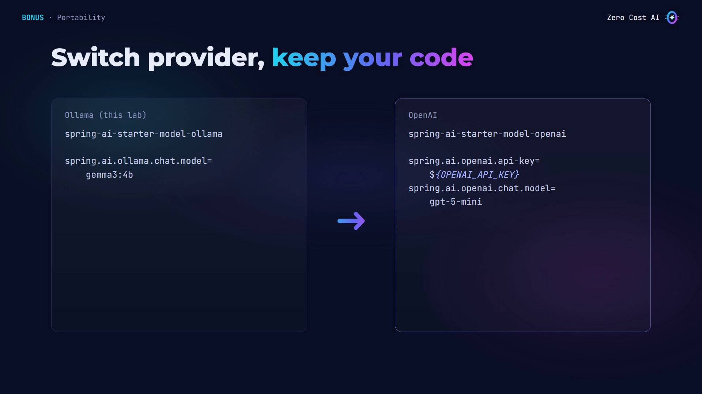

## 3 common mistakes

Before you go, three common mistakes.

Connection refused? Ollama isn't running. Start it, then try again.

Model not found? The name in your properties doesn't match ollama list.

And never commit an API key. Use an environment variable, like `OPENAI_API_KEY`.

- **Connection refused**: Ollama isn't running: start it
- **Model not found**: Property must match `ollama list`
- **Leaked API key**: Use env vars, never commit keys

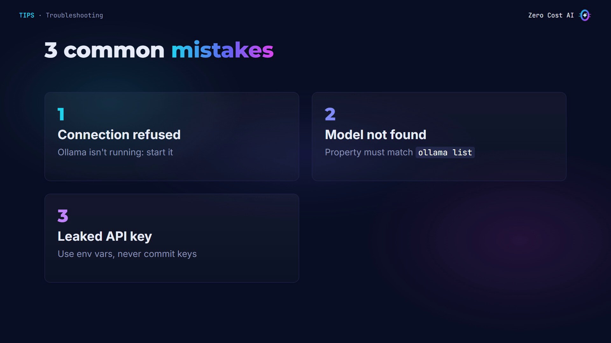

## Your challenge

Your challenge, before the next lesson. Add a second endpoint, `/joke`, that takes a topic and returns a joke about it.

Then try a different model from Ollama, just by changing one property.

- **/joke?topic=java**: A second endpoint with the same ChatClient
- **Another model**: e.g. `ollama pull llama3.2`, change one property

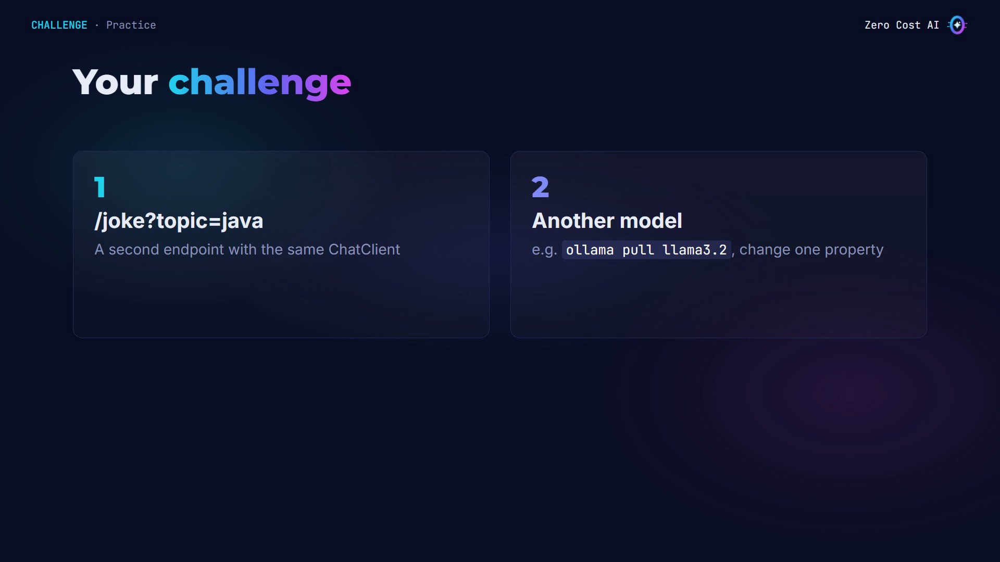

## Recap

- The starter **auto-configures** `ChatClient.Builder`: just inject it
- `prompt().user().call().content()` = one AI call
- Models can hallucinate: never trust an answer blindly

## Get the code and the quiz

- **Code for this lab**: https://github.com/NEDBS12/youtube-tuto/tree/main/spring-ai-course/labs/hello-spring-ai
- **All course code, quizzes and resources**: https://github.com/NEDBS12/youtube-tuto/tree/main/spring-ai-course
- **Lesson quiz and section evals**: https://nedbs12.github.io/youtube-tuto/spring-ai-course/quiz/
- **Spring Initializr**: https://start.spring.io
- **Ollama**: https://ollama.com
- **Spring AI Ollama docs**: https://docs.spring.io/spring-ai/reference/api/chat/ollama-chat.html

🎥 **Watch the video tutorial:** {VIDEO_URL}

**Previous: Lesson 1.1, What is Spring AI? Next: Lesson 1.2, the ChatClient API in depth.**

*The editor and terminal in the screenshots are a simplified recreation; the code and the outputs come from real runs of the lab.*

*I'm Zero Cost AI: I build AI tools and tutorials and share them for free. Follow me on Medium for the next lessons, and subscribe on YouTube: https://www.youtube.com/@zerocostai-f1h*
