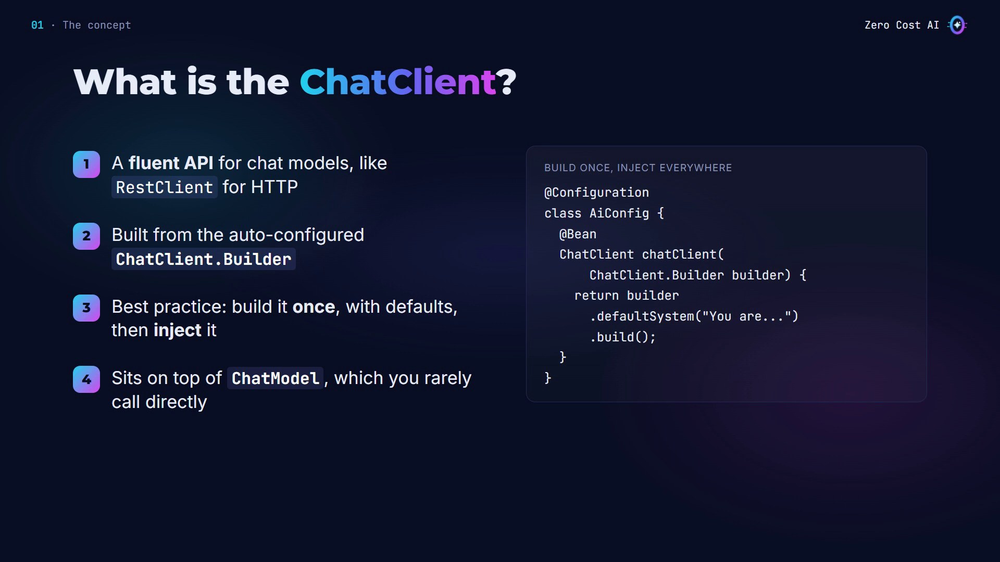
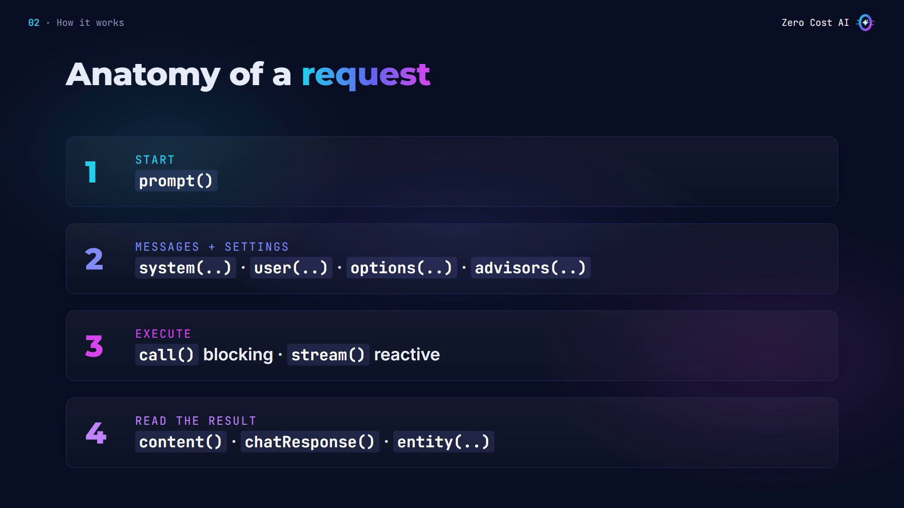
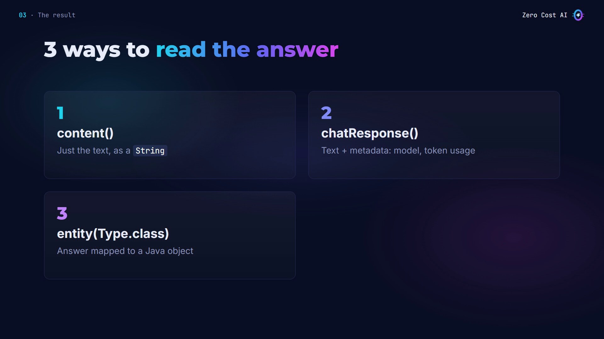
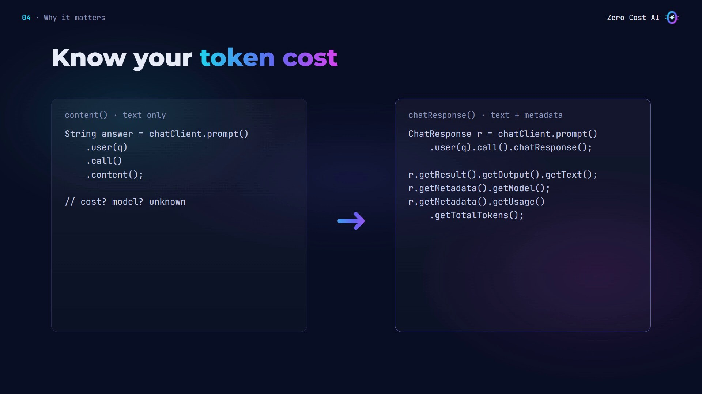
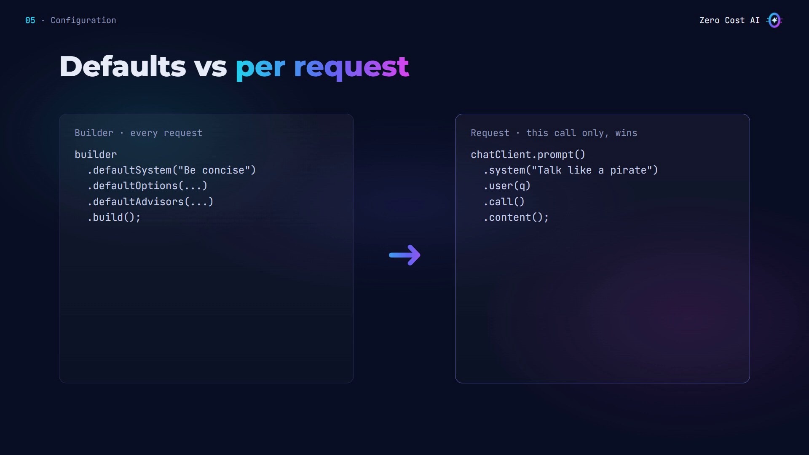
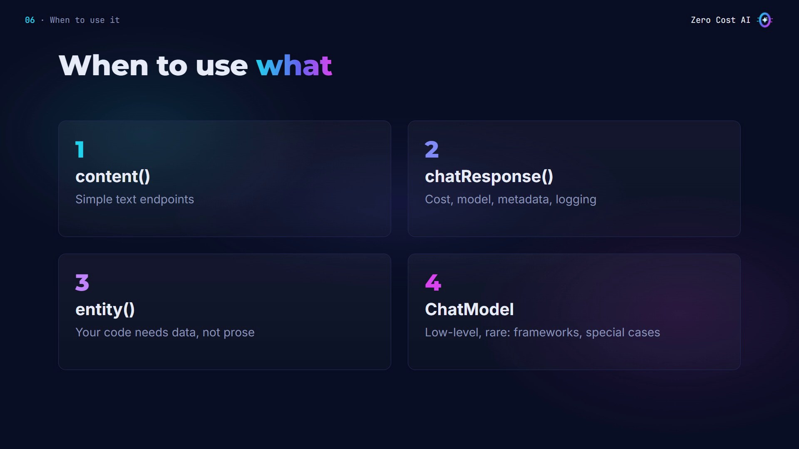

In the last lab, one line of code gave us an AI answer. prompt, user, call, content.

But that line hides a lot of power. Token usage, defaults, system messages, and different ways to read the answer.

In this lesson, you'll learn the ChatClient API in depth, so you know exactly which method to use, and when.

It's lesson 1.2 of my free **Spring AI: Novice to Expert** course, where every lesson has a concept part and a hands-on lab, and everything runs on a free local model with Ollama.

🎥 **Prefer video?** Watch the full tutorial here:

{VIDEO}

## What is the ChatClient?

So, what is the ChatClient?

It's the fluent API you use to talk to a chat model. If you know RestClient or WebClient, it will feel familiar.

You don't create it with new. The model starter gives you a `ChatClient.Builder`, and you build your client from it.

The best practice is to build it once, in a configuration class, with your defaults, and inject it wherever you need it.

Under the hood, it calls the ChatModel. You could use the ChatModel directly, but the ChatClient is simpler, and it's what you'll use 90% of the time.

- A **fluent API** for chat models, like `RestClient` for HTTP
- Built from the auto-configured **`ChatClient.Builder`**
- Best practice: build it **once**, with defaults, then **inject** it
- Sits on top of **`ChatModel`**, which you rarely call directly

In code:

```java
@Configuration
class AiConfig {
  @Bean
  ChatClient chatClient(
      ChatClient.Builder builder) {
    return builder
      .defaultSystem("You are...")
      .build();
  }
}
```



## Anatomy of a request

Every request follows the same four stages.

First, prompt. It starts a new request.

Second, the messages. system for the rules, and user for the question. Plus optional settings, like options and advisors.

Third, you choose how to call the model. call waits for the full answer. stream returns it piece by piece. We'll cover streaming in section two.

And fourth, you choose what you get back. That's the part beginners often miss.

- **Start**: `prompt()`
- **Messages + settings**: `system(..)` · `user(..)` · `options(..)` · `advisors(..)`
- **Execute**: `call()` blocking · `stream()` reactive
- **Read the result**: `content()` · `chatResponse()` · `entity(..)`



## 3 ways to read the answer

After call, you have three main ways to read the result.

Content returns just the text, as a String. Perfect for simple endpoints.

ChatResponse returns the full response: the text, plus metadata, like the model name and the token usage.

And entity converts the answer into a Java object, like a record. That's structured output, coming in lesson 2.2.

- **content()**: Just the text, as a `String`
- **chatResponse()**: Text + metadata: model, token usage
- **entity(Type.class)**: Answer mapped to a Java object



## Know your token cost

Why care about chatResponse? Because of tokens.

Hosted models charge you per token: the tokens you send, and the tokens they generate. With content, you can't see that cost.

With chatResponse, the metadata gives you the prompt tokens, the completion tokens, and the total. You can log them, or show them on a dashboard.

### content() · text only

```text
String answer = chatClient.prompt()
    .user(q)
    .call()
    .content();

// cost? model? unknown
```

### chatResponse() · text + metadata

```text
ChatResponse r = chatClient.prompt()
    .user(q).call().chatResponse();

r.getResult().getOutput().getText();
r.getMetadata().getModel();
r.getMetadata().getUsage()
    .getTotalTokens();
```



## Defaults vs per request

One more key idea: defaults versus per-request settings.

On the builder, you set defaults that apply to every request. A default system message, default options, default advisors.

On a single request, you can override them. For example, one endpoint can use a different system message. The request wins.

### Builder · every request

```text
builder
  .defaultSystem("Be concise")
  .defaultOptions(...)
  .defaultAdvisors(...)
  .build();
```

### Request · this call only, wins

```text
chatClient.prompt()
  .system("Talk like a pirate")
  .user(q)
  .call()
  .content();
```



## When to use what

So when do you use what?

Use content for simple text answers.

Use chatResponse when you need cost, the model name, or other metadata.

Use entity when your code needs data, not prose.

And drop down to the ChatModel only for low-level work, or when you build your own framework on top.

- **content()**: Simple text endpoints
- **chatResponse()**: Cost, model, metadata, logging
- **entity()**: Your code needs data, not prose
- **ChatModel**: Low-level, rare: frameworks, special cases



## Recap

- Build the ChatClient **once**, with defaults, and **inject** it
- `prompt → messages → call → content / chatResponse / entity`
- `chatResponse()` shows the model and the token usage

## Quick quiz

Test yourself before you read the answers.

1. **Build it**: Where do you get a ChatClient from?
2. **Token usage**: Which method gives you the token usage?
3. **Override**: A default system message and a request system message. Which wins?

**Answers:**

1. The auto-configured **ChatClient.Builder**
2. **chatResponse()** → metadata → usage
3. The **request**: it overrides the default

The full five-question quiz for this lesson is free on the course quiz page: https://nedbs12.github.io/youtube-tuto/spring-ai-course/quiz/

## Get the code and the quiz

- **Lab code for this lesson**: https://github.com/NEDBS12/youtube-tuto/tree/main/spring-ai-course/labs/chatclient-explorer
- **All course code, quizzes and resources**: https://github.com/NEDBS12/youtube-tuto/tree/main/spring-ai-course
- **Lesson quiz and section evals**: https://nedbs12.github.io/youtube-tuto/spring-ai-course/quiz/
- **Spring AI ChatClient docs**: https://docs.spring.io/spring-ai/reference/api/chatclient.html
- **Spring AI reference docs**: https://docs.spring.io/spring-ai/reference/

🎥 **Watch the video tutorial:** {VIDEO_URL}

**Previous: Lab 1.1, your first Spring AI app. Next: Lab 1.2, explore the ChatClient hands on.**

*I'm Zero Cost AI: I build AI tools and tutorials and share them for free. Follow me on Medium for the next lessons, and subscribe on YouTube: https://www.youtube.com/@zerocostai-f1h*
