Today we'll explore the ChatClient API, hands on.

You'll build a ChatClient bean with defaults, read the model name and token usage, and override the system message for one endpoint.

It's lab 1.2 of my free **Spring AI: Novice to Expert** course, where every lesson has a concept part and a hands-on lab, and everything runs on a free local model with Ollama.

🎥 **Prefer video?** Watch the full tutorial here:

{VIDEO}

## What we'll build

Here's the plan, in five steps.

One ChatClient bean, with a default system message. A simple text endpoint.

An endpoint that returns the answer with its metadata. An endpoint that overrides the system message. And then, we test it all.

1. **One ChatClient bean**: Default system message
2. **A simple endpoint**: `/chat` → `content()`
3. **Read the metadata**: `/chat/details` → model + tokens
4. **Override per request**: `/chat/pirate` → own system
5. **Run and test**: Compare the three answers

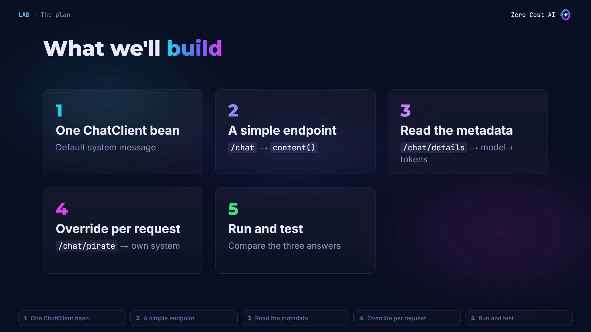

## Step 1: One ChatClient bean

Step one. I've created a new project, chatclient explorer, exactly like in lab 1.1: Spring Web, and Ollama.

**`application.properties`** (`src/main/resources/application.properties`):

```properties
spring.application.name=chatclient-explorer
spring.ai.ollama.chat.model=gemma3:4b
```

The properties only set the model. The base URL defaults to localhost, port 11434.

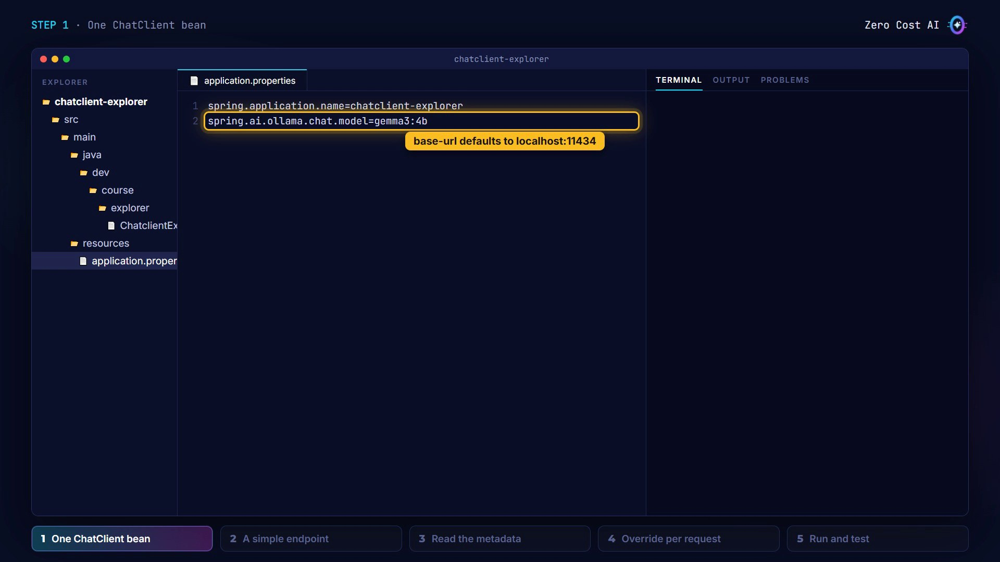

Now, a configuration class, AiConfig. It defines one ChatClient bean.

**`AiConfig.java`**:

```java
package dev.course.explorer;

import org.springframework.ai.chat.client.ChatClient;
import org.springframework.context.annotation.Bean;
import org.springframework.context.annotation.Configuration;

@Configuration
public class AiConfig {

    @Bean
    ChatClient chatClient(ChatClient.Builder builder) {
        return builder
                .defaultSystem("You are a concise assistant for Java developers. Answer in at most two sentences.")
                .build();
    }
}
```

I take the auto-configured builder, add a default system message, and build. Every request through this client gets these rules: concise, two sentences maximum.

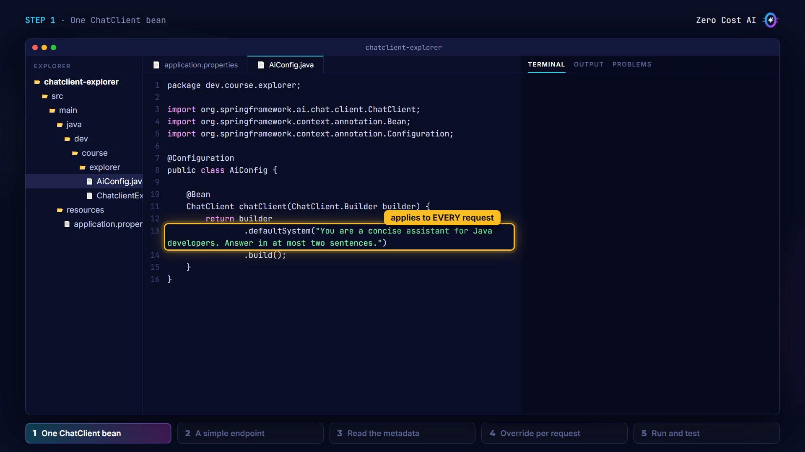

Now the whole app shares one ChatClient, configured in one place.

## Step 2: A simple endpoint

In ChatController, I inject the ChatClient bean directly. Not the builder this time.

**`ChatController.java`**:

```java
package dev.course.explorer;

import org.springframework.ai.chat.client.ChatClient;
import org.springframework.ai.chat.model.ChatResponse;
import org.springframework.web.bind.annotation.GetMapping;
import org.springframework.web.bind.annotation.RequestParam;
import org.springframework.web.bind.annotation.RestController;

@RestController
public class ChatController {

    private final ChatClient chatClient;

    public ChatController(ChatClient chatClient) {
        this.chatClient = chatClient;
    }

    @GetMapping("/chat")
    public String chat(@RequestParam String message) {
        return chatClient.prompt().user(message).call().content();
    }
```

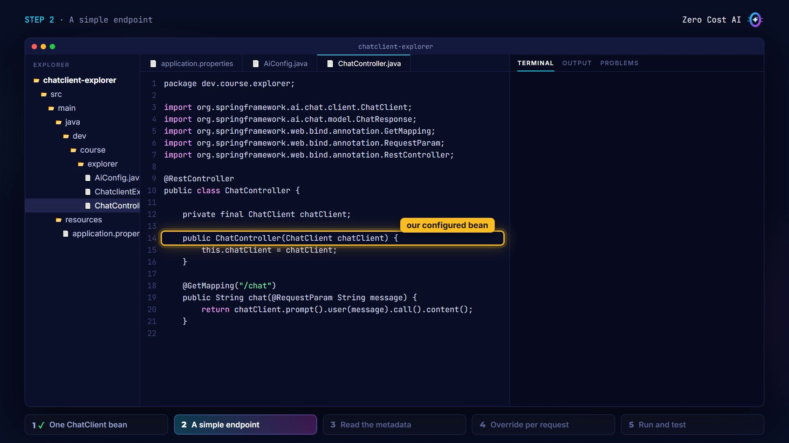

And `/chat` returns content, just the text, like in the first lab.

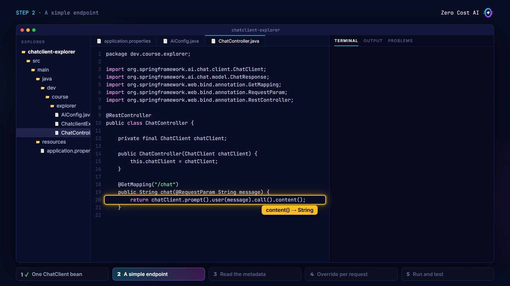

## Step 3: Read the metadata

First, a small record to return: the answer, the model, and three token counts.

**`ChatDetails.java`**:

```java
package dev.course.explorer;

public record ChatDetails(String answer, String model,
                          Integer promptTokens, Integer completionTokens, Integer totalTokens) {
}
```

Back in the controller, the `/chat/details` endpoint ends with chatResponse instead of content.

**`ChatController.java`** (continued):

```java
    @GetMapping("/chat/details")
    public ChatDetails details(@RequestParam String message) {
        ChatResponse response = chatClient.prompt().user(message).call().chatResponse();
        var usage = response.getMetadata().getUsage();
        return new ChatDetails(
                response.getResult().getOutput().getText(),
                response.getMetadata().getModel(),
                usage.getPromptTokens(), usage.getCompletionTokens(), usage.getTotalTokens());
    }
```

The ChatResponse holds everything. getResult, getOutput, getText gives you the answer.


And getMetadata gives you the model name, and the usage: prompt tokens, completion tokens, and the total.

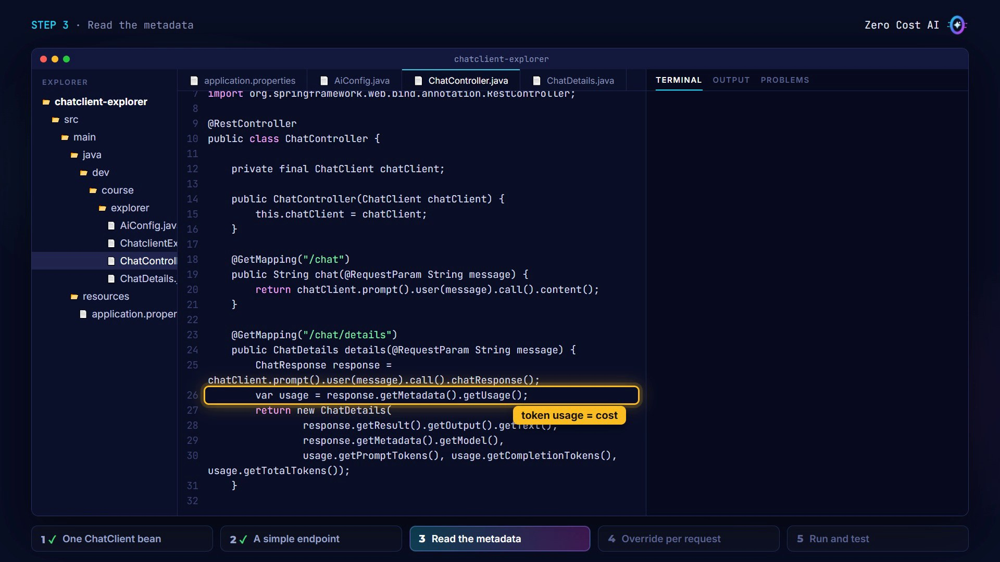

## Step 4: Override per request

The `/chat/pirate` endpoint sets its own system message.

**`ChatController.java`** (continued):

```java
    @GetMapping("/chat/pirate")
    public String pirate(@RequestParam String message) {
        return chatClient.prompt()
                .system("You are a friendly pirate. Answer in one sentence, in pirate speak.")
                .user(message)
                .call()
                .content();
    }
}
```

This system message replaces the default one, for this request only. Every other endpoint keeps the concise rules.

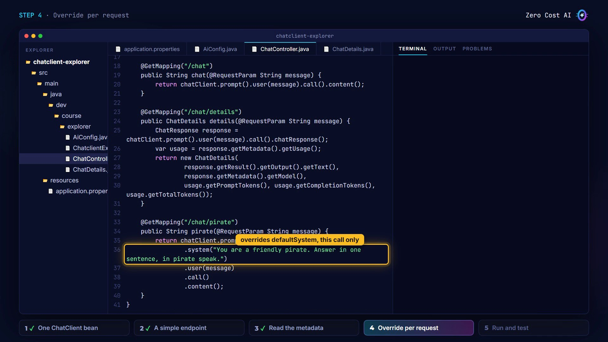

## Step 5: Run and test

```bash
$ ./mvnw spring-boot:run
...
Started ChatclientExplorerApplication in 2.2 seconds
```

First, `/chat`. Two sentences, as the default system message asked.

```bash
$ curl "localhost:8080/chat?message=What+is+a+Java+record%3F"
A Java record is a concise way to create immutable data
classes, automatically generating methods like
`equals()`, `hashCode()`, and `toString()`. They offer a
simplified syntax for representing data with minimal
boilerplate code.
```

Now `/details`. Same kind of answer, but now with the model name, and the token usage.

```bash
$ curl "localhost:8080/chat/details?message=What+is+a+Java+record%3F"
{
  "answer": "A Java record is a concise way to
     create immutable data classes, ...",
  "model": "gemma3:4b",
  "promptTokens": 38,
  "completionTokens": 48,
  "totalTokens": 86
}
```

38 tokens in, 48 out. With a hosted model, this is exactly what you pay for.

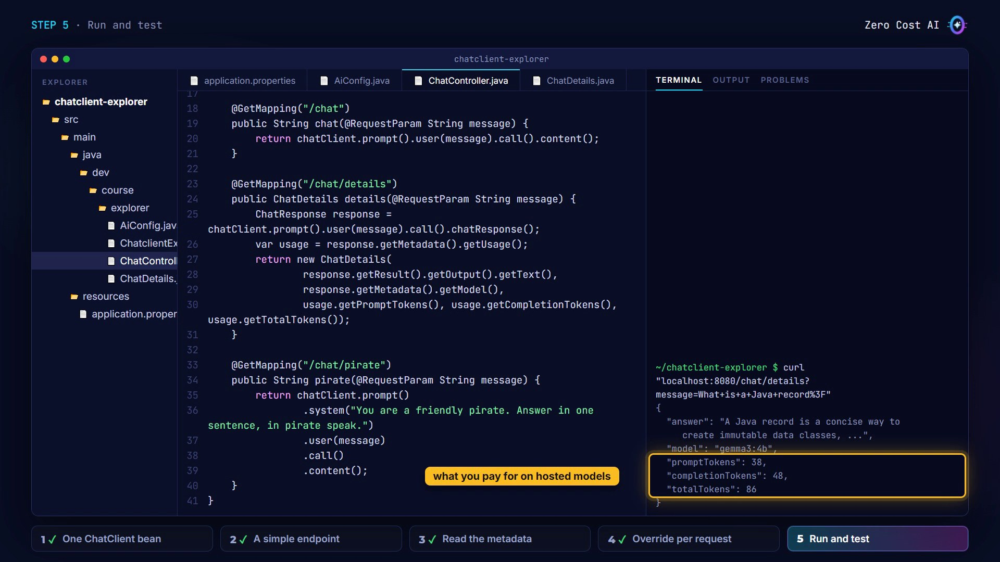

And the pirate endpoint. Same client, same question, but a different system message.

```bash
$ curl "localhost:8080/chat/pirate?message=What+is+a+Java+record%3F"
Shiver me timbers, a Java record be like a sturdy chest
filled with valuable goods – a simple, immutable way to
store data, savvy?
```

Shiver me timbers! The per-request system message won.

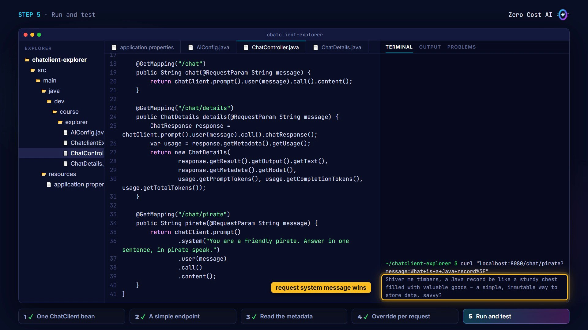

## 3 pro tips

Three tips before you go.

Log the token usage of every call. It's the first thing you'll need when the bill arrives.

Keep the default system message short and generic. Put task-specific rules on the request.

And if you need two very different personalities, create two ChatClient beans, with names, instead of overriding everywhere.

- **Log token usage**: Know your cost before the bill
- **Short defaults**: Task rules go on the request
- **Several beans**: Different personalities = named beans

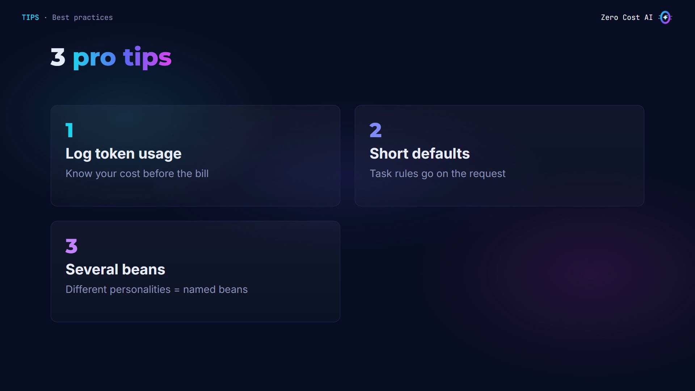

## Your challenge

Your challenge: add a `/chat/short` endpoint that overrides the system message to answer in at most ten words.

Then return the token usage too, and compare it with `/details`. Fewer words, fewer tokens, lower cost.

- **/chat/short**: Override: answer in ≤ 10 words
- **Compare tokens**: Fewer words → fewer completion tokens

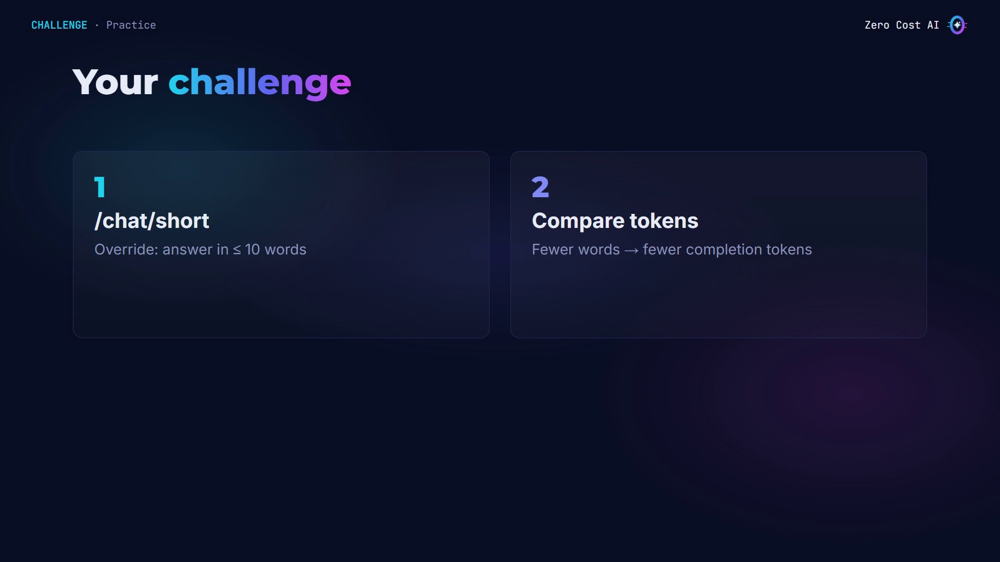

## Recap

- One **ChatClient bean** with `defaultSystem`, injected everywhere
- `chatResponse()` → answer + **model** + **token usage**
- A request `.system(..)` overrides the default

## Get the code and the quiz

- **Code for this lab**: https://github.com/NEDBS12/youtube-tuto/tree/main/spring-ai-course/labs/chatclient-explorer
- **All course code, quizzes and resources**: https://github.com/NEDBS12/youtube-tuto/tree/main/spring-ai-course
- **Lesson quiz and section evals**: https://nedbs12.github.io/youtube-tuto/spring-ai-course/quiz/
- **Ollama**: https://ollama.com
- **Spring AI ChatClient docs**: https://docs.spring.io/spring-ai/reference/api/chatclient.html
- **Spring AI reference docs**: https://docs.spring.io/spring-ai/reference/

🎥 **Watch the video tutorial:** {VIDEO_URL}

**Previous: Lesson 1.2, the ChatClient API. Next: Lesson 1.3, prompts and templates.**

*The editor and terminal in the screenshots are a simplified recreation; the code and the outputs come from real runs of the lab.*

*I'm Zero Cost AI: I build AI tools and tutorials and share them for free. Follow me on Medium for the next lessons, and subscribe on YouTube: https://www.youtube.com/@zerocostai-f1h*
