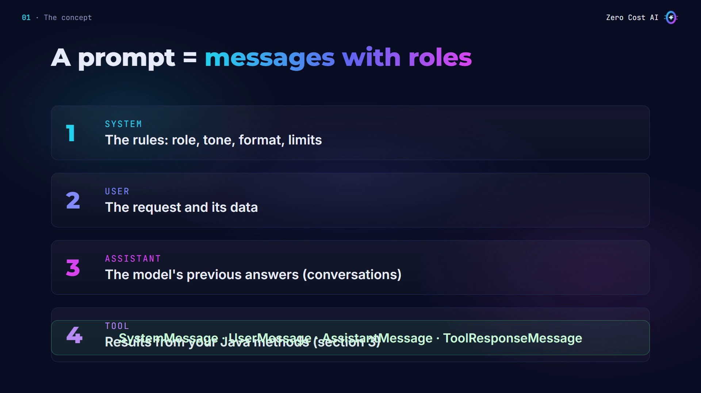
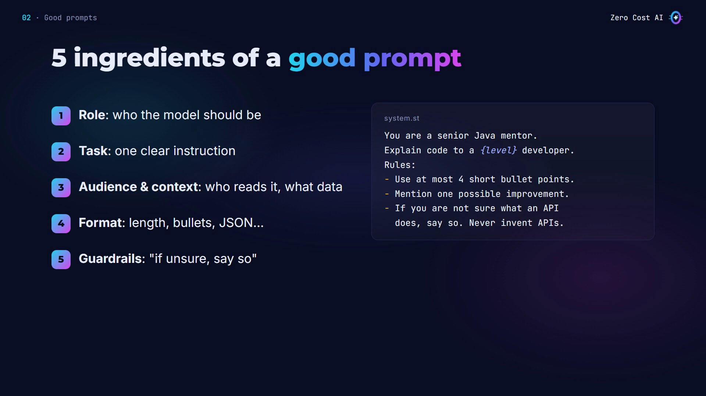
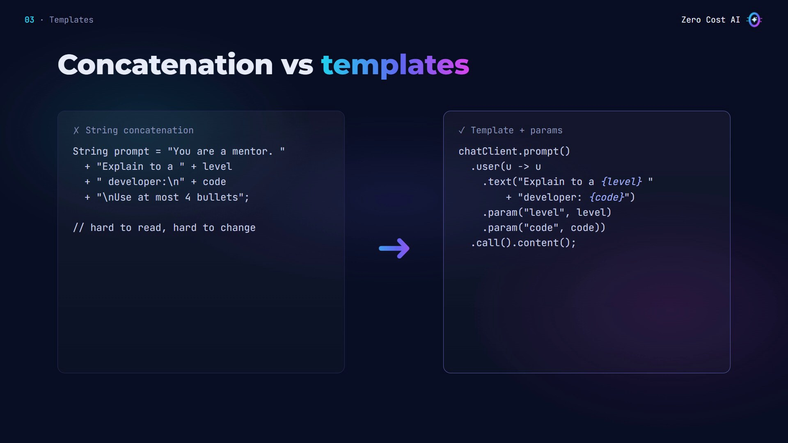
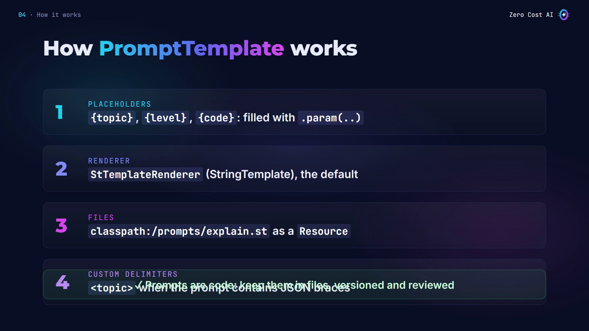
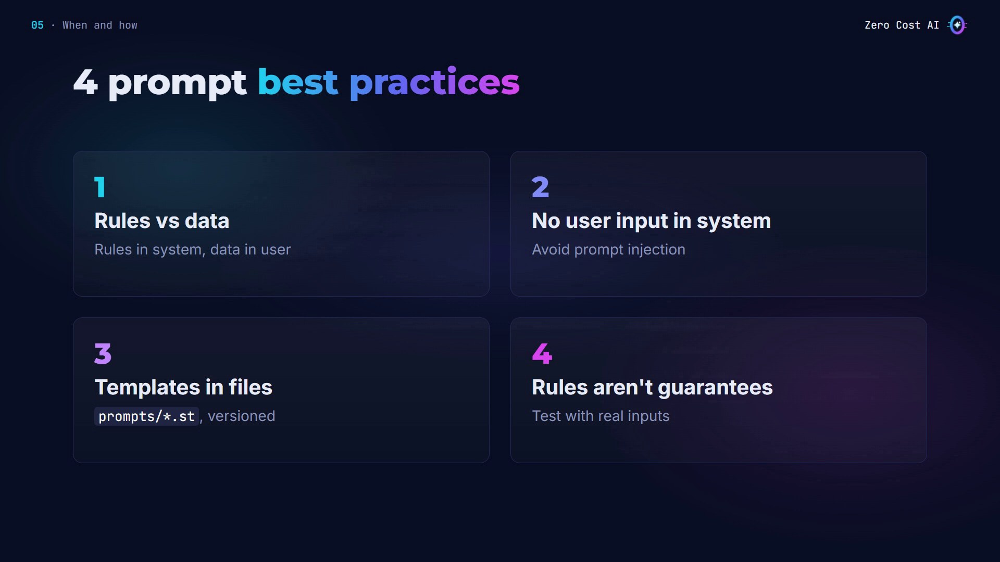

Same model. Same question. But one answer is vague, and the other is exactly what you need. The difference? The prompt.

In this lesson, you'll learn how Spring AI structures prompts: message roles, what makes a good prompt, and templates that keep prompts out of your Java code.

It's lesson 1.3 of my free **Spring AI: Novice to Expert** course, where every lesson has a concept part and a hands-on lab, and everything runs on a free local model with Ollama.

🎥 **Prefer video?** Watch the full tutorial here:

{VIDEO}

## A prompt = messages with roles

A prompt isn't just one string. It's a list of messages, and each message has a role.

The system message sets the rules: who the model is, the tone, the format, what it must never do.

The user message carries the actual request, and the data to work on.

Assistant messages are the model's previous answers. They matter for conversations, and chat memory adds them for you.

And tool messages carry results from your Java methods. We'll meet them in the tools section.

In Spring AI, these are the classes SystemMessage, UserMessage, AssistantMessage, and ToolResponseMessage.

- **system**: The rules: role, tone, format, limits
- **user**: The request and its data
- **assistant**: The model's previous answers (conversations)
- **tool**: Results from your Java methods (section 3)

**SystemMessage · UserMessage · AssistantMessage · ToolResponseMessage**



## 5 ingredients of a good prompt

So what makes a good prompt? Five ingredients.

A role. Who should the model be? For example, a senior Java mentor.

A clear task. Explain this code. Not: tell me about this.

The audience and context. A junior developer needs a different answer than a senior one.

Format rules. At most four bullet points. Reply with the tagline only.

And guardrails. If you're not sure, say so. Never invent APIs. This simple line reduces hallucinations.

- **Role**: who the model should be
- **Task**: one clear instruction
- **Audience & context**: who reads it, what data
- **Format**: length, bullets, JSON…
- **Guardrails**: "if unsure, say so"

In code:

```java
You are a senior Java mentor.
Explain code to a {level} developer.
Rules:
- Use at most 4 short bullet points.
- Mention one possible improvement.
- If you are not sure what an API
  does, say so. Never invent APIs.
```



## Concatenation vs templates

Now, how do you put your data into a prompt? The beginner way is string concatenation.

It works, but it gets messy fast. The prompt is buried in Java, hard to read, and hard to change.

Spring AI gives you templates instead. You write placeholders in curly braces, and fill them with param. The prompt stays readable.

### ✗ String concatenation

```text
String prompt = "You are a mentor. "
  + "Explain to a " + level
  + " developer:\n" + code
  + "\nUse at most 4 bullets";

// hard to read, hard to change
```

### ✓ Template + params

```text
chatClient.prompt()
  .user(u -> u
    .text("Explain to a {level} "
        + "developer: {code}")
    .param("level", level)
    .param("code", code))
  .call().content();
```



## How PromptTemplate works

Under the hood, this is the PromptTemplate.

Placeholders use curly braces by default, like curly brace topic.

They're rendered by the StTemplateRenderer, based on the StringTemplate engine.

Even better: the template can live in a file, like `prompts/explain.st`, and you pass it as a Spring Resource.

And if your prompt itself needs curly braces, for example a JSON example, you can switch the delimiters to angle brackets.

Prompts are code. Keep them in files, versioned and reviewed, just like your Java.

- **Placeholders**: `{topic}`, `{level}`, `{code}`: filled with `.param(..)`
- **Renderer**: `StTemplateRenderer` (StringTemplate), the default
- **Files**: `classpath:/prompts/explain.st` as a `Resource`
- **Custom delimiters**: `<topic>` when the prompt contains JSON braces

**✓ Prompts are code: keep them in files, versioned and reviewed**



## 4 prompt best practices

Four best practices.

Put the rules in the system message, and the data in the user message.

Never paste user input into the system message. A user could write: ignore all previous rules. That's prompt injection, and section seven covers it.

Keep long prompts in template files, not in Java strings.

And remember: a prompt rule is a request, not a guarantee. Smaller models may ignore it. Test with real inputs.

- **Rules vs data**: Rules in system, data in user
- **No user input in system**: Avoid prompt injection
- **Templates in files**: `prompts/*.st`, versioned
- **Rules aren't guarantees**: Test with real inputs



## Recap

- A prompt is a list of **messages with roles**: system, user, assistant, tool
- Good prompt = role + task + audience + format + **guardrails**
- Use templates with `{placeholders}`, kept in `.st` files

## Quick quiz

Test yourself before you read the answers.

1. **Roles**: Where do the rules and tone of the model go?
2. **Syntax**: What is the default placeholder syntax?
3. **JSON**: Your template must contain JSON braces. What do you do?

**Answers:**

1. The **system** message
2. Curly braces: **{name}**
3. Switch to **custom delimiters**, like < >

The full five-question quiz for this lesson is free on the course quiz page: https://nedbs12.github.io/youtube-tuto/spring-ai-course/quiz/

## Get the code and the quiz

- **Lab code for this lesson**: https://github.com/NEDBS12/youtube-tuto/tree/main/spring-ai-course/labs/code-explainer
- **All course code, quizzes and resources**: https://github.com/NEDBS12/youtube-tuto/tree/main/spring-ai-course
- **Lesson quiz and section evals**: https://nedbs12.github.io/youtube-tuto/spring-ai-course/quiz/
- **Spring AI prompts docs**: https://docs.spring.io/spring-ai/reference/api/prompt.html
- **Spring AI reference docs**: https://docs.spring.io/spring-ai/reference/

🎥 **Watch the video tutorial:** {VIDEO_URL}

**Previous: Lab 1.2. Next: Lab 1.3, build a code explainer with prompt templates.**

*I'm Zero Cost AI: I build AI tools and tutorials and share them for free. Follow me on Medium for the next lessons, and subscribe on YouTube: https://www.youtube.com/@zerocostai-f1h*
