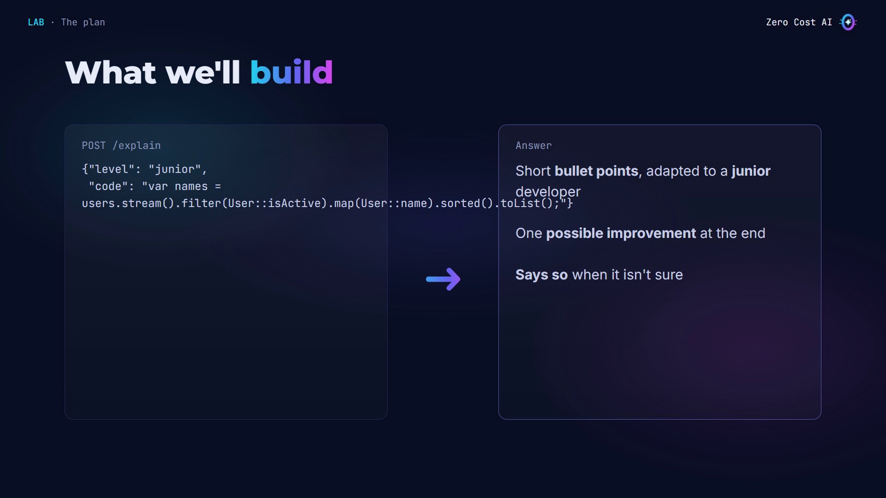
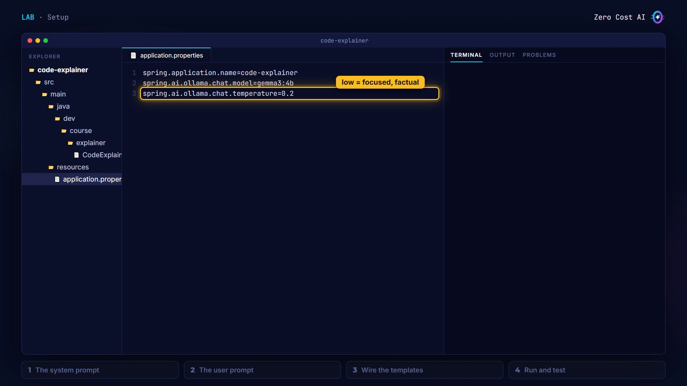
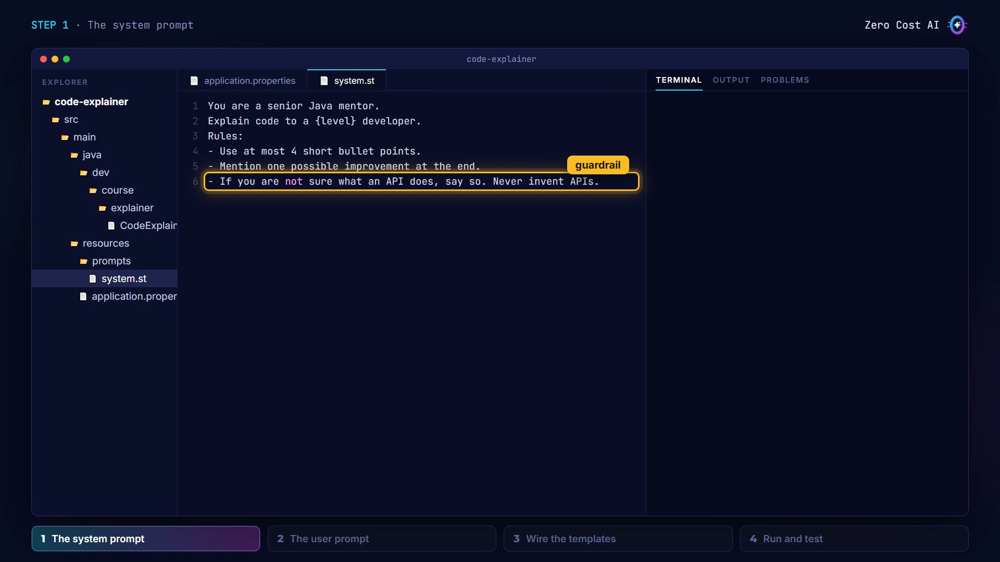
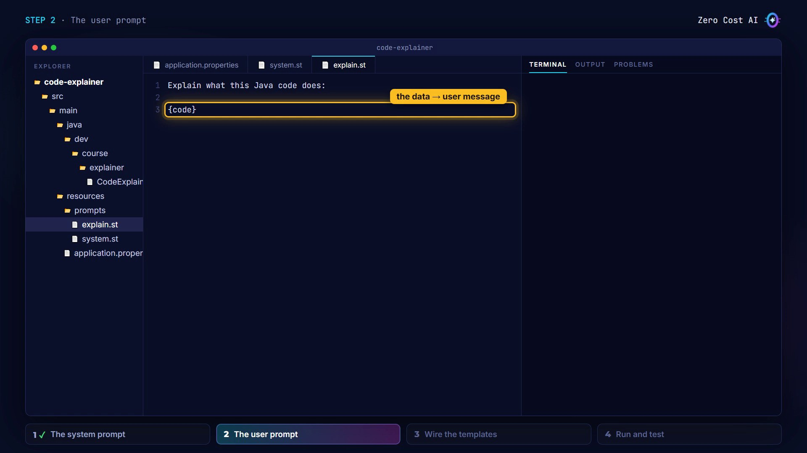
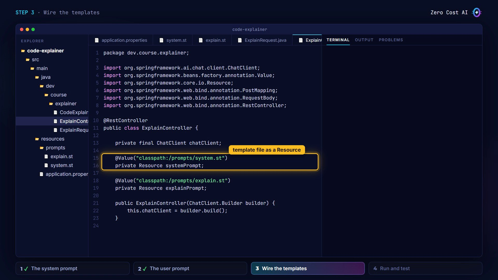
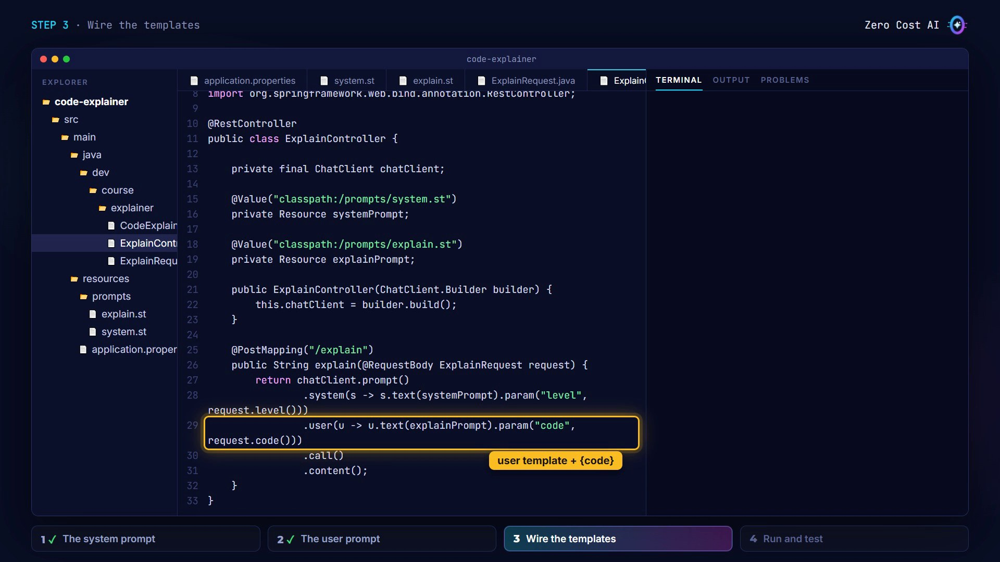
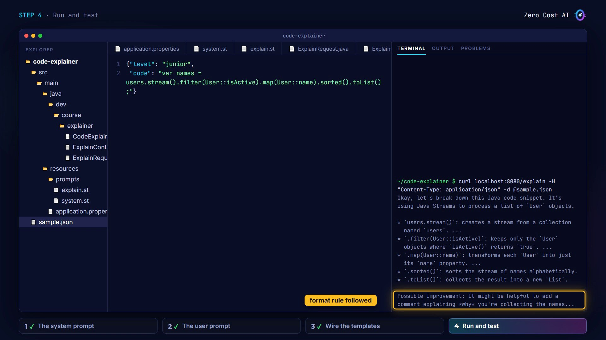
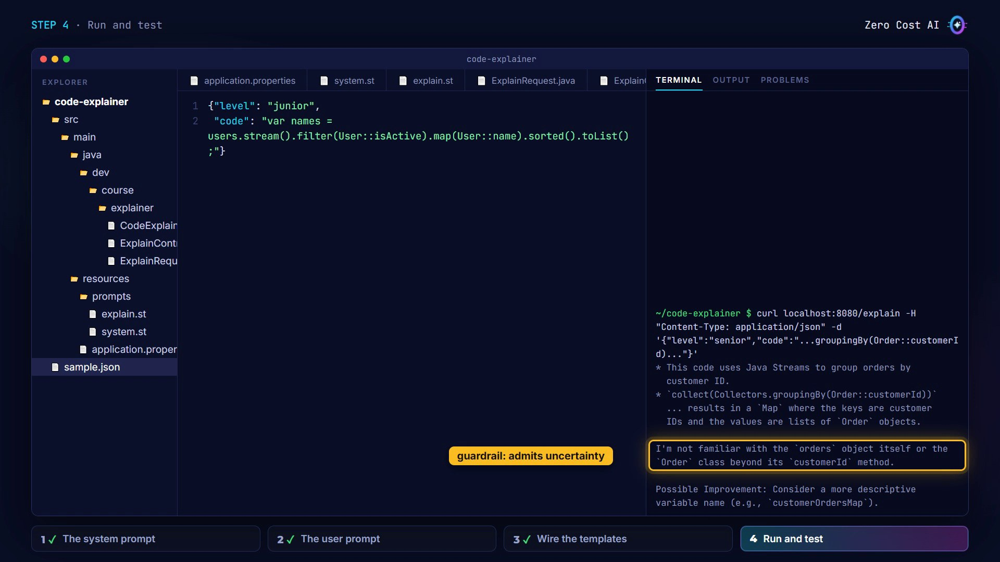
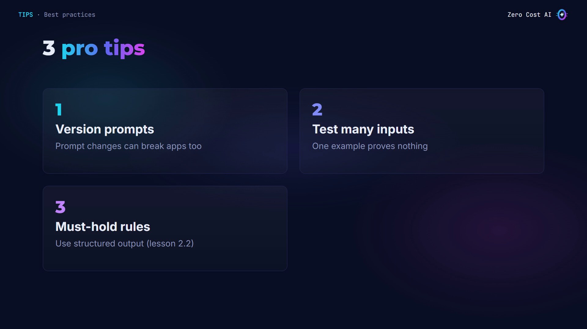
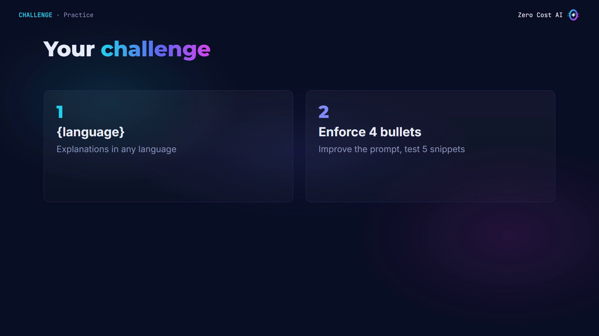

Today, you'll build a code explainer: an API that explains any Java snippet, at the right level for the reader.

And the prompts won't live in Java strings. They'll live in template files.

It's lab 1.3 of my free **Spring AI: Novice to Expert** course, where every lesson has a concept part and a hands-on lab, and everything runs on a free local model with Ollama.

🎥 **Prefer video?** Watch the full tutorial here:

{VIDEO}

## What we'll build

Here's the goal. You post a snippet and a level, junior or senior.

And you get back a short explanation, adapted to that level, with one improvement idea at the end.

### POST /explain

```text
{"level": "junior",
 "code": "var names = users.stream().filter(User::isActive).map(User::name).sorted().toList();"}
```

### Answer

- Short **bullet points**, adapted to a **junior** developer
- One **possible improvement** at the end
- **Says so** when it isn't sure



I've created a new project, code explainer, with Spring Web and Ollama.

**`application.properties`** (`src/main/resources/application.properties`):

```properties
spring.application.name=code-explainer
spring.ai.ollama.chat.model=gemma3:4b
spring.ai.ollama.chat.temperature=0.2
```

Notice the temperature: 0.2. For explanations, we want focused answers, not creativity.



## Step 1: The system prompt

I'll create a prompts folder in resources, with a file called `system.st`.

**`system.st`**:

```text
You are a senior Java mentor.
Explain code to a {level} developer.
Rules:
- Use at most 4 short bullet points.
- Mention one possible improvement at the end.
- If you are not sure what an API does, say so. Never invent APIs.
```

It has all five ingredients. A role: senior Java mentor. The audience, with a level placeholder. Format rules. And a guardrail: never invent APIs.

This line is our guardrail against hallucinations.



## Step 2: The user prompt

`explain.st`. Short, with one placeholder for the code.

**`explain.st`**:

```text
Explain what this Java code does:

{code}
```



The rules stay in the system prompt. The data goes in the user prompt. That's the separation from the concept video.


## Step 3: Wire the templates

First, a record for the request body: the code, and the level.

**`ExplainRequest.java`**:

```java
package dev.course.explainer;

public record ExplainRequest(String code, String level) {
}
```

In the controller, I inject both template files as Spring Resources, with the Value annotation and a classpath location.

**`ExplainController.java`**:

```java
package dev.course.explainer;

import org.springframework.ai.chat.client.ChatClient;
import org.springframework.beans.factory.annotation.Value;
import org.springframework.core.io.Resource;
import org.springframework.web.bind.annotation.PostMapping;
import org.springframework.web.bind.annotation.RequestBody;
import org.springframework.web.bind.annotation.RestController;

@RestController
public class ExplainController {

    private final ChatClient chatClient;

    @Value("classpath:/prompts/system.st")
    private Resource systemPrompt;

    @Value("classpath:/prompts/explain.st")
    private Resource explainPrompt;

    public ExplainController(ChatClient.Builder builder) {
        this.chatClient = builder.build();
    }
```



Now the endpoint. For the system message, I pass the resource, and fill the level parameter.

**`ExplainController.java`** (continued):

```java
    @PostMapping("/explain")
    public String explain(@RequestBody ExplainRequest request) {
        return chatClient.prompt()
                .system(s -> s.text(systemPrompt).param("level", request.level()))
                .user(u -> u.text(explainPrompt).param("code", request.code()))
                .call()
                .content();
    }
}
```

And for the user message, the explain template, with the code parameter. Spring AI renders both templates before calling the model.



No string concatenation anywhere. Want to improve the prompt? Edit the `.st` file, not the Java.

## Step 4: Run and test

I've saved a sample request in `sample.json`: a stream pipeline, for a junior developer.

**`sample.json`** (`sample.json`):

```json
{"level": "junior",
 "code": "var names = users.stream().filter(User::isActive).map(User::name).sorted().toList();"}
```

```bash
$ ./mvnw spring-boot:run
...
Started CodeExplainerApplication in 2.3 seconds
```

Let's post it.

```bash
$ curl localhost:8080/explain -H "Content-Type: application/json" -d @sample.json
Okay, let's break down this Java code snippet. It's
using Java Streams to process a list of `User` objects.

* `users.stream()`: creates a stream from a collection
  named `users`. ...
* `.filter(User::isActive)`: keeps only the `User`
  objects where `isActive()` returns `true`. ...
* `.map(User::name)`: transforms each `User` into just
  its `name` property. ...
* `.sorted()`: sorts the stream of names alphabetically.
* `.toList()`: collects the result into a new `List`.

Possible Improvement: It might be helpful to add a
comment explaining *why* you're collecting the names...
```

A friendly, step-by-step explanation, with an improvement at the end. That's the junior level.



But look: I asked for at most four bullet points, and I got five. Small models don't always follow every rule. A prompt rule is a request, not a guarantee.

Now the same endpoint, with a senior level, and a groupingBy snippet.

```bash
$ curl localhost:8080/explain -H "Content-Type: application/json" -d '{"level":"senior","code":"...groupingBy(Order::customerId)..."}'
* This code uses Java Streams to group orders by
  customer ID.
* `collect(Collectors.groupingBy(Order::customerId))`
  ... results in a `Map` where the keys are customer
  IDs and the values are lists of `Order` objects.

I'm not familiar with the `orders` object itself or the
`Order` class beyond its `customerId` method.

Possible Improvement: Consider a more descriptive
variable name (e.g., `customerOrdersMap`).
```

Shorter and more direct. And look at this: the model says what it isn't sure about. That's our guardrail working.



## 3 pro tips

Three tips from this lab.

Version your prompt files with git. A prompt change can break your app as easily as a code change.

Test each prompt with several real inputs, not just one.

And when a rule really must hold, like valid JSON, don't rely on the prompt alone. Structured output, in lesson 2.2, enforces it.

- **Version prompts**: Prompt changes can break apps too
- **Test many inputs**: One example proves nothing
- **Must-hold rules**: Use structured output (lesson 2.2)



## Your challenge

Your challenge: add a language parameter, so the explanation can be written in French, Spanish, or any language.

Then try to make the model always respect the four-bullet limit, by improving the prompt. Test it on five snippets.

- **{language}**: Explanations in any language
- **Enforce 4 bullets**: Improve the prompt, test 5 snippets



## Recap

- Prompts live in **`.st` files**, injected as `Resource`
- `.system(s -> s.text(..).param(..))` and `.user(u -> ...)`
- Rules are **requests**: test them with real inputs

## Get the code and the quiz

- **Code for this lab**: https://github.com/NEDBS12/youtube-tuto/tree/main/spring-ai-course/labs/code-explainer
- **All course code, quizzes and resources**: https://github.com/NEDBS12/youtube-tuto/tree/main/spring-ai-course
- **Lesson quiz and section evals**: https://nedbs12.github.io/youtube-tuto/spring-ai-course/quiz/
- **Ollama**: https://ollama.com
- **Spring AI prompts docs**: https://docs.spring.io/spring-ai/reference/api/prompt.html
- **Spring AI reference docs**: https://docs.spring.io/spring-ai/reference/

🎥 **Watch the video tutorial:** {VIDEO_URL}

**Previous: Lesson 1.3, prompts and templates. Next: Lesson 1.4, model options and providers.**

*The editor and terminal in the screenshots are a simplified recreation; the code and the outputs come from real runs of the lab.*

*I'm Zero Cost AI: I build AI tools and tutorials and share them for free. Follow me on Medium for the next lessons, and subscribe on YouTube: https://www.youtube.com/@zerocostai-f1h*
