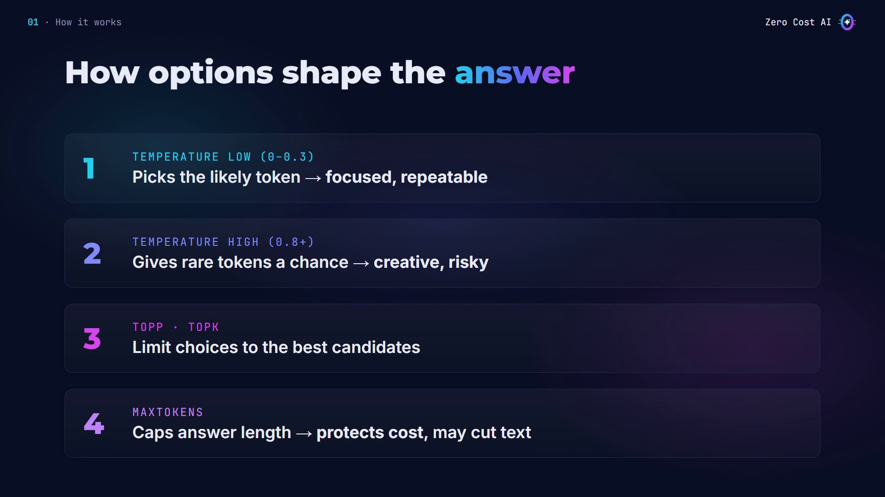
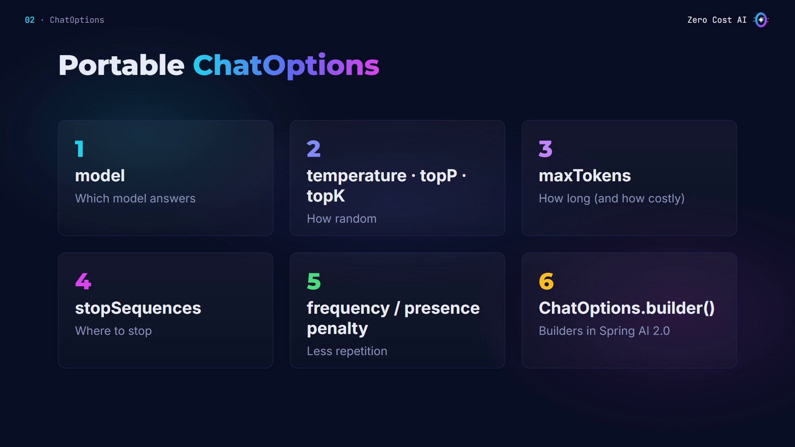
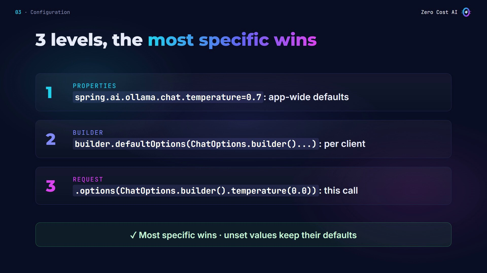
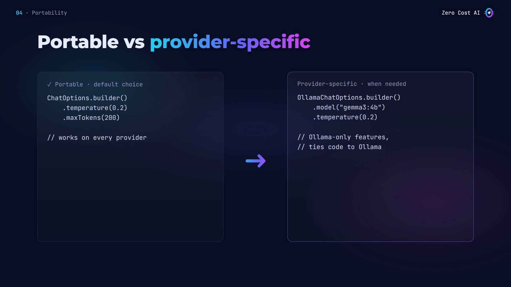
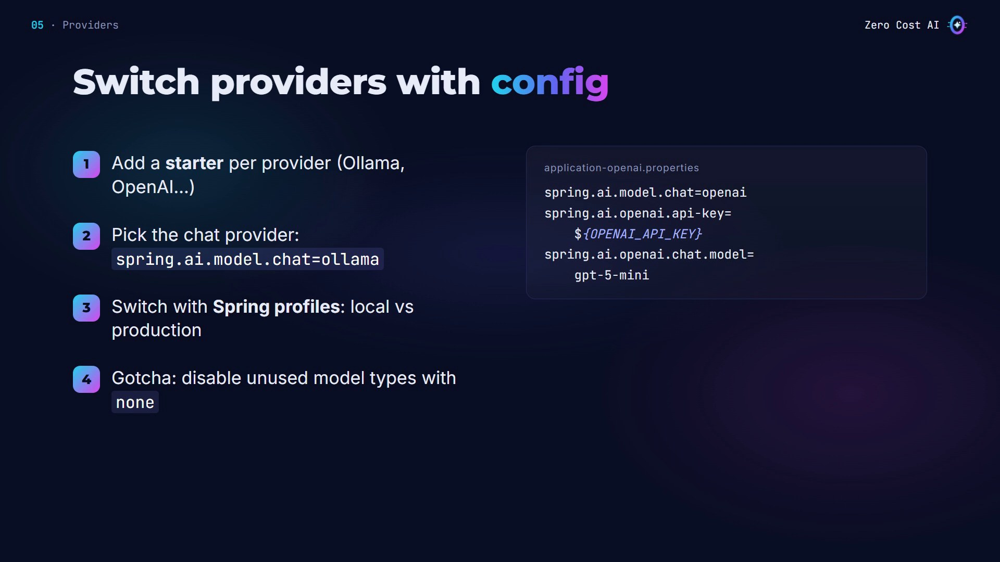
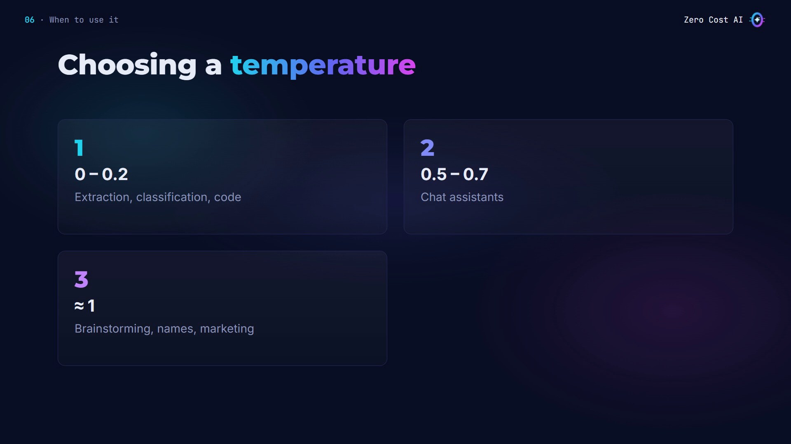

Ask a model the same question twice, and you may get two different answers. Is that a bug?

No. It's a setting. In this lesson, you'll learn the model options that control answers, and how to switch models and providers without touching your code.

It's lesson 1.4 of my free **Spring AI: Novice to Expert** course, where every lesson has a concept part and a hands-on lab, and everything runs on a free local model with Ollama.

🎥 **Prefer video?** Watch the full tutorial here:

{VIDEO}

## How options shape the answer

Remember: a model predicts the next token. More precisely, it gives every possible next token a probability.

Temperature reshapes those probabilities. Low temperature means the model almost always picks the most likely token. Focused and repeatable.

High temperature gives less likely tokens a real chance. More variety, more creativity, and more risk of nonsense.

Top P and top K are other ways to limit the choice to the best candidates. In practice, tune one thing at a time, usually the temperature.

And max tokens caps the length of the answer. It protects your cost, but a too-small value cuts the answer off.

- **temperature low (0–0.3)**: Picks the likely token → **focused, repeatable**
- **temperature high (0.8+)**: Gives rare tokens a chance → **creative, risky**
- **topP · topK**: Limit choices to the best candidates
- **maxTokens**: Caps answer length → **protects cost**, may cut text



## Portable ChatOptions

Spring AI defines these as portable options, in the ChatOptions interface. They work on every provider.

Model, to choose the model.

Temperature, top P and top K, for randomness.

Max tokens, for length.

Stop sequences, to stop at a given text.

And frequency and presence penalties, to reduce repetition.

In Spring AI two, you create options with a builder: `ChatOptions.builder()`.

- **model**: Which model answers
- **temperature · topP · topK**: How random
- **maxTokens**: How long (and how costly)
- **stopSequences**: Where to stop
- **frequency / presence penalty**: Less repetition
- **ChatOptions.builder()**: Builders in Spring AI 2.0



## 3 levels, the most specific wins

You can set options at three levels.

In application properties. These are the start-up defaults for the whole app.

On the ChatClient builder, with defaultOptions. Defaults for one client.

And on one request, with `.options()`. Only for that call.

The most specific level wins. And what you don't set keeps its default. Set only the temperature on a request, and the model stays the same.

- **Properties**: `spring.ai.ollama.chat.temperature=0.7`: app-wide defaults
- **Builder**: `builder.defaultOptions(ChatOptions.builder()...)`: per client
- **Request**: `.options(ChatOptions.builder().temperature(0.0))`: this call

**✓ Most specific wins · unset values keep their defaults**



## Portable vs provider-specific

Portable options cover the common needs. But each provider also has its own options class.

Like OllamaChatOptions, or OpenAiChatOptions, for features only that provider has.

Use portable options by default. Use provider options only when you need a special feature, because they tie your code to that provider.

### ✓ Portable · default choice

```text
ChatOptions.builder()
    .temperature(0.2)
    .maxTokens(200)

// works on every provider
```

### Provider-specific · when needed

```text
OllamaChatOptions.builder()
    .model("gemma3:4b")
    .temperature(0.2)

// Ollama-only features,
// ties code to Ollama
```



## Switch providers with config

Now, switching providers. Three building blocks.

Add the starter for each provider you want. For example, Ollama and OpenAI.

Tell Spring AI which one to use for chat, with the property `spring.ai.model.chat`.

And use Spring profiles to switch: a default profile for free local development, and an OpenAI profile for production.

One gotcha. A provider starter also brings other model types, like images or audio. Turn the ones you don't use off, with none, or they may ask for an API key at start-up.

- Add a **starter** per provider (Ollama, OpenAI…)
- Pick the chat provider: `spring.ai.model.chat=ollama`
- Switch with **Spring profiles**: local vs production
- Gotcha: disable unused model types with `none`

In code:

```properties
spring.ai.model.chat=openai
spring.ai.openai.api-key=
    ${OPENAI_API_KEY}
spring.ai.openai.chat.model=
    gpt-5-mini
```



## Choosing a temperature

Finally, which temperature should you use?

Zero to 0.2 for extraction, classification, and code. You want the same answer every time.

Around 0.5 to 0.7 for chat assistants.

And around one for brainstorming, names, and marketing ideas. Just review the results.

- **0 – 0.2**: Extraction, classification, code
- **0.5 – 0.7**: Chat assistants
- **≈ 1**: Brainstorming, names, marketing



## Recap

- **Temperature** controls randomness; **maxTokens** controls length and cost
- Properties → builder → request: the **most specific wins**
- Switch providers with **starters + `spring.ai.model.chat` + profiles**

## Quick quiz

Test yourself before you read the answers.

1. **Temperature**: You need the same answer every time. Which temperature?
2. **Precedence**: Properties say 0.7, the request says 0.0. Which applies?
3. **Providers**: Two starters are on the classpath. How do you pick the chat one?

**Answers:**

1. Low: **0 to 0.2**
2. The **request**: most specific wins
3. `spring.ai.model.chat=ollama`

The full five-question quiz for this lesson is free on the course quiz page: https://nedbs12.github.io/youtube-tuto/spring-ai-course/quiz/

## Get the code and the quiz

- **Lab code for this lesson**: https://github.com/NEDBS12/youtube-tuto/tree/main/spring-ai-course/labs/model-options
- **All course code, quizzes and resources**: https://github.com/NEDBS12/youtube-tuto/tree/main/spring-ai-course
- **Lesson quiz and section evals**: https://nedbs12.github.io/youtube-tuto/spring-ai-course/quiz/
- **Spring AI chat model API docs**: https://docs.spring.io/spring-ai/reference/api/chatmodel.html
- **Spring AI reference docs**: https://docs.spring.io/spring-ai/reference/

🎥 **Watch the video tutorial:** {VIDEO_URL}

**Previous: Lab 1.3. Next: Lab 1.4, tune options and switch models with profiles.**

*I'm Zero Cost AI: I build AI tools and tutorials and share them for free. Follow me on Medium for the next lessons, and subscribe on YouTube: https://www.youtube.com/@zerocostai-f1h*
