4, the last lab of section one.

Today you'll set the temperature per request, see its effect live, and switch models and providers with Spring profiles, without changing a line of Java.

It's lab 1.4 of my free **Spring AI: Novice to Expert** course, where every lesson has a concept part and a hands-on lab, and everything runs on a free local model with Ollama.

🎥 **Prefer video?** Watch the full tutorial here:

{VIDEO}

## A tagline generator

Our app is a tagline generator. Give it a product, and it writes a marketing tagline.

It's the perfect test for temperature, because creativity matters here.

Five steps: two providers, their configuration, options per request, a live temperature comparison, and profiles.

1. **Two providers**: Ollama + OpenAI starters
2. **Configure them**: `spring.ai.model.chat`
3. **Options per request**: `temperature` + `maxTokens`
4. **Compare temperatures**: 0 vs 1.2, live
5. **Switch with profiles**: llama · openai

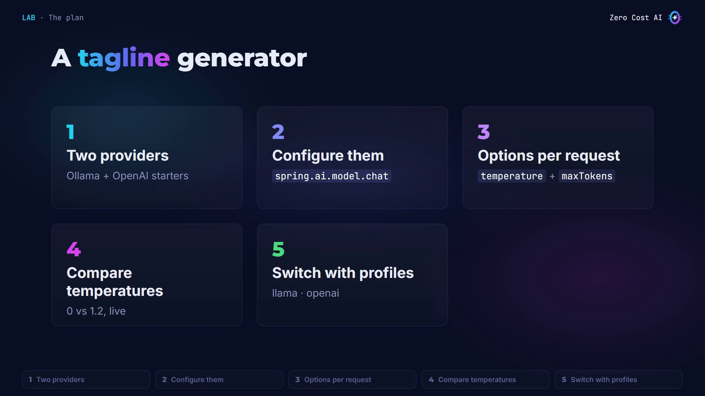

## Step 1: Two providers

When I generated this project, I added Spring Web, Ollama, and OpenAI. So the pom has both starters.

**`pom.xml`** (`pom.xml`):

```xml
<!-- pom.xml (excerpt) -->
<dependency>
    <groupId>org.springframework.ai</groupId>
    <artifactId>spring-ai-starter-model-ollama</artifactId>
</dependency>
<dependency>
    <groupId>org.springframework.ai</groupId>
    <artifactId>spring-ai-starter-model-openai</artifactId>
</dependency>
```

Two starters means two chat models. Spring AI needs to know which one to use.

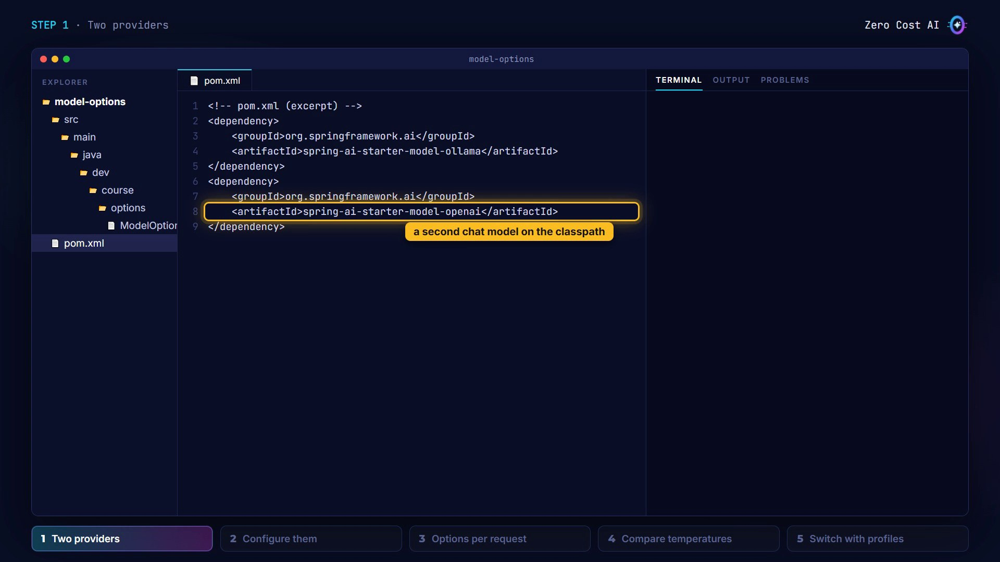

## Step 2: Configure them

In application properties, I choose Ollama for chat.

**`application.properties`** (`src/main/resources/application.properties`):

```properties
spring.application.name=model-options
```

**`application.properties`** (continued):

```properties
spring.ai.model.chat=ollama
```

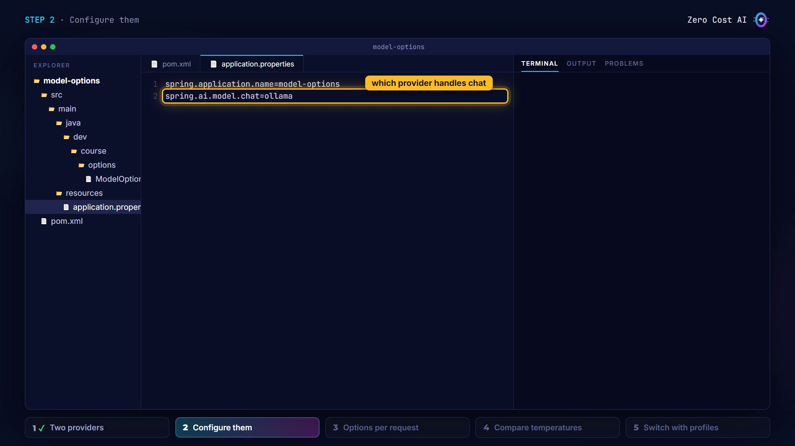

Now the gotcha from the concept video. I first tried without these next lines, and the app refused to start. The OpenAI starter also creates audio and image models, and they wanted an API key.

**APPLICATION FAILED TO START**

> Error creating bean 'openAiSdkAudioSpeechModel': At least one credential source must be specified: credential (apiKey)...

So I turn every model type I don't use off, with none.

**`application.properties`** (continued):

```properties
spring.ai.model.embedding=none
spring.ai.model.image=none
spring.ai.model.audio.speech=none
spring.ai.model.audio.transcription=none
spring.ai.model.moderation=none
```

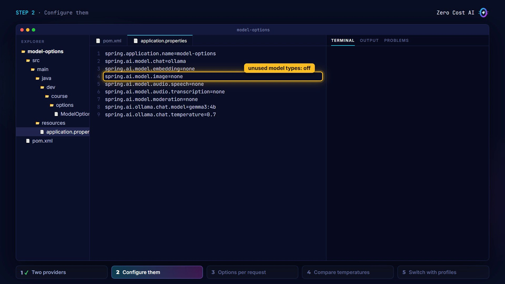

And the Ollama defaults: Gemma, at a temperature of 0.7.

**`application.properties`** (continued):

```properties
spring.ai.ollama.chat.model=gemma3:4b
spring.ai.ollama.chat.temperature=0.7
```

## Step 3: Options per request

First, a record for the response: the model, the temperature, and the tagline.

**`Tagline.java`**:

```java
package dev.course.options;

public record Tagline(String model, Double temperature, String text) {
}
```

The controller takes a product, and an optional temperature, defaulting to 0.7.

**`TaglineController.java`**:

```java
package dev.course.options;

import org.springframework.ai.chat.client.ChatClient;
import org.springframework.ai.chat.model.ChatResponse;
import org.springframework.ai.chat.prompt.ChatOptions;
import org.springframework.web.bind.annotation.GetMapping;
import org.springframework.web.bind.annotation.RequestParam;
import org.springframework.web.bind.annotation.RestController;

@RestController
public class TaglineController {

    private final ChatClient chatClient;

    public TaglineController(ChatClient.Builder builder) {
        this.chatClient = builder.build();
    }

    @GetMapping("/tagline")
    public Tagline tagline(@RequestParam String product,
                           @RequestParam(defaultValue = "0.7") double temperature) {
        ChatResponse response = chatClient.prompt()
                .user("Write one short marketing tagline for: " + product + ". Reply with the tagline only.")
                .options(ChatOptions.builder()
                        .temperature(temperature)
                        .maxTokens(30))
                .call()
                .chatResponse();
        return new Tagline(response.getMetadata().getModel(), temperature,
                response.getResult().getOutput().getText());
    }
}
```

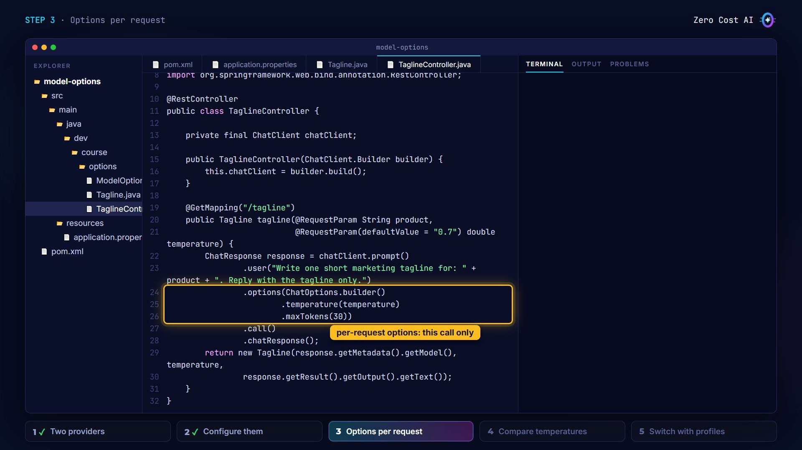

Here's the key part. `.options()`, with a ChatOptions builder: the temperature from the request, and max tokens 30, because a tagline is short.

Notice I pass the builder itself. In Spring AI two, options are built for you.

And I return the model name from the metadata, so we can see which model answered.

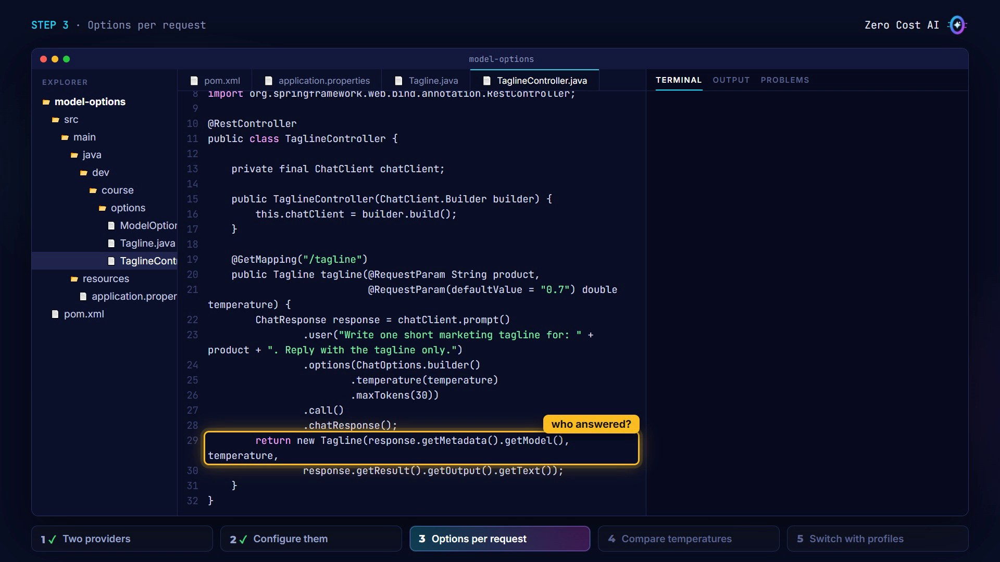

## Step 4: Compare temperatures

I start the app, and call it twice at temperature zero.

```bash
$ ./mvnw spring-boot:run
...
Started ModelOptionsApplication in 2.3 seconds
```

```bash
$ curl "localhost:8080/tagline?product=a+coffee+shop+for+Java+developers&temperature=0"
{"model":"gemma3:4b","temperature":0.0,
 "text":"Code. Coffee. Connect."}
```

```bash
$ curl "localhost:8080/tagline?product=a+coffee+shop+for+Java+developers&temperature=0"
{"model":"gemma3:4b","temperature":0.0,
 "text":"Code. Coffee. Connect."}
```

The exact same tagline, twice. Temperature zero is repeatable.

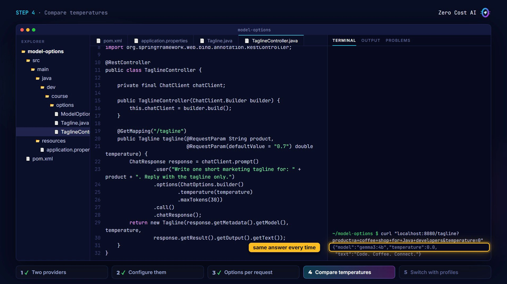

Now four calls at 1.2.

```bash
$ curl "localhost:8080/tagline?product=a+coffee+shop+for+Java+developers&temperature=1.2"
{"model":"gemma3:4b","temperature":1.2,
 "text":"Code. Coffee. Conquer."}
```

```bash
$ curl "localhost:8080/tagline?product=a+coffee+shop+for+Java+developers&temperature=1.2"
{"model":"gemma3:4b","temperature":1.2,
 "text":"Code. Coffee. Connect."}
```

```bash
$ curl "localhost:8080/tagline?product=a+coffee+shop+for+Java+developers&temperature=1.2"
{"model":"gemma3:4b","temperature":1.2,
 "text":"Code. Coffee. Connect."}
```

```bash
$ curl "localhost:8080/tagline?product=a+coffee+shop+for+Java+developers&temperature=1.2"
{"model":"gemma3:4b","temperature":1.2,
 "text":"Compile. Brew. Repeat."}
```

Now we get variety: Conquer, Connect, and Compile, Brew, Repeat. Some answers repeat, because a higher temperature makes variety more likely, not guaranteed.

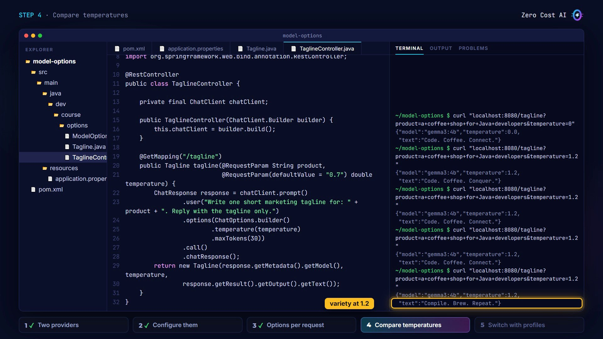

## Step 5: Switch with profiles

I've pulled a second, smaller model: llama3.2, 1 billion parameters.

```bash
$ ollama pull llama3.2:1b
pulling manifest
...
success
```

I create `application-llama.properties`, with one line: the model name.

**`application-llama.properties`**:

```properties
spring.ai.ollama.chat.model=llama3.2:1b
```

Then I restart with the llama profile, and call the same endpoint.

```bash
$ ./mvnw spring-boot:run -Dspring-boot.run.profiles=llama
...
Started ModelOptionsApplication in 2.2 seconds
```

```bash
$ curl "localhost:8080/tagline?product=a+coffee+shop+for+Java+developers&temperature=0"
{"model":"llama3.2:1b","temperature":0.0,
 "text":"\"Code, Brew, Repeat\""}
```

The model in the response is now llama3.2. Same Java code, different model.

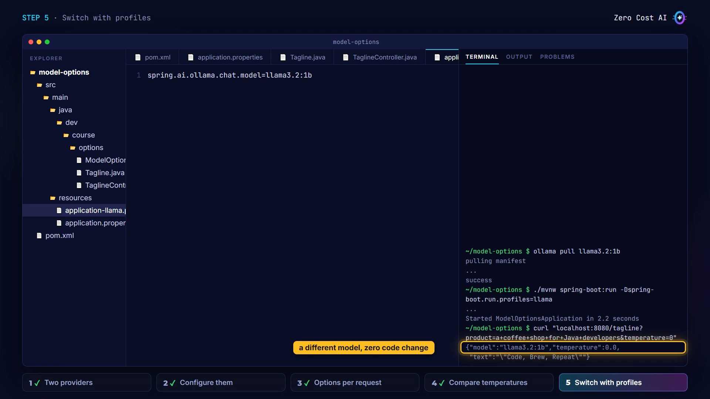

And for production, `application-openai.properties` switches the provider itself, with the key from an environment variable.

**`application-openai.properties`**:

```properties
spring.ai.model.chat=openai
spring.ai.openai.api-key=${OPENAI_API_KEY}
spring.ai.openai.chat.model=gpt-5-mini
```

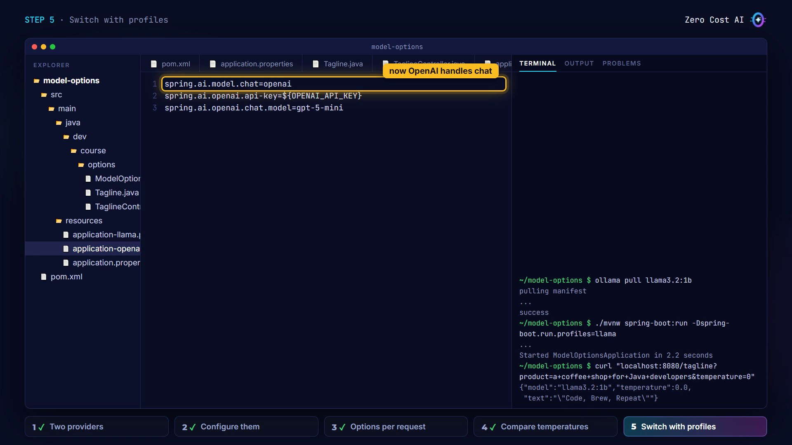

I don't use a paid key in this course. But with a real key, run with the openai profile, and the same endpoint answers with OpenAI.

## 3 pro tips

Develop and test for free with Ollama, then use a profile for your hosted provider in production.

Set a max tokens limit on every endpoint. It's your safety net against runaway costs.

And never put an API key in a properties file. Always use an environment variable or a secret manager.

- **Free dev, paid prod**: Ollama locally, profile for prod
- **Always set maxTokens**: A safety net for cost
- **Keys in env vars**: `${OPENAI_API_KEY}`, never committed

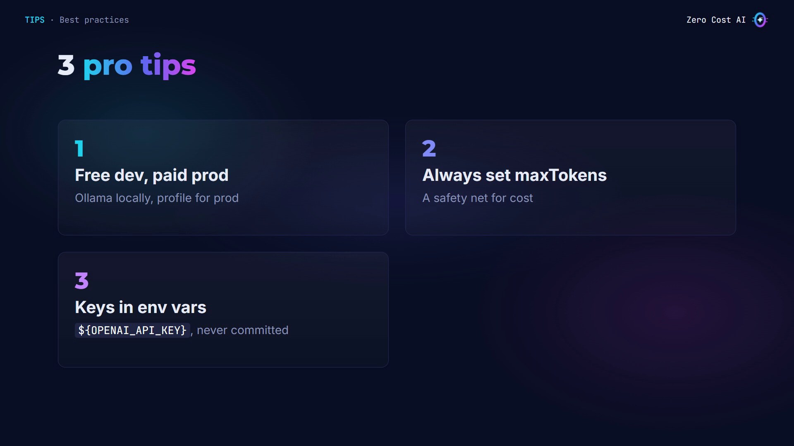

## Your challenge

Your challenge: add a `/names` endpoint that suggests five product names, with its own default temperature of one.

Then lower max tokens to five, and see what happens to the answer. That's why the limit matters.

- **/names**: 5 product names, temperature 1
- **maxTokens = 5**: Watch the answer get cut off

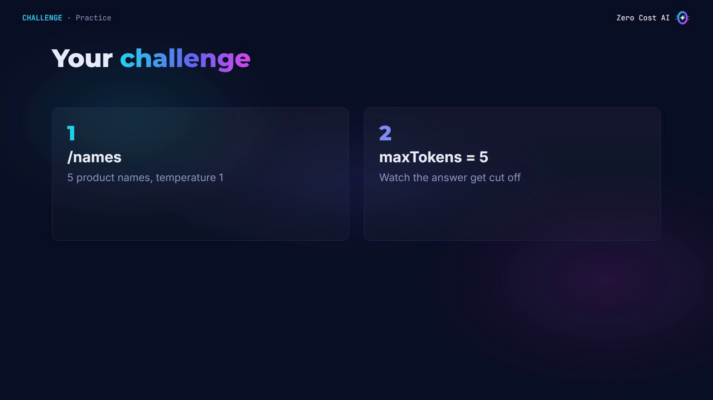

## Recap

- `.options(ChatOptions.builder()...)` sets options **per request**
- Temperature 0 = **repeatable**; higher = more **variety**
- Profiles + `spring.ai.model.chat` switch models and providers

## Get the code and the quiz

- **Code for this lab**: https://github.com/NEDBS12/youtube-tuto/tree/main/spring-ai-course/labs/model-options
- **All course code, quizzes and resources**: https://github.com/NEDBS12/youtube-tuto/tree/main/spring-ai-course
- **Section 1 eval and lesson quizzes**: https://nedbs12.github.io/youtube-tuto/spring-ai-course/quiz/
- **Ollama**: https://ollama.com
- **Spring AI OpenAI docs**: https://docs.spring.io/spring-ai/reference/api/chat/openai-chat.html
- **Spring AI reference docs**: https://docs.spring.io/spring-ai/reference/

🎥 **Watch the video tutorial:** {VIDEO_URL}

**Previous: Lesson 1.4, model options. Section 1 is complete: take the Section 1 eval (link above) to check your level!**

*The editor and terminal in the screenshots are a simplified recreation; the code and the outputs come from real runs of the lab.*

*I'm Zero Cost AI: I build AI tools and tutorials and share them for free. Follow me on Medium for the next lessons, and subscribe on YouTube: https://www.youtube.com/@zerocostai-f1h*
