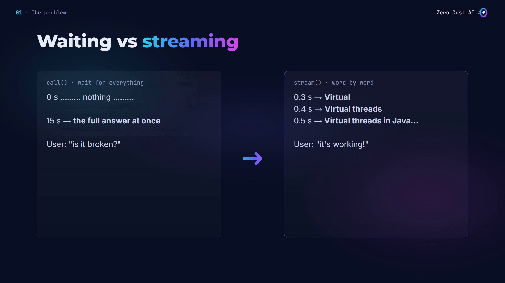
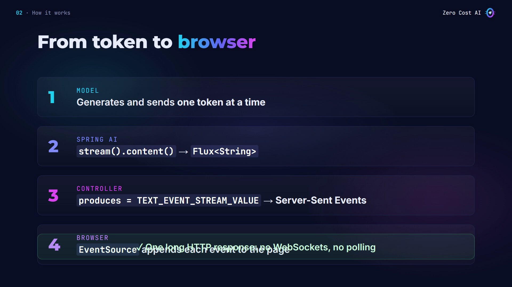
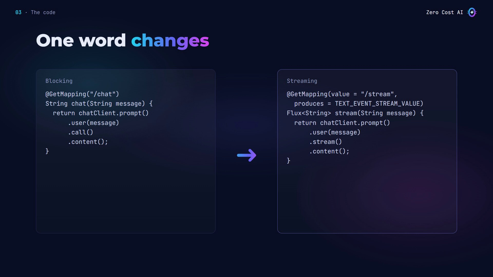
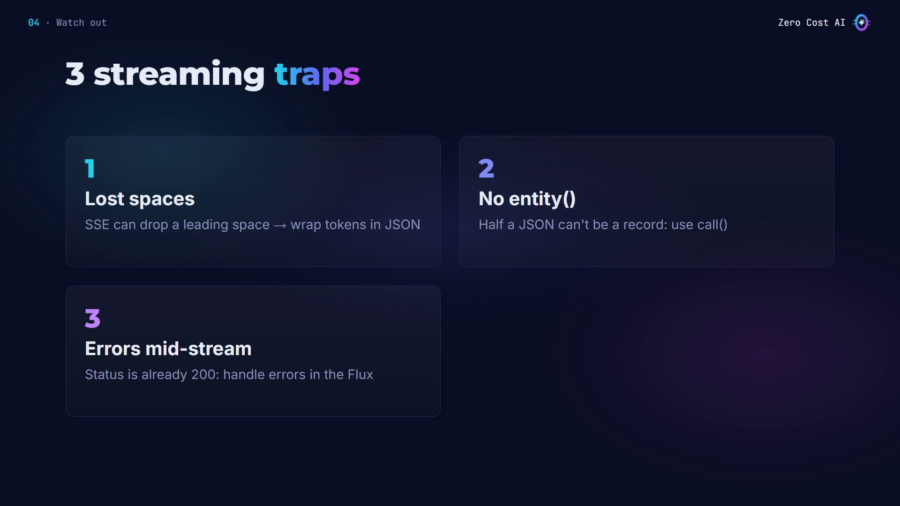
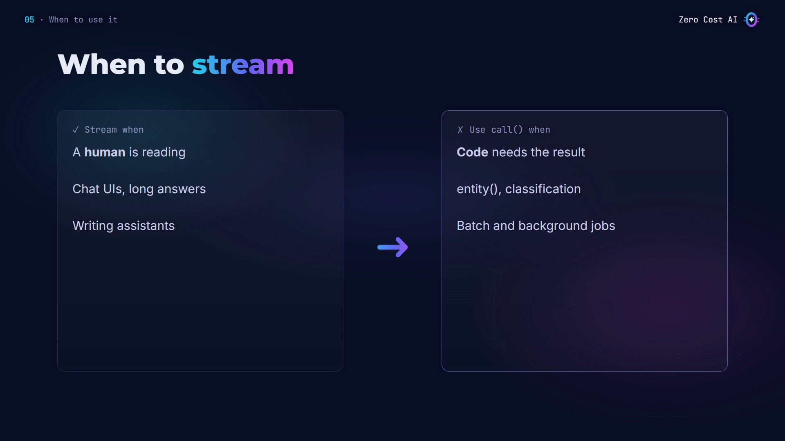

Welcome to section two: building real chat applications. And we start with the feature users notice first.

When you use a chatbot, the answer appears word by word. You never stare at a blank screen for 20 seconds. That's streaming.

In this lesson, you'll learn how streaming works, and how Spring AI makes it one method call.

It's lesson 2.1 of my free **Spring AI: Novice to Expert** course, where every lesson has a concept part and a hands-on lab, and everything runs on a free local model with Ollama.

🎥 **Prefer video?** Watch the full tutorial here:

{VIDEO}

## Waiting vs streaming

Here's the problem.

With call, your code waits until the model has generated the whole answer. For a long answer, that can take ten or 20 seconds, and the user sees nothing.

With stream, you send each piece of text the moment the model produces it. The first words arrive in a fraction of a second.

The total time is the same. The cost is the same. But it feels much faster.

### call() · wait for everything

- 0 s ……… nothing ………
- 15 s → **the full answer at once**
- User: "is it broken?"

### stream() · word by word

- 0.3 s → **Virtual**
0.4 s → **Virtual threads**
0.5 s → **Virtual threads in Java…**
- User: "it's working!"



## From token to browser

How does it work? Remember, a model generates one token at a time.

With streaming, the provider sends each token as soon as it's generated, instead of collecting them.

In Spring AI, stream returns a Flux. That's Project Reactor's type for a stream of values over time.

Your controller returns that Flux, with the media type text event stream. Spring sends each value to the browser as a Server-Sent Event.

And in the browser, the EventSource API receives each event, and appends it to the page.

No WebSockets, no polling. Just one long HTTP response.

- **Model**: Generates and sends **one token at a time**
- **Spring AI**: `stream().content()` → `Flux<String>`
- **Controller**: `produces = TEXT_EVENT_STREAM_VALUE` → **Server-Sent Events**
- **Browser**: `EventSource` appends each event to the page

**✓ One long HTTP response: no WebSockets, no polling**



## One word changes

In code, the change is tiny.

Replace call with stream. And return a Flux, with the event stream media type.

Spring MVC supports Flux return values. You don't need to switch your app to WebFlux.

### Blocking

```text
@GetMapping("/chat")
String chat(String message) {
  return chatClient.prompt()
      .user(message)
      .call()
      .content();
}
```

### Streaming

```text
@GetMapping(value = "/stream",
  produces = TEXT_EVENT_STREAM_VALUE)
Flux<String> stream(String message) {
  return chatClient.prompt()
      .user(message)
      .stream()
      .content();
}
```



## 3 streaming traps

Streaming has a few traps. Here are three you'll meet.

Spaces. Tokens often start with a space. The Server-Sent Events format can drop it, and your words get glued together. Wrapping each token in JSON fixes it. We'll see it live in the lab.

Structured output. You can't map half a JSON object to a record. For entity, use call.

And errors. Once streaming has started, the HTTP status is already 200. Handle errors inside the stream.

- **Lost spaces**: SSE can drop a leading space → wrap tokens in JSON
- **No entity()**: Half a JSON can't be a record: use call()
- **Errors mid-stream**: Status is already 200: handle errors in the Flux



## When to stream

So, when should you stream?

Stream when a human is waiting and reading: chat interfaces, long explanations, writing assistants.

Don't stream when code is waiting for the result: structured output, classification, or a backend job. There, call is simpler.

### ✓ Stream when

- A **human** is reading
- Chat UIs, long answers
- Writing assistants

### ✗ Use call() when

- **Code** needs the result
- entity(), classification
- Batch and background jobs



## Recap

- `stream().content()` returns a **Flux** of text chunks
- Return it with **text/event-stream**: the browser gets Server-Sent Events
- Stream for **humans**; use call() when code needs the result

## Quick quiz

Test yourself before you read the answers.

1. **API**: Which method streams the answer?
2. **Media type**: Which media type sends a Flux as Server-Sent Events?
3. **Cost**: Does streaming reduce the number of tokens?

**Answers:**

1. `stream().content()` → **Flux<String>**
2. **text/event-stream**
3. **No**: same tokens, it only feels faster

The full five-question quiz for this lesson is free on the course quiz page: https://nedbs12.github.io/youtube-tuto/spring-ai-course/quiz/

## Get the code and the quiz

- **Lab code for this lesson**: https://github.com/NEDBS12/youtube-tuto/tree/main/spring-ai-course/labs/streaming-chat
- **All course code, quizzes and resources**: https://github.com/NEDBS12/youtube-tuto/tree/main/spring-ai-course
- **Lesson quiz and section evals**: https://nedbs12.github.io/youtube-tuto/spring-ai-course/quiz/
- **Spring AI ChatClient docs**: https://docs.spring.io/spring-ai/reference/api/chatclient.html
- **Spring AI reference docs**: https://docs.spring.io/spring-ai/reference/

🎥 **Watch the video tutorial:** {VIDEO_URL}

**Previous: Lab 1.4 (Section 1 complete). Next: Lab 2.1, build a streaming chat.**

*I'm Zero Cost AI: I build AI tools and tutorials and share them for free. Follow me on Medium for the next lessons, and subscribe on YouTube: https://www.youtube.com/@zerocostai-f1h*
