Today, you'll build a chat that streams its answer word by word, into a real web page.

And we'll hit a sneaky bug on the way, and fix it.

It's lab 2.1 of my free **Spring AI: Novice to Expert** course, where every lesson has a concept part and a hands-on lab, and everything runs on a free local model with Ollama.

🎥 **Prefer video?** Watch the full tutorial here:

{VIDEO}

## What we'll build

A streaming endpoint, a curl test, a web page, a bug fix, and the final result in the browser.

1. **The streaming endpoint**: `Flux` + `text/event-stream`
2. **Test with curl**: Watch the events arrive
3. **A web page**: `EventSource` in 15 lines
4. **Fix the spaces**: Wrap tokens in JSON
5. **See it stream**: In a real browser

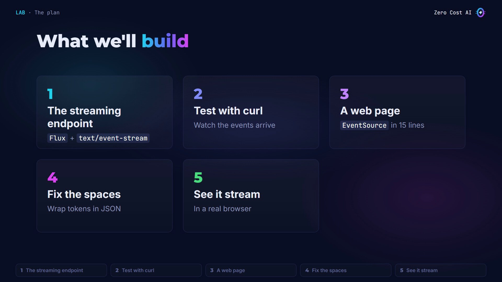

## Step 1: The streaming endpoint

Step one. A new project, streaming chat, with Spring Web and Ollama. Just like before.

**`application.properties`** (`src/main/resources/application.properties`):

```properties
spring.application.name=streaming-chat
spring.ai.ollama.chat.model=gemma3:4b
```

I create StreamController, and inject the ChatClient builder.

**`StreamController.java`**:

```java
package dev.course.streaming;

import org.springframework.ai.chat.client.ChatClient;
import org.springframework.http.MediaType;
import org.springframework.web.bind.annotation.GetMapping;
import org.springframework.web.bind.annotation.RequestParam;
import org.springframework.web.bind.annotation.RestController;
import reactor.core.publisher.Flux;

@RestController
public class StreamController {

    private final ChatClient chatClient;

    public StreamController(ChatClient.Builder builder) {
        this.chatClient = builder.build();
    }
```

The endpoint produces text event stream, and returns a Flux of strings.

**`StreamController.java`** (continued):

```java
    @GetMapping(value = "/stream", produces = MediaType.TEXT_EVENT_STREAM_VALUE)
    public Flux<String> stream(@RequestParam String message) {
        return chatClient.prompt()
                .user(message)
                .stream()
                .content();
    }
}
```

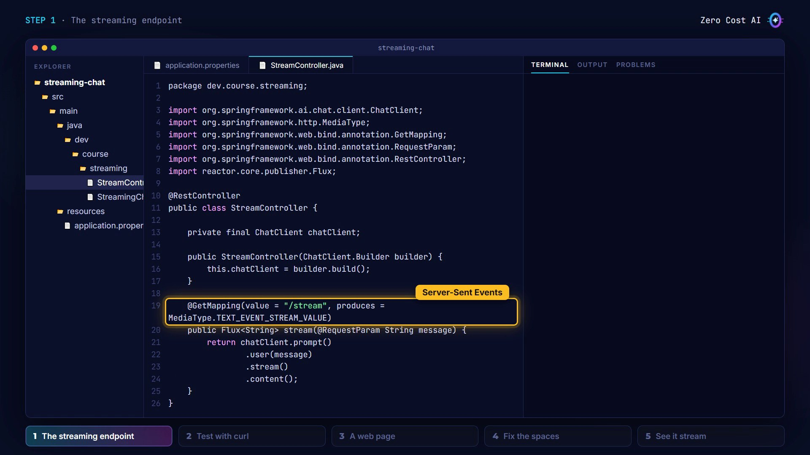

And the only real change from our first lab: stream instead of call.

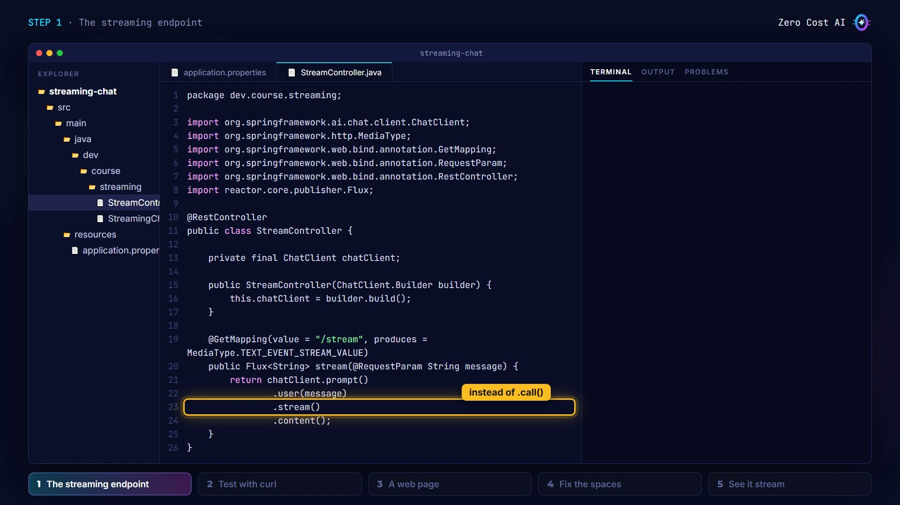

## Step 2: Test with curl

Step two. Let's run it, and test with curl. The minus N flag tells curl not to buffer, so we see each event as it arrives.

```bash
$ ./mvnw spring-boot:run
...
Started StreamingChatApplication in 2.3 seconds
```

```bash
$ curl -N "localhost:8080/stream?message=Explain+virtual+threads+in+Java+in+3+sentences"
data:Virtual

data: threads

data: in

data: Java

data: are

data: lightweight
...
```

Each token is one event, starting with `data:`. They arrived about 40 milliseconds apart.

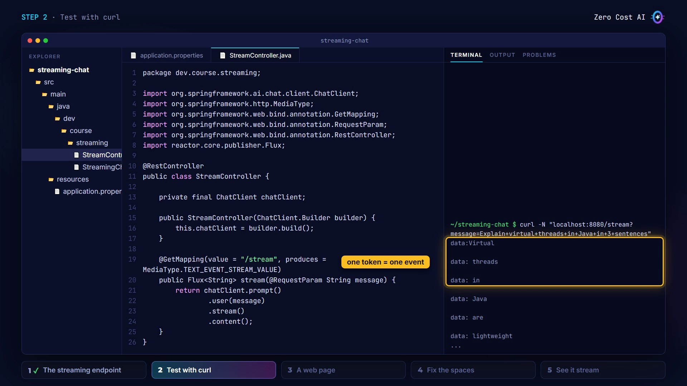

Notice something: most tokens start with a space. `data:`, space, threads. Remember that.

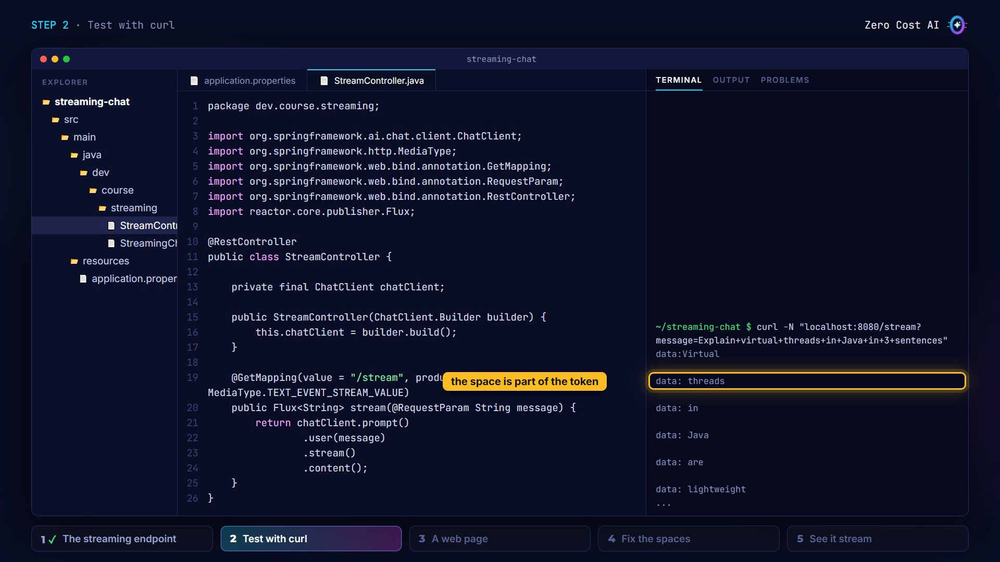

## Step 3: A web page

I'll add `index.html` in `resources/static`. Spring Boot serves it at the root.

**`index.html`**:

```html
<!doctype html>
<html>
<body style="font-family: sans-serif; max-width: 640px; margin: 40px auto">
<h2>Streaming chat</h2>
<input id="q" size="50" value="Explain virtual threads in Java in 3 sentences">
<button onclick="ask()">Ask</button>
<p id="answer"></p>
<script>
function ask() {
  const answer = document.getElementById("answer");
  answer.textContent = "";
  const q = encodeURIComponent(document.getElementById("q").value);
  const source = new EventSource("/stream?message=" + q);
  source.onmessage = (e) => answer.textContent += e.data;
  source.onerror = () => source.close();
}
</script>
</body>
</html>
```

When you click Ask, the page opens an EventSource on `/stream`, and appends each event's data to the answer.

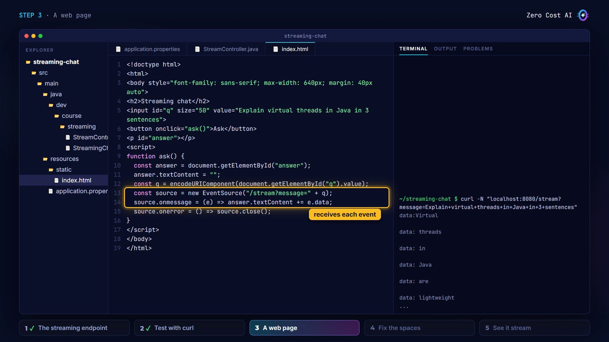

Let's try it in the browser.

## Where did the spaces go?

Hmm. The words are glued together. Virtual threads in Java, without a single space.

Here's why. The Server-Sent Events standard says: the browser removes one space after `data:`. And our spaces were exactly there.

So every token that started with a space lost it. The model was fine. Our transport ate the spaces.

- SSE removes **one space** after `data:`
- Tokens like `" threads"` lose their space

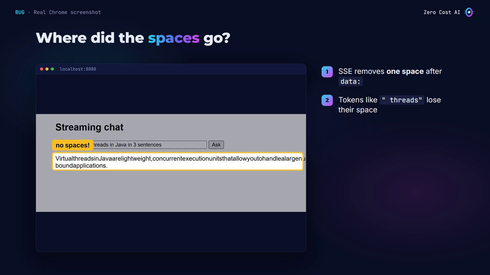

## Step 4: Fix the spaces

Instead of raw strings, I'll send a tiny JSON object per token. A record, Token, with one field: text.

**`Token.java`**:

```java
package dev.course.streaming;

public record Token(String text) {
}
```

In the controller, the Flux now emits Tokens. I just map each string with `Token::new`.

**`StreamController.java`** (`src/main/java/dev/course/streaming/StreamController.java`):

```java
package dev.course.streaming;

import org.springframework.ai.chat.client.ChatClient;
import org.springframework.http.MediaType;
import org.springframework.web.bind.annotation.GetMapping;
import org.springframework.web.bind.annotation.RequestParam;
import org.springframework.web.bind.annotation.RestController;
import reactor.core.publisher.Flux;

@RestController
public class StreamController {

    private final ChatClient chatClient;

    public StreamController(ChatClient.Builder builder) {
        this.chatClient = builder.build();
    }

    @GetMapping(value = "/stream", produces = MediaType.TEXT_EVENT_STREAM_VALUE)
    public Flux<Token> stream(@RequestParam String message) {
        return chatClient.prompt()
                .user(message)
                .stream()
                .content()
                .map(Token::new);
    }
}
```

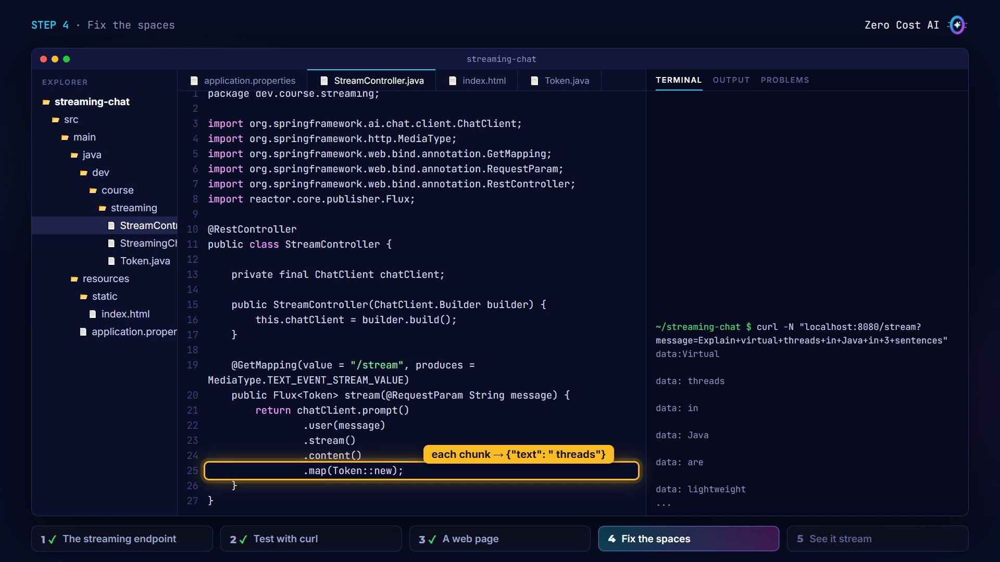

Inside JSON, the space is part of a quoted string. Nothing can strip it.

And in the page, I parse the JSON, and append its text.

**`index.html`** (`src/main/resources/static/index.html`):

```html
<!doctype html>
<html>
<body style="font-family: sans-serif; max-width: 640px; margin: 40px auto">
<h2>Streaming chat</h2>
<input id="q" size="50" value="Explain virtual threads in Java in 3 sentences">
<button onclick="ask()">Ask</button>
<p id="answer"></p>
<script>
function ask() {
  const answer = document.getElementById("answer");
  answer.textContent = "";
  const q = encodeURIComponent(document.getElementById("q").value);
  const source = new EventSource("/stream?message=" + q);
  source.onmessage = (e) => answer.textContent += JSON.parse(e.data).text;
  source.onerror = () => source.close();
}
</script>
</body>
</html>
```

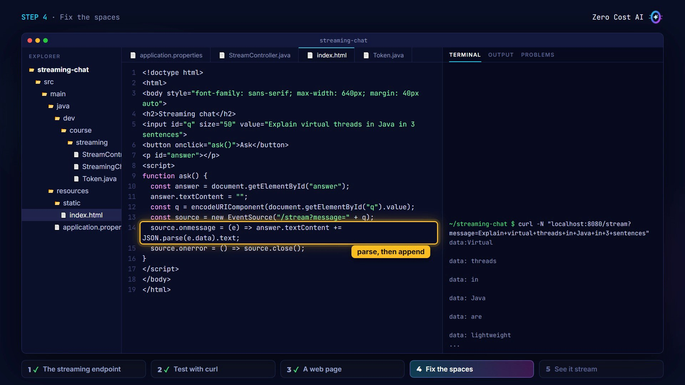

Let's check with curl first.

```bash
$ curl -N "localhost:8080/stream?message=Say+hello+in+5+words"
data:{"text":"Hello"}

data:{"text":","}

data:{"text":" how"}
...
```

Each event is now JSON, and the space before how is safe inside the quotes.

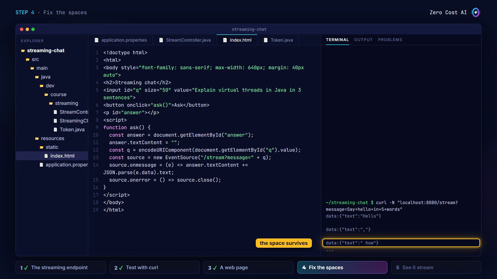

## It streams!

Step five. Back to the browser. I click Ask, and the answer starts appearing in about a second.

Word by word, with the spaces in the right places.

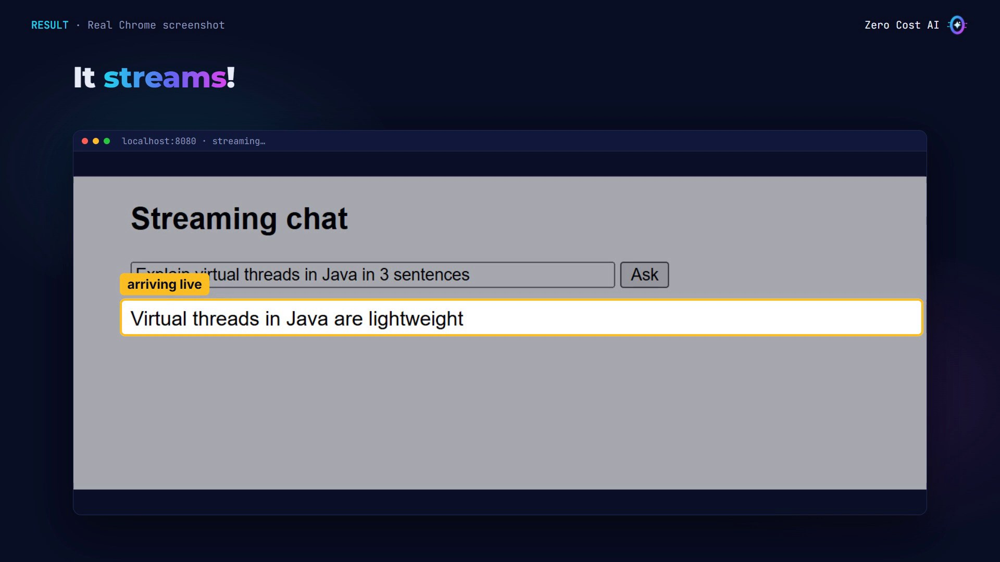

## The full answer

And here's the complete answer. Same model, same total time as before. But the user was reading from the very first second.

That's the power of streaming.

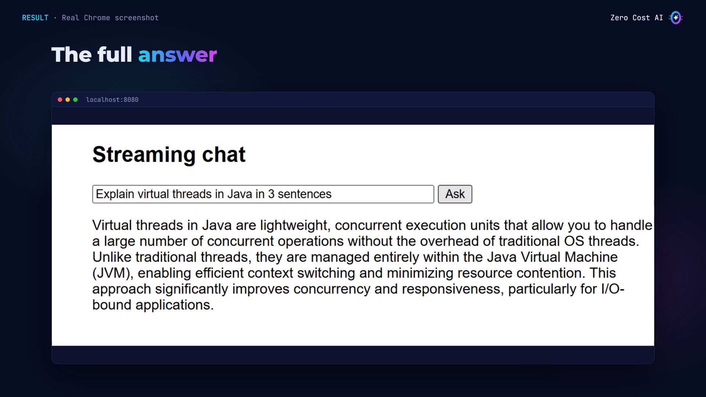

## 3 pro tips

Always test streaming with curl minus N. Without it, curl buffers, and you'll think streaming is broken.

Close the EventSource when you're done. Otherwise, the browser reconnects and asks again.

And put streaming behind the same security as your other endpoints. Each request still costs tokens.

- **curl -N**: No buffering: see events live
- **Close EventSource**: Or the browser reconnects
- **Secure it**: Streams cost tokens too

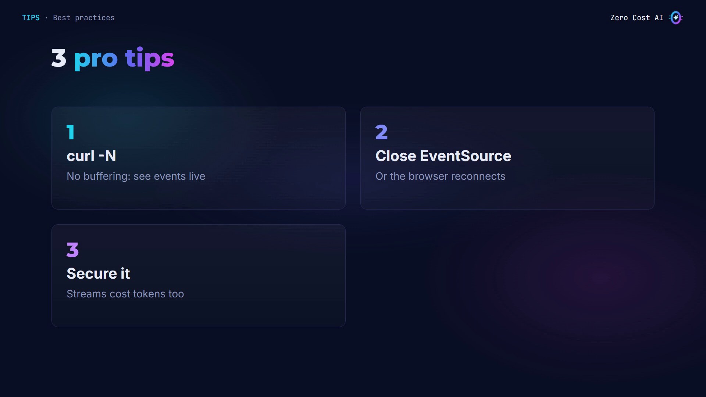

## Your challenge

Your challenge: send a final event with the token usage, so the page can show how many tokens the answer used.

Hint: stream, then chatResponse, gives you ChatResponse objects, and the last one carries the usage metadata.

- **Show token usage**: A final event with the total tokens
- **Hint**: `stream().chatResponse()` → metadata

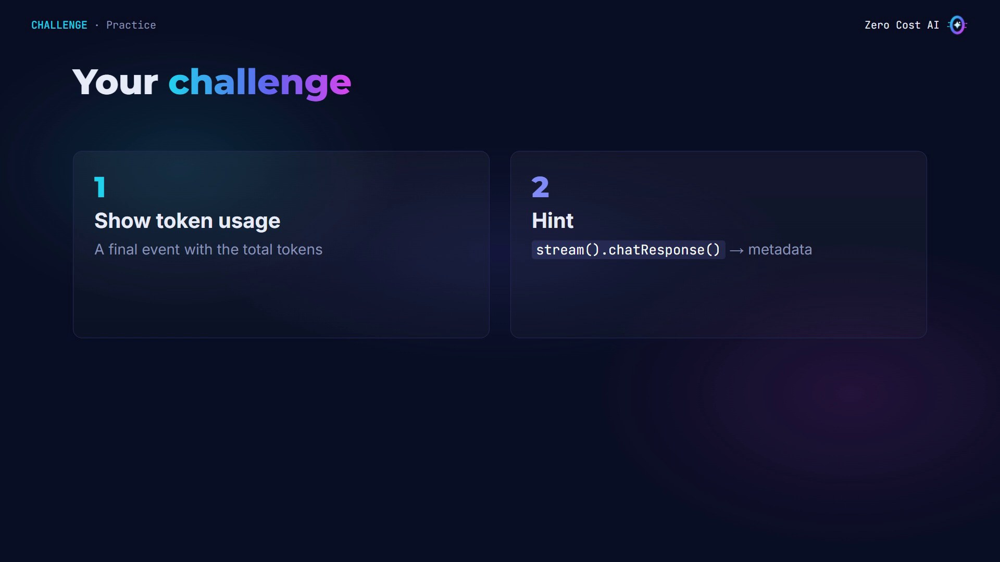

## Recap

- `stream().content()` + **text/event-stream** = live tokens
- SSE can drop leading spaces: **wrap tokens in JSON**
- Test with curl -N, read with `EventSource`

## Get the code and the quiz

- **Code for this lab**: https://github.com/NEDBS12/youtube-tuto/tree/main/spring-ai-course/labs/streaming-chat
- **All course code, quizzes and resources**: https://github.com/NEDBS12/youtube-tuto/tree/main/spring-ai-course
- **Lesson quiz and section evals**: https://nedbs12.github.io/youtube-tuto/spring-ai-course/quiz/
- **Ollama**: https://ollama.com
- **Spring AI ChatClient docs**: https://docs.spring.io/spring-ai/reference/api/chatclient.html
- **Spring AI reference docs**: https://docs.spring.io/spring-ai/reference/

🎥 **Watch the video tutorial:** {VIDEO_URL}

**Previous: Lesson 2.1, streaming. Next: Lesson 2.2, structured output.**

*The editor and terminal in the screenshots are a simplified recreation; the code and the outputs come from real runs of the lab.*

*I'm Zero Cost AI: I build AI tools and tutorials and share them for free. Follow me on Medium for the next lessons, and subscribe on YouTube: https://www.youtube.com/@zerocostai-f1h*
