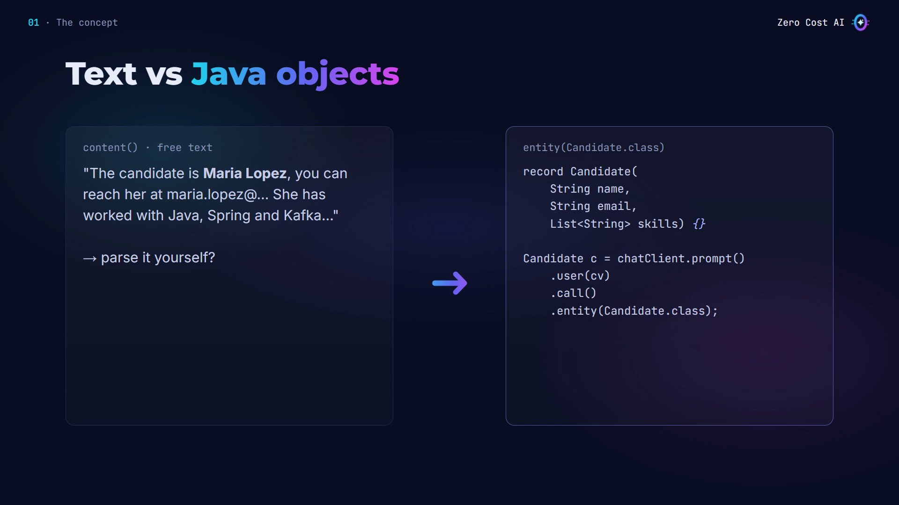
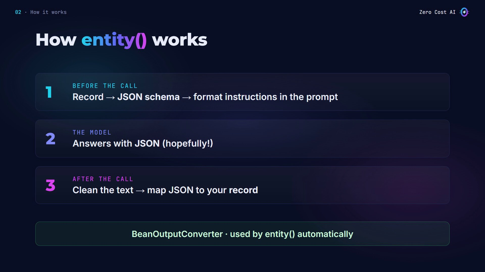
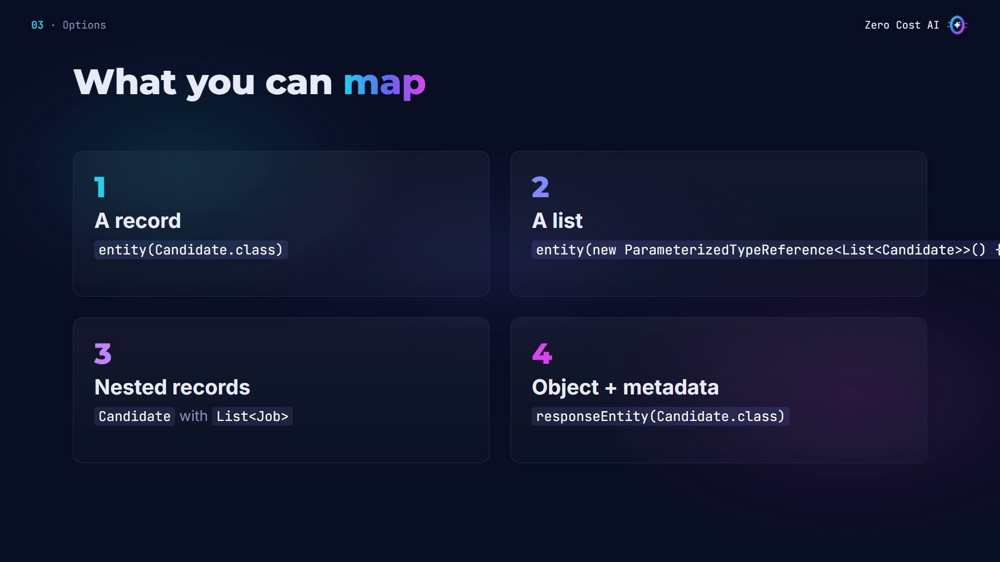
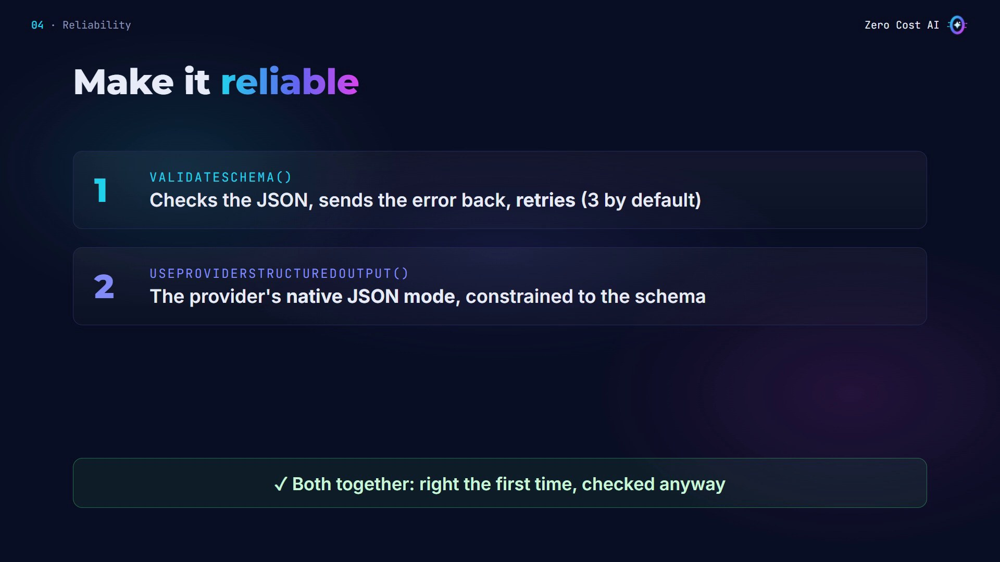
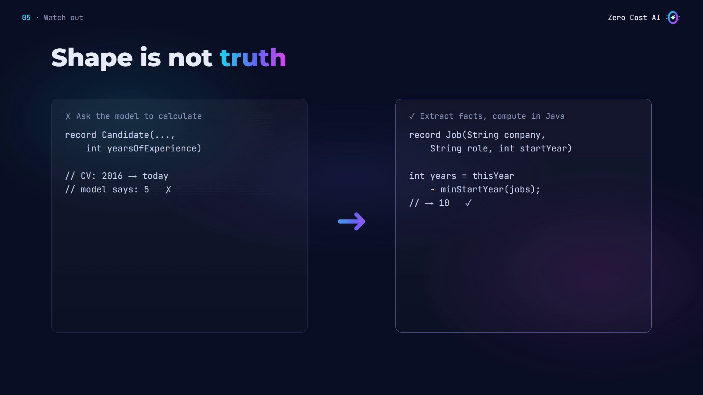

So far, our models answered with text. That's great for humans. But your Java code can't do much with a paragraph.

Your code wants objects. A record with a name, an email, a list of skills.

In this lesson, you'll learn structured output: how Spring AI turns an answer into a Java object, and how to make it reliable.

It's lesson 2.2 of my free **Spring AI: Novice to Expert** course, where every lesson has a concept part and a hands-on lab, and everything runs on a free local model with Ollama.

🎥 **Prefer video?** Watch the full tutorial here:

{VIDEO}

## Text vs Java objects

Here's the idea.

Without structured output, you get free text, and you'd have to parse it yourself. Fragile, and different every time.

With entity, you pass a record class. And you get back an instance of that record, ready to use.

### content() · free text

- "The candidate is **Maria Lopez**, you can reach her at maria.lopez@… She has worked with Java, Spring and Kafka…"
- → parse it yourself?

### entity(Candidate.class)

```text
record Candidate(
    String name,
    String email,
    List<String> skills) {}

Candidate c = chatClient.prompt()
    .user(cv)
    .call()
    .entity(Candidate.class);
```



## How entity() works

How does it work? With a converter, in two phases.

Before the call, Spring AI generates a JSON schema from your record, and adds format instructions to the prompt: respond in JSON, matching this schema.

The model answers with JSON.

After the call, Spring AI cleans the answer, for example removing markdown code fences, and maps the JSON to your record.

That's the BeanOutputConverter. And entity uses it for you.

- **Before the call**: Record → **JSON schema** → format instructions in the prompt
- **The model**: Answers with **JSON** (hopefully!)
- **After the call**: Clean the text → map JSON to your **record**

**BeanOutputConverter · used by entity() automatically**



## What you can map

Entity works with more than single records.

A record or a class: entity, with the class.

A list or another generic type: entity, with a ParameterizedTypeReference.

And nested records work too, like a candidate with a list of jobs.

If you need the metadata as well, responseEntity gives you both the ChatResponse and the object.

- **A record**: `entity(Candidate.class)`
- **A list**: `entity(new ParameterizedTypeReference<List<Candidate>>() {})`
- **Nested records**: `Candidate` with `List<Job>`
- **Object + metadata**: `responseEntity(Candidate.class)`



## Make it reliable

But a model can still return broken JSON. Spring AI two gives you two tools to make it reliable.

First, validate schema. Spring AI checks the JSON against the schema. If it's wrong, it sends the error back to the model, and asks again. Three attempts by default.

Second, use provider structured output. Many providers have a native JSON mode, where the model is constrained to the schema. Support varies per model, so test it.

Together, they're the most reliable option. In the lab, this combination was four times faster than validation alone, because the model got it right the first time.

- **validateSchema()**: Checks the JSON, sends the error back, **retries** (3 by default)
- **useProviderStructuredOutput()**: The provider's **native JSON mode**, constrained to the schema

**✓ Both together: right the first time, checked anyway**



## Shape is not truth

One last, very important lesson.

Structured output guarantees the shape of the data. Not its truth. The JSON can be perfectly valid, and the value still wrong.

So let the model do what it's good at: extracting facts from text. And let Java do the math, the dates, and the rules.

### ✗ Ask the model to calculate

```text
record Candidate(...,
    int yearsOfExperience)

// CV: 2016 → today
// model says: 5   ✗
```

### ✓ Extract facts, compute in Java

```text
record Job(String company,
    String role, int startYear)

int years = thisYear
    - minStartYear(jobs);
// → 10   ✓
```



## Recap

- `entity(Record.class)`: JSON schema in, **Java object** out
- `validateSchema()` + `useProviderStructuredOutput()` for **reliability**
- Shape ≠ truth: the model **extracts**, Java computes

## Quick quiz

Test yourself before you read the answers.

1. **Method**: Which method maps the answer to a record?
2. **Lists**: How do you get a List of candidates?
3. **Truth**: The JSON is valid. Is the data correct?

**Answers:**

1. `entity(Candidate.class)`
2. `ParameterizedTypeReference<List<Candidate>>`
3. **Not necessarily**: shape ≠ truth

The full five-question quiz for this lesson is free on the course quiz page: https://nedbs12.github.io/youtube-tuto/spring-ai-course/quiz/

## Get the code and the quiz

- **Lab code for this lesson**: https://github.com/NEDBS12/youtube-tuto/tree/main/spring-ai-course/labs/cv-parser
- **All course code, quizzes and resources**: https://github.com/NEDBS12/youtube-tuto/tree/main/spring-ai-course
- **Lesson quiz and section evals**: https://nedbs12.github.io/youtube-tuto/spring-ai-course/quiz/
- **Spring AI structured output docs**: https://docs.spring.io/spring-ai/reference/api/structured-output/converters.html
- **Spring AI reference docs**: https://docs.spring.io/spring-ai/reference/

🎥 **Watch the video tutorial:** {VIDEO_URL}

**Previous: Lab 2.1. Next: Lab 2.2, build a CV parser.**

*I'm Zero Cost AI: I build AI tools and tutorials and share them for free. Follow me on Medium for the next lessons, and subscribe on YouTube: https://www.youtube.com/@zerocostai-f1h*
