Today you'll build a CV parser: paste a CV, and get back clean Java objects.

We'll also catch the model giving a wrong answer in perfect JSON, and fix the design. That's the most important lesson of this lab.

It's lab 2.2 of my free **Spring AI: Novice to Expert** course, where every lesson has a concept part and a hands-on lab, and everything runs on a free local model with Ollama.

🎥 **Prefer video?** Watch the full tutorial here:

{VIDEO}

## Plain text → Java record

Here's the input: a short CV in plain text.

And the goal: a Java record with the name, email, skills, and years of experience.

### cv.txt

```text
Maria Lopez - maria.lopez@example.com
Senior Backend Engineer at ShopNow (2021 - today)
Backend Developer at BankCo (2016 - 2021)
Skills: Java 21, Spring Boot, Kafka, PostgreSQL, Docker
```

### Candidate

- **name**, **email**
- **skills**: a list
- **years of experience**
- Ready for your Java code

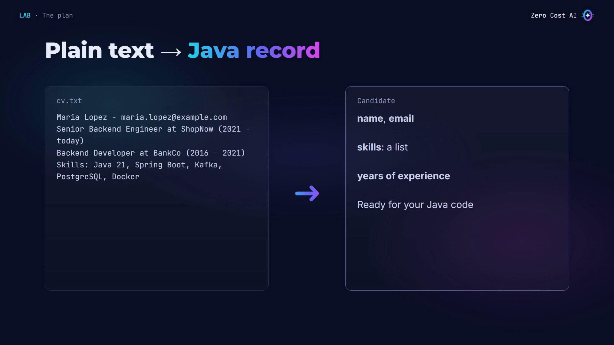

## Step 1: The records

New project, cv parser, with Spring Web and Ollama. Temperature zero, because extraction should be repeatable.

**`application.properties`** (`src/main/resources/application.properties`):

```properties
spring.application.name=cv-parser
spring.ai.ollama.chat.model=gemma3:4b
spring.ai.ollama.chat.temperature=0.0
```

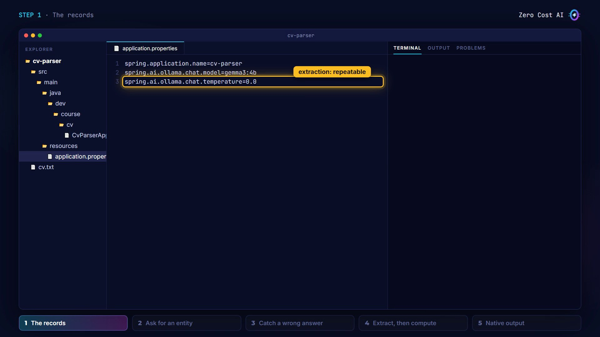

I describe what I want as a record: Candidate. Name, email, current role, years of experience, and skills.

**`Candidate.java`**:

```java
package dev.course.cv;

import java.util.List;

public record Candidate(String name, String email, String currentRole,
                        int yearsOfExperience, List<String> skills) {
}
```

The field names matter. Spring AI turns them into a JSON schema for the model. Clear names, better answers.

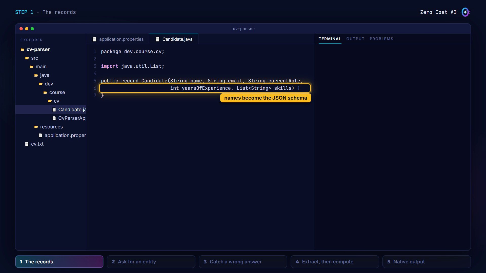

## Step 2: Ask for an entity

CvController takes the CV as the request body.

**`CvController.java`**:

```java
package dev.course.cv;

import org.springframework.ai.chat.client.ChatClient;
import org.springframework.web.bind.annotation.PostMapping;
import org.springframework.web.bind.annotation.RequestBody;
import org.springframework.web.bind.annotation.RestController;

@RestController
public class CvController {

    private final ChatClient chatClient;

    public CvController(ChatClient.Builder builder) {
        this.chatClient = builder
                .defaultSystem("You extract data from CVs. Use only facts written in the CV.")
                .build();
    }
```

The system message says: use only facts written in the CV. Then the endpoint.

**`CvController.java`** (continued):

```java
    @PostMapping("/parse")
    public Candidate parse(@RequestBody String cv) {
        return chatClient.prompt()
                .user(u -> u.text("Extract the candidate from this CV:\n{cv}").param("cv", cv))
                .call()
                .entity(Candidate.class, spec -> spec.validateSchema());
    }
}
```

Instead of content, I call entity, with `Candidate.class`. And I add validate schema, so Spring AI checks the JSON and retries if it's broken.

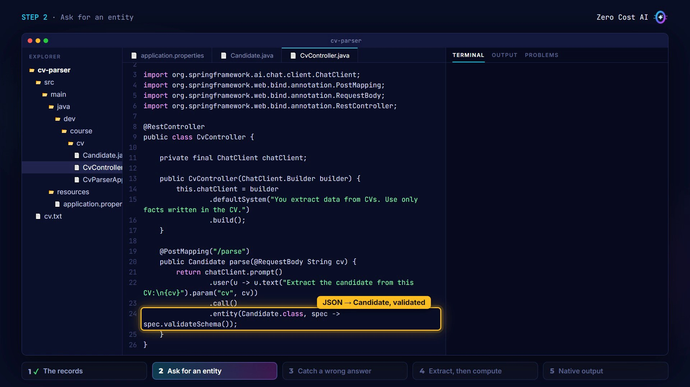

## Step 3: Catch a wrong answer

```bash
$ ./mvnw spring-boot:run
...
Started CvParserApplication in 2.4 seconds
```

```bash
$ curl localhost:8080/parse -H "Content-Type: text/plain" --data-binary @cv.txt
{
  "name": "Maria Lopez",
  "email": "maria.lopez@example.com",
  "currentRole": "Senior Backend Engineer",
  "yearsOfExperience": 5,
  "skills": ["Java 21", "Spring Boot", "Kafka",
             "PostgreSQL", "Docker"]
}
```

Perfect JSON. Name, email, role, skills, all correct.

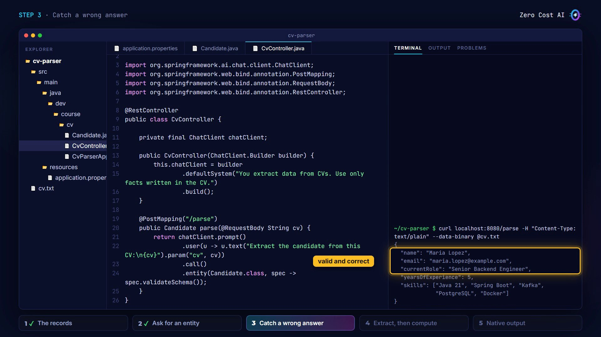

But look at years of experience: five. Maria started in 2016. That's ten years.

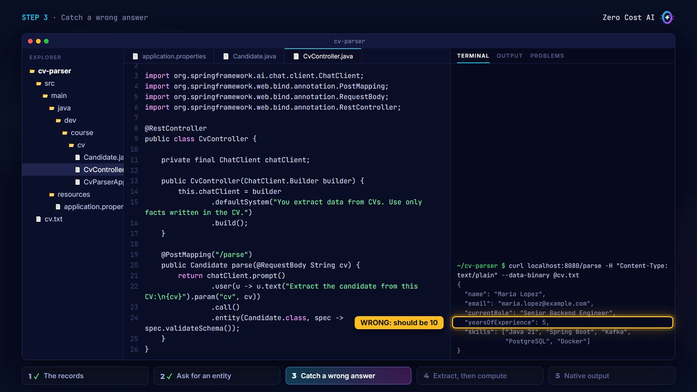

The model only counted her current job. The JSON is valid, and the answer is wrong. Structured output guarantees the shape, not the truth.

## Step 4: Extract, then compute

The model should extract facts, and Java should compute. So first, a Job record: company, role, and start year.

**`Job.java`**:

```java
package dev.course.cv;

public record Job(String company, String role, int startYear) {
}
```

The Candidate now has a list of jobs, instead of a number the model has to calculate.

**`Candidate.java`** (`src/main/java/dev/course/cv/Candidate.java`):

```java
package dev.course.cv;

import java.util.List;

public record Candidate(String name, String email, List<String> skills, List<Job> jobs) {
}
```

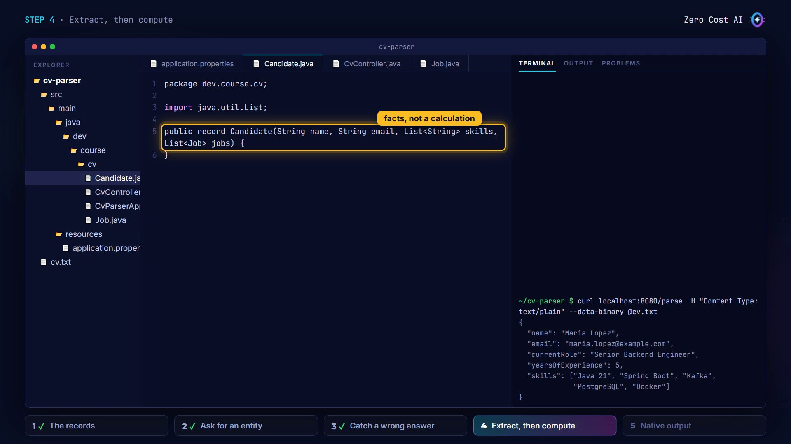

And a CvResult record, for the response: the candidate, plus the years we compute ourselves.

**`CvResult.java`**:

```java
package dev.course.cv;

public record CvResult(Candidate candidate, int yearsOfExperience) {
}
```

In the controller, I get the candidate with entity, then compute the years in plain Java: this year, minus the earliest start year.

**`CvController.java`** (`src/main/java/dev/course/cv/CvController.java`):

```java
package dev.course.cv;

import java.time.Year;

import org.springframework.ai.chat.client.ChatClient;
import org.springframework.web.bind.annotation.PostMapping;
import org.springframework.web.bind.annotation.RequestBody;
import org.springframework.web.bind.annotation.RestController;

@RestController
public class CvController {

    private final ChatClient chatClient;

    public CvController(ChatClient.Builder builder) {
        this.chatClient = builder
                .defaultSystem("You extract data from CVs. Use only facts written in the CV.")
                .build();
    }

    @PostMapping("/parse")
    public CvResult parse(@RequestBody String cv) {
        Candidate candidate = chatClient.prompt()
                .user(u -> u.text("Extract the candidate from this CV:\n{cv}").param("cv", cv))
                .call()
                .entity(Candidate.class, spec -> spec.validateSchema());
        return new CvResult(candidate, yearsOfExperience(candidate));
    }

    private int yearsOfExperience(Candidate candidate) {
        int thisYear = Year.now().getValue();
        int first = candidate.jobs().stream().mapToInt(Job::startYear).min().orElse(thisYear);
        return thisYear - first;
    }
}
```

Let's run it, and look at the result.

```bash
$ curl localhost:8080/parse -H "Content-Type: text/plain" --data-binary @cv.txt
{
  "candidate": {
    "name": "Maria Lopez", ...,
    "jobs": [
      {"company": "ShopNow",
       "role": "Senior Backend Engineer",
       "startYear": 2021},
      {"company": "BankCo",
       "role": "Backend Developer", "startYear": 2016}
    ]
  },
  "yearsOfExperience": 10
}
```

Both jobs, extracted correctly. And ten years of experience. Correct!

But this call took 47 seconds. Let's look at the logs.

```bash
$ # application log
WARN  StructuredOutputValidationAdvisor :
  JSON validation failed: Invalid JSON:
  Unexpected character ('`' (code 96))
  ... (x3, then the converter cleans it)
```


The model wrapped its JSON in markdown code fences. Validation rejected it three times, before the converter cleaned it up. Lots of wasted calls.

## Step 5: Native output

I add use provider structured output. Ollama now constrains the model to our JSON schema. No more code fences.

**`CvController.java`** (`src/main/java/dev/course/cv/CvController.java`):

```java
package dev.course.cv;

import java.time.Year;

import org.springframework.ai.chat.client.ChatClient;
import org.springframework.web.bind.annotation.PostMapping;
import org.springframework.web.bind.annotation.RequestBody;
import org.springframework.web.bind.annotation.RestController;

@RestController
public class CvController {

    private final ChatClient chatClient;

    public CvController(ChatClient.Builder builder) {
        this.chatClient = builder
                .defaultSystem("You extract data from CVs. Use only facts written in the CV.")
                .build();
    }

    @PostMapping("/parse")
    public CvResult parse(@RequestBody String cv) {
        Candidate candidate = chatClient.prompt()
                .user(u -> u.text("Extract the candidate from this CV:\n{cv}").param("cv", cv))
                .call()
                .entity(Candidate.class, spec -> spec
                        .useProviderStructuredOutput()
                        .validateSchema());
        return new CvResult(candidate, yearsOfExperience(candidate));
    }

    private int yearsOfExperience(Candidate candidate) {
        int thisYear = Year.now().getValue();
        int first = candidate.jobs().stream().mapToInt(Job::startYear).min().orElse(thisYear);
        return thisYear - first;
    }
}
```

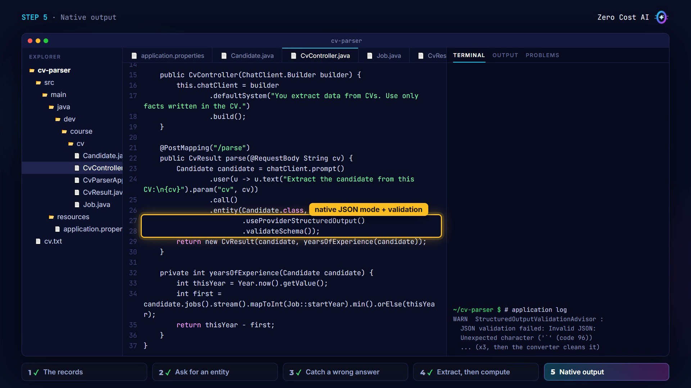

I keep validate schema as a safety net. Let's run it again.

```bash
$ curl -w "\n%{time_total}s" localhost:8080/parse -H "Content-Type: text/plain" --data-binary @cv.txt
{"candidate":{"name":"Maria Lopez", ...
  "yearsOfExperience":10}
10.46s
```

Same correct answer, in about ten seconds instead of 47. And zero validation failures in the log.

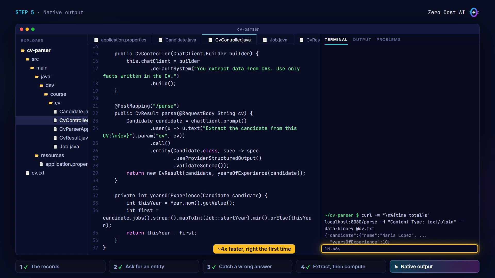

## 3 pro tips

Three tips from this lab.

Let the model extract facts, and let Java compute. Dates, sums, and business rules belong in code.

Use native structured output when your model supports it, and keep validate schema as a safety net.

And design for nullability. With strict native schemas, a model may not be allowed to return null. Keep only the fields you really need.

- **Extract, then compute**: Math and rules belong in Java
- **Native + validate**: Fast first try, safety net
- **Keep fields simple**: Strict schemas may forbid null

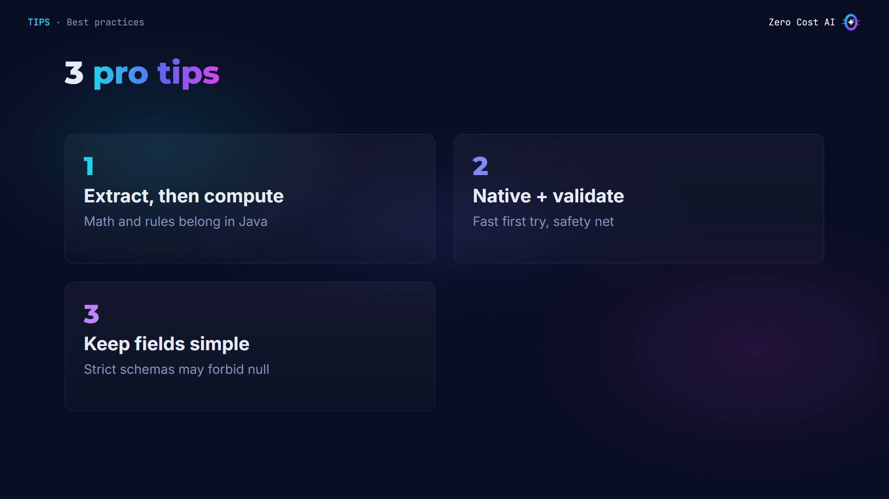

## Your challenge

Your challenge: parse a whole page of CVs at once, and return a list of results.

Use a ParameterizedTypeReference for the list, and test it with three different CVs.

- **Many CVs → List**: `ParameterizedTypeReference<List<Candidate>>`
- **Test 3 CVs**: Check every computed value

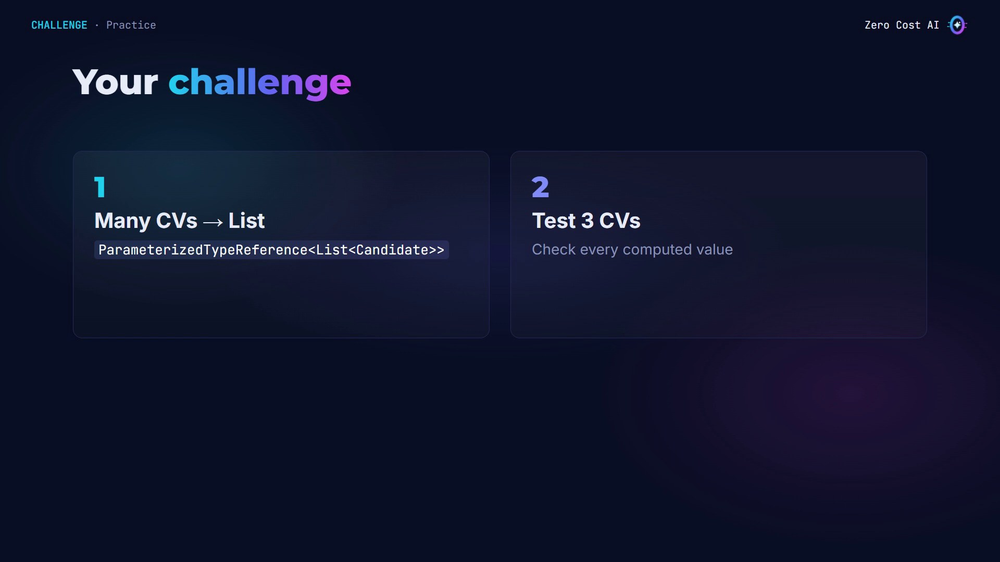

## Recap

- `entity(Candidate.class)` maps the answer to a **record**
- Valid JSON can be **wrong**: extract facts, compute in Java
- Native output + `validateSchema()`: right the first time

## Get the code and the quiz

- **Code for this lab**: https://github.com/NEDBS12/youtube-tuto/tree/main/spring-ai-course/labs/cv-parser
- **All course code, quizzes and resources**: https://github.com/NEDBS12/youtube-tuto/tree/main/spring-ai-course
- **Lesson quiz and section evals**: https://nedbs12.github.io/youtube-tuto/spring-ai-course/quiz/
- **Ollama**: https://ollama.com
- **Schema validation docs**: https://docs.spring.io/spring-ai/reference/api/structured-output/validation.html
- **Spring AI reference docs**: https://docs.spring.io/spring-ai/reference/

🎥 **Watch the video tutorial:** {VIDEO_URL}

**Previous: Lesson 2.2, structured output. Next: Lesson 2.3, advisors.**

*The editor and terminal in the screenshots are a simplified recreation; the code and the outputs come from real runs of the lab.*

*I'm Zero Cost AI: I build AI tools and tutorials and share them for free. Follow me on Medium for the next lessons, and subscribe on YouTube: https://www.youtube.com/@zerocostai-f1h*
