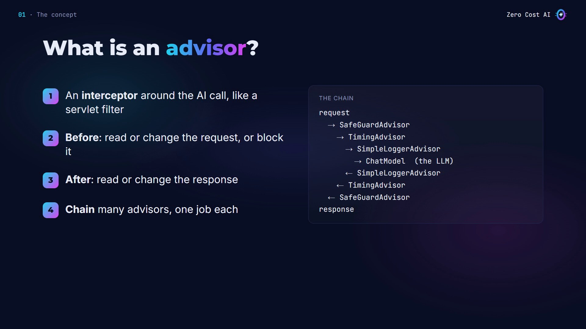
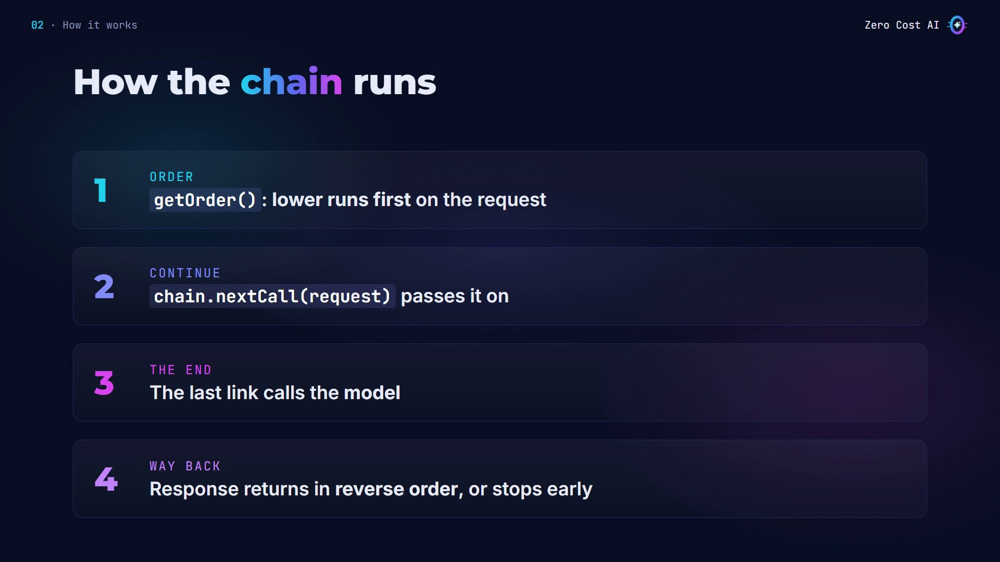
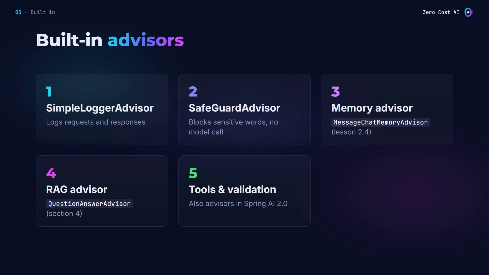
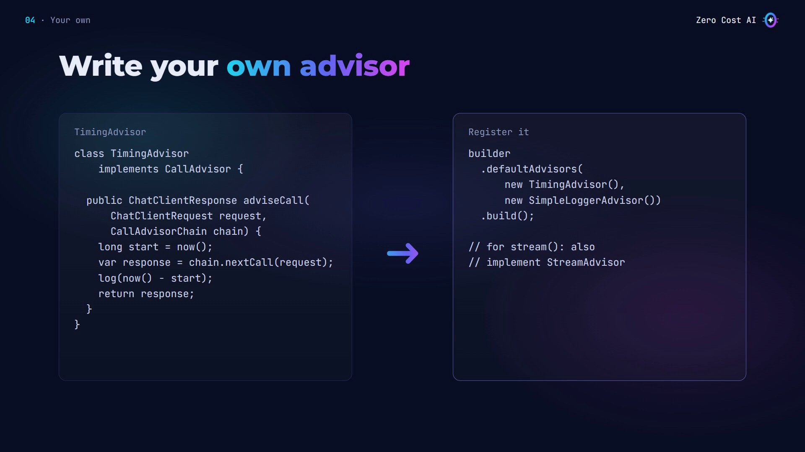
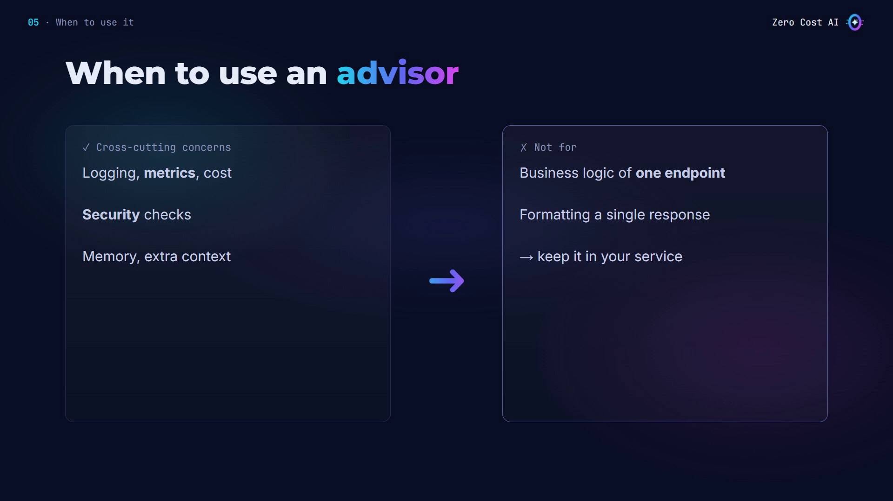

You want to log every AI call. Block sensitive requests. Add memory. Measure cost. Would you copy that code into every controller?

No. In Spring, cross-cutting concerns go into interceptors. And in Spring AI, those interceptors are called advisors.

It's lesson 2.3 of my free **Spring AI: Novice to Expert** course, where every lesson has a concept part and a hands-on lab, and everything runs on a free local model with Ollama.

🎥 **Prefer video?** Watch the full tutorial here:

{VIDEO}

## What is an advisor?

So, what is an advisor?

An advisor wraps around the AI call. Like a servlet filter, or around advice in Spring AOP.

On the way in, it can read or change the request: add messages, add context, or block it.

On the way out, it can read or change the response: log it, measure it, save it.

And you can chain as many as you like. Each one does one job.

- An **interceptor** around the AI call, like a servlet filter
- **Before**: read or change the request, or block it
- **After**: read or change the response
- **Chain** many advisors, one job each

In code:

```java
request
  → SafeGuardAdvisor
    → TimingAdvisor
      → SimpleLoggerAdvisor
        → ChatModel  (the LLM)
      ← SimpleLoggerAdvisor
    ← TimingAdvisor
  ← SafeGuardAdvisor
response
```



## How the chain runs

Here's how the chain runs.

Advisors are sorted by their order. A lower number runs first on the way in.

Each advisor does its work, then calls `chain.nextCall()`, to pass the request on.

The last link in the chain calls the model.

Then the response travels back through the same advisors, in reverse order. And an advisor can also stop early, and never call the next one.

- **Order**: `getOrder()`: **lower runs first** on the request
- **Continue**: `chain.nextCall(request)` passes it on
- **The end**: The last link calls the **model**
- **Way back**: Response returns in **reverse order**, or stops early



## Built-in advisors

Spring AI ships with useful advisors. You'll use these all the time.

SimpleLoggerAdvisor logs every request and response.

SafeGuardAdvisor blocks requests containing sensitive words, without calling the model.

MessageChatMemoryAdvisor gives your app memory. That's the next lesson.

QuestionAnswerAdvisor adds your own documents to the prompt. That's RAG, in section four.

And in Spring AI two, even tool calling and structured output validation run as advisors.

- **SimpleLoggerAdvisor**: Logs requests and responses
- **SafeGuardAdvisor**: Blocks sensitive words, no model call
- **Memory advisor**: `MessageChatMemoryAdvisor` (lesson 2.4)
- **RAG advisor**: `QuestionAnswerAdvisor` (section 4)
- **Tools & validation**: Also advisors in Spring AI 2.0



## Write your own advisor

And writing your own advisor is simple.

Implement CallAdvisor. In advise call, do your work before, call `chain.nextCall()`, then do your work after.

Give it a name and an order, and register it with default advisors. Done.

### TimingAdvisor

```text
class TimingAdvisor
    implements CallAdvisor {

  public ChatClientResponse adviseCall(
      ChatClientRequest request,
      CallAdvisorChain chain) {
    long start = now();
    var response = chain.nextCall(request);
    log(now() - start);
    return response;
  }
}
```

### Register it

```text
builder
  .defaultAdvisors(
      new TimingAdvisor(),
      new SimpleLoggerAdvisor())
  .build();

// for stream(): also
// implement StreamAdvisor
```



## When to use an advisor

When should you write an advisor?

Use one for concerns that apply to many AI calls: logging, metrics, security checks, memory, adding context.

Don't use one for business logic of a single endpoint. That stays in your service. Advisors should be generic and reusable.

### ✓ Cross-cutting concerns

- Logging, **metrics**, cost
- **Security** checks
- Memory, extra context

### ✗ Not for

- Business logic of **one endpoint**
- Formatting a single response
- → keep it in your service



## Recap

- Advisors **intercept** AI calls: before and after
- Sorted by `getOrder()`; continue with `chain.nextCall()`
- Use them for **cross-cutting** concerns: logs, security, memory

## Quick quiz

Test yourself before you read the answers.

1. **Concept**: What does an advisor do?
2. **Continue**: Inside adviseCall, how do you reach the model?
3. **Order**: Two advisors: order 0 and order 10. Which runs first on the request?

**Answers:**

1. Intercepts the AI call: **before and after**
2. `chain.nextCall(request)`
3. **Order 0**: lower runs first

The full five-question quiz for this lesson is free on the course quiz page: https://nedbs12.github.io/youtube-tuto/spring-ai-course/quiz/

## Get the code and the quiz

- **Lab code for this lesson**: https://github.com/NEDBS12/youtube-tuto/tree/main/spring-ai-course/labs/advisors-demo
- **All course code, quizzes and resources**: https://github.com/NEDBS12/youtube-tuto/tree/main/spring-ai-course
- **Lesson quiz and section evals**: https://nedbs12.github.io/youtube-tuto/spring-ai-course/quiz/
- **Spring AI advisors docs**: https://docs.spring.io/spring-ai/reference/api/advisors.html
- **Spring AI reference docs**: https://docs.spring.io/spring-ai/reference/

🎥 **Watch the video tutorial:** {VIDEO_URL}

**Previous: Lab 2.2. Next: Lab 2.3, build an advisor chain.**

*I'm Zero Cost AI: I build AI tools and tutorials and share them for free. Follow me on Medium for the next lessons, and subscribe on YouTube: https://www.youtube.com/@zerocostai-f1h*
