Today you'll build an advisor chain: a logger, a safeguard, and your own custom advisor.

And you won't touch the controller once it's written. That's the point of advisors.

It's lab 2.3 of my free **Spring AI: Novice to Expert** course, where every lesson has a concept part and a hands-on lab, and everything runs on a free local model with Ollama.

🎥 **Prefer video?** Watch the full tutorial here:

{VIDEO}

## What we'll build

Log every call. Write our own timing advisor. Add a safeguard for sensitive words. And run the whole chain.

1. **Log every call**: `SimpleLoggerAdvisor`
2. **Write an advisor**: `TimingAdvisor`: ms + tokens
3. **Add a safeguard**: `SafeGuardAdvisor`: block words
4. **Run the chain**: Watch the logs

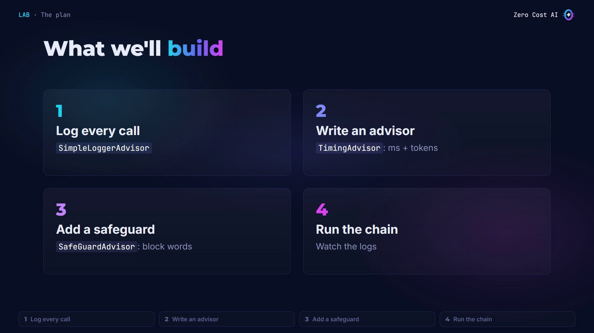

Here's the project, advisors demo. A simple controller: `/chat`, using an injected ChatClient. It won't change in this lab.

**`ChatController.java`** (`src/main/java/dev/course/advisors/ChatController.java`):

```java
package dev.course.advisors;

import org.springframework.ai.chat.client.ChatClient;
import org.springframework.web.bind.annotation.GetMapping;
import org.springframework.web.bind.annotation.RequestParam;
import org.springframework.web.bind.annotation.RestController;

@RestController
public class ChatController {

    private final ChatClient chatClient;

    public ChatController(ChatClient chatClient) {
        this.chatClient = chatClient;
    }

    @GetMapping("/chat")
    public String chat(@RequestParam String message) {
        return chatClient.prompt().user(message).call().content();
    }
}
```

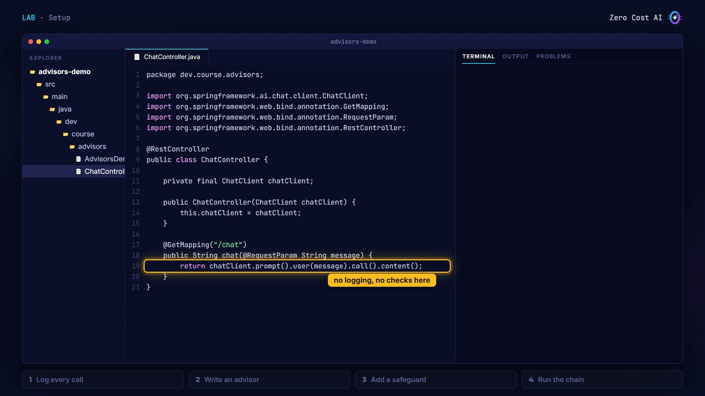

## Step 1: Log every call

In AiConfig, I build the ChatClient with a default system message, and one default advisor: SimpleLoggerAdvisor.

**`AiConfig.java`**:

```java
package dev.course.advisors;

import org.springframework.ai.chat.client.ChatClient;
import org.springframework.ai.chat.client.advisor.SimpleLoggerAdvisor;
import org.springframework.context.annotation.Bean;
import org.springframework.context.annotation.Configuration;

@Configuration
public class AiConfig {

    @Bean
    ChatClient chatClient(ChatClient.Builder builder) {
        return builder
                .defaultSystem("You are a helpful assistant. Answer in one sentence.")
                .defaultAdvisors(new SimpleLoggerAdvisor())
                .build();
    }
}
```

It logs at debug level, so I turn on debug logging for the advisor package.

**`application.properties`** (`src/main/resources/application.properties`):

```properties
spring.application.name=advisors-demo
spring.ai.ollama.chat.model=gemma3:4b
```

**`application.properties`** (continued):

```properties
logging.level.org.springframework.ai.chat.client.advisor=DEBUG
```

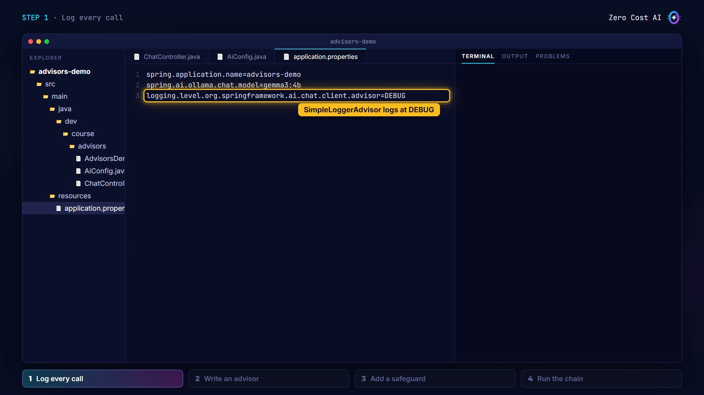

## Step 2: Write an advisor

TimingAdvisor, implementing CallAdvisor.

**`TimingAdvisor.java`**:

```java
package dev.course.advisors;

import org.slf4j.Logger;
import org.slf4j.LoggerFactory;
import org.springframework.ai.chat.client.ChatClientRequest;
import org.springframework.ai.chat.client.ChatClientResponse;
import org.springframework.ai.chat.client.advisor.api.CallAdvisor;
import org.springframework.ai.chat.client.advisor.api.CallAdvisorChain;

public class TimingAdvisor implements CallAdvisor {

    private static final Logger log = LoggerFactory.getLogger(TimingAdvisor.class);
```

In advise call, I note the start time, call `chain.nextCall()` to run the rest of the chain and the model, then measure.

**`TimingAdvisor.java`** (continued):

```java
    @Override
    public ChatClientResponse adviseCall(ChatClientRequest request, CallAdvisorChain chain) {
        long start = System.currentTimeMillis();
        ChatClientResponse response = chain.nextCall(request);
        long millis = System.currentTimeMillis() - start;
        var usage = response.chatResponse().getMetadata().getUsage();
        log.info("AI call took {} ms, {} tokens", millis, usage.getTotalTokens());
        return response;
    }
```

This line is the key. Everything before it runs on the way in. Everything after it runs on the way out.

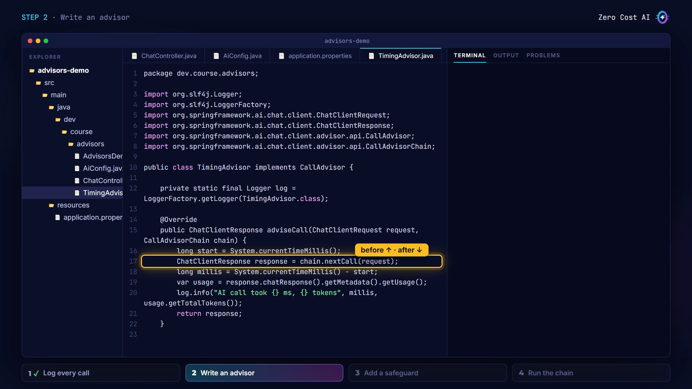

After the call, I read the token usage from the response, and log both.

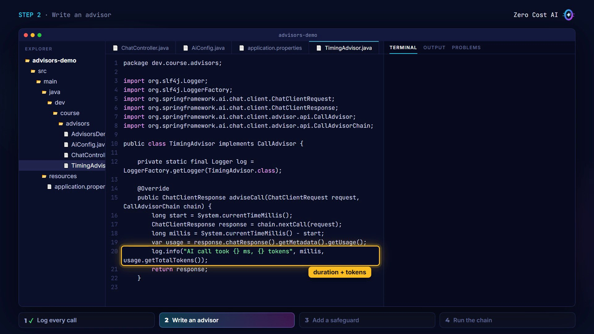

Finally, a name, and an order. Zero.

**`TimingAdvisor.java`** (continued):

```java
    @Override
    public String getName() {
        return "TimingAdvisor";
    }

    @Override
    public int getOrder() {
        return 0;
    }
}
```

## Step 3: Add a safeguard

Back in AiConfig, I add SafeGuardAdvisor, with a list of sensitive words, and a polite failure response.

**`AiConfig.java`** (`src/main/java/dev/course/advisors/AiConfig.java`):

```java
package dev.course.advisors;

import java.util.List;

import org.springframework.ai.chat.client.ChatClient;
import org.springframework.ai.chat.client.advisor.SafeGuardAdvisor;
import org.springframework.ai.chat.client.advisor.SimpleLoggerAdvisor;
import org.springframework.context.annotation.Bean;
import org.springframework.context.annotation.Configuration;

@Configuration
public class AiConfig {

    @Bean
    ChatClient chatClient(ChatClient.Builder builder) {
        return builder
                .defaultSystem("You are a helpful assistant. Answer in one sentence.")
                .defaultAdvisors(
                        SafeGuardAdvisor.builder()
                                .sensitiveWords(List.of("password", "credit card"))
                                .failureResponse("Sorry, I can't help with passwords or payment data.")
                                .build(),
                        new TimingAdvisor(),
                        new SimpleLoggerAdvisor())
                .build();
    }
}
```

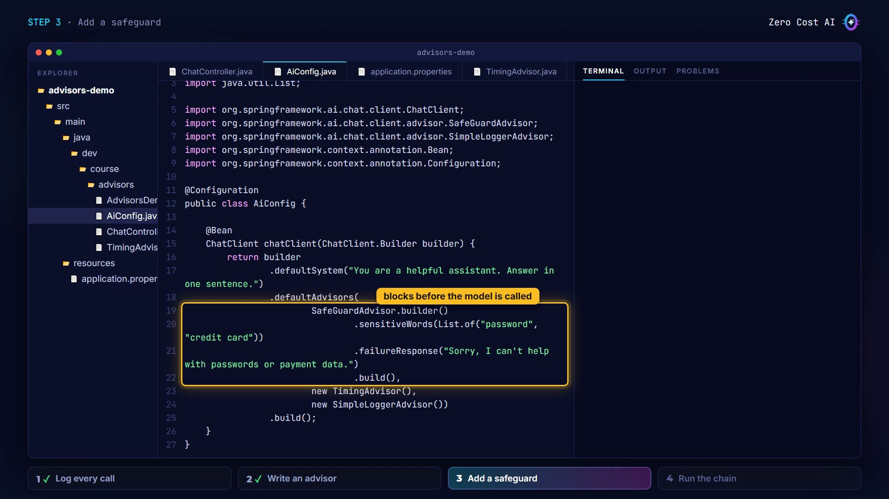

Then our TimingAdvisor, and the logger. Three advisors, each with one job. And still, not a single change in the controller.

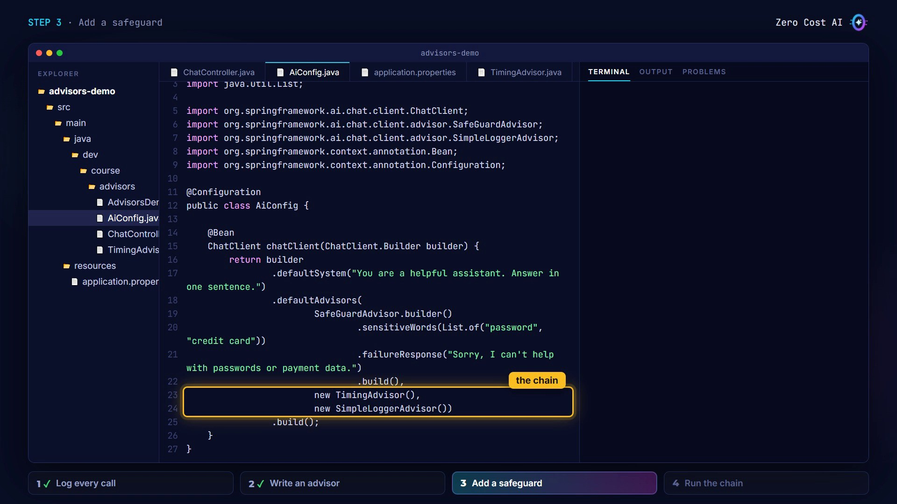

## Step 4: Run the chain

A normal question first.

```bash
$ ./mvnw spring-boot:run
...
Started AdvisorsDemoApplication in 2.5 seconds
```

```bash
$ curl "localhost:8080/chat?message=What+is+a+Spring+bean%3F"
A Spring bean is an object managed by the Spring
container, providing a reusable and configurable
component within your application.
```

One sentence, as the system message asked. Now the application log.

```bash
$ # application log
DEBUG SimpleLoggerAdvisor : request: ChatClientRequest[
  prompt=Prompt{messages=[SystemMessage{textContent=
  'You are a helpful assistant. Answer in one
  sentence.'...}, UserMessage{content='What is a
  Spring bean?'...}]
DEBUG SimpleLoggerAdvisor : response: { ... }
INFO  TimingAdvisor : AI call took 2435 ms, 56 tokens
```

The logger printed the full request: the system message and the user message.

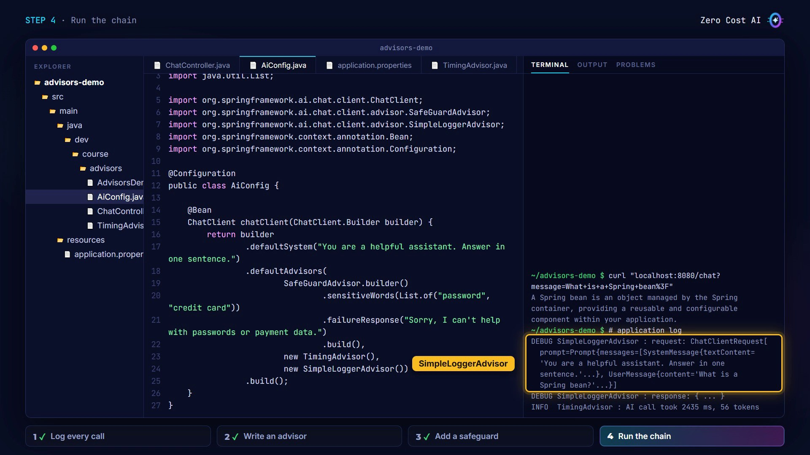

And our TimingAdvisor: 2.4 seconds, 56 tokens.

Now, a request with a sensitive word.

```bash
$ curl "localhost:8080/chat?message=Write+a+strong+password+for+me"
Sorry, I can't help with passwords or payment data.
```

Blocked instantly. And in the logs, there's no timing line for this request. The safeguard stopped it before the model, so it cost zero tokens.

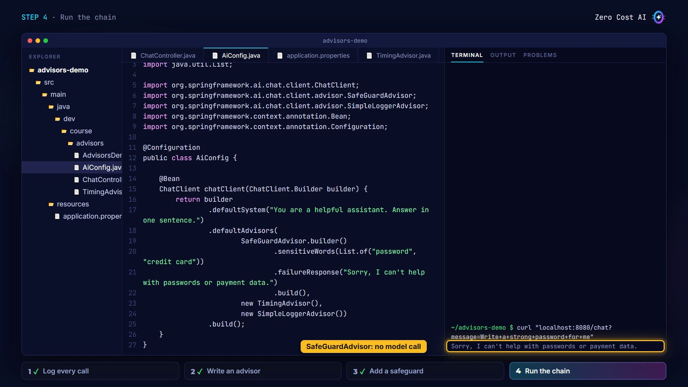

## 3 pro tips

Order matters. Put security advisors first, so blocked requests never reach the model, or your other advisors.

A keyword list is a simple first defense, not real security. Section seven covers prompt injection properly.

And if you use stream, implement StreamAdvisor too. A CallAdvisor only runs for call.

- **Security first**: Block before anything else runs
- **Keywords ≠ security**: A first line of defense only
- **Streaming too**: Implement `StreamAdvisor` as well

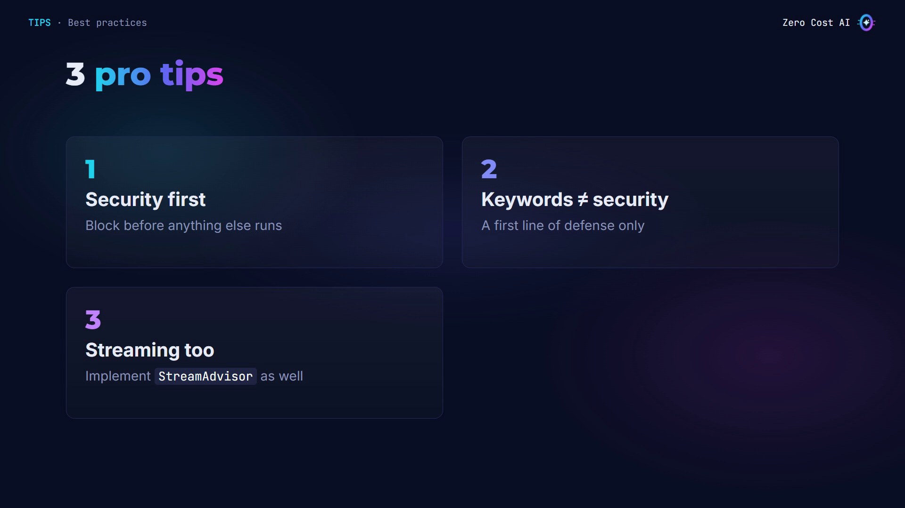

## Your challenge

Your challenge: write a CostAdvisor that keeps a running total of tokens for the whole app.

Then expose the total on a `/stats` endpoint.

- **CostAdvisor**: Running total of tokens (AtomicLong)
- **/stats**: Expose the total

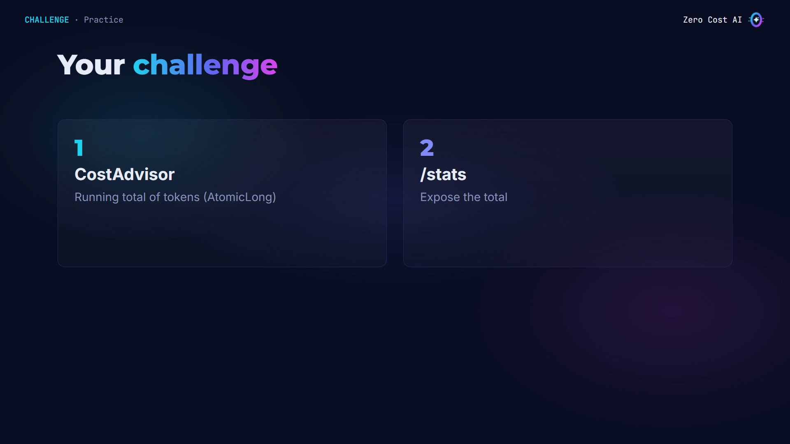

## Recap

- `defaultAdvisors(...)` adds behavior to **every** call
- Custom advisor = `CallAdvisor` + **`chain.nextCall()`**
- `SafeGuardAdvisor` blocks before the model: zero tokens

## Get the code and the quiz

- **Code for this lab**: https://github.com/NEDBS12/youtube-tuto/tree/main/spring-ai-course/labs/advisors-demo
- **All course code, quizzes and resources**: https://github.com/NEDBS12/youtube-tuto/tree/main/spring-ai-course
- **Lesson quiz and section evals**: https://nedbs12.github.io/youtube-tuto/spring-ai-course/quiz/
- **Ollama**: https://ollama.com
- **Spring AI advisors docs**: https://docs.spring.io/spring-ai/reference/api/advisors.html
- **Spring AI reference docs**: https://docs.spring.io/spring-ai/reference/

🎥 **Watch the video tutorial:** {VIDEO_URL}

**Previous: Lesson 2.3, advisors. Next: Lesson 2.4, chat memory.**

*The editor and terminal in the screenshots are a simplified recreation; the code and the outputs come from real runs of the lab.*

*I'm Zero Cost AI: I build AI tools and tutorials and share them for free. Follow me on Medium for the next lessons, and subscribe on YouTube: https://www.youtube.com/@zerocostai-f1h*
