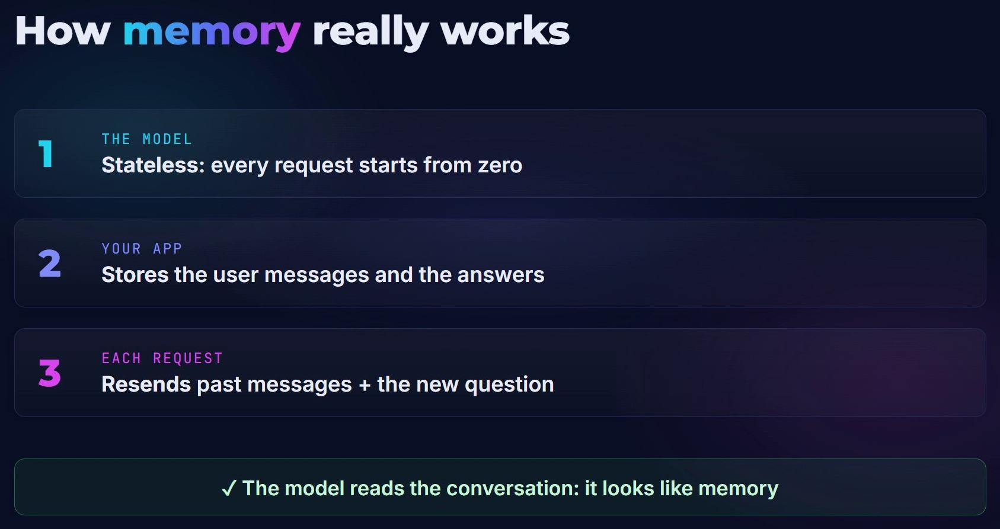
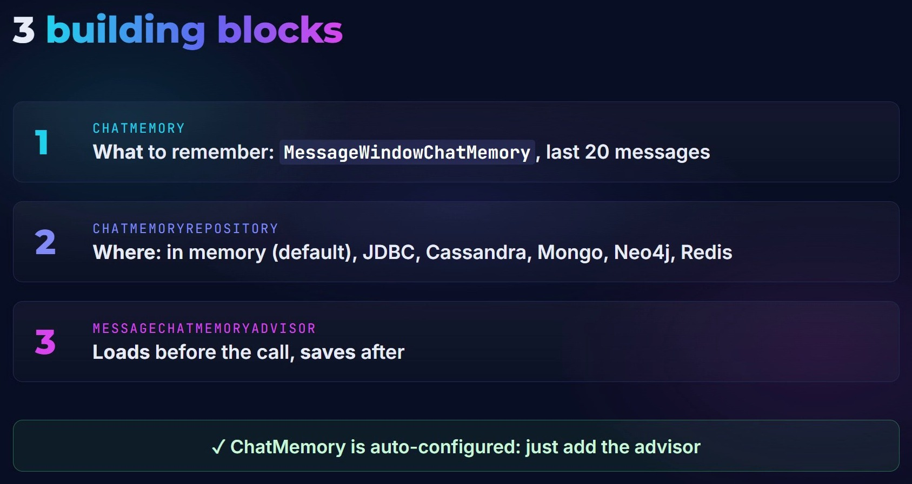
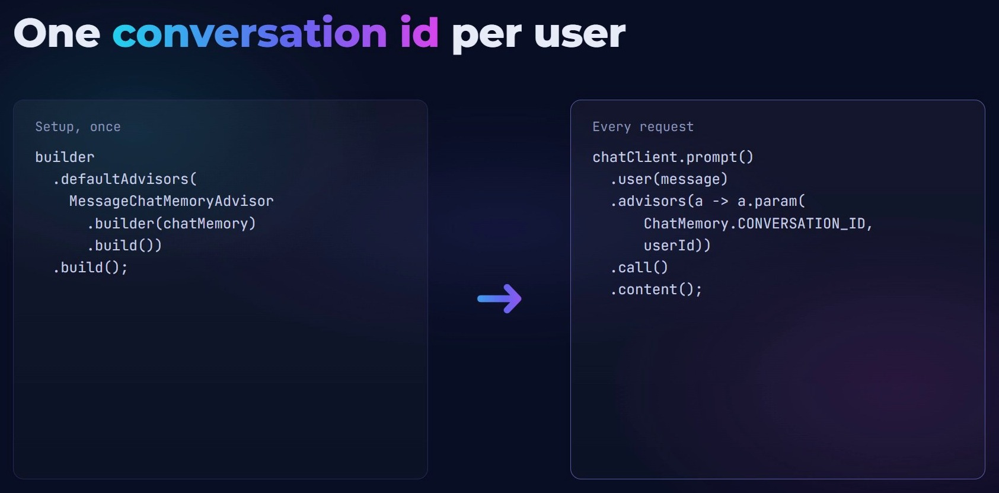
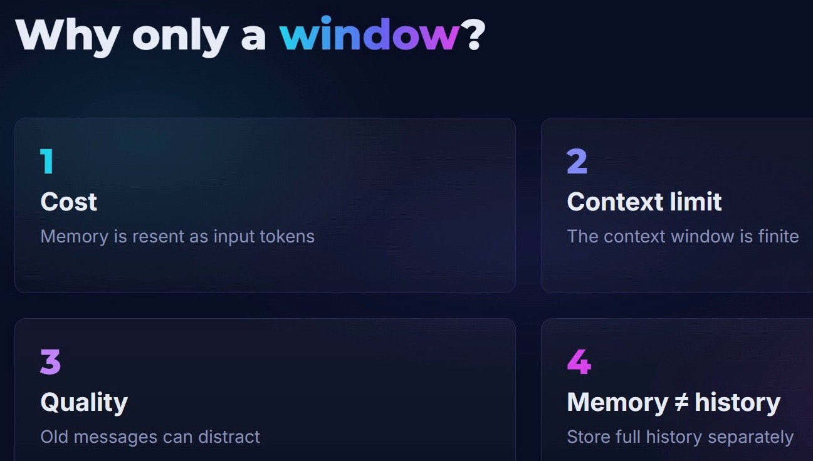
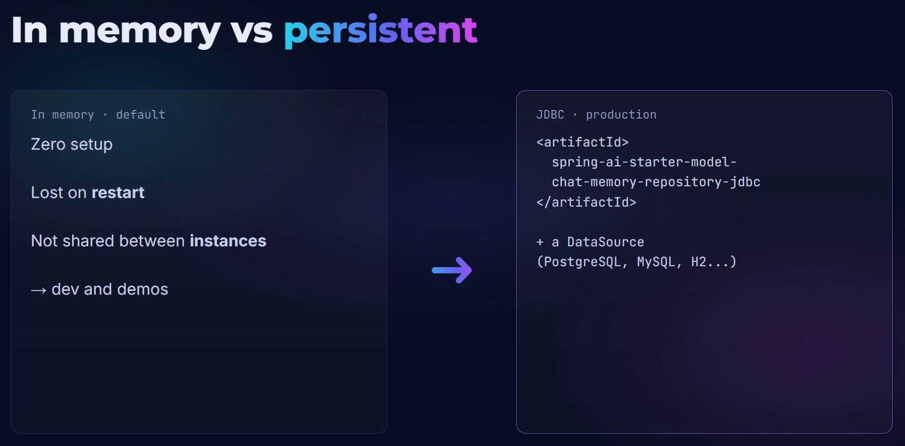

You tell a chatbot your name. In the next message, you ask: what's my name? And it has no idea.

Remember lesson 1.1? Models are stateless. In this lesson, you'll give your app a memory, and learn how to keep it under control.

It's lesson 2.4 of my free **Spring AI: Novice to Expert** course, where every lesson has a concept part and a hands-on lab, and everything runs on a free local model with Ollama.

🎥 **Prefer video?** Watch the full tutorial here:

{VIDEO}

## How memory really works

Here's the trick behind every chatbot.

The model never remembers anything. Each request is brand new.

So the application stores the conversation, the user messages and the assistant answers.

And with every new request, it sends the previous messages again, before the new question.

The model reads the whole conversation, and answers as if it remembered. That's chat memory.

- **The model**: **Stateless**: every request starts from zero
- **Your app**: **Stores** the user messages and the answers
- **Each request**: **Resends** past messages + the new question

**✓ The model reads the conversation: it looks like memory**



## 3 building blocks

Spring AI gives you three building blocks.

ChatMemory decides what to remember. The default, MessageWindowChatMemory, keeps the last 20 messages.

A ChatMemoryRepository decides where to store it. In memory by default, or JDBC, Cassandra, Mongo, Neo4j, Redis.

And MessageChatMemoryAdvisor, an advisor from the last lesson, loads the messages before the call, and saves the new ones after.

Spring Boot auto-configures the ChatMemory for you. You just add the advisor.

- **ChatMemory**: **What** to remember: `MessageWindowChatMemory`, last 20 messages
- **ChatMemoryRepository**: **Where**: in memory (default), JDBC, Cassandra, Mongo, Neo4j, Redis
- **MessageChatMemoryAdvisor**: **Loads** before the call, **saves** after

**✓ ChatMemory is auto-configured: just add the advisor**



## One conversation id per user

And one detail you must never forget: the conversation id.

Without it, every user would share the same memory. Alice's secrets in Bob's chat.

You pass a conversation id as an advisor parameter, on each request. One id per user, or per chat. Spring AI requires it on every call.

### Setup, once

```text
builder
  .defaultAdvisors(
    MessageChatMemoryAdvisor
      .builder(chatMemory)
      .build())
  .build();
```

### Every request

```text
chatClient.prompt()
  .user(message)
  .advisors(a -> a.param(
      ChatMemory.CONVERSATION_ID,
      userId))
  .call()
  .content();
```



## Why only a window?

Why keep only the last 20 messages, and not everything?

Cost. Every remembered message is sent again, as input tokens, on every request.

Limits. The model's context window is finite. A long chat would eventually not fit.

And quality. Old, irrelevant messages can distract the model.

So, memory is what the model needs right now. If you need the full chat history for auditing, store it separately.

- **Cost**: Memory is resent as input tokens
- **Context limit**: The context window is finite
- **Quality**: Old messages can distract
- **Memory ≠ history**: Store full history separately



## In memory vs persistent

Last choice: where to store memory.

In memory is perfect for development and demos. But a restart, or a second instance of your app, and it's gone.

For production, use a persistent repository. With the JDBC starter, it's one dependency and a datasource. The memory survives restarts, and is shared by all instances.

### In memory · default

- Zero setup
- Lost on **restart**
- Not shared between **instances**
- → dev and demos

### JDBC · production

```text
<artifactId>
  spring-ai-starter-model-
  chat-memory-repository-jdbc
</artifactId>

+ a DataSource
(PostgreSQL, MySQL, H2...)
```



## Recap

- Memory = the app **resends** past messages to a stateless model
- `MessageChatMemoryAdvisor` + a **conversation id** per user
- Window for cost; JDBC to survive restarts

## Quick quiz

Test yourself before you read the answers.

1. **Stateless**: How does a stateless model seem to remember?
2. **Isolation**: What keeps Alice's and Bob's memories apart?
3. **Restart**: The bot forgets everything after a restart. Fix?

**Answers:**

1. The app **resends past messages**
2. `ChatMemory.CONVERSATION_ID`
3. A **persistent repository** (e.g. JDBC)

The full five-question quiz for this lesson is free on the course quiz page: https://nedbs12.github.io/youtube-tuto/spring-ai-course/quiz/

## Get the code and the quiz

- **Lab code for this lesson**: https://github.com/NEDBS12/youtube-tuto/tree/main/spring-ai-course/labs/support-bot
- **All course code, quizzes and resources**: https://github.com/NEDBS12/youtube-tuto/tree/main/spring-ai-course
- **Lesson quiz and section evals**: https://nedbs12.github.io/youtube-tuto/spring-ai-course/quiz/
- **Spring AI chat memory docs**: https://docs.spring.io/spring-ai/reference/api/chat-memory.html
- **Spring AI reference docs**: https://docs.spring.io/spring-ai/reference/

🎥 **Watch the video tutorial:** {VIDEO_URL}

**Previous: Lab 2.3. Next: Lab 2.4, a support bot that remembers.**

*I'm Zero Cost AI: I build AI tools and tutorials and share them for free. Follow me on Medium for the next lessons, and subscribe on YouTube: https://www.youtube.com/@zerocostai-f1h*
