4, the last lab of section two. Today you'll build a support bot that remembers each user.

First in memory. Then, in a database, so it survives a restart.

It's lab 2.4 of my free **Spring AI: Novice to Expert** course, where every lesson has a concept part and a hands-on lab, and everything runs on a free local model with Ollama.

🎥 **Prefer video?** Watch the full tutorial here:

{VIDEO}

## What we'll build

Add the memory advisor, use one conversation id per user, test with two users, see what a restart does, and fix it with JDBC.

1. **Add the memory advisor**: `MessageChatMemoryAdvisor`
2. **One id per user**: `ChatMemory.CONVERSATION_ID`
3. **Test two users**: Alice and Bob
4. **Restart = amnesia**: In-memory is lost
5. **Persist with JDBC**: H2 file database

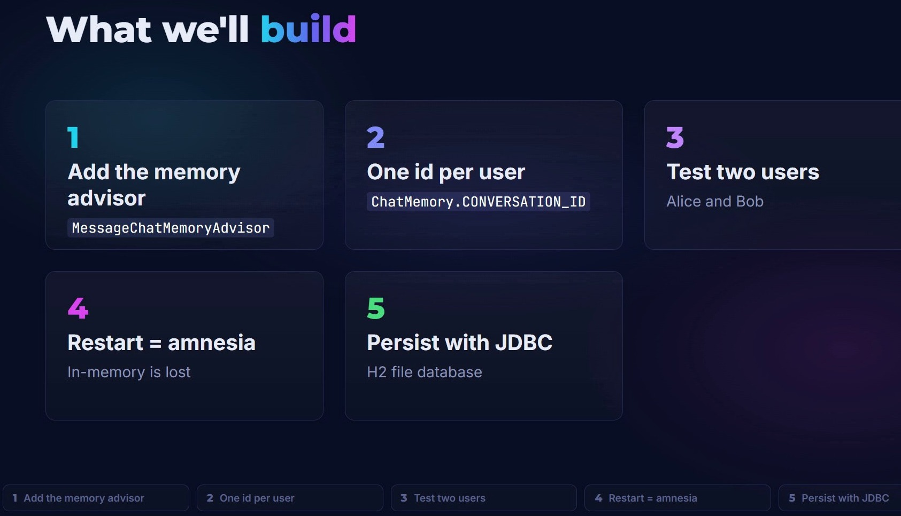

## Step 1: Add the memory advisor

Step one. Our project, support bot, for an app called CloudNote. In AiConfig, I inject the ChatClient builder, and the ChatMemory that Spring AI auto-configures.

**`AiConfig.java`**:

```java
package dev.course.support;

import org.springframework.ai.chat.client.ChatClient;
import org.springframework.ai.chat.client.advisor.MessageChatMemoryAdvisor;
import org.springframework.ai.chat.memory.ChatMemory;
import org.springframework.context.annotation.Bean;
import org.springframework.context.annotation.Configuration;

@Configuration
public class AiConfig {

    @Bean
    ChatClient chatClient(ChatClient.Builder builder, ChatMemory chatMemory) {
        return builder
                .defaultSystem("You are the support assistant of CloudNote, a note-taking app. "
                        + "Be friendly and answer in at most two sentences.")
                .defaultAdvisors(MessageChatMemoryAdvisor.builder(chatMemory).build())
                .build();
    }
}
```

No extra dependency needed. ChatMemory is a window of the last 20 messages, in memory.

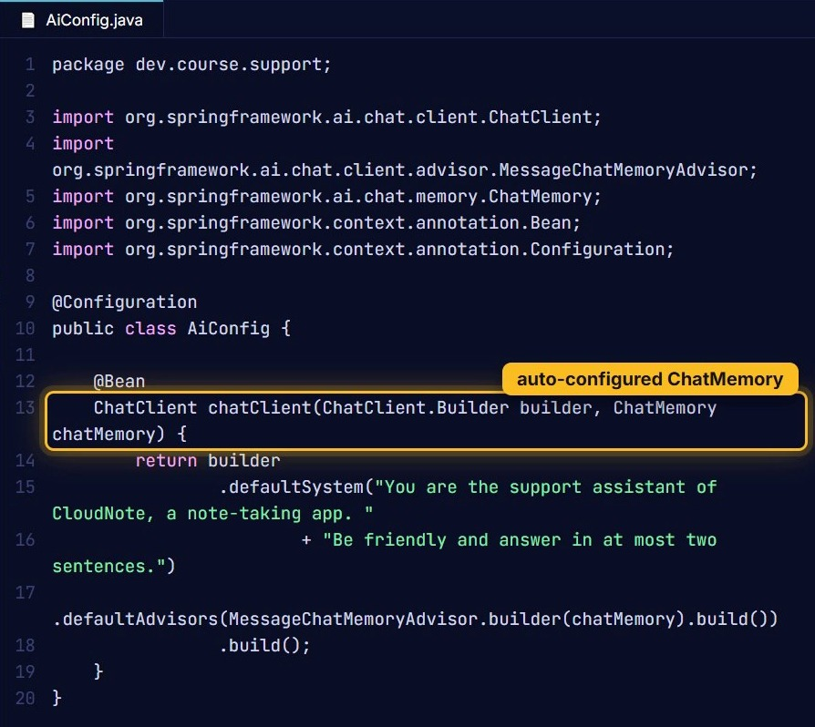

I add a support persona as the default system message, and the MessageChatMemoryAdvisor, built from the chat memory.

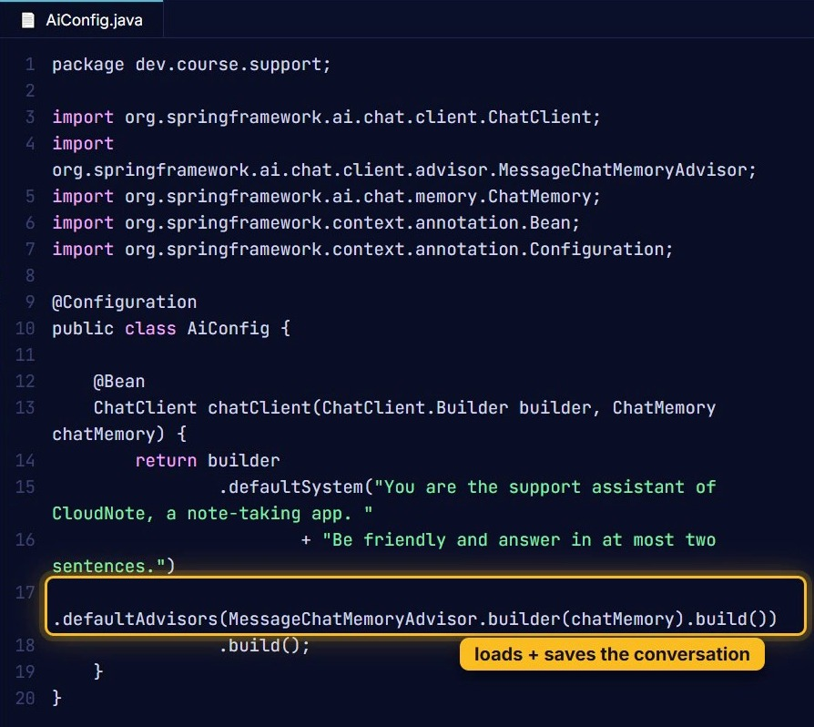

## Step 2: One id per user

The endpoint takes the user id in the path, and the message in the body.

**`SupportController.java`**:

```java
package dev.course.support;

import org.springframework.ai.chat.client.ChatClient;
import org.springframework.ai.chat.memory.ChatMemory;
import org.springframework.web.bind.annotation.PathVariable;
import org.springframework.web.bind.annotation.PostMapping;
import org.springframework.web.bind.annotation.RequestBody;
import org.springframework.web.bind.annotation.RestController;

@RestController
public class SupportController {

    private final ChatClient chatClient;

    public SupportController(ChatClient chatClient) {
        this.chatClient = chatClient;
    }

    @PostMapping("/support/{userId}")
    public String chat(@PathVariable String userId, @RequestBody String message) {
        return chatClient.prompt()
                .user(message)
                .advisors(a -> a.param(ChatMemory.CONVERSATION_ID, userId))
                .call()
                .content();
    }
}
```

And here's the crucial line. I pass the user id as the conversation id, as an advisor parameter.

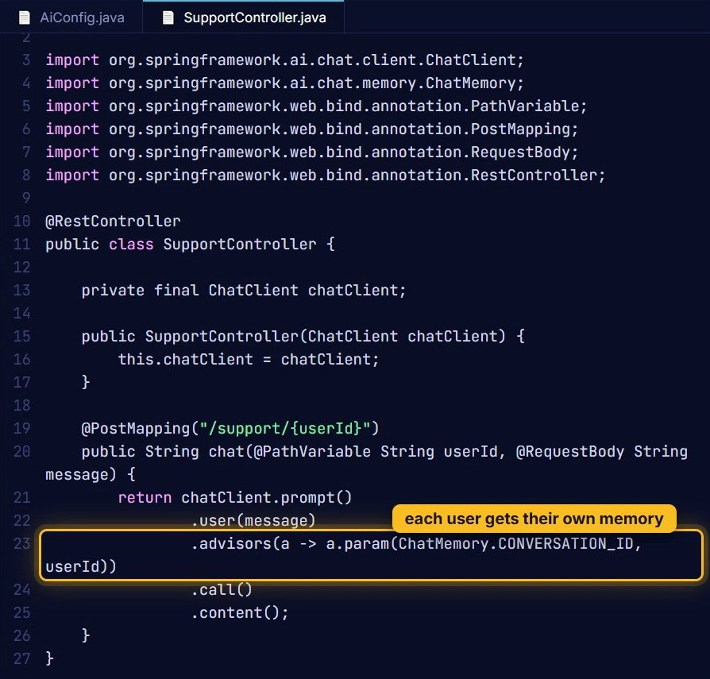

## Step 3: Test two users

Alice introduces herself, and describes her problem.

```bash
$ ./mvnw spring-boot:run
...
Started SupportBotApplication in 2.7 seconds
```

```bash
$ curl localhost:8080/support/alice -H "Content-Type: text/plain" -d "Hi, I'm Alice. My notes stopped syncing on my Android phone."
Hi Alice, I'm sorry to hear your notes aren't syncing!
Let's get this sorted out - could you please tell me
which Android device you're using and if you've tried
restarting it?
```

Now Alice asks: what's my name, and what device did I mention?

```bash
$ curl localhost:8080/support/alice -H "Content-Type: text/plain" -d "What's my name, and what device did I mention?"
Your name is Alice, and you mentioned you're using an
Android phone! Let's troubleshoot your syncing issue
together, Alice.
```

Alice, and an Android phone. The bot remembers!

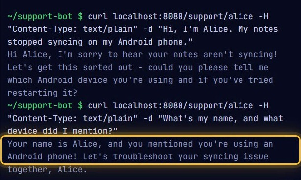

Now Bob asks the exact same question.

```bash
$ curl localhost:8080/support/bob -H "Content-Type: text/plain" -d "What's my name, and what device did I mention?"
Hello there! I don't have access to your personal
information, so I don't know your name or the device you
mentioned. Could you please remind me, or perhaps tell
me a little about what you were working on in CloudNote?
```

Bob gets nothing about Alice. Different conversation id, different memory.

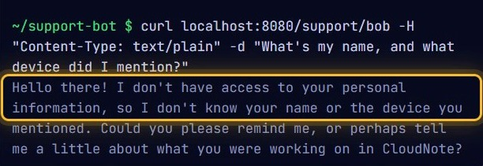

## Step 4: Restart = amnesia

Step four. Let's restart the app, like a new deployment would, and ask Alice's question again.

```bash
$ ./mvnw spring-boot:run
...
Started SupportBotApplication in 2.3 seconds
```

```bash
$ curl localhost:8080/support/alice -H "Content-Type: text/plain" -d "What's my name, and what device did I mention?"
I don't have access to your personal information, so I
don't know your name or the device you mentioned! Could
you please tell me again so I can help you better?
```


Total amnesia. The memory lived in the JVM, and the JVM restarted.

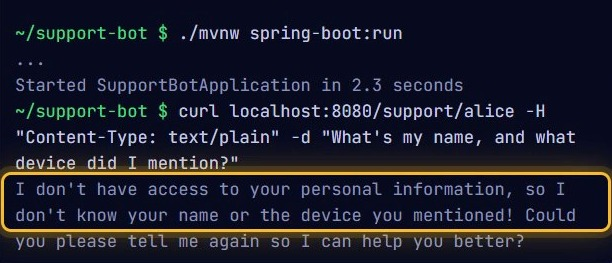

## Step 5: Persist with JDBC

In the pom, I add the JDBC chat memory repository starter, and the H2 database for this demo.

**`pom.xml`** (`pom.xml`):

```xml
<!-- pom.xml (added) -->
<dependency>
    <groupId>org.springframework.ai</groupId>
    <artifactId>spring-ai-starter-model-chat-memory-repository-jdbc</artifactId>
</dependency>
<dependency>
    <groupId>com.h2database</groupId>
    <artifactId>h2</artifactId>
    <scope>runtime</scope>
</dependency>
```

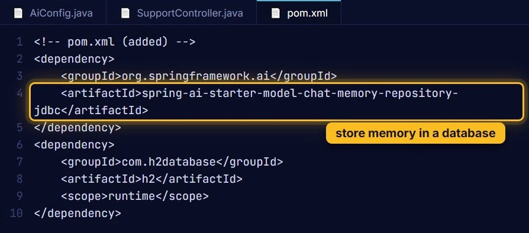

In the properties, an H2 file database, and I ask Spring AI to create the memory table.

**`application.properties`**:

```properties
spring.datasource.url=jdbc:h2:file:./data/support
spring.ai.chat.memory.repository.jdbc.initialize-schema=always
```

No Java change. Spring AI sees the JDBC repository, and uses it instead of the in-memory one.

Alice tells her story again. Then, I restart the app, and ask.

```bash
$ curl localhost:8080/support/alice -H "Content-Type: text/plain" -d "Hi, I'm Alice. My notes stopped syncing on my Android phone."
Hi Alice, I'm sorry to hear your notes aren't syncing! ...
```

```bash
$ ./mvnw spring-boot:run
...
Started SupportBotApplication in 4.4 seconds
```

```bash
$ curl localhost:8080/support/alice -H "Content-Type: text/plain" -d "What's my name, and what device did I mention?"
You're Alice, and you mentioned you're using an Android
phone! Let's get those notes syncing back for you.
```

You're Alice, with an Android phone. The memory survived the restart.

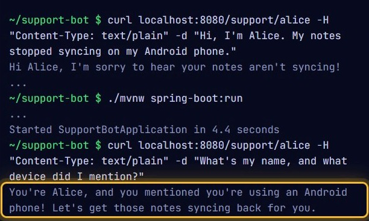

## 3 pro tips

Never use a value the client can fake as the conversation id in production. Take it from the authenticated user.

In production, use a real database like PostgreSQL. H2 was just for the demo.

And watch your token usage. Every remembered message is sent again, so tune the window size.

- **Trusted ids**: Use the authenticated user, not the URL
- **Real database**: PostgreSQL in production
- **Tune the window**: Memory = input tokens on every call

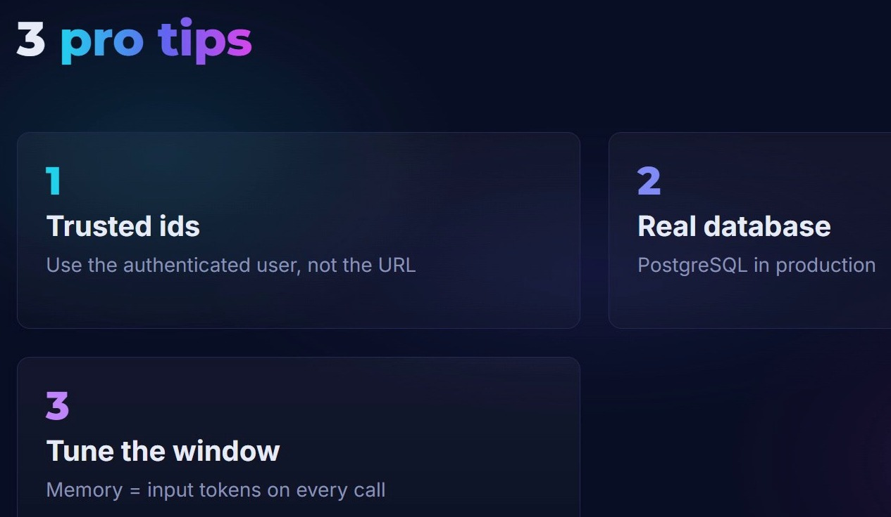

## Your challenge

Your challenge: add a DELETE endpoint that clears a user's memory, with `chatMemory.clear()`.

Then build the full section two challenge from the eval page: a streaming tutor bot with memory.

- **DELETE /support/{userId}**: `chatMemory.clear(userId)`
- **Section 2 challenge**: Streaming tutor bot with memory

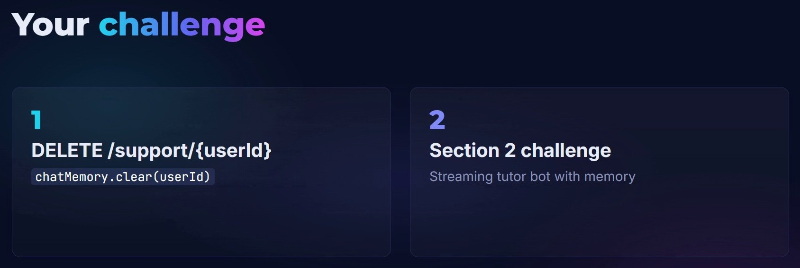

## Recap

- `MessageChatMemoryAdvisor` + auto-configured **ChatMemory**
- One **conversation id** per user keeps memories apart
- The JDBC repository survives restarts, with zero Java changes

## Get the code and the quiz

- **Code for this lab**: https://github.com/NEDBS12/youtube-tuto/tree/main/spring-ai-course/labs/support-bot
- **All course code, quizzes and resources**: https://github.com/NEDBS12/youtube-tuto/tree/main/spring-ai-course
- **Section 2 eval and lesson quizzes**: https://nedbs12.github.io/youtube-tuto/spring-ai-course/quiz/
- **Ollama**: https://ollama.com
- **Spring AI chat memory docs**: https://docs.spring.io/spring-ai/reference/api/chat-memory.html
- **Spring AI reference docs**: https://docs.spring.io/spring-ai/reference/

🎥 **Watch the video tutorial:** {VIDEO_URL}

**Previous: Lesson 2.4, chat memory. Section 2 is complete: take the Section 2 eval (link above) to check your level!**

*The editor and terminal in the screenshots are a simplified recreation; the code and the outputs come from real runs of the lab.*

*I'm Zero Cost AI: I build AI tools and tutorials and share them for free. Follow me on Medium for the next lessons, and subscribe on YouTube: https://www.youtube.com/@zerocostai-f1h*
