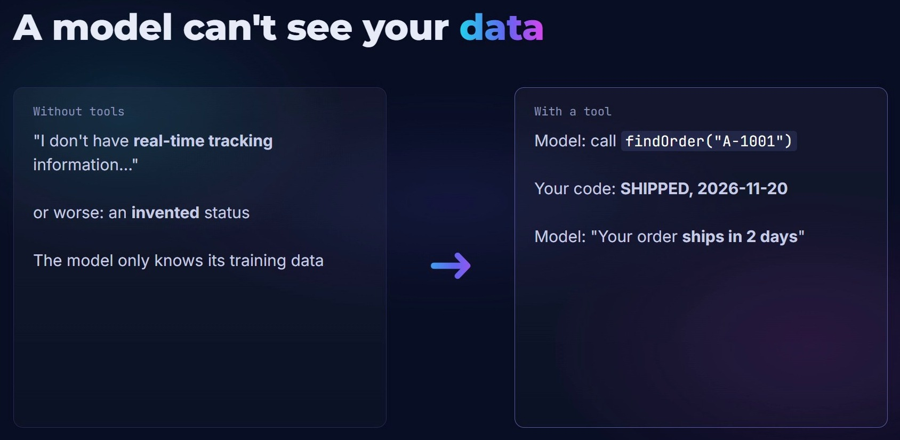
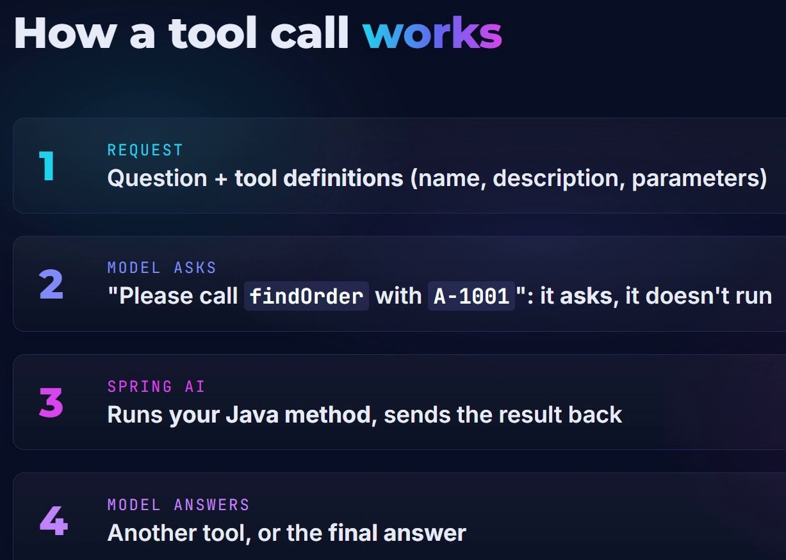
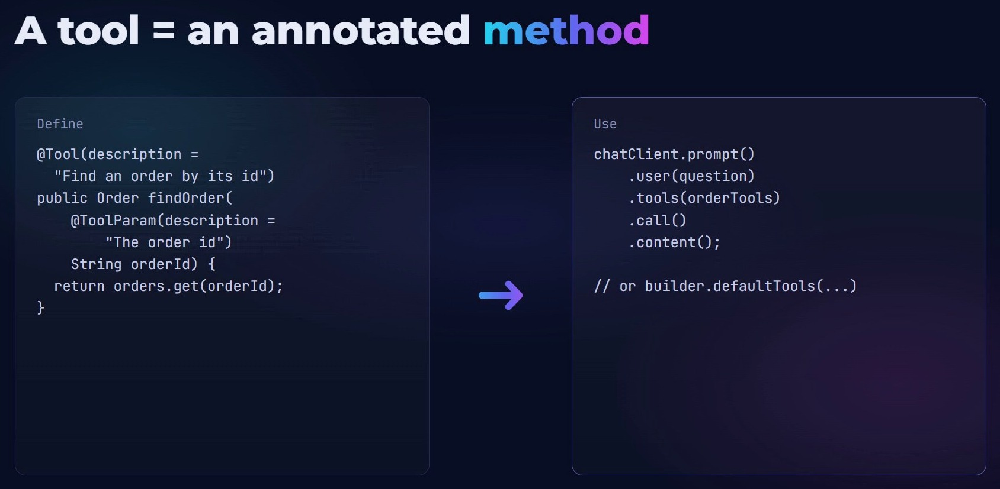
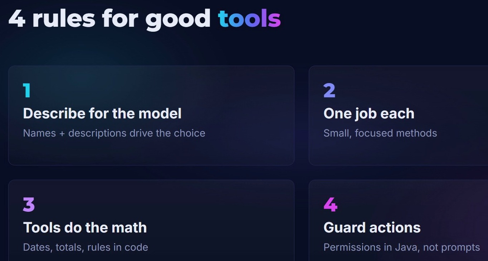
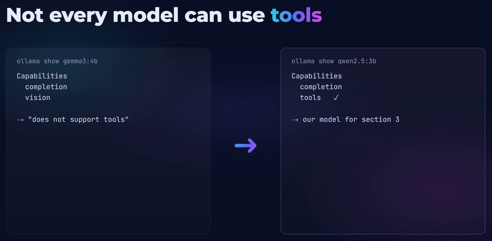

Welcome to section three: tools and agents. This is where AI apps become truly useful.

So far, our models could only talk. They didn't know today's date, your orders, or your customers. And they couldn't do anything.

In this lesson, you'll learn tool calling: how a model can ask your Java code for facts and actions.

It's lesson 3.1 of my free **Spring AI: Novice to Expert** course, where every lesson has a concept part and a hands-on lab, and everything runs on a free local model with Ollama.

🎥 **Prefer video?** Watch the full tutorial here:

{VIDEO}

## A model can't see your data

Here's the problem.

Ask a model: where is my order A-1001? It has never seen your database. At best it says it can't know. At worst, it invents an answer.

With a tool, the model can say: please call findOrder, with A-1001. Your code runs the query, and the model answers with real data.

### Without tools

- "I don't have **real-time tracking** information…"
- or worse: an **invented** status
- The model only knows its training data

### With a tool

- Model: call `findOrder("A-1001")`
- Your code: **SHIPPED, 2026-11-20**
- Model: "Your order **ships in 2 days**"



## How a tool call works

Here's how a tool call really works. And one thing surprises everyone.

Spring AI sends your question, plus the list of available tools: their names, descriptions, and parameters.

The model doesn't run anything. It answers with a request: call this tool, with these arguments.

Spring AI runs your Java method, and sends the result back to the model, in a new request.

The model reads the result, and either asks for another tool, or writes the final answer.

The model never touches your system. Your code stays in control of what runs.

- **Request**: Question + **tool definitions** (name, description, parameters)
- **Model asks**: "Please call `findOrder` with `A-1001`": it **asks**, it doesn't run
- **Spring AI**: Runs **your Java method**, sends the result back
- **Model answers**: Another tool, or the **final answer**

**✓ The model only asks: your code decides what runs**



## A tool = an annotated method

In Spring AI, a tool is just a Java method with an annotation.

Add the Tool annotation with a clear description, and describe each parameter with ToolParam.

Then pass the object to the ChatClient with `.tools()`, for one request, or default tools for every request. Spring AI does the rest.

### Define

```text
@Tool(description =
  "Find an order by its id")
public Order findOrder(
    @ToolParam(description =
        "The order id")
    String orderId) {
  return orders.get(orderId);
}
```

### Use

```text
chatClient.prompt()
    .user(question)
    .tools(orderTools)
    .call()
    .content();

// or builder.defaultTools(...)
```



## 4 rules for good tools

Four rules for good tools.

Write descriptions for the model. It picks tools only from their names and descriptions.

Keep each tool small, with one job.

Let tools do the math. Dates, totals, and rules belong in code, like we learned in lesson 2.2.

And be careful with tools that change things, like cancelling an order. Check permissions in your Java code, not in the prompt.

- **Describe for the model**: Names + descriptions drive the choice
- **One job each**: Small, focused methods
- **Tools do the math**: Dates, totals, rules in code
- **Guard actions**: Permissions in Java, not prompts



## Not every model can use tools

One important catch: not every model supports tools.

The model must be trained for tool calling. In Ollama, check the capabilities with ollama show. Gemma 3, our model so far, has none.

So for this section, we switch to Qwen 2.5, 3 billion parameters. Still free, still local, and it supports tools.

### ollama show gemma3:4b

```text
Capabilities
  completion
  vision

→ "does not support tools"
```

### ollama show qwen2.5:3b

```text
Capabilities
  completion
  tools   ✓

→ our model for section 3
```



## Recap

- The model **asks** for a tool; Spring AI **runs** your method
- `@Tool` + `@ToolParam`, passed with `.tools(...)`
- Pick a model with the tools capability

## Quick quiz

Test yourself before you read the answers.

1. **Who runs it?**: Who executes the Java method of a tool?
2. **Annotation**: Which annotation turns a method into a tool?
3. **Choice**: How does the model choose a tool?

**Answers:**

1. **Your app**, via Spring AI: the model only asks
2. `@Tool`, with `@ToolParam` for parameters
3. From its **name and description**

The full five-question quiz for this lesson is free on the course quiz page: https://nedbs12.github.io/youtube-tuto/spring-ai-course/quiz/

## Get the code and the quiz

- **Lab code for this lesson**: https://github.com/NEDBS12/youtube-tuto/tree/main/spring-ai-course/labs/order-assistant
- **All course code, quizzes and resources**: https://github.com/NEDBS12/youtube-tuto/tree/main/spring-ai-course
- **Lesson quiz and section evals**: https://nedbs12.github.io/youtube-tuto/spring-ai-course/quiz/
- **Spring AI tool calling docs**: https://docs.spring.io/spring-ai/reference/api/tools.html
- **Spring AI reference docs**: https://docs.spring.io/spring-ai/reference/

🎥 **Watch the video tutorial:** {VIDEO_URL}

**Previous: Lab 2.4 (Section 2 complete). Next: Lab 3.1, an order assistant with tools.**

*I'm Zero Cost AI: I build AI tools and tutorials and share them for free. Follow me on Medium for the next lessons, and subscribe on YouTube: https://www.youtube.com/@zerocostai-f1h*
