Today you'll build an order assistant for a tech shop, that answers with real data from your Java code.

We'll compare it with and without tools, and watch the model call them.

It's lab 3.1 of my free **Spring AI: Novice to Expert** course, where every lesson has a concept part and a hands-on lab, and everything runs on a free local model with Ollama.

🎥 **Prefer video?** Watch the full tutorial here:

{VIDEO}

## What we'll build

A model that supports tools. Our tools. A tool that does the math. Giving the tools to the client. And a comparison, with and without tools.

1. **A model with tools**: qwen2.5:3b
2. **Write the tools**: `findOrder` with `@Tool`
3. **Tools do the math**: `daysUntil` in Java
4. **Give tools to the client**: `.tools(orderTools)`
5. **Run and compare**: With and without tools

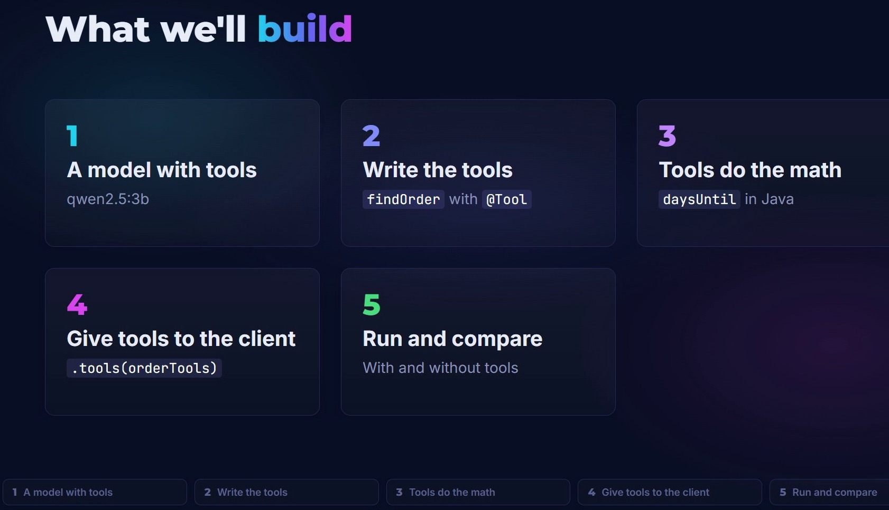

## Step 1: A model with tools

If you try tools with Gemma, Ollama refuses the request.

```bash
$ # with gemma3:4b and tools
NonTransientAiException: HTTP 400 -
{"error":"registry.ollama.ai/library/gemma3:4b
  does not support tools"}
```

So I pull Qwen 2.5, 3 billion parameters, and check its capabilities. Tools: yes.

```bash
$ ollama pull qwen2.5:3b
...
success
```

```bash
$ ollama show qwen2.5:3b
  Capabilities
    completion
    tools
```

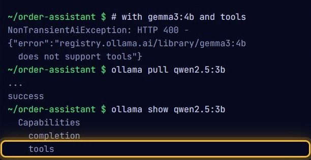

In the properties: the new model, and temperature zero. With tools, we want predictable decisions.

**`application.properties`** (`src/main/resources/application.properties`):

```properties
spring.application.name=order-assistant
spring.ai.ollama.chat.model=qwen2.5:3b
spring.ai.ollama.chat.temperature=0.0
```

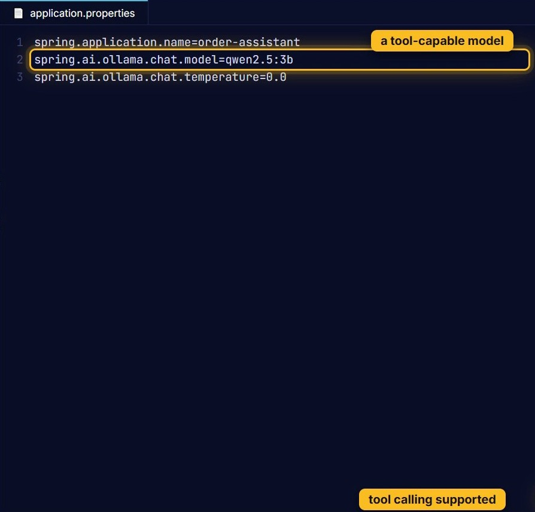

## Step 2: Write the tools

First, an Order record: id, product, status, and delivery date.

**`Order.java`**:

```java
package dev.course.orders;

import java.time.LocalDate;

public record Order(String id, String product, String status, LocalDate deliveryDate) {
}
```

OrderTools is a Spring component. For the demo, the orders live in a map. In a real app, this would be your repository.

**`OrderTools.java`**:

```java
package dev.course.orders;

import java.time.LocalDate;
import java.time.temporal.ChronoUnit;
import java.util.Map;

import org.slf4j.Logger;
import org.slf4j.LoggerFactory;
import org.springframework.ai.tool.annotation.Tool;
import org.springframework.ai.tool.annotation.ToolParam;
import org.springframework.stereotype.Component;

@Component
public class OrderTools {

    private static final Logger log = LoggerFactory.getLogger(OrderTools.class);

    private final Map<String, Order> orders = Map.of(
            "A-1001", new Order("A-1001", "Mechanical keyboard", "SHIPPED", LocalDate.of(2026, 11, 20)),
            "A-1002", new Order("A-1002", "4K monitor", "PROCESSING", LocalDate.of(2026, 11, 27)));

    @Tool(description = "Find an order by its id, for example A-1001")
    public Order findOrder(@ToolParam(description = "The order id") String orderId) {
        log.info("TOOL findOrder({})", orderId);
        return orders.get(orderId);
    }
```

FindOrder is a normal Java method. The Tool annotation, with a description the model can understand, makes it a tool.

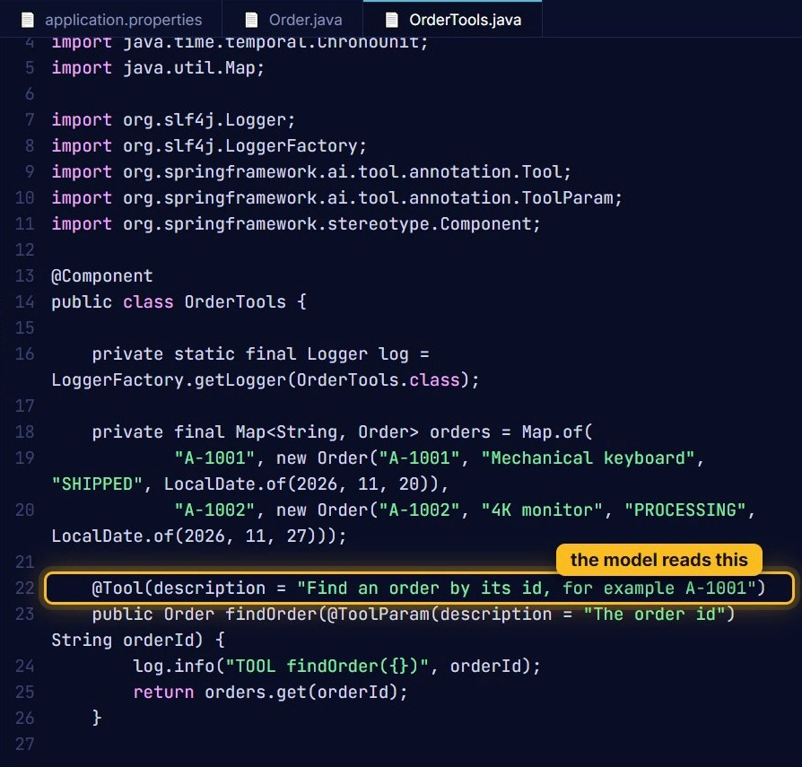

ToolParam describes the parameter. And I log each call, so we can see what the model asks for.

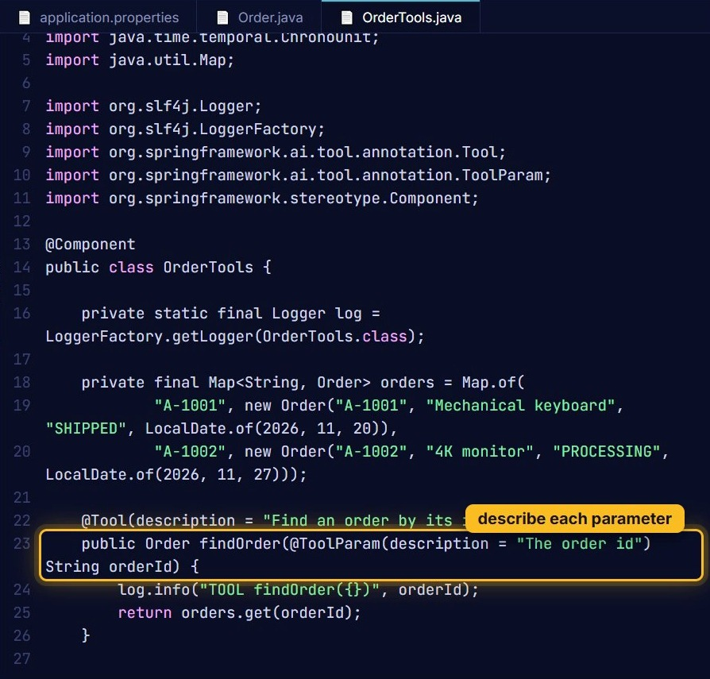

## Step 3: Tools do the math

Customers ask: how many days until it arrives? That's date arithmetic.

**`OrderTools.java`** (continued):

```java
    @Tool(description = "Count the days from today until a date given in ISO format, for example 2026-11-20")
    public long daysUntil(@ToolParam(description = "The date, in ISO format") String date) {
        long days = ChronoUnit.DAYS.between(LocalDate.now(), LocalDate.parse(date));
        log.info("TOOL daysUntil({}) = {}", date, days);
        return days;
    }
}
```

In my first version, I only gave the model today's date, and let it calculate. Once, it answered: 284 days. The real answer was two.

**First version, one real answer**

> "...expected to arrive on November 20, 2026, which is 284 days from today."

So daysUntil computes it in Java, with ChronoUnit. The model just asks. Same rule as lesson 2.2: let code do the math.

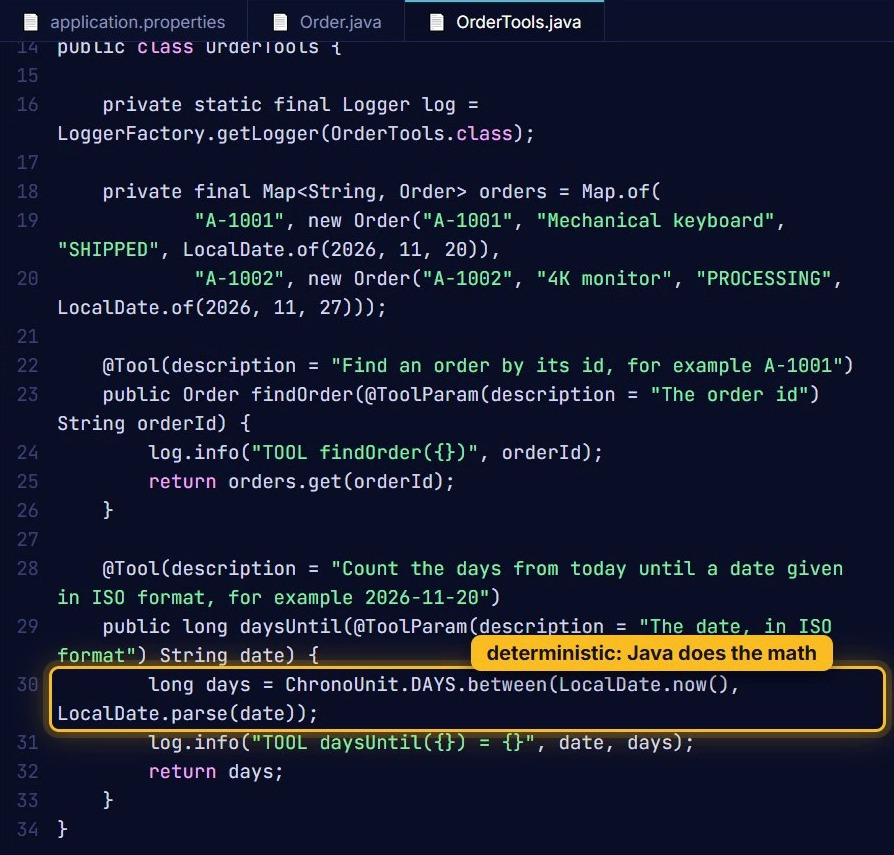

## Step 4: Give tools to the client

The controller injects the builder and our OrderTools.

**`AssistantController.java`**:

```java
package dev.course.orders;

import org.springframework.ai.chat.client.ChatClient;
import org.springframework.web.bind.annotation.GetMapping;
import org.springframework.web.bind.annotation.RequestParam;
import org.springframework.web.bind.annotation.RestController;

@RestController
public class AssistantController {

    private final ChatClient chatClient;
    private final OrderTools orderTools;

    public AssistantController(ChatClient.Builder builder, OrderTools orderTools) {
        this.chatClient = builder
                .defaultSystem("You are the customer assistant of a tech shop. Answer in at most two sentences.")
                .build();
        this.orderTools = orderTools;
    }
```

`/ask` passes the tools with `.tools()`. That's all. The model can now call findOrder and daysUntil.

**`AssistantController.java`** (continued):

```java
    @GetMapping("/ask")
    public String ask(@RequestParam String question) {
        return chatClient.prompt()
                .user(question)
                .tools(orderTools)
                .call()
                .content();
    }
```

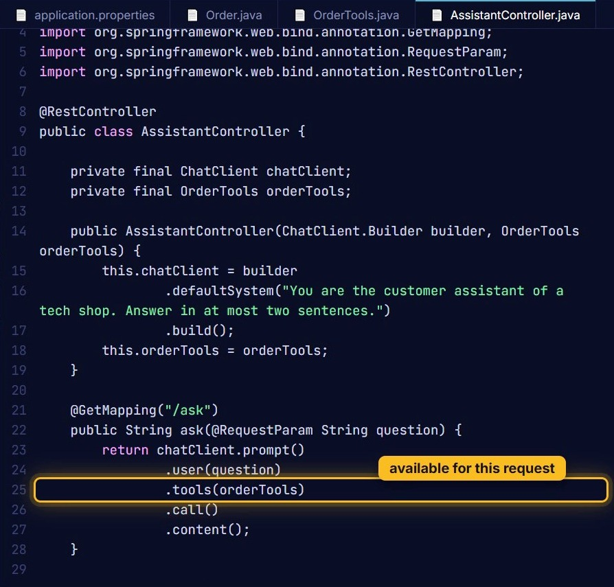

And for comparison, `/ask-no-tools`: the same question, without tools.

**`AssistantController.java`** (continued):

```java
    @GetMapping("/ask-no-tools")
    public String askWithoutTools(@RequestParam String question) {
        return chatClient.prompt()
                .user(question)
                .call()
                .content();
    }
}
```

## Step 5: Run and compare

Without tools first.

```bash
$ ./mvnw spring-boot:run
...
Started OrderAssistantApplication in 2.7 seconds
```

```bash
$ curl "localhost:8080/ask-no-tools?question=Where+is+my+order+A-1001+and+how+many+days+until+it+arrives%3F"
I'm sorry, for your order A-1001, I don't have real-time
tracking information available. As for the estimated
arrival date, please check your order confirmation email
or contact customer support for the most accurate
information.
```

The model has no idea. At least this time, it didn't invent anything.

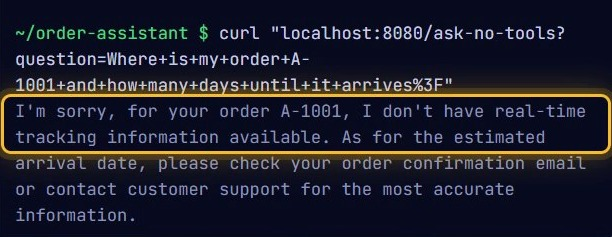

Now with tools.

```bash
$ curl "localhost:8080/ask?question=Where+is+my+order+A-1001+and+how+many+days+until+it+arrives%3F"
Your order A-1001 is in the "SHIPPED" status and it is
expected to arrive in 2 days.
```

Shipped, arriving in two days. Correct. And here's what happened behind the scenes.

```bash
$ # application log
INFO OrderTools : TOOL findOrder(A-1001)
INFO OrderTools : TOOL daysUntil(2026-11-20) = 2
```

The model called findOrder, took the delivery date from the result, then called daysUntil with it. Two tools, chained, by itself.

And an order that doesn't exist? The tool returns nothing, and the model says so honestly.

```bash
$ curl "localhost:8080/ask?question=What+is+the+status+of+order+A-9999%3F"
I couldn't find any order with the ID A-9999. Could you
please check the order ID or try again?
```

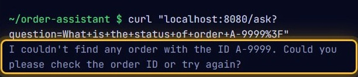

## 3 pro tips

Log every tool call. When an answer looks wrong, the log tells you whether the model asked for the wrong tool, or the tool returned bad data.

Return small, clear results. A record with a few fields is easier for the model than a huge object.

And remember: the model chooses the arguments. Validate them in your tool, like any user input.

- **Log tool calls**: Find out who got it wrong
- **Small results**: A record, not a huge object
- **Validate arguments**: The model chooses them: treat as user input

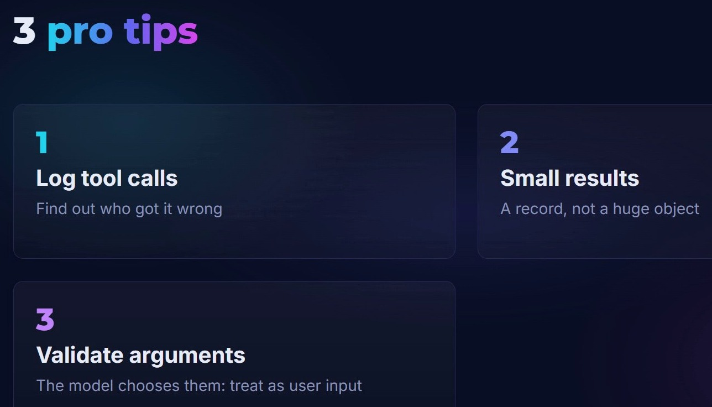

## Your challenge

Your challenge: add a cancelOrder tool. But only orders in PROCESSING can be cancelled, and that rule must be checked in Java.

Then try to convince the assistant to cancel a shipped order. Your Java check should win.

- **cancelOrder tool**: Only PROCESSING orders, checked in Java
- **Try to break it**: Ask it to cancel a shipped order

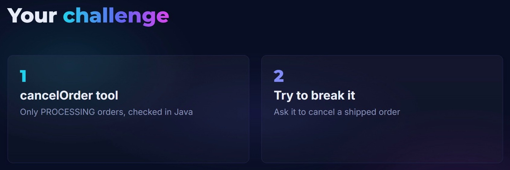

## Recap

- Tools need a model with the **tools** capability
- `@Tool` + `@ToolParam` + `.tools(...)`: the model can **chain** calls
- Tools **do the math**; log every call

## Get the code and the quiz

- **Code for this lab**: https://github.com/NEDBS12/youtube-tuto/tree/main/spring-ai-course/labs/order-assistant
- **All course code, quizzes and resources**: https://github.com/NEDBS12/youtube-tuto/tree/main/spring-ai-course
- **Lesson quiz and section evals**: https://nedbs12.github.io/youtube-tuto/spring-ai-course/quiz/
- **Ollama**: https://ollama.com
- **Spring AI tool calling docs**: https://docs.spring.io/spring-ai/reference/api/tools.html
- **Spring AI reference docs**: https://docs.spring.io/spring-ai/reference/

🎥 **Watch the video tutorial:** {VIDEO_URL}

**Previous: Lesson 3.1, tool calling. Next: Lesson 3.2, inside the tool loop.**

*The editor and terminal in the screenshots are a simplified recreation; the code and the outputs come from real runs of the lab.*

*I'm Zero Cost AI: I build AI tools and tutorials and share them for free. Follow me on Medium for the next lessons, and subscribe on YouTube: https://www.youtube.com/@zerocostai-f1h*
