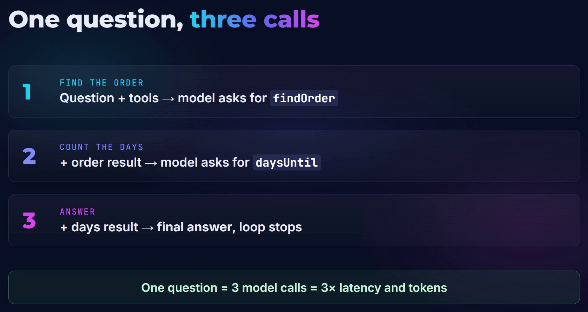
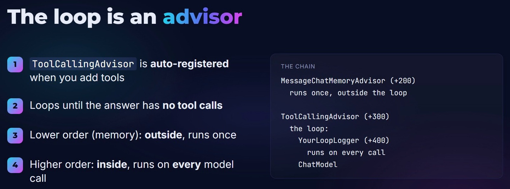
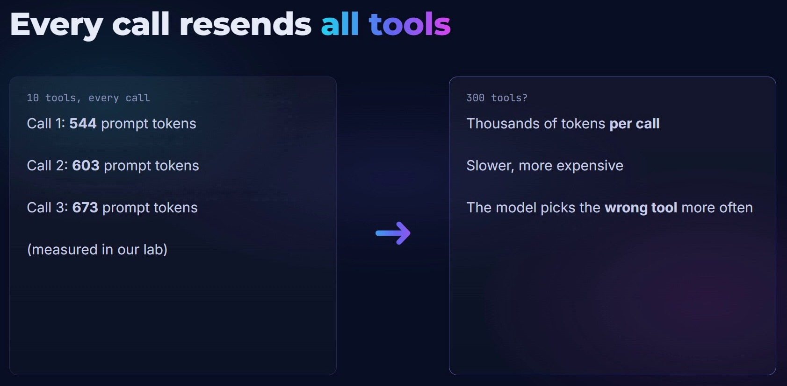
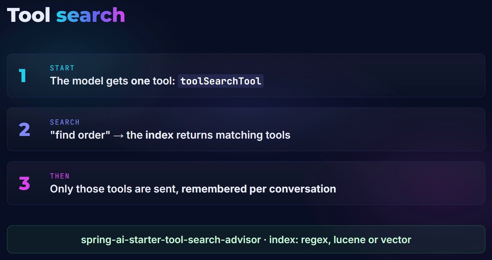
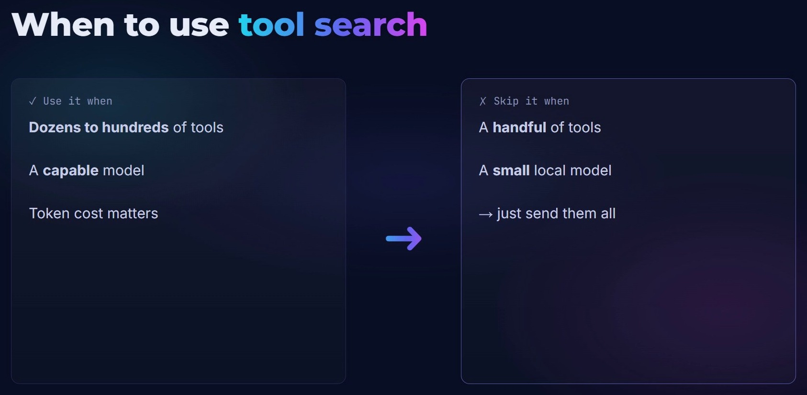

In the last lab, one question made the model call two tools in a row. But how many requests really went to the model?

In this lesson, we open the hood: the tool loop, how Spring AI two runs it as an advisor, and how to keep it efficient when you have many tools.

It's lesson 3.2 of my free **Spring AI: Novice to Expert** course, where every lesson has a concept part and a hands-on lab, and everything runs on a free local model with Ollama.

🎥 **Prefer video?** Watch the full tutorial here:

{VIDEO}

## One question, three calls

Here's the loop, for our order question.

Call one: the model reads the question and the tools, and asks for findOrder.

Spring AI runs it, and calls the model again with the result. Call two: the model asks for daysUntil.

Call three: with both results, the model writes the final answer. No more tool calls, so the loop stops.

One question, three model calls. Each one costs time and tokens.

- **Find the order**: Question + tools → model asks for `findOrder`
- **Count the days**: + order result → model asks for `daysUntil`
- **Answer**: + days result → **final answer**, loop stops

**One question = 3 model calls = 3× latency and tokens**



## The loop is an advisor

In Spring AI two, this loop is an advisor: the ToolCallingAdvisor.

The ChatClient registers it automatically, as soon as you give it tools.

It keeps calling the model, and running tools, until the answer contains no more tool calls.

Because it's an advisor, its position in the chain matters. Advisors with a lower order wrap the whole loop, like chat memory. They run once.

Advisors with a higher order sit inside the loop. They run on every model call. That's how you can observe each step.

- `ToolCallingAdvisor` is **auto-registered** when you add tools
- Loops until the answer has **no tool calls**
- Lower order (memory): **outside**, runs once
- Higher order: **inside**, runs on **every** model call

In code:

```java
MessageChatMemoryAdvisor (+200)
  runs once, outside the loop

ToolCallingAdvisor (+300)
  the loop:
    YourLoopLogger (+400)
      runs on every call
    ChatModel
```



## Every call resends all tools

And here's a hidden cost.

Every model call in the loop sends the definitions of all your tools again. With ten tools, in our lab, that's about 500 tokens per call, before the question even starts.

With hundreds of tools, it gets expensive, and the model gets confused. Spring AI two has an answer: tool search.

### 10 tools, every call

- Call 1: **544** prompt tokens
- Call 2: **603** prompt tokens
- Call 3: **673** prompt tokens
- (measured in our lab)

### 300 tools?

- Thousands of tokens **per call**
- Slower, more expensive
- The model picks the **wrong tool** more often



## Tool search

Tool search is called progressive tool disclosure.

Instead of all tools, the model first gets just one: a tool search tool.

The model searches for what it needs, like: find order. Spring AI looks it up in an index of your tools.

Only the matching tools are added to the next call. And they're remembered for the conversation.

You enable it with one starter and a property. The index can be regex, Lucene keywords, or a vector store.

- **Start**: The model gets **one** tool: `toolSearchTool`
- **Search**: "find order" → the **index** returns matching tools
- **Then**: Only those tools are sent, **remembered per conversation**

**spring-ai-starter-tool-search-advisor · index: regex, lucene or vector**



## When to use tool search

So, should you always use tool search?

Use it when you have many tools, dozens or hundreds, and a capable model that follows instructions well.

Skip it with a handful of tools, or with small models. In our lab, a 3 billion parameter model didn't use the search tool reliably. Sending ten tools directly worked better.

### ✓ Use it when

- **Dozens to hundreds** of tools
- A **capable** model
- Token cost matters

### ✗ Skip it when

- A **handful** of tools
- A **small** local model
- → just send them all



## Recap

- One question can mean **several model calls**
- `ToolCallingAdvisor` runs the loop; order decides **inside or outside**
- Tool search: fewer tokens with many tools and a capable model

## Quick quiz

Test yourself before you read the answers.

1. **Calls**: findOrder, then daysUntil. How many model calls?
2. **Inside**: How do you run an advisor on every loop iteration?
3. **Tool search**: What does tool search reduce?

**Answers:**

1. **3**: two tool requests + the final answer
2. Order **higher** than the ToolCallingAdvisor
3. The **tool definitions** sent on each call

The full five-question quiz for this lesson is free on the course quiz page: https://nedbs12.github.io/youtube-tuto/spring-ai-course/quiz/

## Get the code and the quiz

- **Lab code for this lesson**: https://github.com/NEDBS12/youtube-tuto/tree/main/spring-ai-course/labs/tool-loop
- **All course code, quizzes and resources**: https://github.com/NEDBS12/youtube-tuto/tree/main/spring-ai-course
- **Lesson quiz and section evals**: https://nedbs12.github.io/youtube-tuto/spring-ai-course/quiz/
- **ToolCallingAdvisor docs**: https://docs.spring.io/spring-ai/reference/api/tools/tool-calling-advisor.html
- **Tool search docs**: https://docs.spring.io/spring-ai/reference/api/tools/tool-search-tool.html
- **Spring AI reference docs**: https://docs.spring.io/spring-ai/reference/

🎥 **Watch the video tutorial:** {VIDEO_URL}

**Previous: Lab 3.1. Next: Lab 3.2, watch the loop and try tool search.**

*I'm Zero Cost AI: I build AI tools and tutorials and share them for free. Follow me on Medium for the next lessons, and subscribe on YouTube: https://www.youtube.com/@zerocostai-f1h*
