Today, we'll look inside the tool loop: every model call, every tool request, and the tokens it costs.

Then we'll try tool search for real, and see honestly where it works, and where it doesn't.

It's lab 3.2 of my free **Spring AI: Novice to Expert** course, where every lesson has a concept part and a hands-on lab, and everything runs on a free local model with Ollama.

🎥 **Prefer video?** Watch the full tutorial here:

{VIDEO}

## What we'll do

Ten shop tools. An advisor that logs the loop. Watching it run. Turning on tool search. And trying a bigger model.

1. **Ten tools**: A realistic shop assistant
2. **Log the loop**: An advisor inside the loop
3. **Watch the loop**: Calls and tokens
4. **Turn on tool search**: One starter, two properties
5. **Bigger model**: qwen2.5:7b, Lucene index

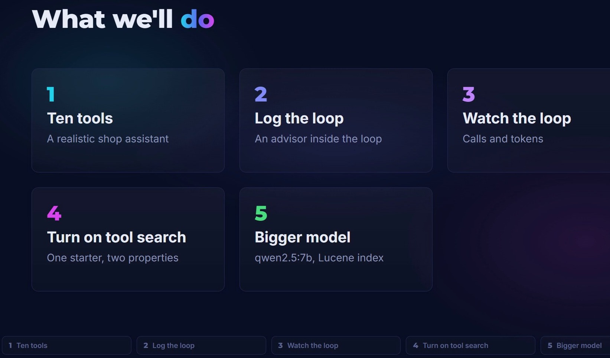

## Step 1: Ten tools

ShopTools has the order tools from the last lab, plus store hours, returns, shipping, stock, warranty, categories, loyalty points and promo codes.

**`ShopTools.java`** (`src/main/java/dev/course/toolloop/ShopTools.java`):

```java
package dev.course.toolloop;

import java.time.LocalDate;
import java.time.temporal.ChronoUnit;

import org.springframework.ai.tool.annotation.Tool;
import org.springframework.ai.tool.annotation.ToolParam;
import org.springframework.stereotype.Component;

@Component
public class ShopTools {

    @Tool(description = "Find an order by its id and return its status and delivery date")
    public String findOrder(@ToolParam(description = "The order id, e.g. A-1001") String orderId) {
        return "A-1001".equals(orderId) ? "SHIPPED, delivery 2026-11-20" : "Order not found";
    }

    @Tool(description = "Count the days from today until a date in ISO format")
    public long daysUntil(@ToolParam(description = "ISO date, e.g. 2026-11-20") String date) {
        return ChronoUnit.DAYS.between(LocalDate.now(), LocalDate.parse(date));
    }

    @Tool(description = "Get the store opening hours")
    public String getStoreHours() {
        return "Monday to Saturday, 9:00 to 19:00";
    }

    @Tool(description = "Get the return policy")
    public String getReturnPolicy() {
        return "Returns accepted within 30 days, in the original packaging";
    }

    @Tool(description = "Get the shipping cost to a country")
    public String getShippingCost(@ToolParam(description = "Country name") String country) {
        return "France".equalsIgnoreCase(country) ? "4.90 EUR" : "14.90 EUR";
    }

    @Tool(description = "Check if a product is in stock")
    public String checkStock(@ToolParam(description = "Product name") String product) {
        return product + ": 12 units in stock";
    }

    @Tool(description = "Get the warranty period of a product")
    public String getWarranty(@ToolParam(description = "Product name") String product) {
        return product + ": 2 years warranty";
    }

    @Tool(description = "List the product categories of the shop")
    public String listCategories() {
        return "Keyboards, Monitors, Laptops, Audio";
    }

    @Tool(description = "Get the loyalty points of a customer")
    public int getLoyaltyPoints(@ToolParam(description = "Customer id") String customerId) {
        return 1250;
    }

    @Tool(description = "List the active promo codes")
    public String getPromoCodes() {
        return "WINTER10: 10% off monitors";
    }
}
```

Simple fake data, but a realistic number of tools for a shop assistant.

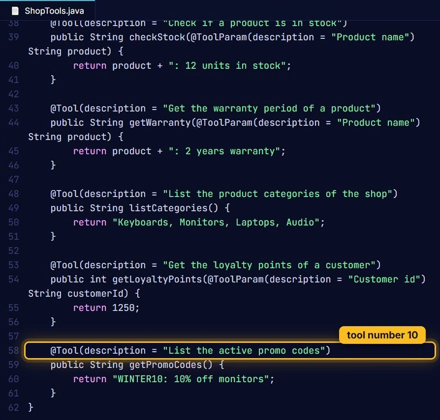

## Step 2: Log the loop

ToolLoopLogger is a CallAdvisor.

**`ToolLoopLogger.java`**:

```java
package dev.course.toolloop;

import java.util.List;

import org.slf4j.Logger;
import org.slf4j.LoggerFactory;
import org.springframework.ai.chat.client.ChatClientRequest;
import org.springframework.ai.chat.client.ChatClientResponse;
import org.springframework.ai.chat.client.advisor.ToolCallingAdvisor;
import org.springframework.ai.chat.client.advisor.api.CallAdvisor;
import org.springframework.ai.chat.client.advisor.api.CallAdvisorChain;
import org.springframework.ai.chat.messages.AssistantMessage;
import org.springframework.ai.model.tool.ToolCallingChatOptions;

public class ToolLoopLogger implements CallAdvisor {

    private static final Logger log = LoggerFactory.getLogger(ToolLoopLogger.class);
```

Before the call, I count the tools offered to the model. After the call, I read the prompt tokens, and the tool calls the model asked for.

**`ToolLoopLogger.java`** (continued):

```java
    @Override
    public ChatClientResponse adviseCall(ChatClientRequest request, CallAdvisorChain chain) {
        int offered = request.prompt().getOptions() instanceof ToolCallingChatOptions options
                ? options.getToolCallbacks().size() : 0;
        ChatClientResponse response = chain.nextCall(request);
        List<String> calls = response.chatResponse().getResult().getOutput().getToolCalls().stream()
                .map(AssistantMessage.ToolCall::name).toList();
        int promptTokens = response.chatResponse().getMetadata().getUsage().getPromptTokens();
        log.info("LOOP tools offered: {}, prompt tokens: {}, model asked for: {}",
                offered, promptTokens, calls.isEmpty() ? "final answer" : calls);
        return response;
    }
```

And the key line: the order. ToolCallingAdvisor's default order, plus 100. That puts our logger inside the loop, so it runs on every model call.

**`ToolLoopLogger.java`** (continued):

```java
    @Override
    public String getName() {
        return "ToolLoopLogger";
    }

    @Override
    public int getOrder() {
        return ToolCallingAdvisor.DEFAULT_ORDER + 100;
    }
}
```

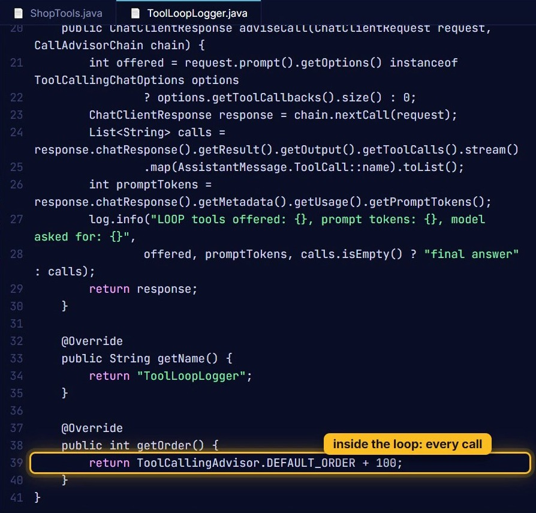

In AiConfig, the ten tools become default tools, and the logger a default advisor.

**`AiConfig.java`**:

```java
package dev.course.toolloop;

import org.springframework.ai.chat.client.ChatClient;
import org.springframework.context.annotation.Bean;
import org.springframework.context.annotation.Configuration;

@Configuration
public class AiConfig {

    @Bean
    ChatClient chatClient(ChatClient.Builder builder, ShopTools shopTools) {
        return builder
                .defaultSystem("You are the assistant of a tech shop. Answer in at most two sentences.")
                .defaultTools(shopTools)
                .defaultAdvisors(new ToolLoopLogger())
                .build();
    }
}
```

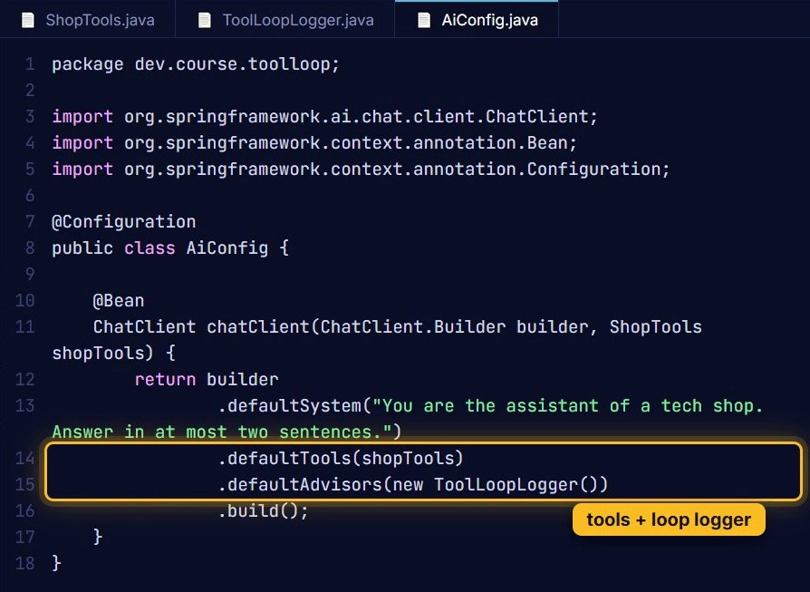

The controller simply asks the question.

**`AskController.java`**:

```java
package dev.course.toolloop;

import org.springframework.ai.chat.client.ChatClient;
import org.springframework.web.bind.annotation.GetMapping;
import org.springframework.web.bind.annotation.RequestParam;
import org.springframework.web.bind.annotation.RestController;

@RestController
public class AskController {

    private final ChatClient chatClient;

    public AskController(ChatClient chatClient) {
        this.chatClient = chatClient;
    }

    @GetMapping("/ask")
    public String ask(@RequestParam String question) {
        return chatClient.prompt().user(question).call().content();
    }
}
```

## Step 3: Watch the loop

I ask how many days until order A-1001 arrives.

```bash
$ ./mvnw spring-boot:run
...
Started ToolLoopApplication in 3.1 seconds
```

```bash
$ curl "localhost:8080/ask?question=How+many+days+until+order+A-1001+arrives%3F"
There are 2 days until the order A-1001 arrives.
```

Correct. Now the log.

```bash
$ # application log
LOOP tools offered: 10, prompt tokens: 544,
     model asked for: [findOrder]
LOOP tools offered: 10, prompt tokens: 603,
     model asked for: [daysUntil]
LOOP tools offered: 10, prompt tokens: 673,
     model asked for: final answer
```

Three model calls for one question. findOrder, then daysUntil, then the final answer.

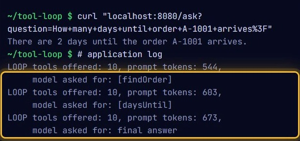

And look at the prompt tokens: more than 500 on every call. All ten tool definitions are sent each time. Over 1,700 input tokens for one simple question.

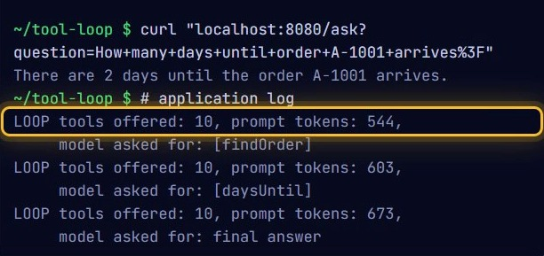

## Step 4: Turn on tool search

In the pom, I add the tool search advisor starter.

**`pom.xml`** (`pom.xml`):

```xml
<!-- pom.xml (added) -->
<dependency>
    <groupId>org.springframework.ai</groupId>
    <artifactId>spring-ai-starter-tool-search-advisor</artifactId>
</dependency>
```

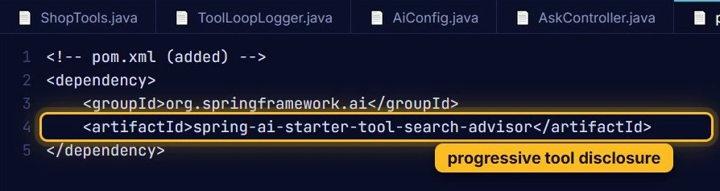

In the properties, I enable it, and choose the Lucene index, which searches tool names and descriptions by keywords.

**`application.properties`**:

```properties
spring.ai.chat.client.tool-search-advisor.enabled=true
spring.ai.chat.client.tool-search-advisor.tool-index-type=lucene
```

First try: an error. Context must contain a non-null value for chat memory conversation id.

```bash
$ curl "localhost:8080/ask?question=How+many+days+until+order+A-1001+arrives%3F"
{"status":500,"error":"Internal Server Error"}
```

**IllegalArgumentException**

> context must contain a non-null value for 'chat_memory_conversation_id'

Tool search remembers the discovered tools per conversation. So it needs a conversation id. I add a session parameter, and pass it as the conversation id.

**`AskController.java`** (`src/main/java/dev/course/toolloop/AskController.java`):

```java
package dev.course.toolloop;

import org.springframework.ai.chat.client.ChatClient;
import org.springframework.ai.chat.memory.ChatMemory;
import org.springframework.web.bind.annotation.GetMapping;
import org.springframework.web.bind.annotation.RequestParam;
import org.springframework.web.bind.annotation.RestController;

@RestController
public class AskController {

    private final ChatClient chatClient;

    public AskController(ChatClient chatClient) {
        this.chatClient = chatClient;
    }

    @GetMapping("/ask")
    public String ask(@RequestParam String question, @RequestParam String session) {
        return chatClient.prompt()
                .user(question)
                .advisors(a -> a.param(ChatMemory.CONVERSATION_ID, session))
                .call()
                .content();
    }
}
```

Let's ask again.

```bash
$ curl "localhost:8080/ask?session=s1&question=How+many+days+until+order+A-1001+arrives%3F"
It seems that the information about the delivery date
for order A-1001 is not directly available in the
current set of tools. To find this information, we might
need to search for a tool ... Let's use the
`toolSearchTool` to find such a tool.
```

One tool offered, and only 342 tokens. But the answer is useless. The model talks about the search tool, and never calls it.

```bash
$ # application log
LOOP tools offered: 1, prompt tokens: 342,
     model asked for: final answer
```

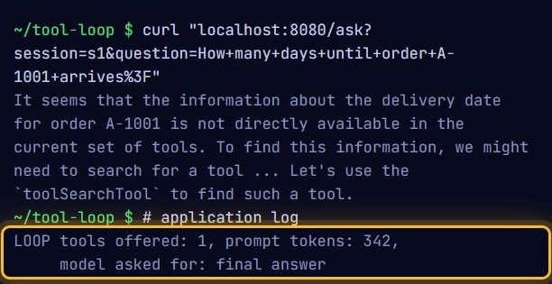

A 3 billion parameter model is too small to follow the search, then use workflow.

## Step 5: Bigger model

I pull Qwen 2.5, 7 billion parameters. Still free and local, just slower.

```bash
$ ollama pull qwen2.5:7b
...
success
```

**`application.properties`** (`src/main/resources/application.properties`):

```properties
spring.application.name=tool-loop
spring.ai.ollama.chat.model=qwen2.5:7b
spring.ai.ollama.chat.temperature=0.0
spring.ai.chat.client.tool-search-advisor.enabled=true
spring.ai.chat.client.tool-search-advisor.tool-index-type=lucene
```

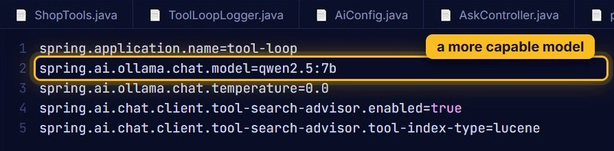

Same question.

```bash
$ curl "localhost:8080/ask?session=s1&question=How+many+days+until+order+A-1001+arrives%3F"
Your order A-1001 was shipped and is expected to arrive
on November 20, 2026.
```

```bash
$ # application log
LOOP tools offered: 1, prompt tokens: 342,
     model asked for: [toolSearchTool]
LOOP tools offered: 2, prompt tokens: 457,
     model asked for: [findOrder]
LOOP tools offered: 2, prompt tokens: 516,
     model asked for: final answer
```

Now it works the way it should. First call: one tool, and the model searches. Then two tools, and it calls findOrder. Then the answer.

But be honest about the result. It gave the date, not the number of days. And on a return policy question, it didn't search at all.

```bash
$ curl "localhost:8080/ask?session=s2&question=What+is+your+return+policy%3F"
I don't have a physical product to offer return policies
for, but if you encounter any issues with the services
or tools provided, feel free to reach out...
```

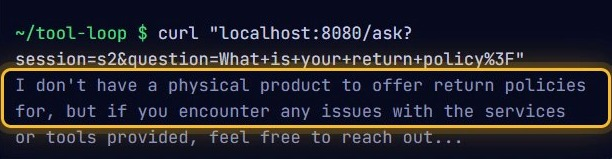

So with ten tools and local models, sending all the tools directly was the better choice. Tool search pays off with hundreds of tools and a strong model.

## 3 pro tips

Measure before you optimize. A loop logger like ours shows exactly where the calls and tokens go.

Keep the tool count small. Group related operations, and only register the tools a feature really needs.

And test with your real model. Tool behavior changes a lot between a 3 billion and a 7 billion parameter model.

- **Measure first**: Log calls and tokens per iteration
- **Few tools**: Register only what a feature needs
- **Test your model**: 3B and 7B behave very differently

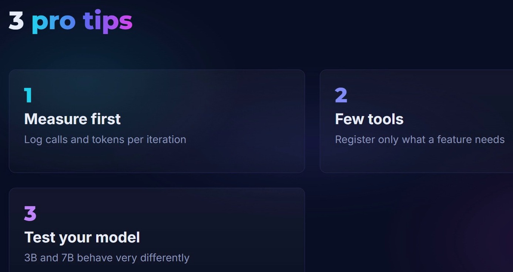

## Your challenge

Your challenge: switch back to sending all ten tools, and compare the total tokens of five questions, with and without tool search, on the 7 billion model.

Then decide, with numbers, which setup you'd ship.

- **Measure 5 questions**: Tokens with and without tool search
- **Decide with data**: Which setup would you ship?

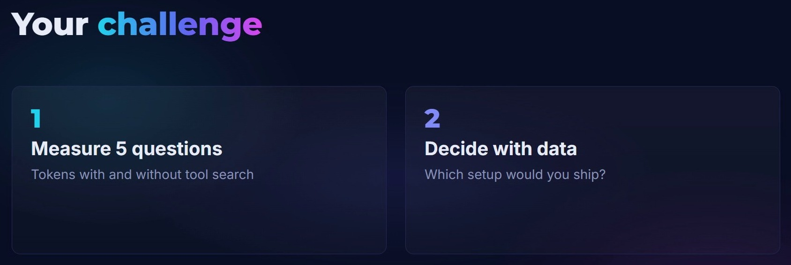

## Recap

- An advisor **inside the loop** sees every model call
- All tool definitions are **resent on every call**
- Tool search needs a **conversation id** and a capable model

## Get the code and the quiz

- **Code for this lab**: https://github.com/NEDBS12/youtube-tuto/tree/main/spring-ai-course/labs/tool-loop
- **All course code, quizzes and resources**: https://github.com/NEDBS12/youtube-tuto/tree/main/spring-ai-course
- **Lesson quiz and section evals**: https://nedbs12.github.io/youtube-tuto/spring-ai-course/quiz/
- **Ollama**: https://ollama.com
- **Tool search docs**: https://docs.spring.io/spring-ai/reference/api/tools/tool-search-tool.html
- **Spring AI reference docs**: https://docs.spring.io/spring-ai/reference/

🎥 **Watch the video tutorial:** {VIDEO_URL}

**Previous: Lesson 3.2, inside the tool loop. Next: Lesson 3.3, agentic patterns.**

*The editor and terminal in the screenshots are a simplified recreation; the code and the outputs come from real runs of the lab.*

*I'm Zero Cost AI: I build AI tools and tutorials and share them for free. Follow me on Medium for the next lessons, and subscribe on YouTube: https://www.youtube.com/@zerocostai-f1h*
