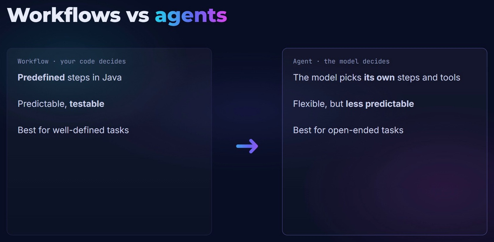
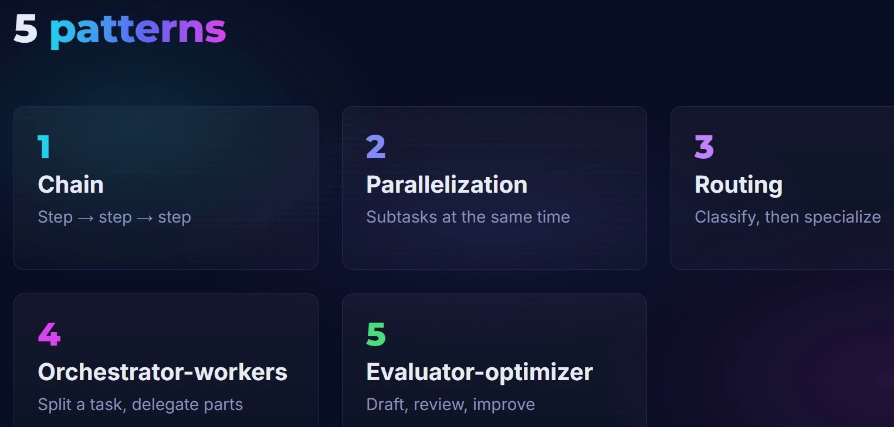
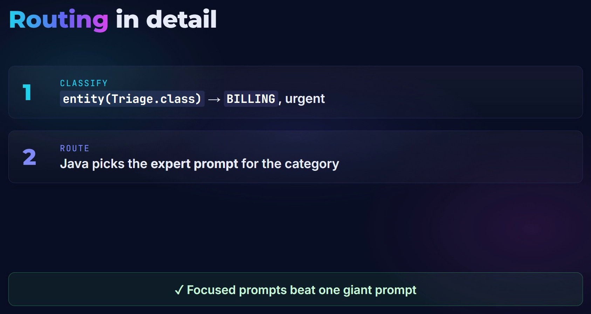
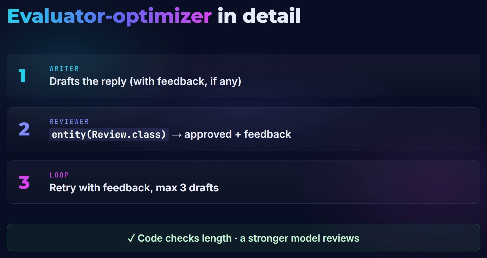
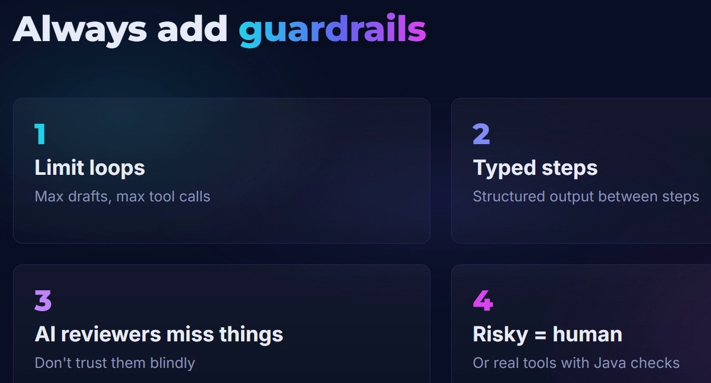

Everyone wants to build AI agents. But what is an agent, really? And do you even need one?

In this lesson, you'll learn the five patterns behind effective AI systems, and why the simplest one that works is usually the best.

It's lesson 3.3 of my free **Spring AI: Novice to Expert** course, where every lesson has a concept part and a hands-on lab, and everything runs on a free local model with Ollama.

🎥 **Prefer video?** Watch the full tutorial here:

{VIDEO}

## Workflows vs agents

First, an important distinction.

In a workflow, you write the steps in code. The model does each step, but your code decides the path. Predictable and testable.

In an agent, the model decides its own steps and which tools to use, in a loop. More flexible, but less predictable, slower, and harder to test.

For most business tasks, the Spring AI guide recommends starting with workflows.

### Workflow · your code decides

- **Predefined** steps in Java
- Predictable, **testable**
- Best for well-defined tasks

### Agent · the model decides

- The model picks **its own** steps and tools
- Flexible, but **less predictable**
- Best for open-ended tasks

## 5 patterns

Here are the five patterns, from the Spring AI guide on building effective agents.

Chain: the output of one step is the input of the next. Like outline, then write, then translate.

Parallelization: independent subtasks run at the same time, then you combine the results.

Routing: classify the input first, then send it to a specialized prompt or model.

Orchestrator-workers: one model splits a task into subtasks, and worker calls handle each one.

Evaluator-optimizer: one model drafts, another evaluates, and you loop with feedback until it's good enough.

- **Chain**: Step → step → step
- **Parallelization**: Subtasks at the same time
- **Routing**: Classify, then specialize
- **Orchestrator-workers**: Split a task, delegate parts
- **Evaluator-optimizer**: Draft, review, improve

## Routing in detail

Let's zoom in on the two patterns we'll build in the lab. First, routing.

With structured output, the model returns a record, like a category and an urgency flag.

Billing, technical, or shipping.

Each expert prompt is short and focused. Much better than one giant prompt that tries to handle everything.

- **Classify**: `entity(Triage.class)` → `BILLING`, urgent
- **Route**: Java picks the **expert prompt** for the category

**✓ Focused prompts beat one giant prompt**

## Evaluator-optimizer in detail

Second: evaluator-optimizer.

A writer drafts a reply.

A reviewer checks it, and returns a record: approved, yes or no, and feedback.

If it's rejected, the writer tries again, with the feedback. And there's always a maximum number of attempts, so the loop can't run forever.

Pro move: check in code what code can check, like length. And use a stronger model as the reviewer.

- **Writer**: Drafts the reply (with feedback, if any)
- **Reviewer**: `entity(Review.class)` → approved + feedback
- **Loop**: Retry with feedback, **max 3 drafts**

**✓ Code checks length · a stronger model reviews**

## Always add guardrails

Whatever pattern you choose, add guardrails.

Always limit loops: a maximum number of drafts, or tool calls.

Use structured output between steps, so your code can make decisions with real types.

Don't fully trust an AI reviewer. It can approve things it shouldn't. In the lab, you'll see one approve a promise we never made.

And for risky actions, like refunds, keep a human in the loop, or use real tools with checks in Java.

- **Limit loops**: Max drafts, max tool calls
- **Typed steps**: Structured output between steps
- **AI reviewers miss things**: Don't trust them blindly
- **Risky = human**: Or real tools with Java checks

## Recap

- **Workflows** (your code decides) before **agents** (the model decides)
- Chain, parallel, **routing**, orchestrator, **evaluator-optimizer**
- Limit loops, check in code, don't trust AI reviewers blindly

## Quick quiz

Test yourself before you read the answers.

1. **Difference**: Workflow or agent: who decides the steps in a workflow?
2. **Pattern**: Classify a ticket, then use a specialised prompt. Which pattern?
3. **Must-have**: What must every evaluator-optimizer loop have?

**Answers:**

1. **Your code** decides the path
2. **Routing**
3. A **maximum** number of attempts

The full five-question quiz for this lesson is free on the course quiz page: https://nedbs12.github.io/youtube-tuto/spring-ai-course/quiz/

## Get the code and the quiz

- **Lab code for this lesson**: https://github.com/NEDBS12/youtube-tuto/tree/main/spring-ai-course/labs/ticket-triage
- **All course code, quizzes and resources**: https://github.com/NEDBS12/youtube-tuto/tree/main/spring-ai-course
- **Lesson quiz and section evals**: https://nedbs12.github.io/youtube-tuto/spring-ai-course/quiz/
- **Building effective agents (Spring AI)**: https://docs.spring.io/spring-ai/reference/api/effective-agents.html
- **Spring AI reference docs**: https://docs.spring.io/spring-ai/reference/

🎥 **Watch the video tutorial:** {VIDEO_URL}

**Previous: Lab 3.2. Next: Lab 3.3, a ticket-triage agent.**

*I'm Zero Cost AI: I build AI tools and tutorials and share them for free. Follow me on Medium for the next lessons, and subscribe on YouTube: https://www.youtube.com/@zerocostai-f1h*
