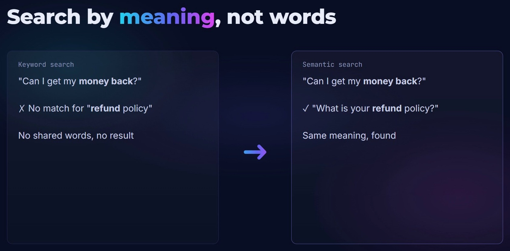
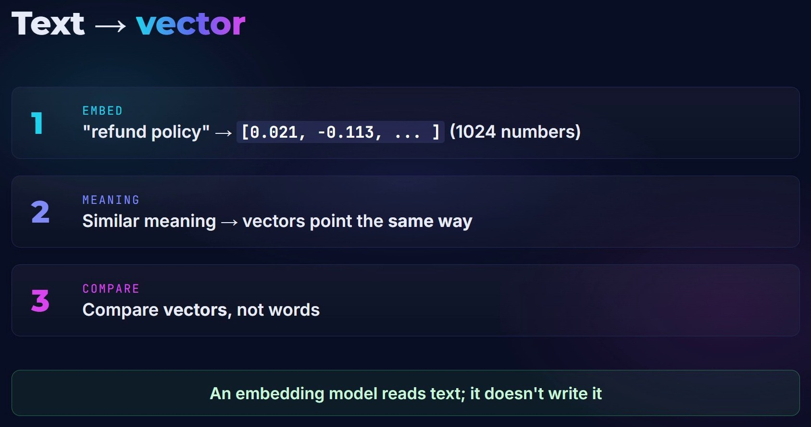
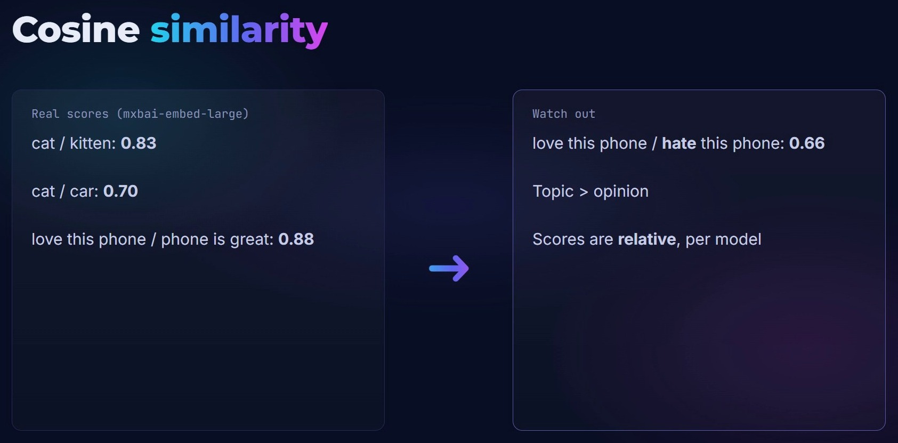
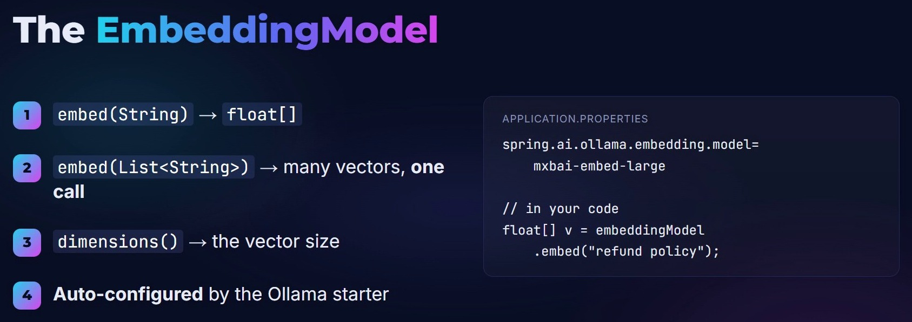
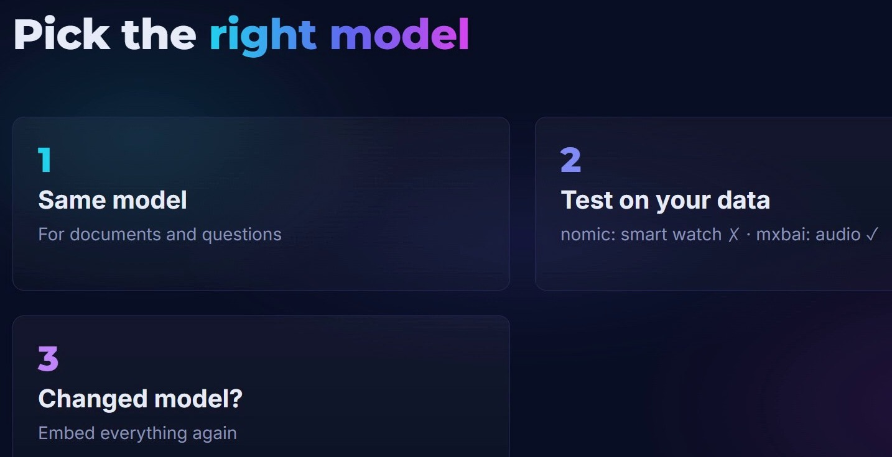

A customer asks: can I get my money back? Your FAQ says: refund policy. Not a single word in common. A keyword search finds nothing.

Welcome to section four: RAG. It starts with the idea that makes search understand meaning: embeddings.

It's lesson 4.1 of my free **Spring AI: Novice to Expert** course, where every lesson has a concept part and a hands-on lab, and everything runs on a free local model with Ollama.

🎥 **Prefer video?** Watch the full tutorial here:

{VIDEO}

## Search by meaning, not words

Two ways to search.

Keyword search matches words. Money back and refund share no word, so it fails. It also misses synonyms and other languages.

Semantic search matches meaning. It knows that money back and refund are about the same thing. That's what embeddings give you.

### Keyword search

- "Can I get my **money back**?"
- ✗ No match for "**refund** policy"
- No shared words, no result

### Semantic search

- "Can I get my **money back**?"
- ✓ "What is your **refund** policy?"
- Same meaning, found



## Text → vector

So what is an embedding?

An embedding model turns a text into a list of numbers, a vector. With the model we'll use, that's 1,024 numbers.

The numbers encode meaning. Texts with a similar meaning get vectors that point in a similar direction.

So, to compare two texts, you compare their vectors. No word matching at all.

Important: an embedding model doesn't write text. It's a different kind of model than a chat model.

- **Embed**: "refund policy" → `[0.021, -0.113, ... ]` (1024 numbers)
- **Meaning**: Similar meaning → vectors point the **same way**
- **Compare**: Compare **vectors**, not words

**An embedding model reads text; it doesn't write it**



## Cosine similarity

To compare two vectors, we use cosine similarity. It measures the angle between them.

Close to one: same meaning. Lower: less related. Here are real scores from our lab. Cat and kitten: 0.83. Cat and car: 0.7.

And look at this. I love this phone, and, I hate this phone: 0.66. Still high! Embeddings capture the topic more than the opinion.

So never read a score alone. Compare scores with each other, for the same model.

### Real scores (mxbai-embed-large)

- cat / kitten: **0.83**
- cat / car: **0.70**
- love this phone / phone is great: **0.88**

### Watch out

- love this phone / **hate** this phone: **0.66**
- Topic > opinion
- Scores are **relative**, per model



## The EmbeddingModel

In Spring AI, embeddings go through one interface: the EmbeddingModel.

Embed, with a string, returns a float array: the vector.

Embed, with a list, embeds many texts in one call. Much faster for documents.

Dimensions tells you the vector size.

And with the Ollama starter, it's auto-configured. You only choose the model, in a property.

- `embed(String)` → `float[]`
- `embed(List<String>)` → many vectors, **one call**
- `dimensions()` → the vector size
- **Auto-configured** by the Ollama starter

In code:

```properties
spring.ai.ollama.embedding.model=
    mxbai-embed-large

// in your code
float[] v = embeddingModel
    .embed("refund policy");
```



## Pick the right model

Choosing an embedding model matters. Three rules.

Use the same model for your documents and your questions. Vectors from two models can't be compared.

Test quality on your own data. In my tests, `nomic-embed-text` ranked a smart watch first, for: something to listen to music on the train. `mxbai-embed-large` ranked three audio products first. So the course uses mxbai.

And if you change the model, you must embed everything again.

- **Same model**: For documents and questions
- **Test on your data**: nomic: smart watch ✗ · mxbai: audio ✓
- **Changed model?**: Embed everything again



## Recap

- Embeddings turn text into **vectors** that encode meaning
- **Cosine similarity** compares them; scores are relative
- `EmbeddingModel`: **same model** for documents and questions

## Quick quiz

Test yourself before you read the answers.

1. **Embedding**: What does an embedding model return?
2. **Similarity**: Cosine similarity close to 1 means...?
3. **Models**: Documents embedded with model A, questions with model B?

**Answers:**

1. A **vector**: a list of numbers
2. **Similar meaning**
3. **Doesn't work**: use the same model

The full five-question quiz for this lesson is free on the course quiz page: https://nedbs12.github.io/youtube-tuto/spring-ai-course/quiz/

## Get the code and the quiz

- **Lab code for this lesson**: https://github.com/NEDBS12/youtube-tuto/tree/main/spring-ai-course/labs/faq-search
- **All course code, quizzes and resources**: https://github.com/NEDBS12/youtube-tuto/tree/main/spring-ai-course
- **Lesson quiz and section evals**: https://nedbs12.github.io/youtube-tuto/spring-ai-course/quiz/
- **Spring AI embeddings docs**: https://docs.spring.io/spring-ai/reference/api/embeddings.html
- **Spring AI reference docs**: https://docs.spring.io/spring-ai/reference/

🎥 **Watch the video tutorial:** {VIDEO_URL}

**Previous: Lab 3.3 (Section 3 complete). Next: Lab 4.1, a semantic FAQ search.**

*I'm Zero Cost AI: I build AI tools and tutorials and share them for free. Follow me on Medium for the next lessons, and subscribe on YouTube: https://www.youtube.com/@zerocostai-f1h*
