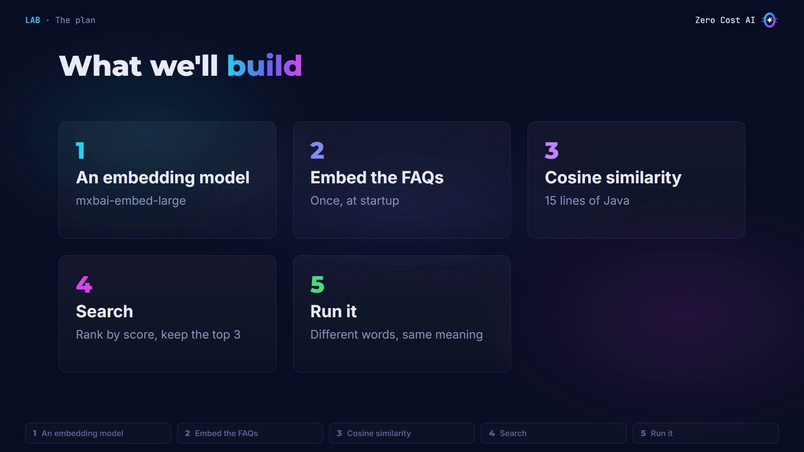
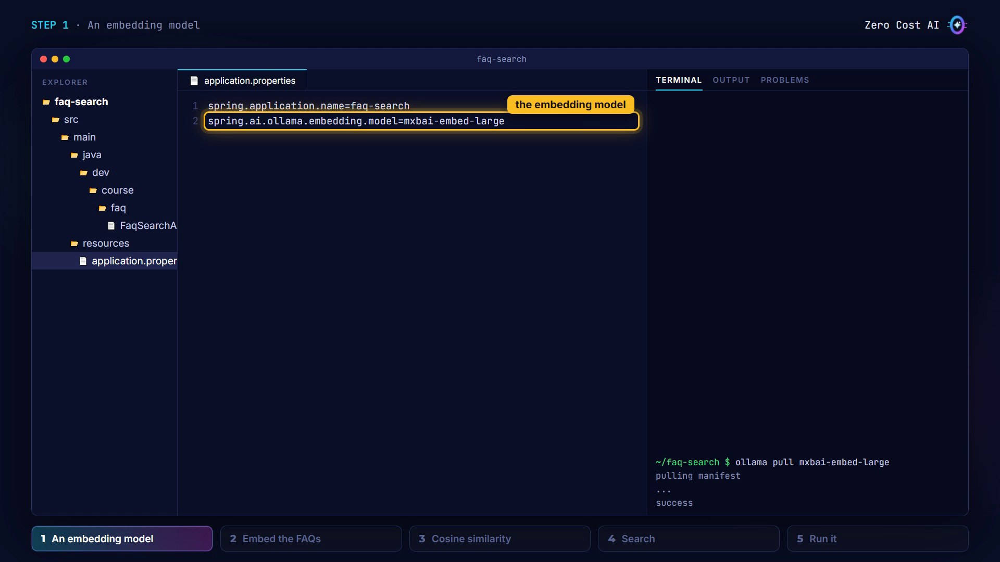
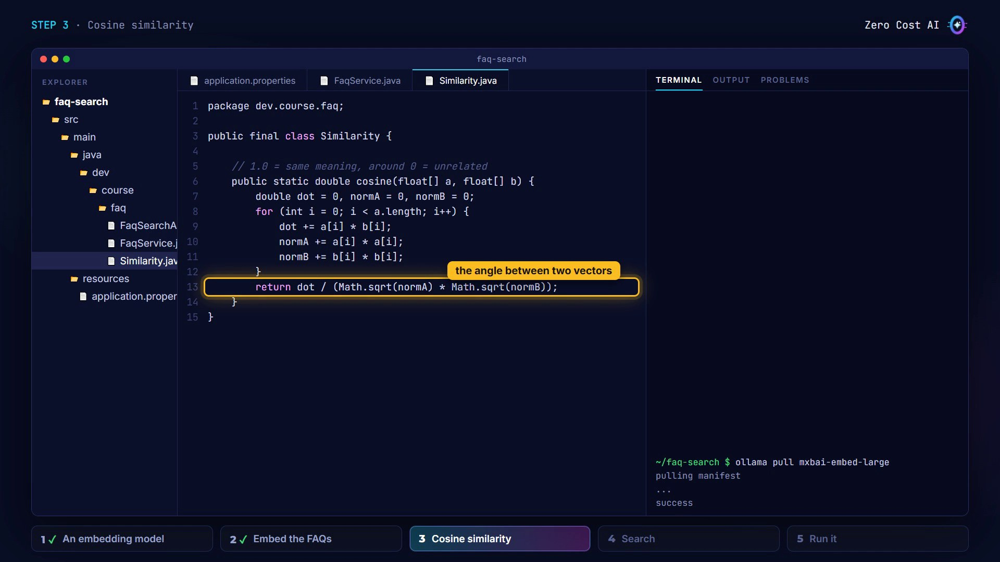
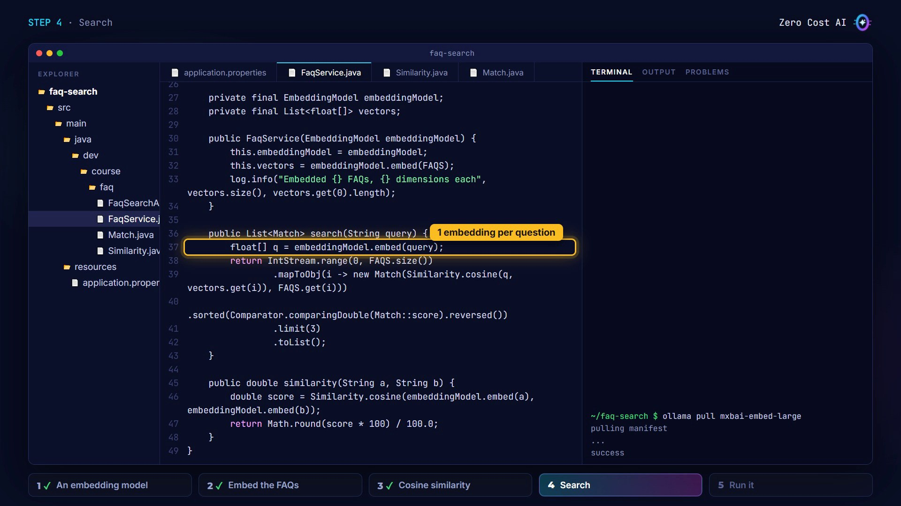
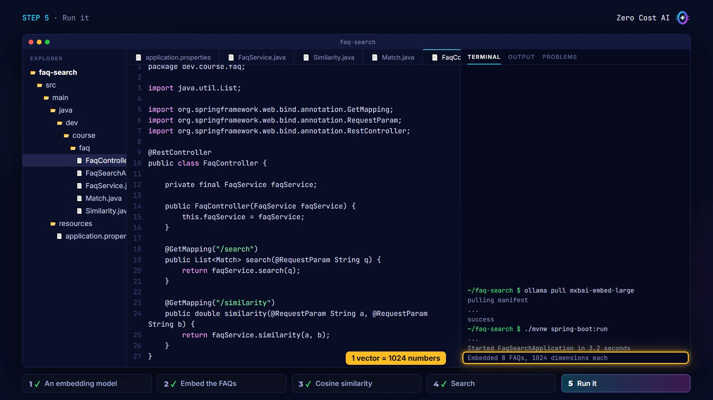
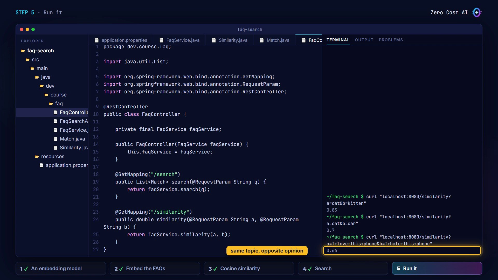
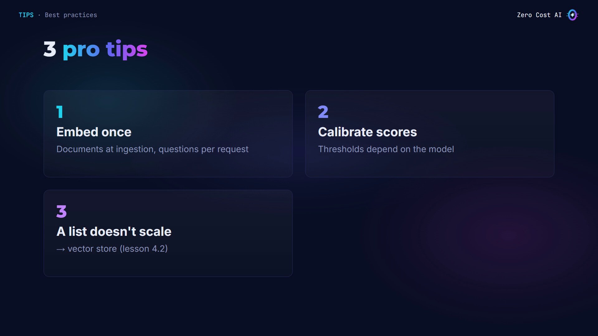
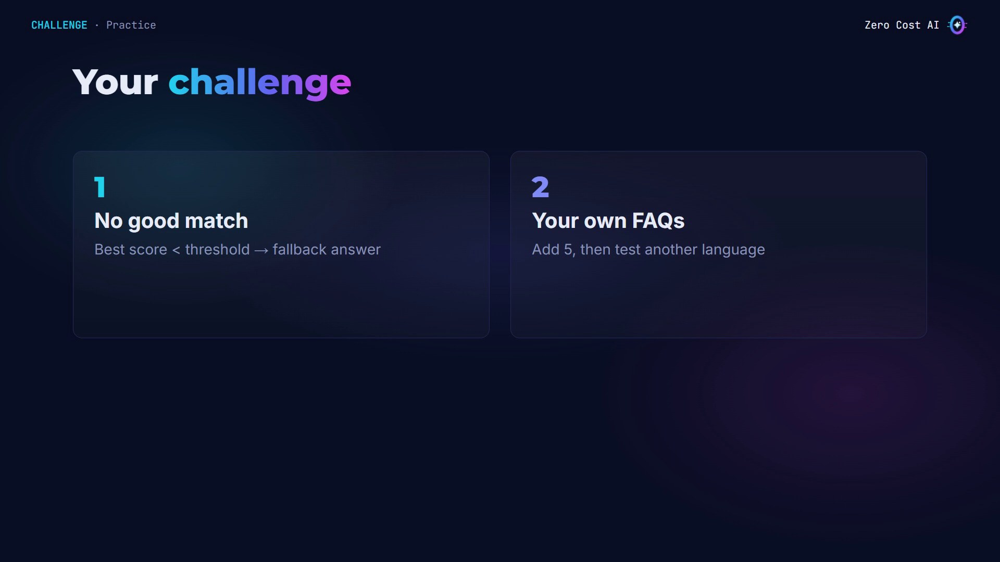

Today you'll build a semantic FAQ search: questions find the right answer, even with completely different words.

And we'll compute similarity ourselves, so there's no magic left.

It's lab 4.1 of my free **Spring AI: Novice to Expert** course, where every lesson has a concept part and a hands-on lab, and everything runs on a free local model with Ollama.

🎥 **Prefer video?** Watch the full tutorial here:

{VIDEO}

## What we'll build

An embedding model. Embedding our FAQs. Cosine similarity, in plain Java. A search method. And then we run it.

1. **An embedding model**: mxbai-embed-large
2. **Embed the FAQs**: Once, at startup
3. **Cosine similarity**: 15 lines of Java
4. **Search**: Rank by score, keep the top 3
5. **Run it**: Different words, same meaning



## Step 1: An embedding model

I pull `mxbai-embed-large` with Ollama. It's free, and it runs locally.

```bash
$ ollama pull mxbai-embed-large
pulling manifest
...
success
```

The project has the web and Ollama starters. In the properties, one line: the embedding model. Spring AI auto-configures an EmbeddingModel bean for it.

**`application.properties`** (`src/main/resources/application.properties`):

```properties
spring.application.name=faq-search
spring.ai.ollama.embedding.model=mxbai-embed-large
```



## Step 2: Embed the FAQs

In FaqService, a list of eight questions and answers, for an online shop.

**`FaqService.java`**:

```java
package dev.course.faq;

import java.util.Comparator;
import java.util.List;
import java.util.stream.IntStream;

import org.slf4j.Logger;
import org.slf4j.LoggerFactory;
import org.springframework.ai.embedding.EmbeddingModel;
import org.springframework.stereotype.Service;

@Service
public class FaqService {

    private static final Logger log = LoggerFactory.getLogger(FaqService.class);

    private static final List<String> FAQS = List.of(
            "How do I reset my password? Click 'Forgot password' on the login page.",
            "What is your refund policy? You can return any item within 30 days for a full refund.",
            "How long does shipping take? Standard delivery takes 3 to 5 business days.",
            "Do you ship abroad? Yes, we ship to 40 countries in Europe and North America.",
            "How do I change my delivery address? Edit it in your account before the order ships.",
            "Which payment methods do you accept? Visa, Mastercard, PayPal and Apple Pay.",
            "How do I contact support? Use the chat on our website, from 9am to 6pm.",
            "Can I cancel my subscription? Yes, anytime, from the billing page of your account.");
```

The constructor gets the EmbeddingModel, and embeds all FAQs in one call, with embed of a list. That happens once, at startup. Then we log the vector size.

**`FaqService.java`** (continued):

```java
    private final EmbeddingModel embeddingModel;
    private final List<float[]> vectors;

    public FaqService(EmbeddingModel embeddingModel) {
        this.embeddingModel = embeddingModel;
        this.vectors = embeddingModel.embed(FAQS);
        log.info("Embedded {} FAQs, {} dimensions each", vectors.size(), vectors.get(0).length);
    }
```


## Step 3: Cosine similarity

It's just a loop: the dot product of the two vectors, divided by their lengths.

**`Similarity.java`** (`src/main/java/dev/course/faq/Similarity.java`):

```java
package dev.course.faq;

public final class Similarity {

    // 1.0 = same meaning, around 0 = unrelated
    public static double cosine(float[] a, float[] b) {
        double dot = 0, normA = 0, normB = 0;
        for (int i = 0; i < a.length; i++) {
            dot += a[i] * b[i];
            normA += a[i] * a[i];
            normB += b[i] * b[i];
        }
        return dot / (Math.sqrt(normA) * Math.sqrt(normB));
    }
}
```



And a Match record, with the score and the FAQ. I round the score to two decimals, so it's easy to read.

**`Match.java`** (`src/main/java/dev/course/faq/Match.java`):

```java
package dev.course.faq;

public record Match(double score, String faq) {

    public Match {
        score = Math.round(score * 100) / 100.0;  // 0.6907... -> 0.69
    }
}
```

## Step 4: Search

Embed the question, compute the similarity with each FAQ, sort by score, and keep the top three.

**`FaqService.java`** (continued):

```java
    public List<Match> search(String query) {
        float[] q = embeddingModel.embed(query);
        return IntStream.range(0, FAQS.size())
                .mapToObj(i -> new Match(Similarity.cosine(q, vectors.get(i)), FAQS.get(i)))
                .sorted(Comparator.comparingDouble(Match::score).reversed())
                .limit(3)
                .toList();
    }

    public double similarity(String a, String b) {
        double score = Similarity.cosine(embeddingModel.embed(a), embeddingModel.embed(b));
        return Math.round(score * 100) / 100.0;
    }
}
```



There's also a similarity method, to compare any two texts. And a controller with two GET endpoints: `/search` and `/similarity`.

**`FaqController.java`** (`src/main/java/dev/course/faq/FaqController.java`):

```java
package dev.course.faq;

import java.util.List;

import org.springframework.web.bind.annotation.GetMapping;
import org.springframework.web.bind.annotation.RequestParam;
import org.springframework.web.bind.annotation.RestController;

@RestController
public class FaqController {

    private final FaqService faqService;

    public FaqController(FaqService faqService) {
        this.faqService = faqService;
    }

    @GetMapping("/search")
    public List<Match> search(@RequestParam String q) {
        return faqService.search(q);
    }

    @GetMapping("/similarity")
    public double similarity(@RequestParam String a, @RequestParam String b) {
        return faqService.similarity(a, b);
    }
}
```

## Step 5: Run it

The log confirms it: eight FAQs, 1,024 dimensions each.

```bash
$ ./mvnw spring-boot:run
...
Started FaqSearchApplication in 3.2 seconds
Embedded 8 FAQs, 1024 dimensions each
```



Now the test from the lesson. Can I get my money back?

```bash
$ curl "localhost:8080/search?q=Can+I+get+my+money+back%3F"
[
 {"score":0.68,"faq":"What is your refund policy? You
   can return any item within 30 days for a full
   refund."},
 {"score":0.61,"faq":"Can I cancel my subscription? Yes,
   anytime, from the billing page of your account."},
 {"score":0.51,"faq":"How do I contact support? Use the
   chat on our website, from 9am to 6pm."},
]
```

First result: the refund policy, with 0.68. No shared word with the question. That's semantic search.

Another one: I can't log in to my account. The password reset FAQ wins, with 0.74.

```bash
$ curl "localhost:8080/search?q=I+can%27t+log+in+to+my+account"
[
 {"score":0.74,"faq":"How do I reset my password? Click
   'Forgot password' on the login page."},
 {"score":0.5,"faq":"How do I contact support? Use the
   chat on our website, from 9am to 6pm."},
 {"score":0.48,"faq":"Can I cancel my subscription? Yes,
   anytime, from the billing page of your account."},
]
```

Now the similarity endpoint. Cat and kitten: 0.83. Cat and car: 0.7.

```bash
$ curl "localhost:8080/similarity?a=cat&b=kitten"
0.83
```

```bash
$ curl "localhost:8080/similarity?a=cat&b=car"
0.7
```

And: I love this phone, versus, I hate this phone. 0.66. Opposite opinions, but a high score, because the topic is the same.

```bash
$ curl "localhost:8080/similarity?a=I+love+this+phone&b=I+hate+this+phone"
0.66
```



## 3 pro tips

Embed your documents once, and store the vectors. Only the question is embedded per request.

Don't trust a score alone. 0.5 here meant: not relevant. With another model, it could mean the opposite. Calibrate on your data.

And a Java list works for eight FAQs. For thousands of documents that survive a restart, you need a vector store. That's next.

- **Embed once**: Documents at ingestion, questions per request
- **Calibrate scores**: Thresholds depend on the model
- **A list doesn't scale**: → vector store (lesson 4.2)



## Your challenge

Your challenge: when the best score is below 0.6, return: no good match, please contact support. Pick the threshold by testing ten questions.

Then add five FAQs of your own, and try questions in another language. Does it still work?

- **No good match**: Best score < threshold → fallback answer
- **Your own FAQs**: Add 5, then test another language



## Recap

- `embed(List)` embeds all documents **in one call**, once
- Cosine similarity is **just math**: rank by score
- Semantic search finds the answer with different words

## Get the code and the quiz

- **Code for this lab**: https://github.com/NEDBS12/youtube-tuto/tree/main/spring-ai-course/labs/faq-search
- **All course code, quizzes and resources**: https://github.com/NEDBS12/youtube-tuto/tree/main/spring-ai-course
- **Lesson quiz and section evals**: https://nedbs12.github.io/youtube-tuto/spring-ai-course/quiz/
- **Ollama**: https://ollama.com
- **Spring AI embeddings docs**: https://docs.spring.io/spring-ai/reference/api/embeddings.html
- **Spring AI reference docs**: https://docs.spring.io/spring-ai/reference/

🎥 **Watch the video tutorial:** {VIDEO_URL}

**Previous: Lesson 4.1, embeddings. Next: Lesson 4.2, vector stores.**

*The editor and terminal in the screenshots are a simplified recreation; the code and the outputs come from real runs of the lab.*

*I'm Zero Cost AI: I build AI tools and tutorials and share them for free. Follow me on Medium for the next lessons, and subscribe on YouTube: https://www.youtube.com/@zerocostai-f1h*
