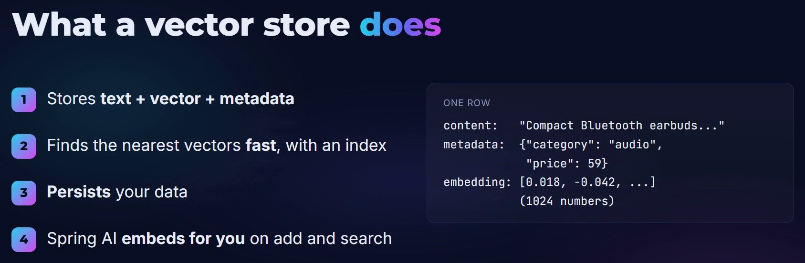
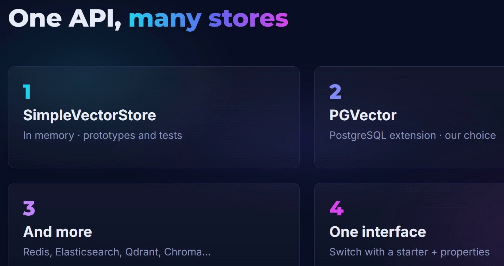
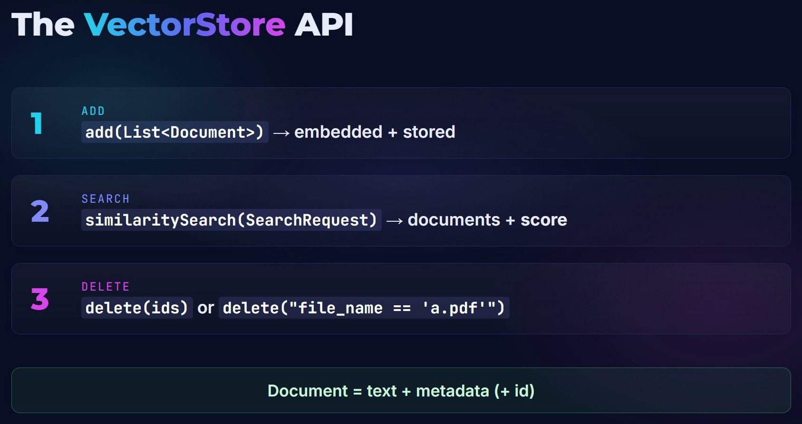
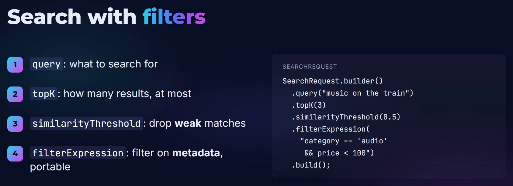
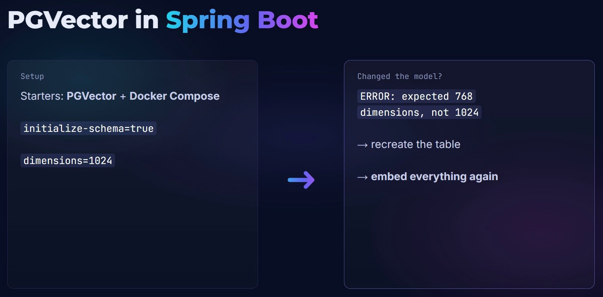

In the last lab, our vectors lived in a Java list. Every search compared the question with every FAQ. Fine for eight. Not for a million. And everything was lost at restart.

In this lesson: vector stores, the databases built for this job, and how Spring AI gives you one API for all of them.

It's lesson 4.2 of my free **Spring AI: Novice to Expert** course, where every lesson has a concept part and a hands-on lab, and everything runs on a free local model with Ollama.

🎥 **Prefer video?** Watch the full tutorial here:

{VIDEO}

## What a vector store does

A vector store does three things.

It stores each document: the text, its vector, and metadata, like a category or a price.

It finds the nearest vectors fast, with an index. Not by comparing all of them. HNSW is a common index for this.

And it persists everything, like any database.

Spring AI computes the embeddings for you, when you add documents and when you search.

- Stores **text + vector + metadata**
- Finds the nearest vectors **fast**, with an index
- **Persists** your data
- Spring AI **embeds for you** on add and search

In code:

```java
content:   "Compact Bluetooth earbuds..."
metadata:  {"category": "audio",
            "price": 59}
embedding: [0.018, -0.042, ...]
           (1024 numbers)
```



## One API, many stores

Spring AI supports many vector stores, behind one VectorStore interface.

SimpleVectorStore: in memory, and you can save it to a file. Perfect for prototypes and tests.

PGVector: an extension for PostgreSQL, the database you probably already run. That's what we'll use.

And many more: Redis, Elasticsearch, MongoDB Atlas, Qdrant, Chroma, Milvus, and others.

Because they share one interface, you can switch stores by changing a starter and a few properties.

- **SimpleVectorStore**: In memory · prototypes and tests
- **PGVector**: PostgreSQL extension · our choice
- **And more**: Redis, Elasticsearch, Qdrant, Chroma...
- **One interface**: Switch with a starter + properties



## The VectorStore API

The VectorStore API is small.

Add a list of Documents. A Document is text plus a metadata map. Spring AI embeds them, and stores them.

SimilaritySearch, with a SearchRequest. It embeds the query, and returns the closest documents, each with a score.

And delete, by ids, or by a filter, like: all documents from this file.

That's the whole API you'll use in this section.

- **add**: `add(List<Document>)` → embedded + stored
- **search**: `similaritySearch(SearchRequest)` → documents + **score**
- **delete**: `delete(ids)` or `delete("file_name == 'a.pdf'")`

**Document = text + metadata (+ id)**



## Search with filters

The SearchRequest controls the search.

Query: the text to search for.

TopK: how many documents, at most.

SimilarityThreshold: drop the documents below this score. So an off-topic question returns nothing.

And filterExpression: a filter on metadata, written once, in a portable syntax. Spring AI translates it for each store.

- `query`: what to search for
- `topK`: how many results, at most
- `similarityThreshold`: drop **weak** matches
- `filterExpression`: filter on **metadata**, portable

In code:

```java
SearchRequest.builder()
  .query("music on the train")
  .topK(3)
  .similarityThreshold(0.5)
  .filterExpression(
    "category == 'audio'
     && price < 100")
  .build();
```



## PGVector in Spring Boot

Setting up PGVector in Spring Boot is easy.

Add the PGVector starter, and Docker Compose support. When the app starts, Spring Boot starts Postgres for you, and connects to it. Then two properties: create the table, and the vector size.

And the size must match your embedding model. If you change models, you get this real error: expected 768 dimensions, not 1,024. You must recreate the table, and embed everything again.

### Setup

- Starters: **PGVector** + **Docker Compose**
- `initialize-schema=true`
- `dimensions=1024`

### Changed the model?

- `ERROR: expected 768`
`dimensions, not 1024`
- → recreate the table
- → **embed everything again**



## Recap

- A vector store **persists** vectors and searches them fast
- One `VectorStore` API: **add**, **similaritySearch**, **delete**
- **topK**, **threshold** and metadata filters shape the results

## Quick quiz

Test yourself before you read the answers.

1. **Store**: What does a vector store keep for each document?
2. **Threshold**: Why set a similarityThreshold?
3. **Filter**: Only audio products under 100. Which option?

**Answers:**

1. Text + **vector** + metadata
2. To drop **weak**, off-topic matches
3. `filterExpression`

The full five-question quiz for this lesson is free on the course quiz page: https://nedbs12.github.io/youtube-tuto/spring-ai-course/quiz/

## Get the code and the quiz

- **Lab code for this lesson**: https://github.com/NEDBS12/youtube-tuto/tree/main/spring-ai-course/labs/product-store
- **All course code, quizzes and resources**: https://github.com/NEDBS12/youtube-tuto/tree/main/spring-ai-course
- **Lesson quiz and section evals**: https://nedbs12.github.io/youtube-tuto/spring-ai-course/quiz/
- **Spring AI vector databases docs**: https://docs.spring.io/spring-ai/reference/api/vectordbs.html
- **PGVector docs**: https://docs.spring.io/spring-ai/reference/api/vectordbs/pgvector.html
- **Spring AI reference docs**: https://docs.spring.io/spring-ai/reference/

🎥 **Watch the video tutorial:** {VIDEO_URL}

**Previous: Lab 4.1. Next: Lab 4.2, a product search on PGVector.**

*I'm Zero Cost AI: I build AI tools and tutorials and share them for free. Follow me on Medium for the next lessons, and subscribe on YouTube: https://www.youtube.com/@zerocostai-f1h*
