Today you'll build a product search for an online shop, on PostgreSQL with PGVector, started automatically by Docker Compose.

With metadata filters, a similarity threshold, and data that survives a restart.

It's lab 4.2 of my free **Spring AI: Novice to Expert** course, where every lesson has a concept part and a hands-on lab, and everything runs on a free local model with Ollama.

🎥 **Prefer video?** Watch the full tutorial here:

{VIDEO}

## What we'll build

Postgres with Docker Compose. PGVector configuration. Loading the catalog. Search with filters. And we run it.

1. **Postgres with Docker Compose**: Started by Spring Boot
2. **Configure PGVector**: Schema + 1024 dimensions
3. **Load the catalog**: 10 products with metadata
4. **Search with filters**: topK, threshold, filter
5. **Run it**: Search, filter, restart

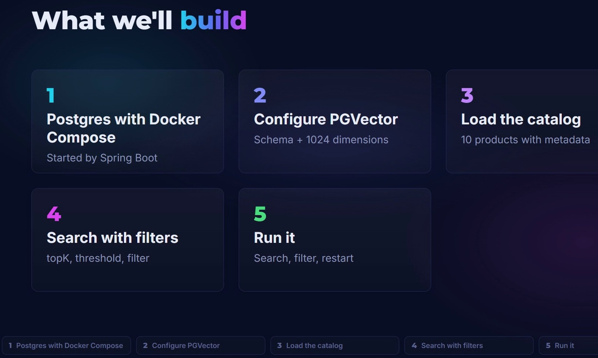

## Step 1: Postgres with Docker Compose

On start.spring.io, I picked four dependencies: Spring Web, Ollama, PGVector, and Docker Compose support.

**start.spring.io dependencies**

- **Spring Web**: REST endpoints
- **Ollama**: the embedding model
- **PGVector**: the vector store
- **Docker Compose Support**: starts Postgres for us

The generated compose file also had an Ollama container. I removed it, because Ollama already runs on my machine. What's left is one service: Postgres, with the PGVector extension.

**`compose.yaml`** (`compose.yaml`):

```yaml
services:
  pgvector:
    image: 'pgvector/pgvector:pg16'
    environment:
      - 'POSTGRES_DB=mydatabase'
      - 'POSTGRES_PASSWORD=secret'
      - 'POSTGRES_USER=myuser'
    labels:
      - "org.springframework.boot.service-connection=postgres"
    ports:
      - '5432'
```

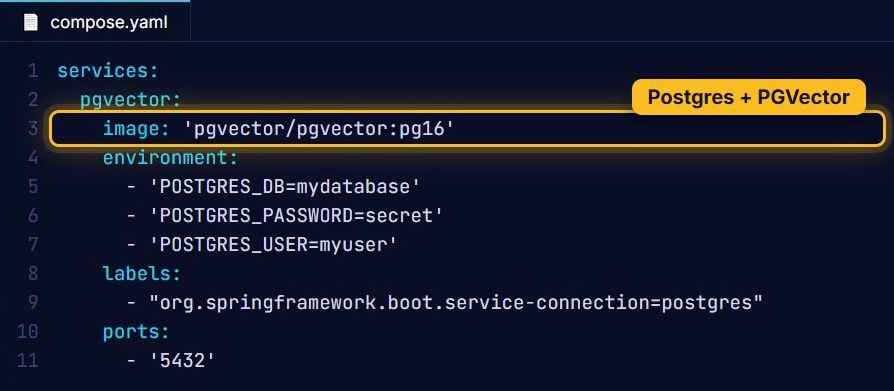

When the app starts, Spring Boot runs docker compose up, and connects to the database. No URL, no password to configure.

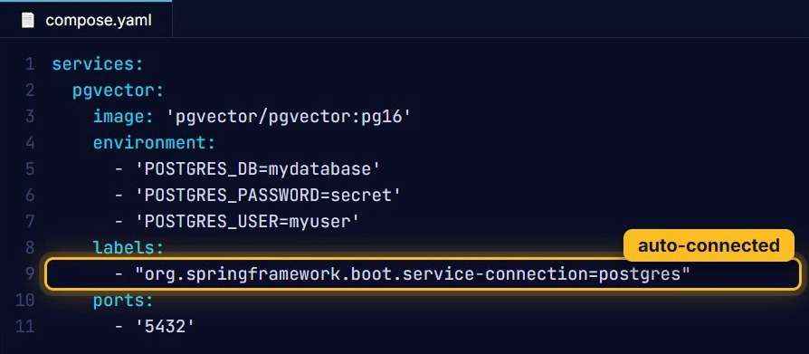

## Step 2: Configure PGVector

The same embedding model as lab 4.1. initialize schema creates the table for us.

**`application.properties`** (`src/main/resources/application.properties`):

```properties
spring.application.name=product-store
spring.ai.ollama.embedding.model=mxbai-embed-large
spring.ai.vectorstore.pgvector.initialize-schema=true
spring.ai.vectorstore.pgvector.dimensions=1024
```

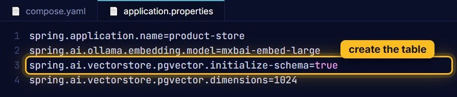

And dimensions: 1,024, the vector size of `mxbai-embed-large`. They must match.

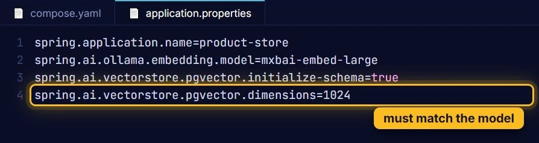

## Step 3: Load the catalog

CatalogLoader is a CommandLineRunner: it runs at startup. It gets the VectorStore, auto-configured, and a JdbcTemplate.

**`CatalogLoader.java`**:

```java
package dev.course.store;

import java.util.List;
import java.util.Map;

import org.slf4j.Logger;
import org.slf4j.LoggerFactory;
import org.springframework.ai.document.Document;
import org.springframework.ai.vectorstore.VectorStore;
import org.springframework.boot.CommandLineRunner;
import org.springframework.jdbc.core.JdbcTemplate;
import org.springframework.stereotype.Component;

@Component
public class CatalogLoader implements CommandLineRunner {

    private static final Logger log = LoggerFactory.getLogger(CatalogLoader.class);

    private final VectorStore vectorStore;
    private final JdbcTemplate jdbc;

    public CatalogLoader(VectorStore vectorStore, JdbcTemplate jdbc) {
        this.vectorStore = vectorStore;
        this.jdbc = jdbc;
    }
```

First, it counts the rows. If the store already has products, it stops. Otherwise, every restart would add them again.

**`CatalogLoader.java`** (continued):

```java
    @Override
    public void run(String... args) {
        Integer count = jdbc.queryForObject("SELECT count(*) FROM vector_store", Integer.class);
        if (count > 0) {
            log.info("Store already has {} products, nothing to load", count);
            return;
        }
```

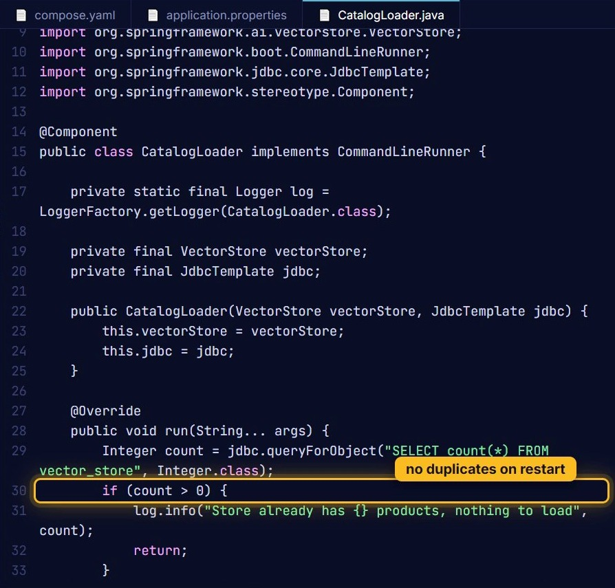

Then ten products. Each one is a Document: the description as text, and the category and price as metadata. One call to add, and Spring AI embeds and stores them all.

**`CatalogLoader.java`** (continued):

```java
        List<Document> products = List.of(
                product("Wireless noise-cancelling headphones, 30 hours of battery", "audio", 199),
                product("Compact Bluetooth earbuds with a charging case", "audio", 59),
                product("Waterproof portable speaker for the beach and the pool", "audio", 79),
                product("Ergonomic mechanical keyboard with quiet switches", "computer", 129),
                product("Vertical mouse that reduces wrist pain", "computer", 45),
                product("27-inch 4K monitor for photo editing", "computer", 349),
                product("Trail running shoes with extra grip", "sport", 119),
                product("Yoga mat, non-slip and easy to clean", "sport", 35),
                product("Insulated steel water bottle, keeps drinks cold for 24 hours", "sport", 25),
                product("Smart watch with heart-rate and sleep tracking", "sport", 249));
        vectorStore.add(products);
        log.info("Added {} products to the vector store", products.size());
    }

    private static Document product(String text, String category, int price) {
        return new Document(text, Map.of("category", category, "price", price));
    }
}
```

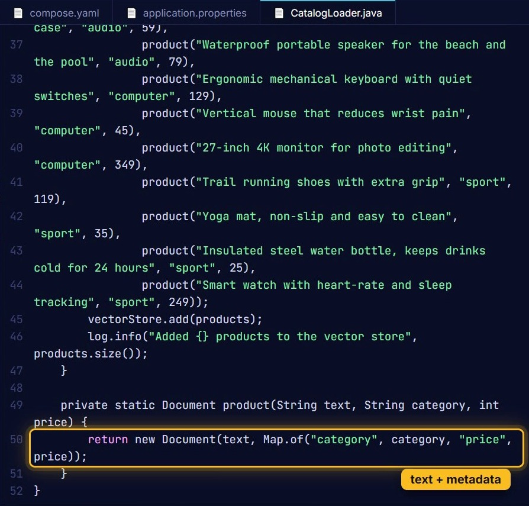

## Step 4: Search with filters

The controller builds a SearchRequest: the query, top three, and a threshold of 0.5.

**`ProductController.java`**:

```java
package dev.course.store;

import java.util.List;

import org.springframework.ai.vectorstore.SearchRequest;
import org.springframework.ai.vectorstore.VectorStore;
import org.springframework.web.bind.annotation.GetMapping;
import org.springframework.web.bind.annotation.RequestParam;
import org.springframework.web.bind.annotation.RestController;

@RestController
public class ProductController {

    private final VectorStore vectorStore;

    public ProductController(VectorStore vectorStore) {
        this.vectorStore = vectorStore;
    }

    @GetMapping("/products/search")
    public List<ProductHit> search(@RequestParam String q,
                                   @RequestParam(required = false) String filter) {
        SearchRequest.Builder request = SearchRequest.builder()
                .query(q)
                .topK(3)
                .similarityThreshold(0.5);
        if (filter != null) {
            request.filterExpression(filter);  // e.g. "category == 'audio' && price < 100"
        }
        return vectorStore.similaritySearch(request.build()).stream()
                .map(d -> new ProductHit(d.getText(), d.getMetadata().get("category"),
                        d.getMetadata().get("price"), d.getScore()))
                .toList();
    }
}
```

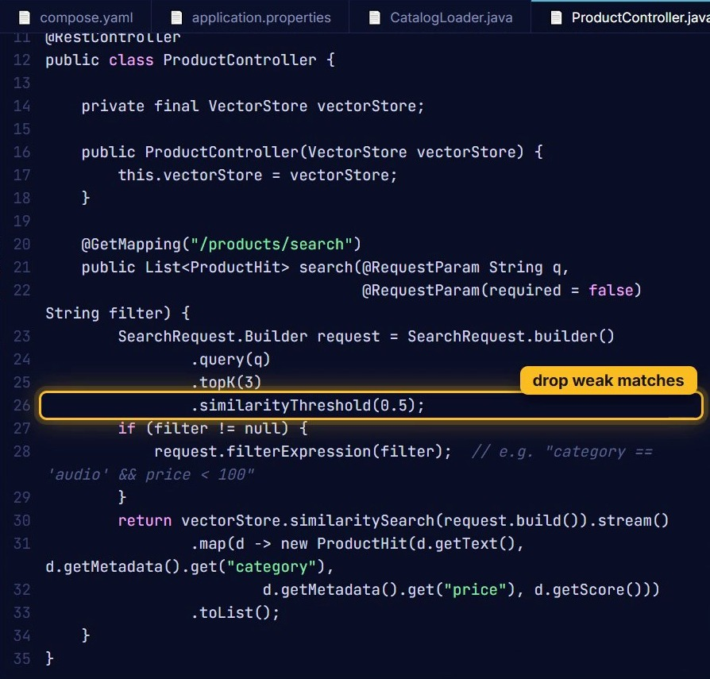

The filter is optional. Then similaritySearch, and I map each Document to a small ProductHit record, with its score.

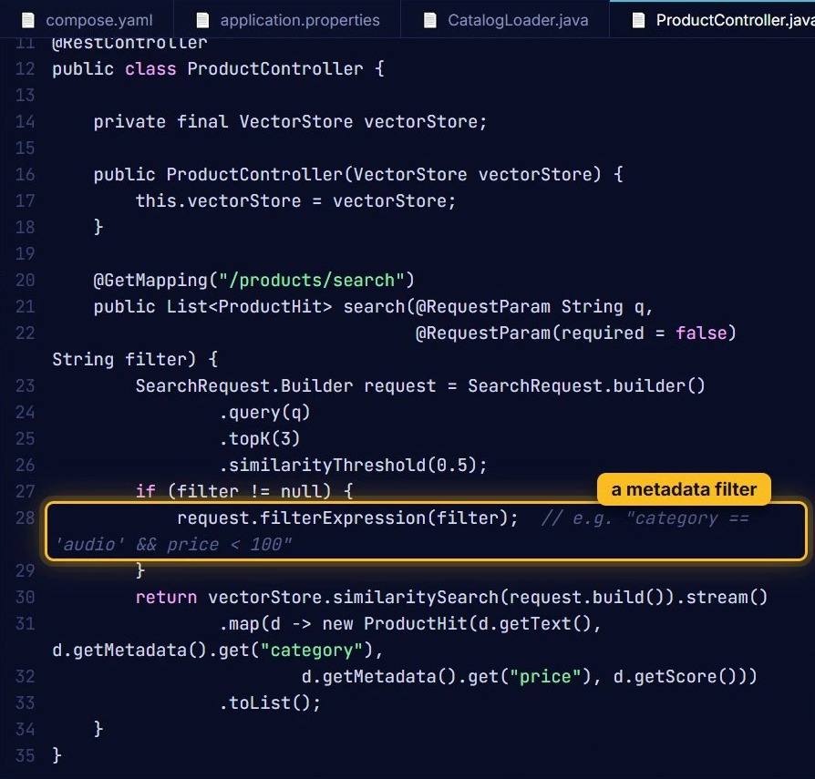

## Step 5: Run it

Spring Boot starts the Postgres container, then our loader adds the ten products.

```bash
$ ./mvnw spring-boot:run
Using Docker Compose file .../compose.yaml
Container product-store-pgvector-1  Started
Started ProductStoreApplication in 5.8 seconds
Added 10 products to the vector store
```

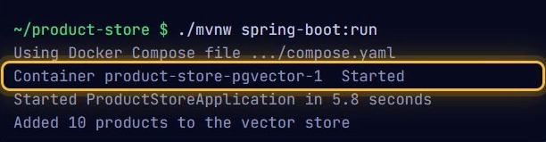

Search: something to listen to music on the train. Three audio products. Honestly, a beach speaker on a train is a strange pick. Search finds the topic, not good manners.

```bash
$ curl "localhost:8080/products/search?q=something+to+listen+to+music+on+the+train"
[
 {"product":"Waterproof portable speaker for the beach
   and the
   pool","category":"audio","price":79,"score":0.61},
 {"product":"Compact Bluetooth earbuds with a charging
   case","category":"audio","price":59,"score":0.61},
 {"product":"Wireless noise-cancelling headphones, 30
   hours of battery","category":"audio","price":199,"sco
   re":0.57},
]
```

Now with a filter: category audio, and price under 100. The headphones, at 199, are gone.

```bash
$ curl "localhost:8080/products/search?q=something+to+listen+to+music+on+the+train&filter=category+%3D%3D+%27audio%27+%26%26+price+%3C+100"
[
 {"product":"Waterproof portable speaker for the beach
   and the
   pool","category":"audio","price":79,"score":0.61},
 {"product":"Compact Bluetooth earbuds with a charging
   case","category":"audio","price":59,"score":0.61},
]
```

My wrist hurts when I work: one result, the vertical mouse. The threshold removed the weak matches. And a chocolate cake recipe? Nothing. Empty list.

```bash
$ curl "localhost:8080/products/search?q=my+wrist+hurts+when+I+work"
[
 {"product":"Vertical mouse that reduces wrist
   pain","category":"computer","price":45,"score":0.72},
]
```

```bash
$ curl "localhost:8080/products/search?q=a+recipe+for+chocolate+cake"
[]
```

Let's look inside Postgres. Next to the text, each row has its metadata, as JSON, and a vector of 1,024 numbers.

```bash
$ docker compose exec pgvector psql -U myuser -d mydatabase
```

```bash
$ SELECT metadata, vector_dims(embedding) AS dims FROM vector_store LIMIT 3;
              metadata               | dims
-------------------------------------+------
 {"price": 199, "category": "audio"} | 1024
 {"price": 59, "category": "audio"}  | 1024
 {"price": 79, "category": "audio"}  | 1024
(3 rows)
```

Finally, I restart the app. The products are still there, and the loader skips them.

```bash
$ ./mvnw spring-boot:run
...
Started ProductStoreApplication in 3.2 seconds
Store already has 10 products, nothing to load
```

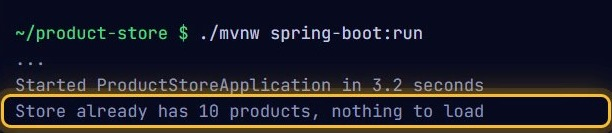

## 3 pro tips

Never paste user input into a filter string. It's like SQL injection. Use the FilterExpressionBuilder, or validate the values.

Use metadata to separate data, like a tenant id or a user id. Then filter on it in every search, so users only see their own documents.

And when I switched embedding models during my tests, the search failed with: expected 768 dimensions, not 1,024. Recreate the table, and embed again.

- **No string filters from users**: FilterExpressionBuilder or validation
- **Metadata for security**: Filter by tenant or user, always
- **Changed model?**: "expected 768 dimensions, not 1024"

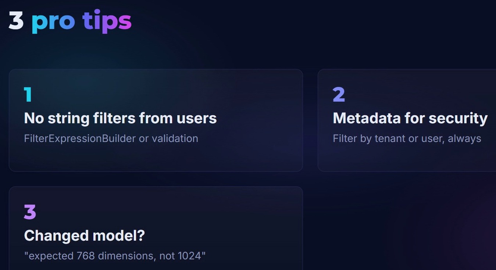

## Your challenge

Your challenge: add a maxPrice parameter, and build the filter with the FilterExpressionBuilder, not with a string.

Then add a POST endpoint to add a new product. Search for it right away.

- **maxPrice, safely**: FilterExpressionBuilder: lte("price", max)
- **Add a product**: POST endpoint, then search for it

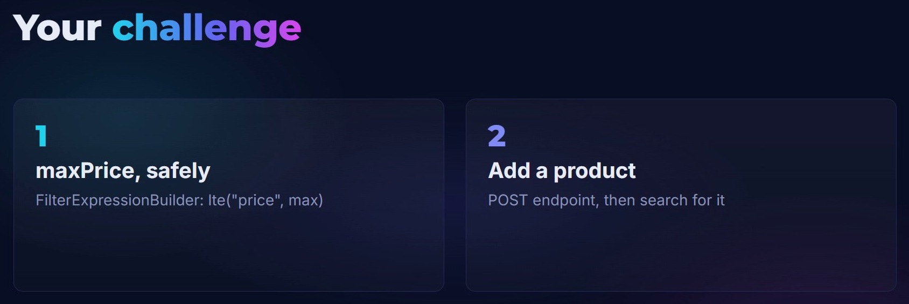

## Recap

- Docker Compose + PGVector: a vector store with **zero setup**
- Documents = text + **metadata**; `add` embeds and stores
- `SearchRequest`: topK, **threshold**, filters

## Get the code and the quiz

- **Code for this lab**: https://github.com/NEDBS12/youtube-tuto/tree/main/spring-ai-course/labs/product-store
- **All course code, quizzes and resources**: https://github.com/NEDBS12/youtube-tuto/tree/main/spring-ai-course
- **Lesson quiz and section evals**: https://nedbs12.github.io/youtube-tuto/spring-ai-course/quiz/
- **Ollama**: https://ollama.com
- **PGVector docs**: https://docs.spring.io/spring-ai/reference/api/vectordbs/pgvector.html
- **Spring AI reference docs**: https://docs.spring.io/spring-ai/reference/

🎥 **Watch the video tutorial:** {VIDEO_URL}

**Previous: Lesson 4.2, vector stores. Next: Lesson 4.3, the ETL pipeline.**

*The editor and terminal in the screenshots are a simplified recreation; the code and the outputs come from real runs of the lab.*

*I'm Zero Cost AI: I build AI tools and tutorials and share them for free. Follow me on Medium for the next lessons, and subscribe on YouTube: https://www.youtube.com/@zerocostai-f1h*
