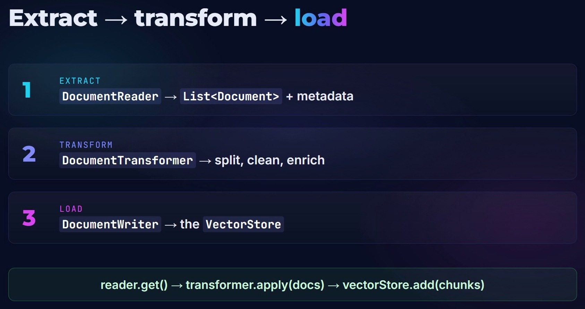
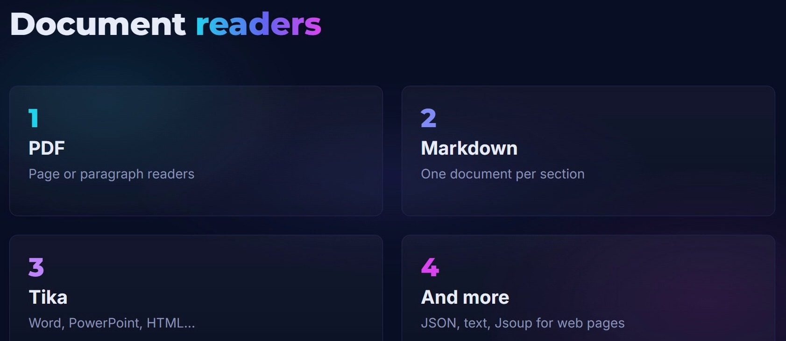
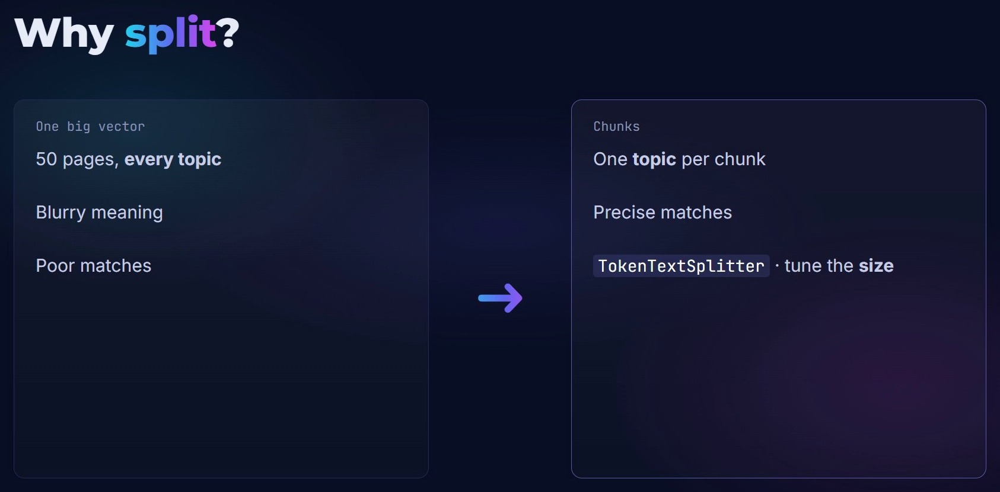
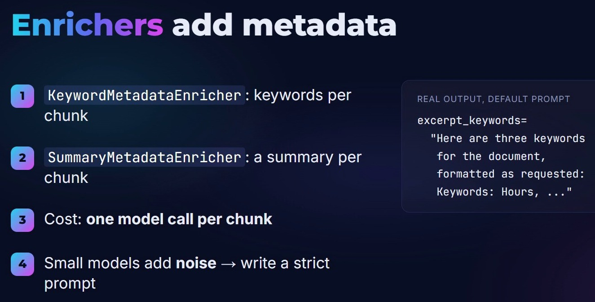
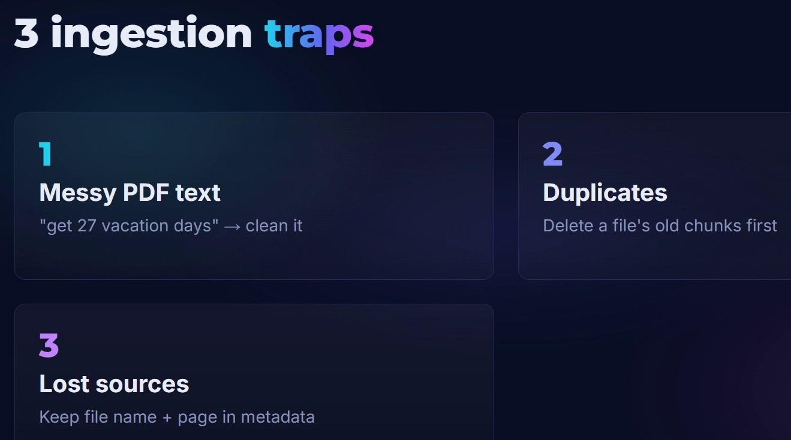

So far, we wrote our documents by hand, in Java. Real knowledge lives in PDFs, Markdown files, Word documents, and web pages.

In this lesson: the ETL pipeline, how Spring AI gets real documents into a vector store, and the traps I hit along the way.

It's lesson 4.3 of my free **Spring AI: Novice to Expert** course, where every lesson has a concept part and a hands-on lab, and everything runs on a free local model with Ollama.

🎥 **Prefer video?** Watch the full tutorial here:

{VIDEO}

## Extract → transform → load

ETL means: extract, transform, load. Spring AI has one interface for each step.

Extract, with a DocumentReader. It reads a file, and returns a list of Documents, with metadata like the file name and page number.

Transform, with a DocumentTransformer. It changes the list: split into chunks, clean the text, add metadata.

Load, with a DocumentWriter. And a VectorStore is a DocumentWriter: it embeds and stores the chunks.

Three interfaces, chained in a few lines of Java.

- **Extract**: `DocumentReader` → `List<Document>` + metadata
- **Transform**: `DocumentTransformer` → split, clean, enrich
- **Load**: `DocumentWriter` → the `VectorStore`

**reader.get() → transformer.apply(docs) → vectorStore.add(chunks)**



## Document readers

Spring AI comes with readers for common formats. Each one is a separate dependency.

PagePdfDocumentReader: one document per PDF page, with the page number. ParagraphPdfDocumentReader uses the PDF's table of contents, when it has one.

MarkdownDocumentReader: one document per section, with the heading as a title.

TikaDocumentReader: Word, PowerPoint, HTML and many more, through Apache Tika.

And readers for JSON, plain text, and web pages, with Jsoup.

- **PDF**: Page or paragraph readers
- **Markdown**: One document per section
- **Tika**: Word, PowerPoint, HTML...
- **And more**: JSON, text, Jsoup for web pages



## Why split?

Why split documents into chunks?

One vector for a whole 50-page PDF mixes every topic. Its meaning is blurry, and it can't match a precise question. Small chunks, one topic each, match much better.

But not too small: a chunk of half a sentence loses its context. The TokenTextSplitter cuts by tokens, at sentence ends when it can. Its default size is 800 tokens. Test sizes on your own documents.

### One big vector

- 50 pages, **every topic**
- Blurry meaning
- Poor matches

### Chunks

- One **topic** per chunk
- Precise matches
- `TokenTextSplitter` · tune the **size**



## Enrichers add metadata

Enrichers add metadata with a chat model.

The KeywordMetadataEnricher asks the model for keywords about each chunk.

The SummaryMetadataEnricher adds a summary of each chunk, and even of its neighbours.

The cost: one model call per chunk. With thousands of chunks, ingestion gets slow.

And small models add noise. In my lab, Gemma returned: here are three keywords for the document, formatted as requested. A stricter prompt fixed it.

- `KeywordMetadataEnricher`: keywords per chunk
- `SummaryMetadataEnricher`: a summary per chunk
- Cost: **one model call per chunk**
- Small models add **noise** → write a strict prompt

In code:

```java
excerpt_keywords=
  "Here are three keywords
   for the document,
   formatted as requested:
   Keywords: Hours, ..."
```



## 3 ingestion traps

Three traps I hit while building the lab.

PDF text keeps the page layout: get 27, many spaces, vacation days. Clean the text before you split it.

Running the ingestion twice stores everything twice. Delete the old chunks of a file before you add the new ones.

And keep the source in the metadata: file name and page. You'll need it to show sources to your users.

- **Messy PDF text**: "get 27    vacation    days" → clean it
- **Duplicates**: Delete a file's old chunks first
- **Lost sources**: Keep file name + page in metadata



## Recap

- **Extract, transform, load**: reader, transformer, writer
- Split into **chunks** with one topic each; tune the size
- Clean text, avoid duplicates, keep sources

## Quick quiz

Test yourself before you read the answers.

1. **Interfaces**: Which interface reads a PDF into Documents?
2. **Chunks**: Why split a long document into chunks?
3. **Re-ingest**: You run the ingestion twice. What happens without care?

**Answers:**

1. `DocumentReader`
2. One **topic** per vector: **precise** matches
3. **Duplicates**: delete first

The full five-question quiz for this lesson is free on the course quiz page: https://nedbs12.github.io/youtube-tuto/spring-ai-course/quiz/

## Get the code and the quiz

- **Lab code for this lesson**: https://github.com/NEDBS12/youtube-tuto/tree/main/spring-ai-course/labs/doc-ingest
- **All course code, quizzes and resources**: https://github.com/NEDBS12/youtube-tuto/tree/main/spring-ai-course
- **Lesson quiz and section evals**: https://nedbs12.github.io/youtube-tuto/spring-ai-course/quiz/
- **Spring AI ETL pipeline docs**: https://docs.spring.io/spring-ai/reference/api/etl-pipeline.html
- **Spring AI reference docs**: https://docs.spring.io/spring-ai/reference/

🎥 **Watch the video tutorial:** {VIDEO_URL}

**Previous: Lab 4.2. Next: Lab 4.3, ingest a PDF and Markdown into PGVector.**

*I'm Zero Cost AI: I build AI tools and tutorials and share them for free. Follow me on Medium for the next lessons, and subscribe on YouTube: https://www.youtube.com/@zerocostai-f1h*
