Today you'll build an ingestion pipeline: a PDF handbook and a Markdown guide, read, cleaned, split, enriched, and stored in PGVector.

The same knowledge base will power our chat in the next lab.

It's lab 4.3 of my free **Spring AI: Novice to Expert** course, where every lesson has a concept part and a hands-on lab, and everything runs on a free local model with Ollama.

🎥 **Prefer video?** Watch the full tutorial here:

{VIDEO}

## What we'll build

The documents. Extract. Transform. Load. And we run it, twice, to check for duplicates.

1. **The documents**: A PDF handbook + a Markdown guide
2. **Extract**: PDF and Markdown readers
3. **Transform**: Clean, split, add keywords
4. **Load**: Replace, then store
5. **Run it**: Ingest twice, then search

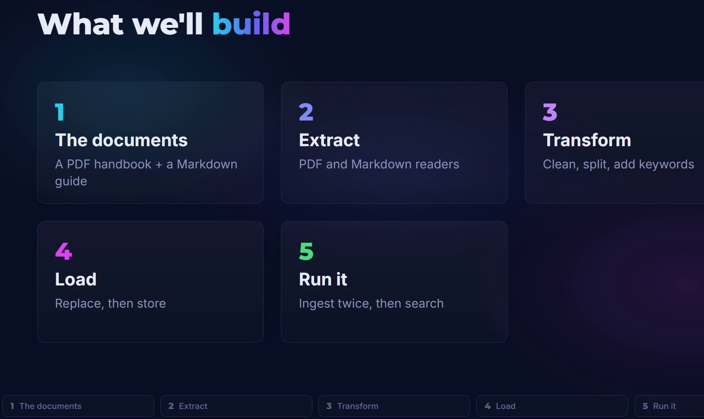

## Step 1: The documents

They belong to Brightwave, a fictional software company. A four-page employee handbook, as a PDF: working hours, remote work, time off, and expenses.

**employee-handbook.pdf · 4 pages**

- **Page 1**: Welcome, working hours
- **Page 2**: Remote work, home office budget
- **Page 3**: Vacation, sick and parental leave
- **Page 4**: Expenses and travel

And an IT help guide, in Markdown, with four sections. A model has never seen these facts. That's the point.

**`it-help.md`** (`src/main/resources/docs/it-help.md`):

```markdown
# IT help

## Connect to the VPN

Use the BrightGate VPN app to reach internal tools from home. Sign in with your Brightwave account, then approve the request in the authenticator app on your phone.

## Reset your password

Passwords expire every 180 days. Reset yours at id.brightwave.example. A new password needs at least 14 characters. You can't reuse your last five passwords.

## Get a new laptop

Laptops are replaced every four years. Open a ticket in the IT portal with the category Hardware. A broken laptop is replaced within two working days.

## Report a security issue

Forward suspicious emails to security@brightwave.example and don't click any link. If you lost a laptop or a phone with company data, call the IT hotline at extension 4400 immediately, day or night.
```

The project is the one from lab 4.2, plus two readers from start.spring.io: the PDF reader and the Markdown reader. And Gemma, as the chat model, for the keywords.

**`application.properties`** (`src/main/resources/application.properties`):

```properties
spring.application.name=doc-ingest
spring.ai.ollama.chat.model=gemma3:4b
spring.ai.ollama.embedding.model=mxbai-embed-large
spring.ai.vectorstore.pgvector.initialize-schema=true
spring.ai.vectorstore.pgvector.dimensions=1024
```

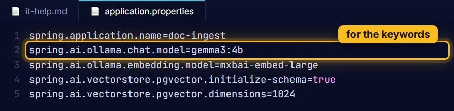

## Step 2: Extract

IngestService injects both files as Resources, the VectorStore, and the ChatModel. Ignore the KEYWORDS prompt for now.

**`IngestService.java`**:

```java
package dev.course.ingest;

import java.util.ArrayList;
import java.util.List;

import org.slf4j.Logger;
import org.slf4j.LoggerFactory;
import org.springframework.ai.chat.model.ChatModel;
import org.springframework.ai.chat.prompt.PromptTemplate;
import org.springframework.ai.document.Document;
import org.springframework.ai.model.transformer.KeywordMetadataEnricher;
import org.springframework.ai.reader.markdown.MarkdownDocumentReader;
import org.springframework.ai.reader.markdown.config.MarkdownDocumentReaderConfig;
import org.springframework.ai.reader.pdf.PagePdfDocumentReader;
import org.springframework.ai.transformer.splitter.TokenTextSplitter;
import org.springframework.ai.vectorstore.VectorStore;
import org.springframework.beans.factory.annotation.Value;
import org.springframework.core.io.Resource;
import org.springframework.stereotype.Service;

@Service
public class IngestService {

    private static final Logger log = LoggerFactory.getLogger(IngestService.class);

    private static final PromptTemplate KEYWORDS = new PromptTemplate("""
            {context_str}

            Give 3 keywords for this text. Reply with the keywords only, comma separated.""");

    @Value("classpath:docs/employee-handbook.pdf")
    private Resource handbook;

    @Value("classpath:docs/it-help.md")
    private Resource itHelp;

    private final VectorStore vectorStore;
    private final ChatModel chatModel;

    public IngestService(VectorStore vectorStore, ChatModel chatModel) {
        this.vectorStore = vectorStore;
        this.chatModel = chatModel;
    }
```

The PagePdfDocumentReader returns one Document per page, with the file name and page number as metadata. The MarkdownDocumentReader returns one per section. I add the file name to those too.

**`IngestService.java`** (continued):

```java
    public IngestReport ingest() {
        // 1. Extract: one document per PDF page, one per Markdown section
        List<Document> pages = new PagePdfDocumentReader(handbook).get();
        List<Document> sections = new MarkdownDocumentReader(itHelp, MarkdownDocumentReaderConfig.builder()
                .withAdditionalMetadata("file_name", "it-help.md")
                .build()).get();
        log.info("EXTRACT {} PDF pages, {} Markdown sections", pages.size(), sections.size());
```

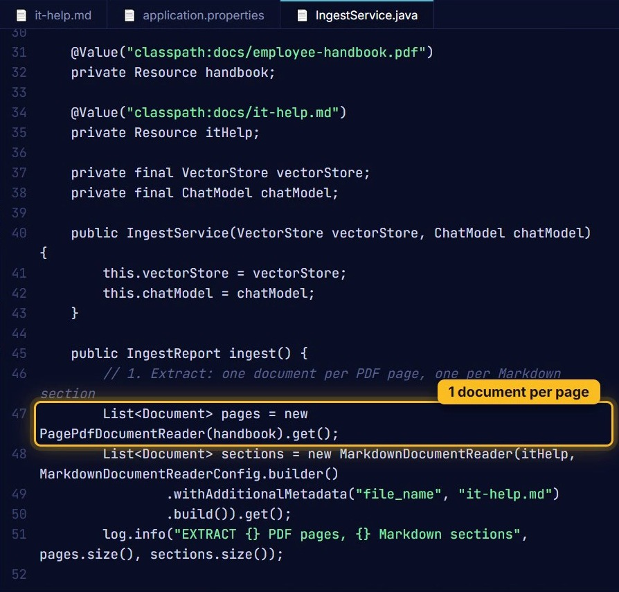

## Step 3: Transform

First, the cleaning. In my first run, the PDF text looked like this.

**First run · real PDF text**

> "Full-time employees    get 27  vacation  days  per year, plus  public holidays."

The PDF keeps the page layout, with lots of spaces. So the transform step starts by cleaning each page, with a small clean method. We'll write it in a moment.

**`IngestService.java`** (continued):

```java
        // 2. Transform: clean the PDF text, split into small chunks, then add keywords
        List<Document> documents = new ArrayList<>(pages.stream().map(IngestService::clean).toList());
        documents.addAll(sections);
        List<Document> chunks = TokenTextSplitter.builder()
                .withChunkSize(100)
                .build()
                .apply(documents);
        chunks = KeywordMetadataEnricher.builder(chatModel)
                .keywordsTemplate(KEYWORDS)
                .build()
                .apply(chunks);
        log.info("TRANSFORM {} chunks, first one: {}", chunks.size(), chunks.get(0).getMetadata());
```

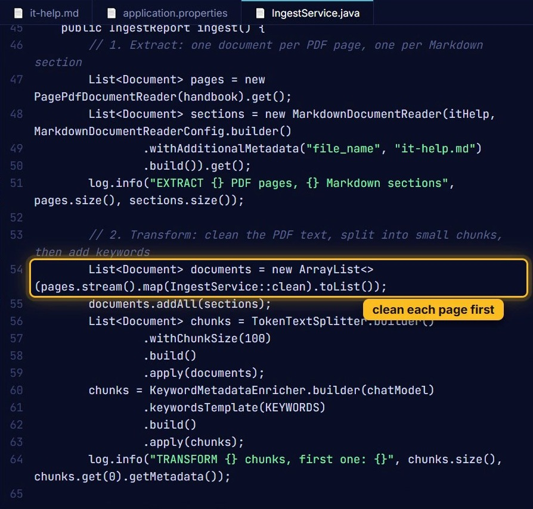

Then the TokenTextSplitter, with chunks of 100 tokens. Our pages are short, so a small size shows the splitting. And the KeywordMetadataEnricher adds keywords to every chunk.

With its default prompt, Gemma answered: here are three keywords for the document, formatted as requested. That sentence ended up in our metadata!

**First run · real keywords**

> excerpt_keywords = "Here are three keywords for the document, formatted as requested: Keywords: Hours, Brightwave, Lyon"

So I gave it a stricter prompt: reply with the keywords only. Context str is where the enricher puts the chunk.

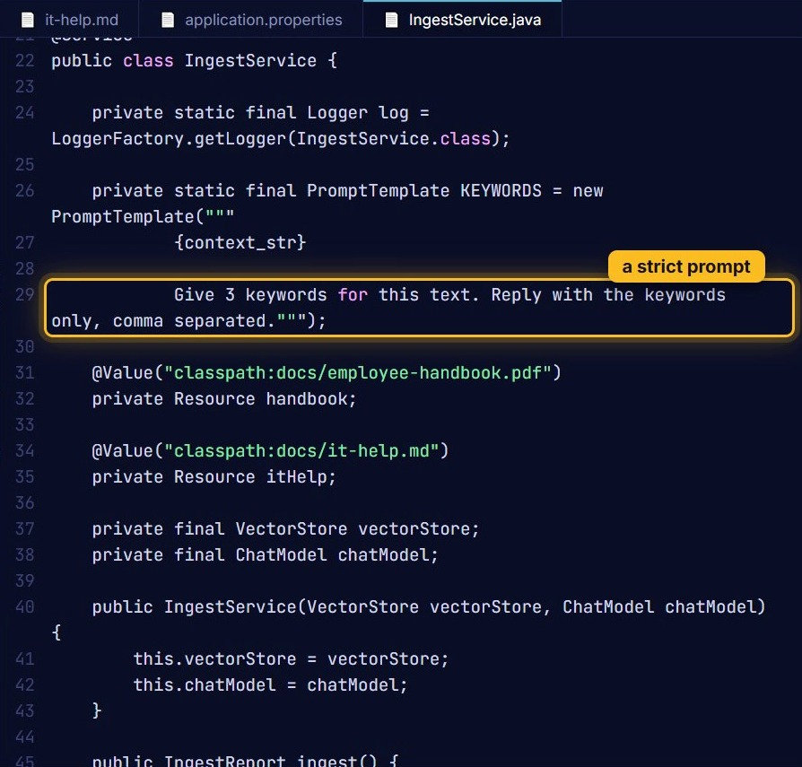

## Step 4: Load

If we ingest twice, we'd store everything twice. So, first, delete the old chunks of these files, with a filter on file name. Then add. The vector store embeds and saves them.

**`IngestService.java`** (continued):

```java
        // 3. Load: replace the old version of these files, then store
        vectorStore.delete("file_name in ['employee-handbook.pdf', 'it-help.md']");
        vectorStore.add(chunks);
        log.info("LOAD {} chunks into the vector store", chunks.size());
        return new IngestReport(pages.size(), sections.size(), chunks.size());
    }
```

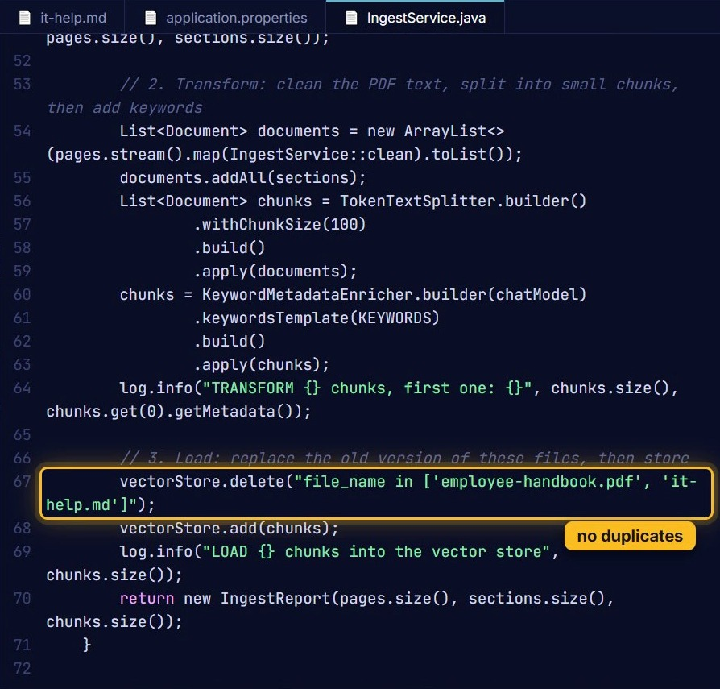

And the clean method: it replaces every run of spaces and line breaks with a single space.

**`IngestService.java`** (continued):

```java
    // PDF text keeps the page layout: "get 27  vacation  days"
    private static Document clean(Document page) {
        return page.mutate().text(page.getText().replaceAll("\\s+", " ").trim()).build();
    }
}
```

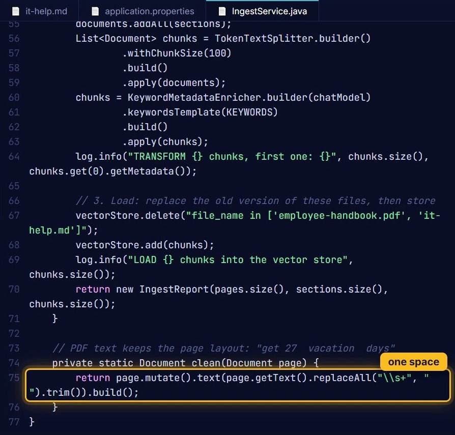

The controller has POST `/ingest`, and GET `/search`, to check the result.

**`IngestController.java`** (`src/main/java/dev/course/ingest/IngestController.java`):

```java
package dev.course.ingest;

import java.util.List;
import java.util.Map;

import org.springframework.ai.vectorstore.SearchRequest;
import org.springframework.ai.vectorstore.VectorStore;
import org.springframework.web.bind.annotation.GetMapping;
import org.springframework.web.bind.annotation.PostMapping;
import org.springframework.web.bind.annotation.RequestParam;
import org.springframework.web.bind.annotation.RestController;

@RestController
public class IngestController {

    private final IngestService ingestService;
    private final VectorStore vectorStore;

    public IngestController(IngestService ingestService, VectorStore vectorStore) {
        this.ingestService = ingestService;
        this.vectorStore = vectorStore;
    }

    @PostMapping("/ingest")
    public IngestReport ingest() {
        return ingestService.ingest();
    }

    @GetMapping("/search")
    public List<Map<String, Object>> search(@RequestParam String q) {
        return vectorStore.similaritySearch(SearchRequest.builder().query(q).topK(2).build()).stream()
                .map(d -> Map.<String, Object>of("text", d.getText(), "source", d.getMetadata().get("file_name")))
                .toList();
    }
}
```

## Step 5: Run it

Four pages, four sections, ten chunks, in about ten seconds.

```bash
$ ./mvnw spring-boot:run
...
Started DocIngestApplication in 3.2 seconds
```

```bash
$ curl -X POST localhost:8080/ingest
{"pdfPages":4,"markdownSections":4,"chunks":10}
```

The log shows each step, and the metadata of the first chunk: its keywords, page number, and file name.

```bash
$ # application log
EXTRACT 4 PDF pages, 4 Markdown sections
TRANSFORM 10 chunks, first one: {chunk_index=0,
  excerpt_keywords=Working hours, Lyon, Software,
  page_number=1, total_chunks=2,
  file_name=employee-handbook.pdf, ...}
LOAD 10 chunks into the vector store
```

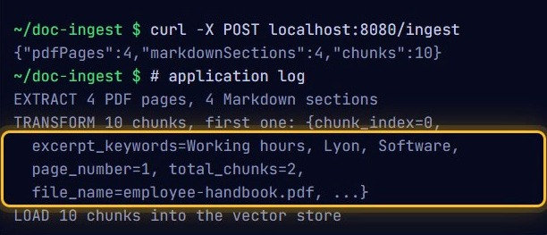

In Postgres, every chunk now has clean keywords.

```bash
$ SELECT metadata->>'file_name' AS file, metadata->>'excerpt_keywords' AS keywords FROM vector_store;
         file          |               keywords
-----------------------+-------------------------------
 employee-handbook.pdf | Working hours, Lyon, Software
 employee-handbook.pdf | Friday, meetings, scheduling
 employee-handbook.pdf | Remote work, home office, budget
 employee-handbook.pdf | Vacation, Sick Leave, Time Off
 ...
 it-help.md            | BrightGate, VPN, Brightwave
 it-help.md            | Passwords, Reset, Brightwave
(10 rows)
```

Now I ingest a second time, and count the rows. Still ten. No duplicates.

```bash
$ curl -X POST localhost:8080/ingest
{"pdfPages":4,"markdownSections":4,"chunks":10}
```

```bash
$ docker compose exec pgvector psql -U myuser -d mydatabase -c "SELECT count(*) FROM vector_store"
 count
-------
    10
```

And a search: I lost my phone. The security section of the Markdown guide, with its source.

```bash
$ curl "localhost:8080/search?q=I+lost+my+phone"
[{"text":"Forward suspicious emails to
 security@brightwave.example and don't click any link.
If you lost a laptop or a phone with company data, call
the IT hotline at extension 4400 immediately, day or
night.",
 "source":"it-help.md"}, ...]
```

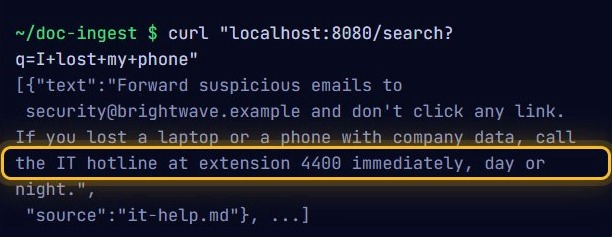

## 3 pro tips

Look at your chunks before you embed them. Most retrieval problems start with bad text.

Enrichers make one model call per chunk. For big document sets, run ingestion in a background job, not in a web request.

And ingest when documents change, not on every startup. Keep a version or a date in the metadata.

- **Read your chunks**: Bad text → bad retrieval
- **Background ingestion**: One model call per chunk
- **Ingest on change**: Version or date in metadata

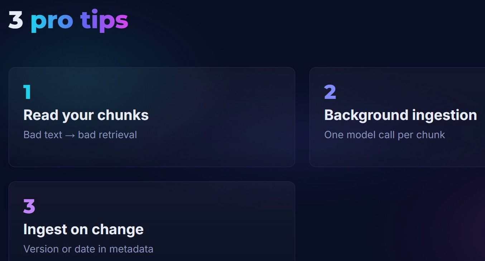

## Your challenge

Your challenge: add a third document, a plain text file, with the TextReader. Give it a file name too.

Then try chunk sizes of 50 and 300 tokens. Search the same three questions, and compare the results.

- **A third format**: TextReader + file_name metadata
- **Chunk sizes**: 50 vs 300 tokens: compare results

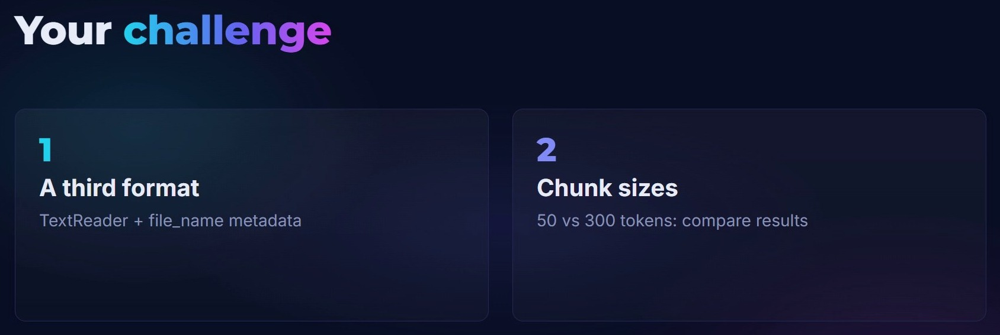

## Recap

- **Readers** return Documents with source metadata
- **Clean**, **split**, **enrich**: check every step's output
- Delete before add: no duplicates

## Get the code and the quiz

- **Code for this lab**: https://github.com/NEDBS12/youtube-tuto/tree/main/spring-ai-course/labs/doc-ingest
- **All course code, quizzes and resources**: https://github.com/NEDBS12/youtube-tuto/tree/main/spring-ai-course
- **Lesson quiz and section evals**: https://nedbs12.github.io/youtube-tuto/spring-ai-course/quiz/
- **Ollama**: https://ollama.com
- **Spring AI ETL pipeline docs**: https://docs.spring.io/spring-ai/reference/api/etl-pipeline.html
- **Spring AI reference docs**: https://docs.spring.io/spring-ai/reference/

🎥 **Watch the video tutorial:** {VIDEO_URL}

**Previous: Lesson 4.3, the ETL pipeline. Next: Lesson 4.4, RAG advisors.**

*The editor and terminal in the screenshots are a simplified recreation; the code and the outputs come from real runs of the lab.*

*I'm Zero Cost AI: I build AI tools and tutorials and share them for free. Follow me on Medium for the next lessons, and subscribe on YouTube: https://www.youtube.com/@zerocostai-f1h*
