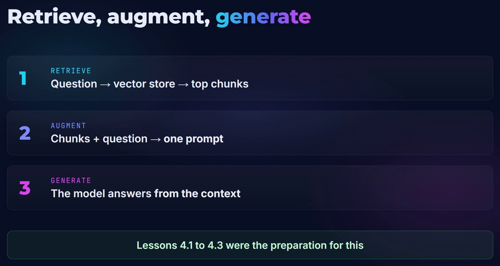
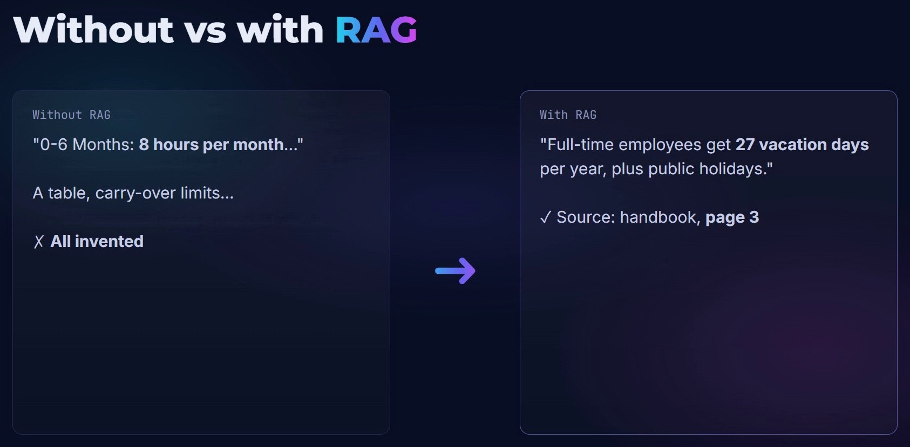
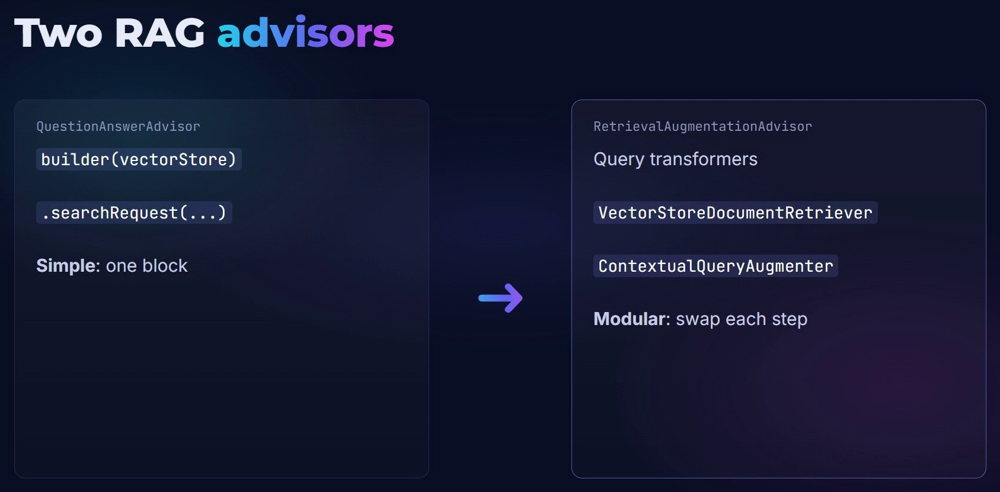
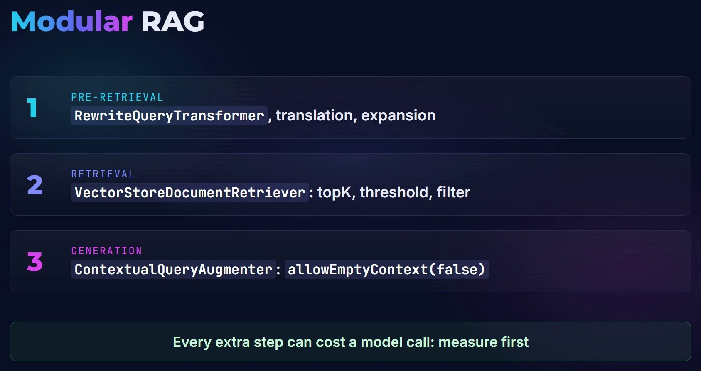
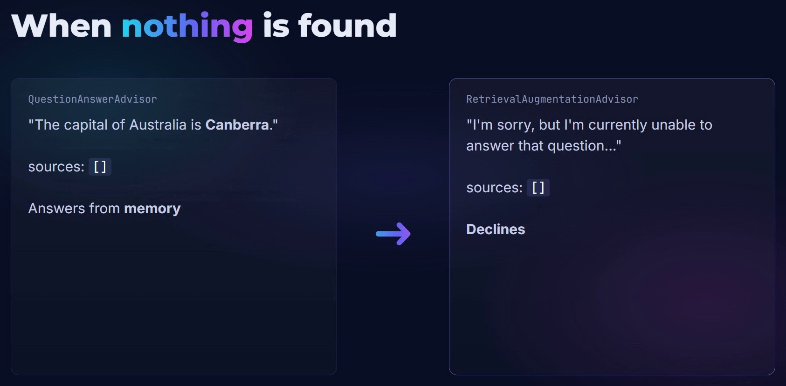
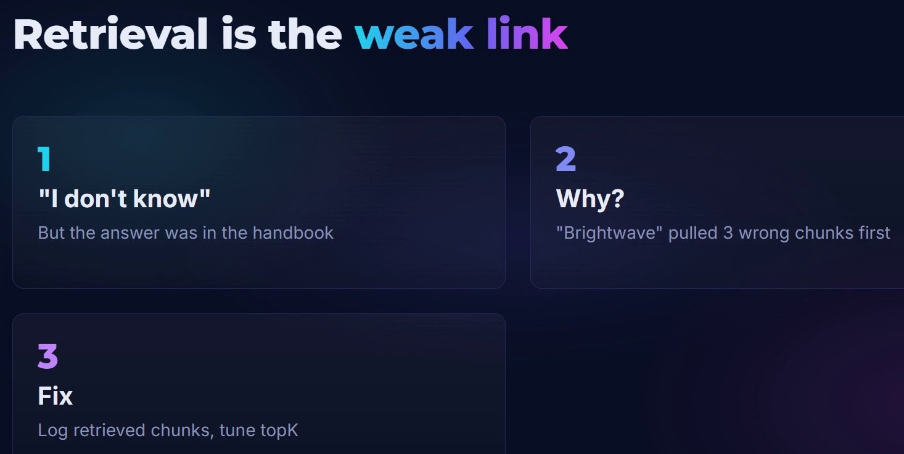

I asked a local model: how many vacation days do I get at Brightwave? It answered with a detailed policy: eight hours per month for new hires, a table, carry-over limits. All invented.

In this lesson: RAG, the pattern that makes a model answer from your documents, and the two Spring AI advisors that do it for you.

It's lesson 4.4 of my free **Spring AI: Novice to Expert** course, where every lesson has a concept part and a hands-on lab, and everything runs on a free local model with Ollama.

🎥 **Prefer video?** Watch the full tutorial here:

{VIDEO}

## Retrieve, augment, generate

RAG means retrieval augmented generation. Three steps, on every question.

Retrieve: search the vector store with the question, and get the most similar chunks.

Augment: add those chunks to the prompt, with an instruction: answer using this context.

Generate: the model writes the answer, from the context, not from memory.

Everything we built in this section was preparation for this.

- **Retrieve**: Question → vector store → top chunks
- **Augment**: Chunks + question → **one prompt**
- **Generate**: The model answers **from the context**

**Lessons 4.1 to 4.3 were the preparation for this**

## Without vs with RAG

Here's the difference, with real answers from our lab.

Without RAG, the model doesn't know Brightwave. So it invents an accrual table, with a confident tone, and a disclaimer at the end.

With RAG: full-time employees get 27 vacation days per year, plus public holidays. Correct, and we know where it comes from: page three of the handbook.

### Without RAG

- "0-6 Months: **8 hours per month**..."
- A table, carry-over limits...
- ✗ **All invented**

### With RAG

- "Full-time employees get **27 vacation days** per year, plus public holidays."
- ✓ Source: handbook, **page 3**

## Two RAG advisors

Spring AI gives you two advisors.

The QuestionAnswerAdvisor: simple. Give it the vector store and a SearchRequest. It searches, and adds the documents to the prompt. Perfect to start.

The RetrievalAugmentationAdvisor: modular. Each step is a building block you can swap or extend: query transformers, retriever, post-processors, and the augmenter.

### QuestionAnswerAdvisor

- `builder(vectorStore)`
- `.searchRequest(...)`
- **Simple**: one block

### RetrievalAugmentationAdvisor

- Query transformers
- `VectorStoreDocumentRetriever`
- `ContextualQueryAugmenter`
- **Modular**: swap each step

## Modular RAG

The modular advisor follows the RAG flow.

Before retrieval: transform the question. For example, RewriteQueryTransformer rewrites it for search, and a translation transformer translates it. A query expander can create several versions.

Retrieval: the VectorStoreDocumentRetriever, with topK, a threshold and a filter.

Generation: the ContextualQueryAugmenter adds the context to the question. And with allowEmptyContext false, when nothing is found, the model politely declines.

Each extra step can mean another model call, so add them only when you measure a gain.

- **Pre-retrieval**: `RewriteQueryTransformer`, translation, expansion
- **Retrieval**: `VectorStoreDocumentRetriever`: topK, threshold, filter
- **Generation**: `ContextualQueryAugmenter`: `allowEmptyContext(false)`

**Every extra step can cost a model call: measure first**

## When nothing is found

What if the answer isn't in your documents? I asked both advisors: what is the capital of Australia?

The QuestionAnswerAdvisor found no document, and the model answered anyway: Canberra. From its own memory.

The RetrievalAugmentationAdvisor, with allowEmptyContext false, declined: it's outside the scope of its knowledge base. For a company assistant, that's usually what you want.

### QuestionAnswerAdvisor

- "The capital of Australia is **Canberra**."
- sources: `[]`
- Answers from **memory**

### RetrievalAugmentationAdvisor

- "I'm sorry, but I'm currently unable to answer that question..."
- sources: `[]`
- **Declines**

## Retrieval is the weak link

One last, very important lesson. Retrieval is the weak link.

In my lab, the first answer to the vacation question was: I don't know. Even though the answer was in the handbook.

The word Brightwave in the question pulled three other chunks to the top. The vacation chunk was fifth, and we only kept three.

The fix: log what you retrieve, then tune topK, the threshold, and your chunks. When a RAG answer is wrong, look at the retrieved documents first.

- **"I don't know"**: But the answer was in the handbook
- **Why?**: "Brightwave" pulled 3 wrong chunks first
- **Fix**: Log retrieved chunks, tune topK

## Recap

- RAG: **retrieve**, **augment**, **generate**, from your documents
- `QuestionAnswerAdvisor` to start; `RetrievalAugmentationAdvisor` to customise
- Wrong answer? Check retrieval first

## Quick quiz

Test yourself before you read the answers.

1. **Steps**: What are the three steps of RAG?
2. **Advisor**: Which advisor lets you add a query transformer?
3. **Debug**: A RAG answer is wrong. What do you check first?

**Answers:**

1. **Retrieve**, augment, generate
2. `RetrievalAugmentationAdvisor`
3. The **retrieved documents**

The full five-question quiz for this lesson is free on the course quiz page: https://nedbs12.github.io/youtube-tuto/spring-ai-course/quiz/

## Get the code and the quiz

- **Lab code for this lesson**: https://github.com/NEDBS12/youtube-tuto/tree/main/spring-ai-course/labs/docs-chat
- **All course code, quizzes and resources**: https://github.com/NEDBS12/youtube-tuto/tree/main/spring-ai-course
- **Lesson quiz and section evals**: https://nedbs12.github.io/youtube-tuto/spring-ai-course/quiz/
- **Spring AI RAG docs**: https://docs.spring.io/spring-ai/reference/api/retrieval-augmented-generation.html
- **Spring AI reference docs**: https://docs.spring.io/spring-ai/reference/

🎥 **Watch the video tutorial:** {VIDEO_URL}

**Previous: Lab 4.3. Next: Lab 4.4, chat with your docs.**

*I'm Zero Cost AI: I build AI tools and tutorials and share them for free. Follow me on Medium for the next lessons, and subscribe on YouTube: https://www.youtube.com/@zerocostai-f1h*
