4, the last lab of section four. Today you'll build a chat with your documents, with both RAG advisors, side by side.

And you'll debug a wrong answer, live, the way you'll do it in real projects.

It's lab 4.4 of my free **Spring AI: Novice to Expert** course, where every lesson has a concept part and a hands-on lab, and everything runs on a free local model with Ollama.

🎥 **Prefer video?** Watch the full tutorial here:

{VIDEO}

## What we'll build

Reuse the ingestion. The QuestionAnswerAdvisor. The RetrievalAugmentationAdvisor. Three endpoints to compare. And we run, and debug.

1. **Reuse the ingestion**: From lab 4.3, at startup
2. **QuestionAnswerAdvisor**: Simple RAG
3. **RetrievalAugmentationAdvisor**: Modular RAG
4. **Three endpoints**: No RAG, QA, modular
5. **Run and debug**: Find why it says "I don't know"

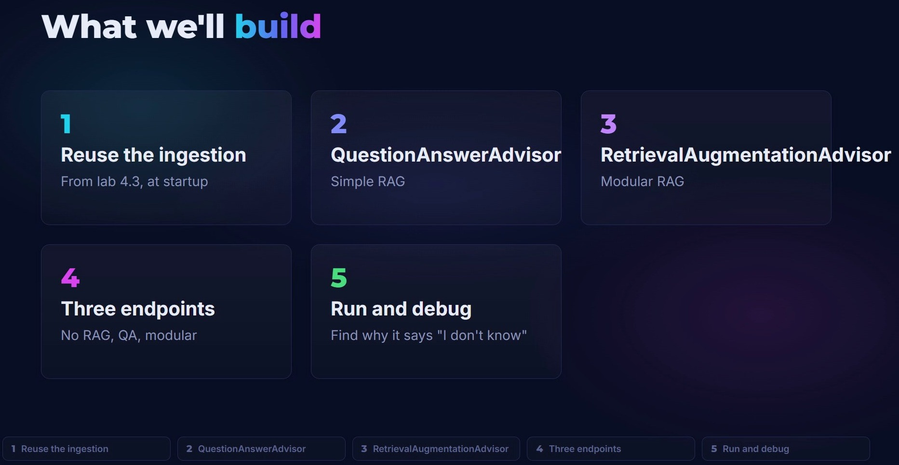

## Step 1: Reuse the ingestion

The documents and the IngestService are copied from lab 4.3. The project adds one dependency: spring AI rag, for the modular advisor.

**pom.xml · one new dependency**

- **spring-ai-rag**: RetrievalAugmentationAdvisor
- **spring-ai-vector-store-advisor**: QuestionAnswerAdvisor

StartupIngest runs at startup, and ingests the documents only when the store is empty.

**`StartupIngest.java`** (`src/main/java/dev/course/docs/StartupIngest.java`):

```java
package dev.course.docs;

import org.springframework.boot.CommandLineRunner;
import org.springframework.jdbc.core.JdbcTemplate;
import org.springframework.stereotype.Component;

@Component
public class StartupIngest implements CommandLineRunner {

    private final IngestService ingestService;
    private final JdbcTemplate jdbc;

    public StartupIngest(IngestService ingestService, JdbcTemplate jdbc) {
        this.ingestService = ingestService;
        this.jdbc = jdbc;
    }

    @Override
    public void run(String... args) {
        Integer count = jdbc.queryForObject("SELECT count(*) FROM vector_store", Integer.class);
        if (count == 0) {
            ingestService.ingest();
        }
    }
}
```

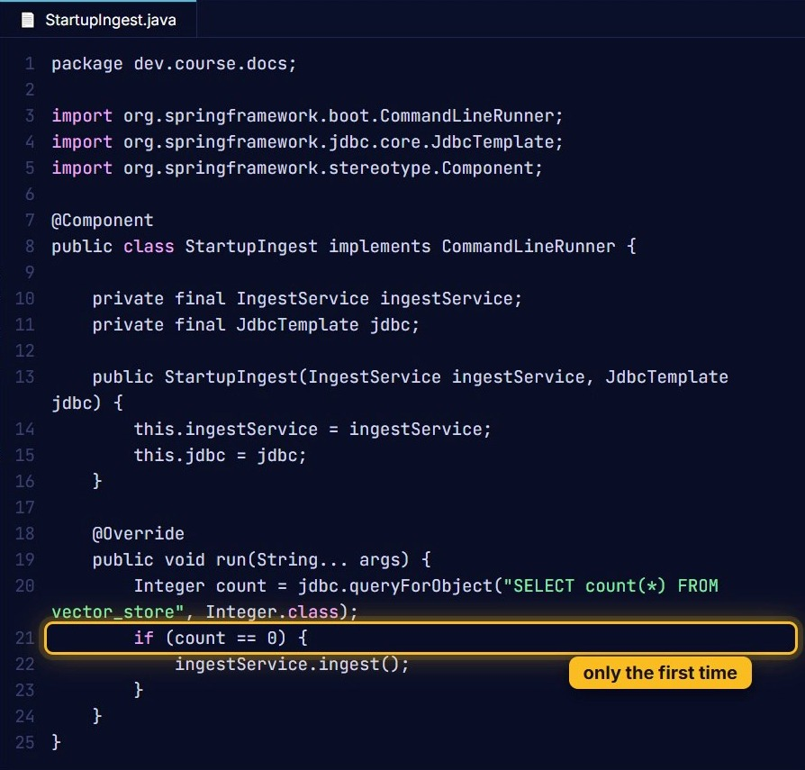

And Answer is a record: the answer, and the list of sources.

**`Answer.java`** (`src/main/java/dev/course/docs/Answer.java`):

```java
package dev.course.docs;

import java.util.List;

public record Answer(String answer, List<String> sources) {
}
```

## Step 2: QuestionAnswerAdvisor

The controller builds one ChatClient, and two advisors, once, in the constructor.

**`ChatController.java`**:

```java
package dev.course.docs;

import java.util.List;

import org.slf4j.Logger;
import org.slf4j.LoggerFactory;
import org.springframework.ai.chat.client.ChatClient;
import org.springframework.ai.chat.client.ChatClientResponse;
import org.springframework.ai.chat.client.advisor.api.Advisor;
import org.springframework.ai.chat.client.advisor.vectorstore.QuestionAnswerAdvisor;
import org.springframework.ai.document.Document;
import org.springframework.ai.rag.advisor.RetrievalAugmentationAdvisor;
import org.springframework.ai.rag.generation.augmentation.ContextualQueryAugmenter;
import org.springframework.ai.rag.retrieval.search.VectorStoreDocumentRetriever;
import org.springframework.ai.vectorstore.SearchRequest;
import org.springframework.ai.vectorstore.VectorStore;
import org.springframework.web.bind.annotation.GetMapping;
import org.springframework.web.bind.annotation.RequestParam;
import org.springframework.web.bind.annotation.RestController;

@RestController
public class ChatController {

    private static final Logger log = LoggerFactory.getLogger(ChatController.class);

    private final ChatClient chatClient;
    private final Advisor qaAdvisor;
    private final Advisor ragAdvisor;

    public ChatController(ChatClient.Builder builder, VectorStore vectorStore) {
        this.chatClient = builder.build();
```

The QuestionAnswerAdvisor gets the vector store, and a SearchRequest: the top three chunks, with a score of at least 0.5.

**`ChatController.java`** (continued):

```java
        // Simple RAG: search, then add the documents to the prompt
        this.qaAdvisor = QuestionAnswerAdvisor.builder(vectorStore)
                .searchRequest(SearchRequest.builder().topK(3).similarityThreshold(0.5).build())
                .build();
```

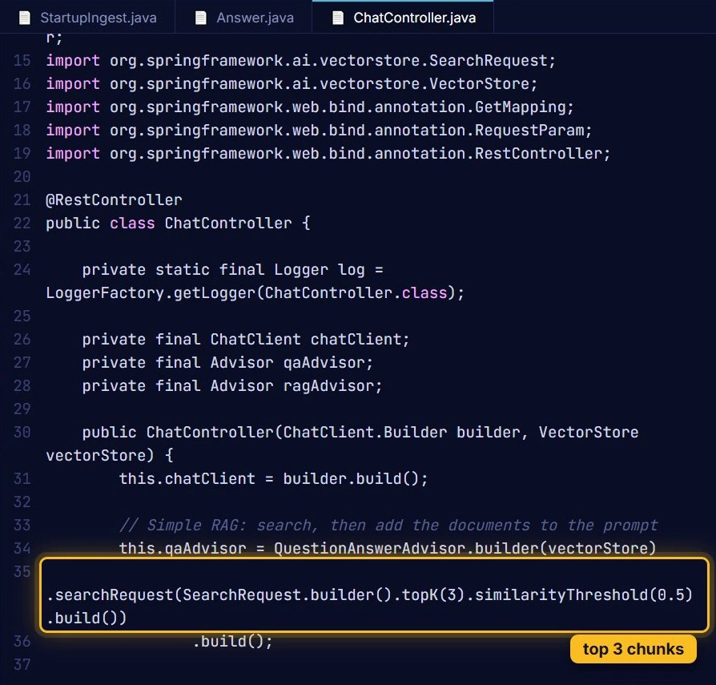

## Step 3: RetrievalAugmentationAdvisor

Same idea, built from blocks. A VectorStoreDocumentRetriever, with the same settings.

**`ChatController.java`** (continued):

```java
        // Modular RAG: every step is a building block you can swap
        this.ragAdvisor = RetrievalAugmentationAdvisor.builder()
                .documentRetriever(VectorStoreDocumentRetriever.builder()
                        .vectorStore(vectorStore)
                        .topK(3)
                        .similarityThreshold(0.5)
                        .build())
                .queryAugmenter(ContextualQueryAugmenter.builder()
                        .allowEmptyContext(false)
                        .build())
                .build();
    }
```

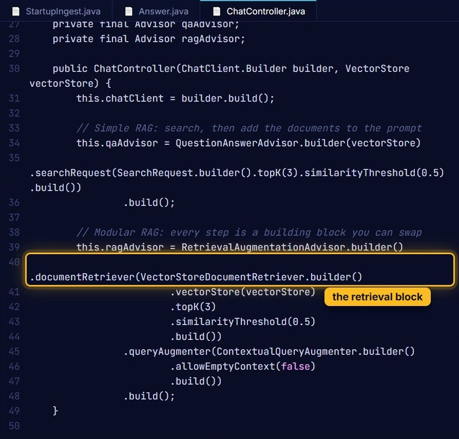

And a ContextualQueryAugmenter, with allowEmptyContext false. When no chunk is found, the model must decline.

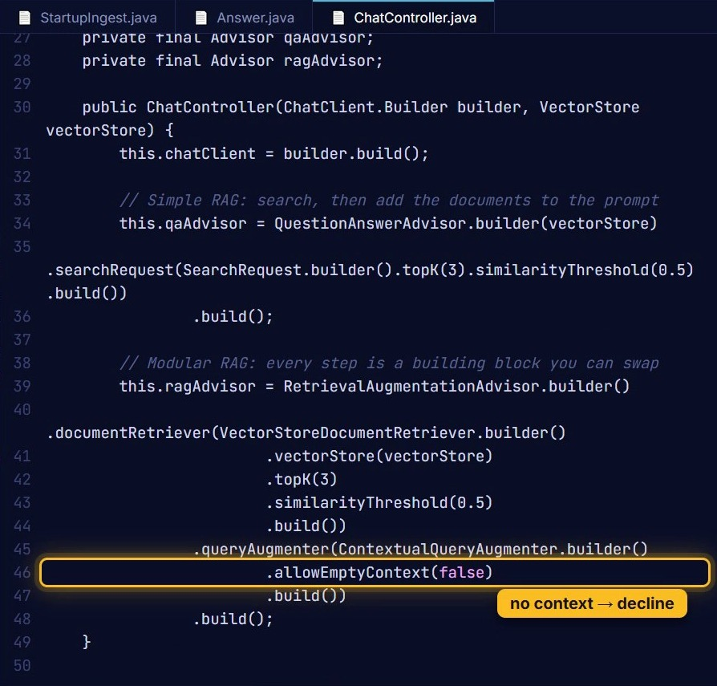

## Step 4: Three endpoints

Ask plain: no RAG at all, for comparison.

**`ChatController.java`** (continued):

```java
    @GetMapping("/ask/plain")
    public String plain(@RequestParam String q) {
        return chatClient.prompt().user(q).call().content();
    }
```

Ask QA and ask RAG call the same helper, with a different advisor, and the key where that advisor stores its documents.

**`ChatController.java`** (continued):

```java
    @GetMapping("/ask/qa")
    public Answer qa(@RequestParam String q) {
        return ask(q, qaAdvisor, QuestionAnswerAdvisor.RETRIEVED_DOCUMENTS);
    }

    @GetMapping("/ask/rag")
    public Answer rag(@RequestParam String q) {
        return ask(q, ragAdvisor, RetrievalAugmentationAdvisor.DOCUMENT_CONTEXT);
    }
```

The helper calls the model, and gets the chatClientResponse. Its context holds the retrieved documents. I log each one, with its score. Then I build the list of sources: file name, and page.

**`ChatController.java`** (continued):

```java
    @SuppressWarnings("unchecked")
    private Answer ask(String question, Advisor advisor, String documentsKey) {
        ChatClientResponse response = chatClient.prompt()
                .user(question)
                .advisors(advisor)
                .call()
                .chatClientResponse();
        List<Document> documents = (List<Document>) response.context().getOrDefault(documentsKey, List.of());
        documents.forEach(d -> log.info("RETRIEVED {} {}...", "%.2f".formatted(d.getScore()), "%.40s".formatted(d.getText())));
        List<String> sources = documents.stream()
                .map(d -> d.getMetadata().get("file_name") + " " + d.getMetadata().getOrDefault("page_number", ""))
                .map(String::strip)
                .toList();
        return new Answer(response.chatResponse().getResult().getOutput().getText(), sources);
    }
}
```

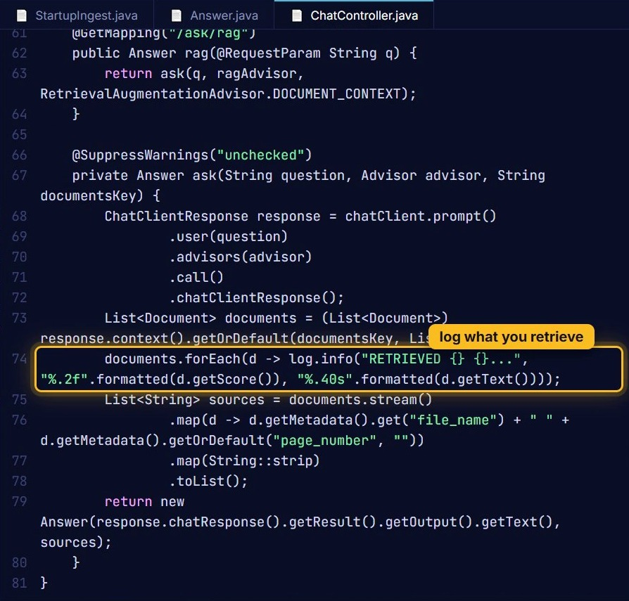

## Step 5: Run and debug

The app starts Postgres, and ingests our documents. First, no RAG.

```bash
$ ./mvnw spring-boot:run
...
Started DocsChatApplication in 5.5 seconds
LOAD 10 chunks into the vector store
```

```bash
$ curl "localhost:8080/ask/plain?q=How+many+vacation+days+do+I+get+at+Brightwave%3F"
Okay, let's break down the vacation time offered at
Brightwave. It's a bit nuanced, as it depends on your
role and tenure. ...

**Brightwave Vacation Time Structure:**
*   **0-6 Months:** 8 hours per month (40 hours
    per year)
*   **6+ Months:** 10 hours per month (52 hours
    per year)
...
**Disclaimer:** *I am an AI Chatbot and not an HR
professional. ...*
```

Gemma invents a full policy: eight hours per month, which it says is 40 hours per year. Even the math is wrong. And it took 44 seconds.

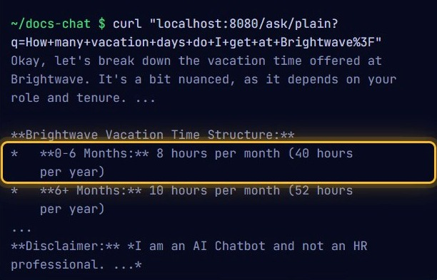

Now with the QuestionAnswerAdvisor.

```bash
$ curl "localhost:8080/ask/qa?q=How+many+vacation+days+do+I+get+at+Brightwave%3F"
{"answer":"The Brightwave Employee Handbook doesn't
specify the number of vacation days you get. It only
mentions parental leave (four weeks of fully paid leave
for every parent) and remote work policy.",
 "sources":["employee-handbook.pdf
1","employee-handbook.pdf 3","employee-handbook.pdf 2"]}
```

What? The handbook doesn't specify the number of vacation days. But it does, on page three! Interesting: the model says it only sees parental leave and remote work.

When a RAG answer is wrong, look at what was retrieved. Here's our log.

```bash
$ # application log
RETRIEVED 0.71 Brightwave Employee Handbook Welcome to ...
RETRIEVED 0.69 Parental leave Brightwave adds four week...
RETRIEVED 0.64 Remote work Remote work policy Employees...
```

The handbook intro, parental leave, and remote work. All three contain the word Brightwave, like our question. The vacation chunk isn't even in the top three.

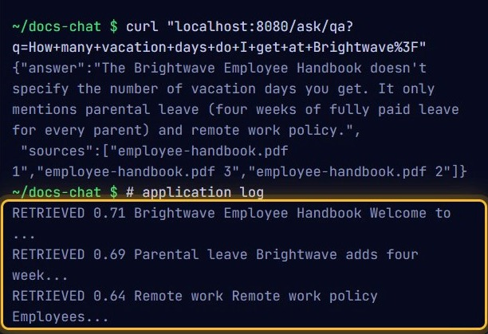

The fix: retrieve more chunks. I change topK to five, in both advisors.

**`ChatController.java`** (`src/main/java/dev/course/docs/ChatController.java`):

```java
package dev.course.docs;

import java.util.List;

import org.slf4j.Logger;
import org.slf4j.LoggerFactory;
import org.springframework.ai.chat.client.ChatClient;
import org.springframework.ai.chat.client.ChatClientResponse;
import org.springframework.ai.chat.client.advisor.api.Advisor;
import org.springframework.ai.chat.client.advisor.vectorstore.QuestionAnswerAdvisor;
import org.springframework.ai.document.Document;
import org.springframework.ai.rag.advisor.RetrievalAugmentationAdvisor;
import org.springframework.ai.rag.generation.augmentation.ContextualQueryAugmenter;
import org.springframework.ai.rag.retrieval.search.VectorStoreDocumentRetriever;
import org.springframework.ai.vectorstore.SearchRequest;
import org.springframework.ai.vectorstore.VectorStore;
import org.springframework.web.bind.annotation.GetMapping;
import org.springframework.web.bind.annotation.RequestParam;
import org.springframework.web.bind.annotation.RestController;

@RestController
public class ChatController {

    private static final Logger log = LoggerFactory.getLogger(ChatController.class);

    private final ChatClient chatClient;
    private final Advisor qaAdvisor;
    private final Advisor ragAdvisor;

    public ChatController(ChatClient.Builder builder, VectorStore vectorStore) {
        this.chatClient = builder.build();

        // Simple RAG: search, then add the documents to the prompt
        this.qaAdvisor = QuestionAnswerAdvisor.builder(vectorStore)
                .searchRequest(SearchRequest.builder().topK(5).similarityThreshold(0.5).build())
                .build();

        // Modular RAG: every step is a building block you can swap
        this.ragAdvisor = RetrievalAugmentationAdvisor.builder()
                .documentRetriever(VectorStoreDocumentRetriever.builder()
                        .vectorStore(vectorStore)
                        .topK(5)
                        .similarityThreshold(0.5)
                        .build())
                .queryAugmenter(ContextualQueryAugmenter.builder()
                        .allowEmptyContext(false)
                        .build())
                .build();
    }

    @GetMapping("/ask/plain")
    public String plain(@RequestParam String q) {
        return chatClient.prompt().user(q).call().content();
    }

    @GetMapping("/ask/qa")
    public Answer qa(@RequestParam String q) {
        return ask(q, qaAdvisor, QuestionAnswerAdvisor.RETRIEVED_DOCUMENTS);
    }

    @GetMapping("/ask/rag")
    public Answer rag(@RequestParam String q) {
        return ask(q, ragAdvisor, RetrievalAugmentationAdvisor.DOCUMENT_CONTEXT);
    }

    @SuppressWarnings("unchecked")
    private Answer ask(String question, Advisor advisor, String documentsKey) {
        ChatClientResponse response = chatClient.prompt()
                .user(question)
                .advisors(advisor)
                .call()
                .chatClientResponse();
        List<Document> documents = (List<Document>) response.context().getOrDefault(documentsKey, List.of());
        documents.forEach(d -> log.info("RETRIEVED {} {}...", "%.2f".formatted(d.getScore()), "%.40s".formatted(d.getText())));
        List<String> sources = documents.stream()
                .map(d -> d.getMetadata().get("file_name") + " " + d.getMetadata().getOrDefault("page_number", ""))
                .map(String::strip)
                .toList();
        return new Answer(response.chatResponse().getResult().getOutput().getText(), sources);
    }
}
```

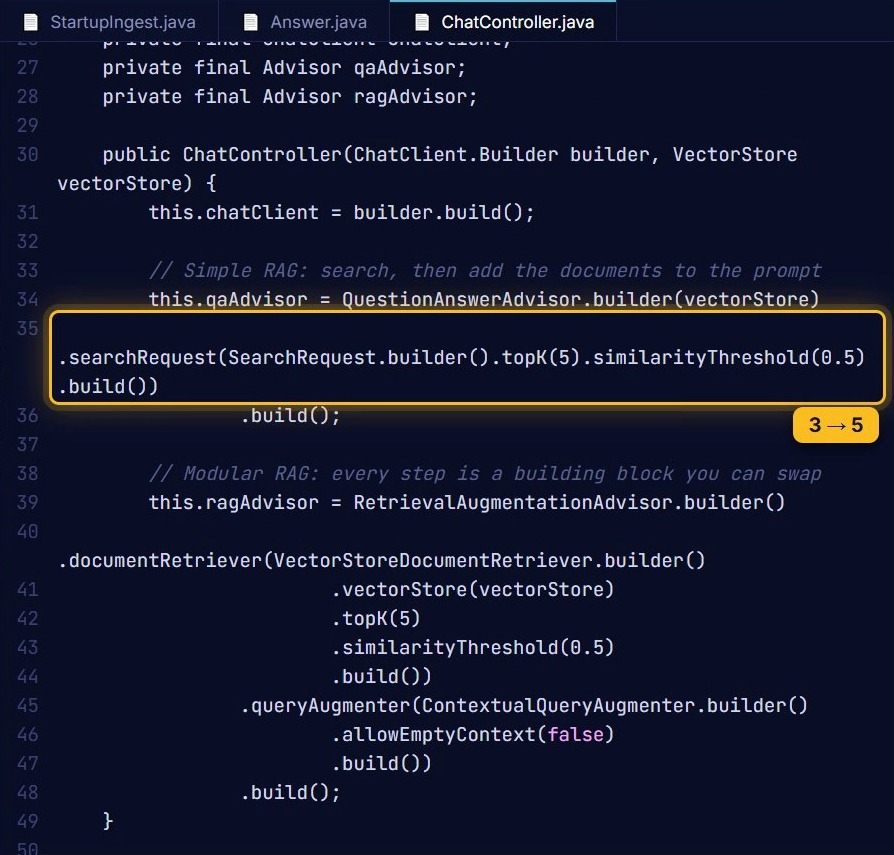

And the same question again.

```bash
$ curl "localhost:8080/ask/qa?q=How+many+vacation+days+do+I+get+at+Brightwave%3F"
{"answer":"Full-time employees at Brightwave get 27
vacation days per year, plus public holidays.",
 "sources":[...5 chunks]}
```

```bash
$ # application log
RETRIEVED 0.71 Brightwave Employee Handbook Welcome to ...
RETRIEVED 0.69 Parental leave Brightwave adds four week...
RETRIEVED 0.64 Remote work Remote work policy Employees...
RETRIEVED 0.60 Passwords expire every 180 days. Reset y...
RETRIEVED 0.59 Time off Vacation days Full-time employe...
```

27 vacation days. Correct. And the log shows why: the vacation chunk came in fifth, with 0.59.

The modular advisor gives the same answer.

```bash
$ curl "localhost:8080/ask/rag?q=How+many+vacation+days+do+I+get+at+Brightwave%3F"
{"answer":"Full-time employees get 27 vacation days per
year, plus public holidays.",
 "sources":[...5 chunks]}
```

Can I work from home on Tuesday? Both are right: Tuesday is the team day. The QuestionAnswerAdvisor explains. The other one just says: no. Correct, but terse. You can give its augmenter your own prompt template.

```bash
$ curl "localhost:8080/ask/qa?q=Can+I+work+from+home+on+Tuesday%3F"
{"answer":"No, you cannot work from home on Tuesday as
it is our team day and everyone is required to be in the
office.",
 "sources":["employee-handbook.pdf 2"]}
```

```bash
$ curl "localhost:8080/ask/rag?q=Can+I+work+from+home+on+Tuesday%3F"
{"answer":"No.",
 "sources":["employee-handbook.pdf 2"]}
```

And outside our documents: what is the capital of Australia? The QuestionAnswerAdvisor answers from memory: Canberra. The modular one declines, as configured.

```bash
$ curl "localhost:8080/ask/qa?q=What+is+the+capital+of+Australia%3F"
{"answer":"The capital of Australia is Canberra.",
 "sources":[]}
```

```bash
$ curl "localhost:8080/ask/rag?q=What+is+the+capital+of+Australia%3F"
{"answer":"I'm sorry, but I don't have the information
to answer your question. My knowledge base is limited,
and this particular topic falls outside of it. ...",
 "sources":[]}
```

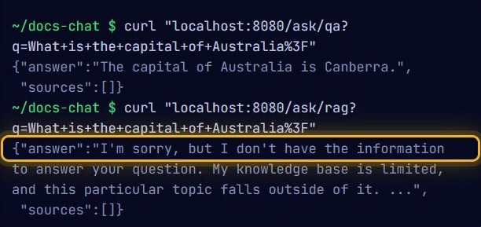

## 3 pro tips

Always log the retrieved chunks and their scores. That's how we found our bug in one minute.

Show the sources to your users, so they can check the answer.

And keep a list of test questions, with the expected answers. Rerun it after every change to chunks, models or topK. We'll automate that with evaluations in section seven.

- **Log retrieval**: Chunks + scores, every time
- **Show sources**: Users can check the answer
- **Test questions**: Rerun after every change

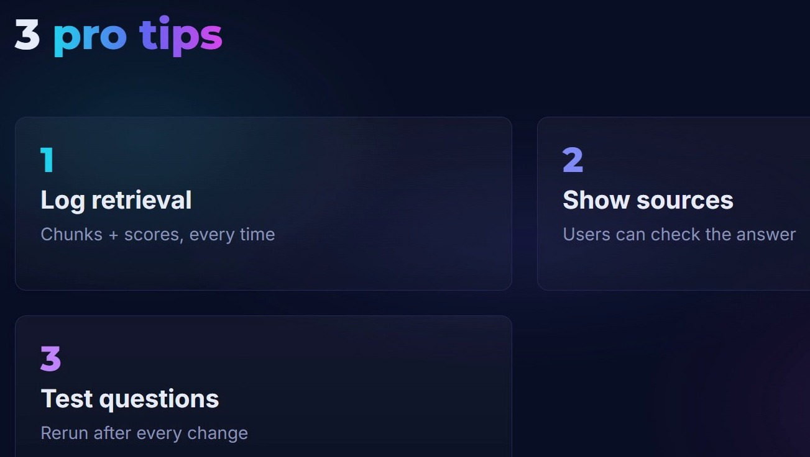

## Your challenge

Your challenge: give the ContextualQueryAugmenter your own prompt template, so its answers are complete sentences, and always end with the source.

Then build the section four challenge: a chat with your own documentation, with an evaluation set of ten questions.

- **Your own prompt**: Full sentences + the source
- **Section 4 challenge**: Chat with your docs + 10 test questions

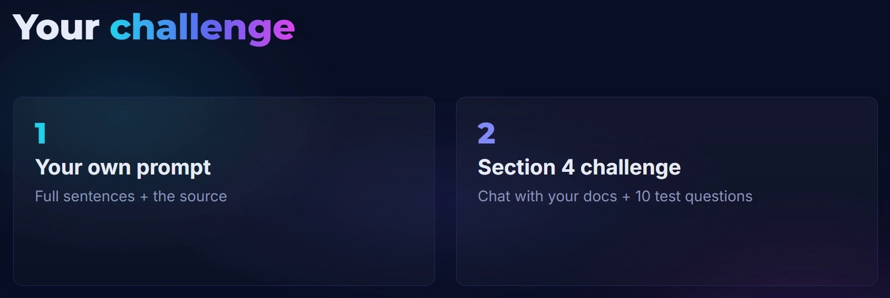

## Recap

- Two advisors: **simple** QA, or **modular** RAG
- `allowEmptyContext(false)`: decline when **nothing** is found
- Wrong answer? **Log retrieval**, then tune topK and chunks

## Get the code and the quiz

- **Code for this lab**: https://github.com/NEDBS12/youtube-tuto/tree/main/spring-ai-course/labs/docs-chat
- **All course code, quizzes and resources**: https://github.com/NEDBS12/youtube-tuto/tree/main/spring-ai-course
- **Section 4 eval and lesson quizzes**: https://nedbs12.github.io/youtube-tuto/spring-ai-course/quiz/
- **Ollama**: https://ollama.com
- **Spring AI RAG docs**: https://docs.spring.io/spring-ai/reference/api/retrieval-augmented-generation.html
- **Spring AI reference docs**: https://docs.spring.io/spring-ai/reference/

🎥 **Watch the video tutorial:** {VIDEO_URL}

**Previous: Lesson 4.4, RAG advisors. Section 4 is complete: take the Section 4 eval (link above) to check your level!**

*The editor and terminal in the screenshots are a simplified recreation; the code and the outputs come from real runs of the lab.*

*I'm Zero Cost AI: I build AI tools and tutorials and share them for free. Follow me on Medium for the next lessons, and subscribe on YouTube: https://www.youtube.com/@zerocostai-f1h*
