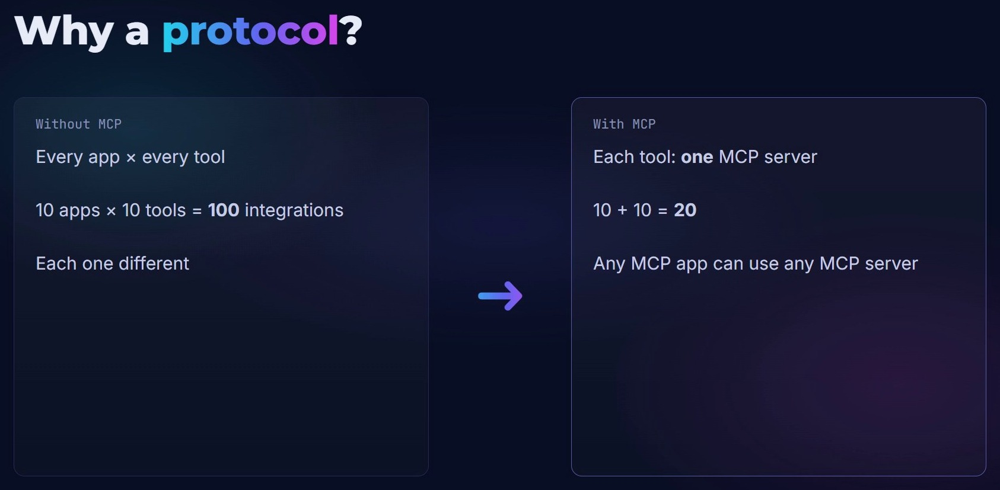
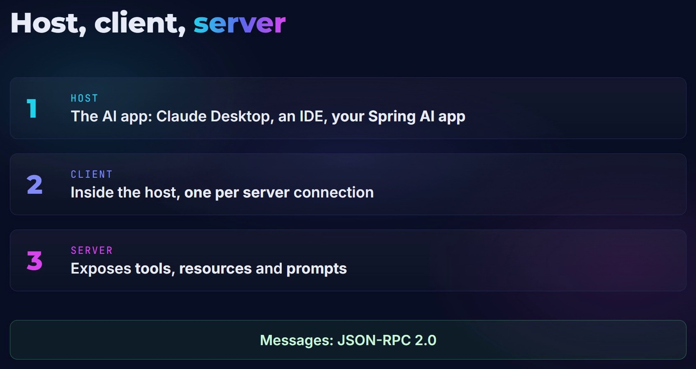
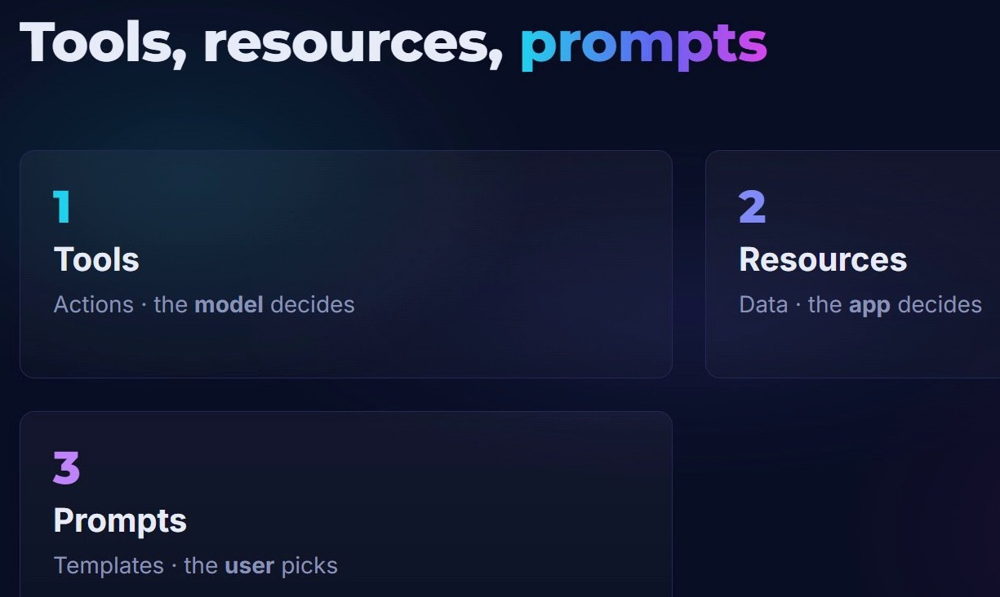
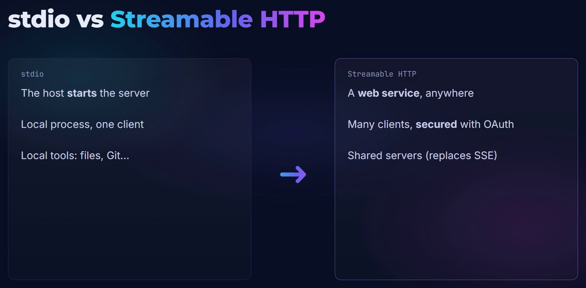
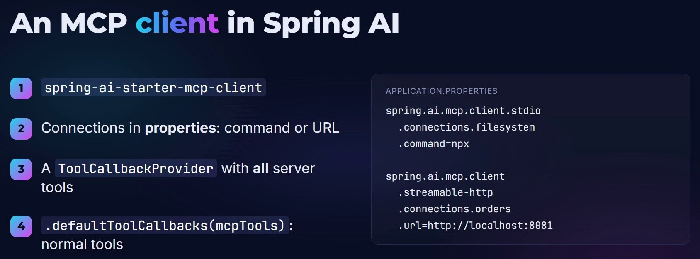
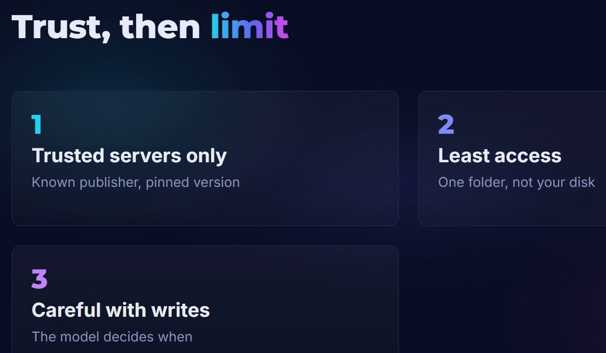

In section three, we wrote tools inside our own app. But what if the tools already exist, in another app, written by another team, maybe in another language?

Welcome to section five: MCP, the Model Context Protocol. A standard way to connect AI apps to tools and data.

It's lesson 5.1 of my free **Spring AI: Novice to Expert** course, where every lesson has a concept part and a hands-on lab, and everything runs on a free local model with Ollama.

🎥 **Prefer video?** Watch the full tutorial here:

{VIDEO}

## Why a protocol?

Here's the problem MCP solves.

Without a standard, every AI app writes its own integration for every tool: files, GitHub, databases, Slack. Ten apps and ten tools: 100 integrations.

With MCP, each tool is written once, as an MCP server. And every AI app that speaks MCP can use it. Ten plus ten. People call it the USB-C port for AI.

### Without MCP

- Every app × every tool
- 10 apps × 10 tools = **100** integrations
- Each one different

### With MCP

- Each tool: **one** MCP server
- 10 + 10 = **20**
- Any MCP app can use any MCP server



## Host, client, server

MCP has three roles.

The host: the AI application the user works with. Claude Desktop, an IDE, or your own Spring AI app.

The client: lives inside the host. One client per server connection. It speaks the protocol.

The server: a program that exposes capabilities, like your orders, your files, or a database.

Messages are JSON-RPC 2.0. You'll see them for real in lab 5.2.

- **Host**: The AI app: Claude Desktop, an IDE, **your Spring AI app**
- **Client**: Inside the host, **one per server** connection
- **Server**: Exposes **tools**, **resources** and **prompts**

**Messages: JSON-RPC 2.0**



## Tools, resources, prompts

A server can offer three kinds of things. The difference is who controls them.

Tools: actions, like find order. The model decides when to call them, like in section three.

Resources: data, like a return policy or a file. The application decides what to read, and what to give the model.

Prompts: reusable prompt templates, like: write an order update email. The user picks them, often from a menu.

- **Tools**: Actions · the **model** decides
- **Resources**: Data · the **app** decides
- **Prompts**: Templates · the **user** picks



## stdio vs Streamable HTTP

And two transports, for how client and server talk.

Standard input and output, stdio: the host starts the server as a local process, and talks through its input and output. Great for local tools, like files on your machine.

Streamable HTTP: the server runs as a web service, anywhere, for many clients. That's how you share a server across a company. It replaces the older SSE transport.

### stdio

- The host **starts** the server
- Local process, one client
- Local tools: files, Git...

### Streamable HTTP

- A **web service**, anywhere
- Many clients, **secured** with OAuth
- Shared servers (replaces SSE)



## An MCP client in Spring AI

In Spring AI, you become an MCP host with one starter.

Add the MCP client starter.

Describe your connections in properties: a command for stdio, a URL for HTTP.

Spring AI connects at startup, and gives you a ToolCallbackProvider with every tool of every server.

Pass it to the ChatClient. MCP tools are now normal tools, so you need a tool-capable model, like Qwen.

- `spring-ai-starter-mcp-client`
- Connections in **properties**: command or URL
- A `ToolCallbackProvider` with **all** server tools
- `.defaultToolCallbacks(mcpTools)`: normal tools

In code:

```properties
spring.ai.mcp.client.stdio
  .connections.filesystem
  .command=npx

spring.ai.mcp.client
  .streamable-http
  .connections.orders
  .url=http://localhost:8081
```



## Trust, then limit

One warning. An MCP server is code that runs with your permissions, and sees your data.

Only use servers you trust, from known publishers, at a fixed version.

Give them as little access as possible, like one folder, not your whole disk.

And be careful with write tools. The model decides when to call them.

- **Trusted servers only**: Known publisher, pinned version
- **Least access**: One folder, not your disk
- **Careful with writes**: The model decides when



## Recap

- MCP: **one** standard to connect AI apps to tools and data
- **Host**, **client**, **server**; tools, resources, prompts
- **stdio** for local, **Streamable HTTP** for shared servers

## Quick quiz

Test yourself before you read the answers.

1. **Roles**: Your Spring AI app uses an MCP server. Which role is your app?
2. **Control**: Who decides when a tool is called?
3. **Transport**: A shared server, used by many apps over the network?

**Answers:**

1. The **host** (with a client inside)
2. The **model**
3. **Streamable HTTP**

The full five-question quiz for this lesson is free on the course quiz page: https://nedbs12.github.io/youtube-tuto/spring-ai-course/quiz/

## Get the code and the quiz

- **Lab code for this lesson**: https://github.com/NEDBS12/youtube-tuto/tree/main/spring-ai-course/labs/mcp-files-client
- **All course code, quizzes and resources**: https://github.com/NEDBS12/youtube-tuto/tree/main/spring-ai-course
- **Lesson quiz and section evals**: https://nedbs12.github.io/youtube-tuto/spring-ai-course/quiz/
- **Model Context Protocol**: https://modelcontextprotocol.io
- **Spring AI MCP overview**: https://docs.spring.io/spring-ai/reference/api/mcp/mcp-overview.html
- **Spring AI reference docs**: https://docs.spring.io/spring-ai/reference/

🎥 **Watch the video tutorial:** {VIDEO_URL}

**Previous: Lab 4.4 (Section 4 complete). Next: Lab 5.1, connect an existing MCP server.**

*I'm Zero Cost AI: I build AI tools and tutorials and share them for free. Follow me on Medium for the next lessons, and subscribe on YouTube: https://www.youtube.com/@zerocostai-f1h*
