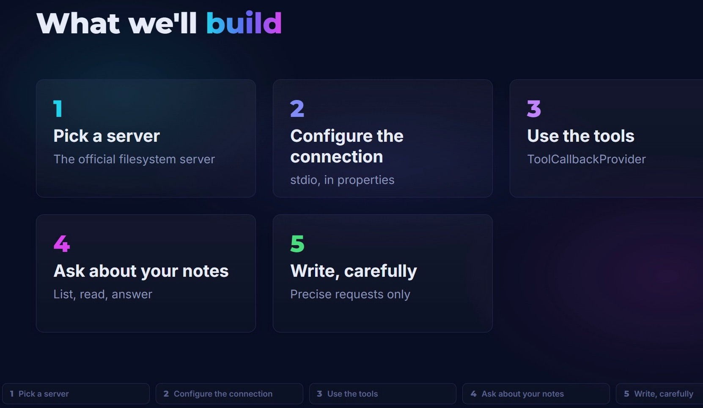
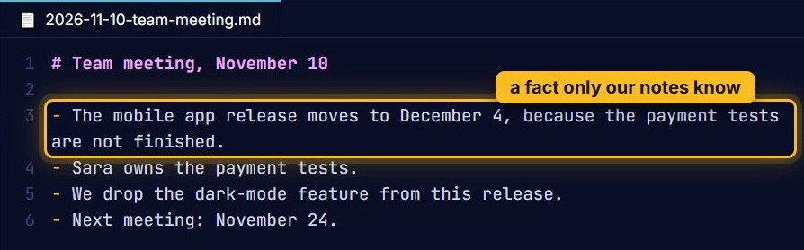
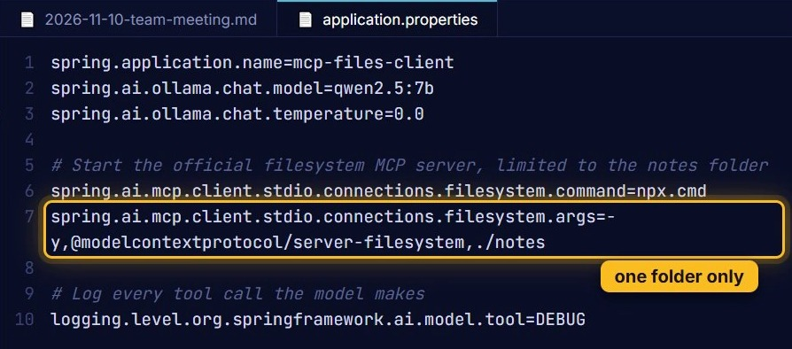
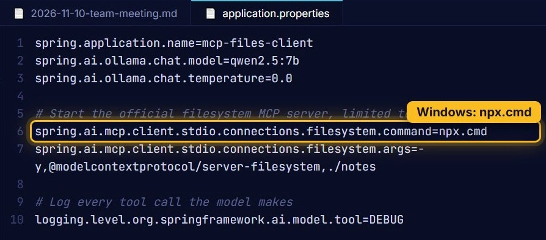
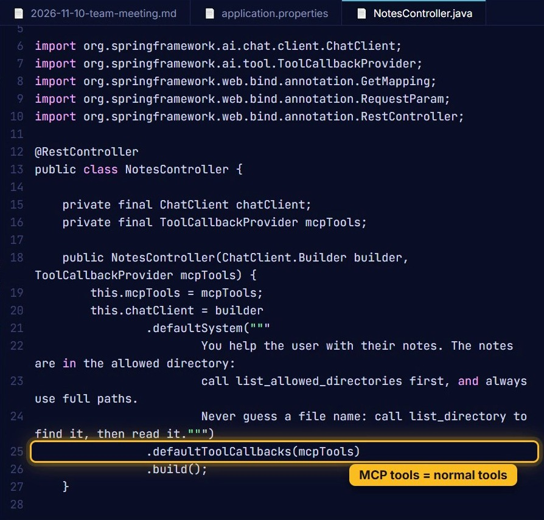
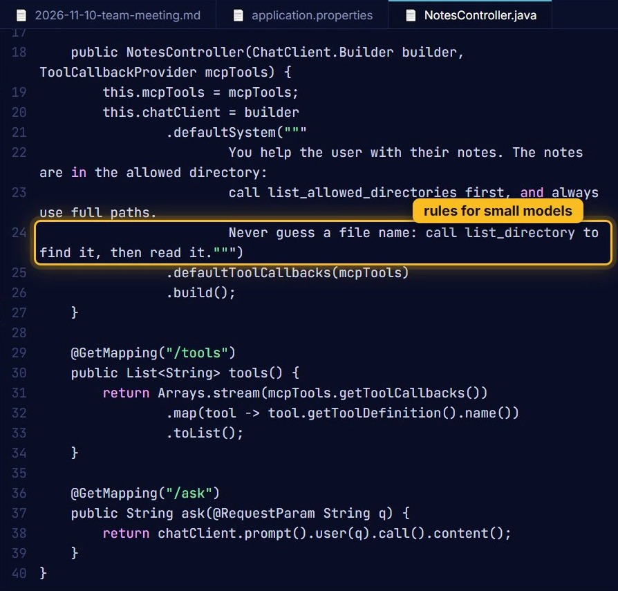
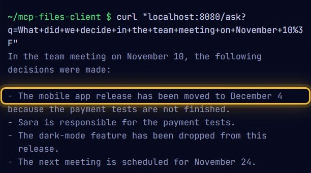
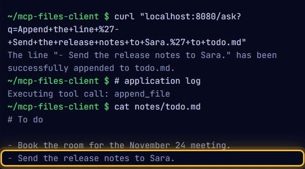
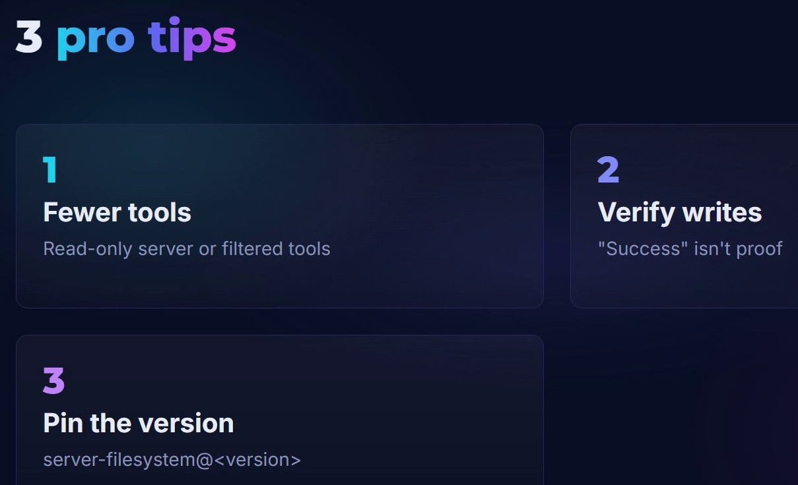
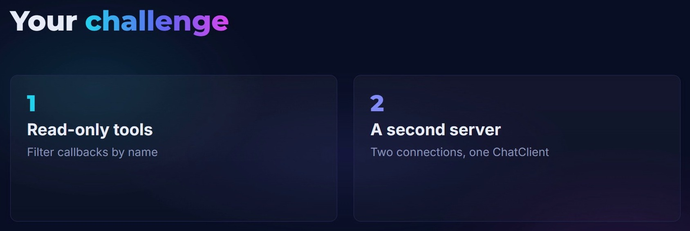

Today, your Spring AI app will use an MCP server written by someone else: the official filesystem server, from the MCP project.

16 file tools, without writing a single one. And you'll see what can go wrong.

It's lab 5.1 of my free **Spring AI: Novice to Expert** course, where every lesson has a concept part and a hands-on lab, and everything runs on a free local model with Ollama.

🎥 **Prefer video?** Watch the full tutorial here:

{VIDEO}

## What we'll build

Pick a server. Configure the connection. Use its tools in a ChatClient. Ask about our notes. And write a file, carefully.

1. **Pick a server**: The official filesystem server
2. **Configure the connection**: stdio, in properties
3. **Use the tools**: ToolCallbackProvider
4. **Ask about your notes**: List, read, answer
5. **Write, carefully**: Precise requests only



## Step 1: Pick a server

The filesystem server is published by the MCP project, on npm. You need Node installed. The host starts it with npx, and gives it one folder: our notes.

**`2026-11-10-team-meeting.md`** (`notes/2026-11-10-team-meeting.md`):

```markdown
# Team meeting, November 10

- The mobile app release moves to December 4, because the payment tests are not finished.
- Sara owns the payment tests.
- We drop the dark-mode feature from this release.
- Next meeting: November 24.
```

Three Markdown notes. A meeting, some ideas, and a to do list. The model has never seen them.



## Step 2: Configure the connection

The project has three starters: Spring Web, Ollama, and the MCP client.

**pom.xml**

- **spring-boot-starter-webmvc**: REST endpoints
- **spring-ai-starter-model-ollama**: the chat model
- **spring-ai-starter-mcp-client**: the MCP client

A stdio connection named filesystem: the command, and its arguments. Dash y, the package name, and the only folder it may touch: `./notes`.

**`application.properties`** (`src/main/resources/application.properties`):

```properties
spring.application.name=mcp-files-client
spring.ai.ollama.chat.model=qwen2.5:7b
spring.ai.ollama.chat.temperature=0.0

# Start the official filesystem MCP server, limited to the notes folder
spring.ai.mcp.client.stdio.connections.filesystem.command=npx.cmd
spring.ai.mcp.client.stdio.connections.filesystem.args=-y,@modelcontextprotocol/server-filesystem,./notes

# Log every tool call the model makes
logging.level.org.springframework.ai.model.tool=DEBUG
```



On Windows, the command is `npx.cmd`. On Mac and Linux, just npx. The model is Qwen seven B. More on that choice in a minute. And debug logging shows every tool call.



## Step 3: Use the tools

The MCP client starter gives us a ToolCallbackProvider, with every tool of every connected server. I pass it to the ChatClient as default tools.

**`NotesController.java`**:

```java
package dev.course.files;

import java.util.Arrays;
import java.util.List;

import org.springframework.ai.chat.client.ChatClient;
import org.springframework.ai.tool.ToolCallbackProvider;
import org.springframework.web.bind.annotation.GetMapping;
import org.springframework.web.bind.annotation.RequestParam;
import org.springframework.web.bind.annotation.RestController;

@RestController
public class NotesController {

    private final ChatClient chatClient;
    private final ToolCallbackProvider mcpTools;

    public NotesController(ChatClient.Builder builder, ToolCallbackProvider mcpTools) {
        this.mcpTools = mcpTools;
        this.chatClient = builder
                .defaultSystem("""
                        You help the user with their notes. The notes are in the allowed directory:
                        call list_allowed_directories first, and always use full paths.
                        Never guess a file name: call list_directory to find it, then read it.""")
                .defaultToolCallbacks(mcpTools)
                .build();
    }
```



The system prompt matters a lot here. I'll show you why. Then `/tools` lists the tool names, and `/ask` sends a question.

**`NotesController.java`** (continued):

```java
    @GetMapping("/tools")
    public List<String> tools() {
        return Arrays.stream(mcpTools.getToolCallbacks())
                .map(tool -> tool.getToolDefinition().name())
                .toList();
    }

    @GetMapping("/ask")
    public String ask(@RequestParam String q) {
        return chatClient.prompt().user(q).call().content();
    }
}
```

I start the app. Spring AI starts the server process, and connects. `/tools`: 16 tools, from read file to list allowed directories.

```bash
$ ./mvnw spring-boot:run
...
MCP server starting.
Secure MCP Filesystem Server running on stdio
Started McpFilesClientApplication in 5.1 seconds
```

```bash
$ curl localhost:8080/tools
["read_file","read_text_file","read_media_file","read_mu
ltiple_files","write_file","append_file","edit_file","cr
eate_directory","list_directory","list_directory_with_si
zes","directory_tree","move_file","copy_file","search_fi
les","get_file_info","list_allowed_directories"]
```

## Step 4: Ask about your notes

My first try used Qwen three B and a one-line system prompt. Here's what happened.

**First try · qwen2.5:3b · real log**

> list_directory("notes") → ENOENT: no such file or directory, scandir '... otes otes'. Answer: "It seems that the directory 'notes' does not exist."

The model asked for a folder called notes. But the server's root already is the notes folder. Small models don't know where a server's files live.

So the system prompt says: call list allowed directories first, use full paths, and never guess a file name. And I switched to Qwen seven B, which follows those rules much better.



Now: which files are in my notes?

```bash
$ curl "localhost:8080/ask?q=Which+files+are+in+my+notes%3F"
The files in your notes directory are:

- `2026-11-10-team-meeting.md`
- `ideas.md`
- `todo.md`
```

```bash
$ # application log
Executing tool call: list_allowed_directories
Executing tool call: list_directory
```

Correct. The log shows two tool calls: the allowed directory, then the listing. And: what did we decide in the team meeting on November tenth?

```bash
$ curl "localhost:8080/ask?q=What+did+we+decide+in+the+team+meeting+on+November+10%3F"
In the team meeting on November 10, the following
decisions were made:

- The mobile app release has been moved to December 4
because the payment tests are not finished.
- Sara is responsible for the payment tests.
- The dark-mode feature has been dropped from this
  release.
- The next meeting is scheduled for November 24.
```

Release moved to December fourth, Sara owns the tests, dark mode dropped. All from our file. It listed the folder, found the exact name, and read it. It took 30 seconds on my machine.



## Step 5: Write, carefully

Here's another real test. I asked: add send the release notes to Sara to my todo list.

**Vague request · real result**

- **1st write_file**: C:\home\user\todo.txt → Access denied
- **2nd write_file**: notes\todo.txt (a new file!)
- **Answer**: "successfully added to the todo list"

The model first tried a path outside the folder, and the server refused: access denied. That's the folder limit protecting my disk. Then it created a new file, `todo.txt`, and said: success. Our real list, `todo.md`, was untouched.

With a precise request: append this line to `todo.md`.

```bash
$ curl "localhost:8080/ask?q=Append+the+line+%27-+Send+the+release+notes+to+Sara.%27+to+todo.md"
The line "- Send the release notes to Sara." has been
successfully appended to todo.md.
```

```bash
$ # application log
Executing tool call: append_file
```

This time, one tool call: append file, on the right file. Don't trust the answer, check the file. It's there.

```bash
$ cat notes/todo.md
# To do

- Book the room for the November 24 meeting.
- Send the release notes to Sara.
```



## 3 pro tips

16 tools is a lot for a small model. If you only need to read, prefer a read-only server, or filter the tools you give to the ChatClient.

Always check the result of a write, in code or by reading it back. In my tests, the model reported success every time. Twice, it had written the wrong file.

And pin the server version in production. Dash y with no version always downloads the latest one.

- **Fewer tools**: Read-only server or filtered tools
- **Verify writes**: "Success" isn't proof
- **Pin the version**: server-filesystem@<version>



## Your challenge

Your challenge: give the ChatClient only the read tools. Filter the tool callbacks by name. Then ask it to edit a file, and check that it can't.

Then connect a second MCP server, from the official list, next to the filesystem server. One client per connection.

- **Read-only tools**: Filter callbacks by name
- **A second server**: Two connections, one ChatClient



## Recap

- MCP client starter + a **connection** in properties
- `ToolCallbackProvider` → **all** server tools in your ChatClient
- Small models: **clear rules**, precise requests, verify writes

## Get the code and the quiz

- **Code for this lab**: https://github.com/NEDBS12/youtube-tuto/tree/main/spring-ai-course/labs/mcp-files-client
- **All course code, quizzes and resources**: https://github.com/NEDBS12/youtube-tuto/tree/main/spring-ai-course
- **Lesson quiz and section evals**: https://nedbs12.github.io/youtube-tuto/spring-ai-course/quiz/
- **Spring AI MCP client docs**: https://docs.spring.io/spring-ai/reference/api/mcp/mcp-client-boot-starter-docs.html
- **Filesystem MCP server**: https://github.com/modelcontextprotocol/servers/tree/main/src/filesystem
- **Spring AI reference docs**: https://docs.spring.io/spring-ai/reference/

🎥 **Watch the video tutorial:** {VIDEO_URL}

**Previous: Lesson 5.1, what is MCP. Next: Lesson 5.2, build an MCP server.**

*The editor and terminal in the screenshots are a simplified recreation; the code and the outputs come from real runs of the lab.*

*I'm Zero Cost AI: I build AI tools and tutorials and share them for free. Follow me on Medium for the next lessons, and subscribe on YouTube: https://www.youtube.com/@zerocostai-f1h*
