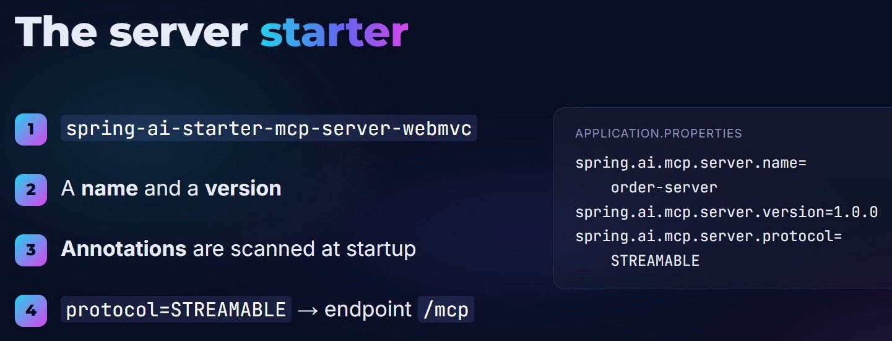
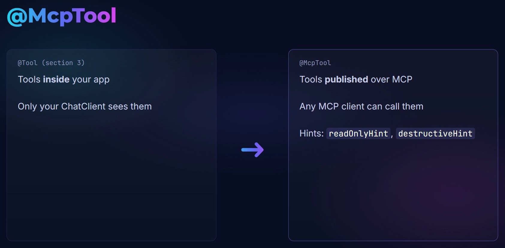
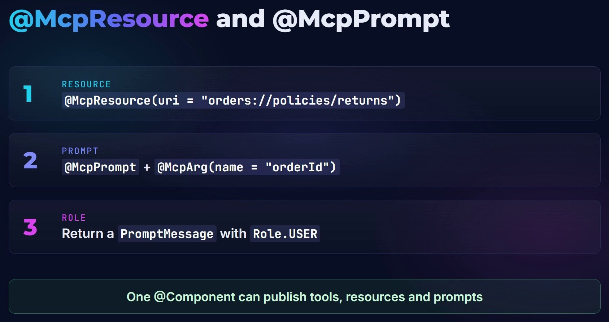
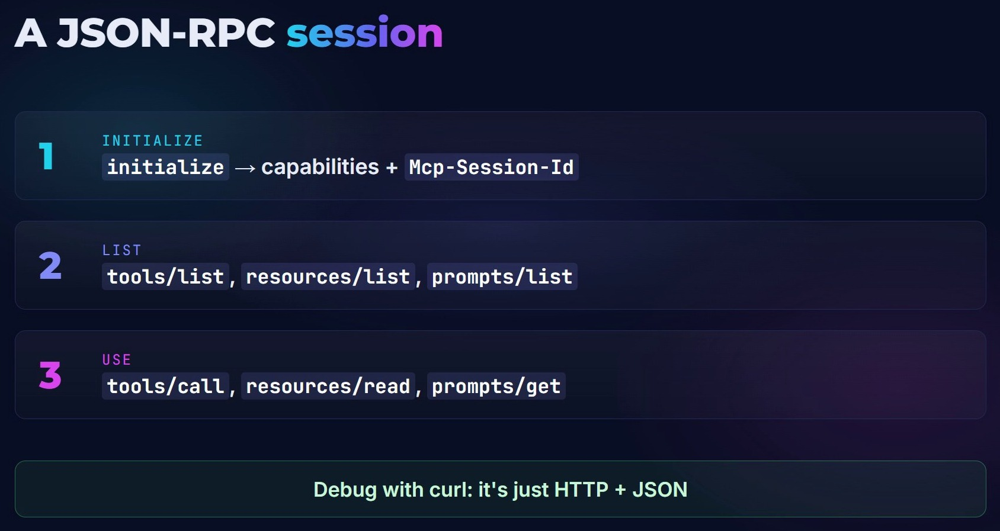
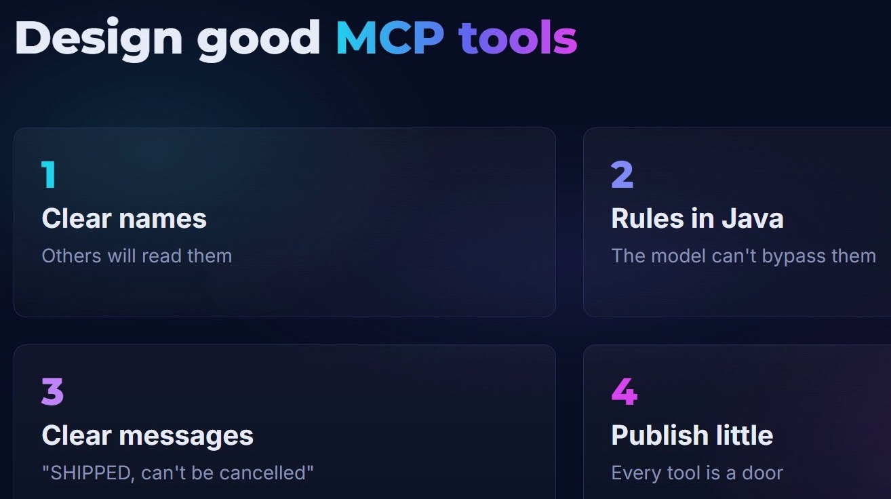

In lab 5.1, we used a server someone else wrote. Now, let's build our own: the orders of our tech shop, as an MCP server, ready for any MCP app.

In this lesson: the server starter, and the three annotations: McpTool, McpResource and McpPrompt.

It's lesson 5.2 of my free **Spring AI: Novice to Expert** course, where every lesson has a concept part and a hands-on lab, and everything runs on a free local model with Ollama.

🎥 **Prefer video?** Watch the full tutorial here:

{VIDEO}

## The server starter

A Spring AI MCP server is a normal Spring Boot app.

Add the MCP server starter. For a web app, that's the WebMVC variant.

Give the server a name and a version. Clients see them when they connect.

At startup, Spring AI scans your beans for MCP annotations, and registers them.

And set the protocol to STREAMABLE. In my tests, without it, the server exposed the old SSE endpoint, and `/mcp` returned a 404.

- `spring-ai-starter-mcp-server-webmvc`
- A **name** and a **version**
- **Annotations** are scanned at startup
- `protocol=STREAMABLE` → endpoint `/mcp`

In code:

```properties
spring.ai.mcp.server.name=
    order-server
spring.ai.mcp.server.version=1.0.0
spring.ai.mcp.server.protocol=
    STREAMABLE
```



## @McpTool

Tools first. You know the Tool annotation from section three. McpTool looks almost the same.

The difference: Tool gives a method to the model inside your own app. McpTool publishes it over the protocol, for any client. Its parameters use McpToolParam.

MCP tools also carry hints for clients: read only, or destructive. Careful: by default, Spring AI marked our find order tool as destructive. Set read only hint, so clients can trust it.

### @Tool (section 3)

- Tools **inside** your app
- Only your ChatClient sees them

### @McpTool

- Tools **published** over MCP
- Any MCP client can call them
- Hints: `readOnlyHint`, `destructiveHint`



## @McpResource and @McpPrompt

Then resources and prompts.

McpResource publishes data under a URI, like `orders://policies/returns`, with a MIME type. The client app reads it, and decides what to do with it.

McpPrompt publishes a prompt template. Its arguments use McpArg. The user picks it, the client fills in the arguments.

Return a PromptMessage with the user role. When I returned a plain String, the message came back with the assistant role.

One component can publish all three.

- **Resource**: `@McpResource(uri = "orders://policies/returns")`
- **Prompt**: `@McpPrompt` + `@McpArg(name = "orderId")`
- **Role**: Return a `PromptMessage` with `Role.USER`

**One @Component can publish tools, resources and prompts**



## A JSON-RPC session

Under the hood, it's all JSON RPC. A session looks like this.

Initialize: the client says hello, and the server answers with its name and capabilities. And a session id, in a header.

Then list: `tools/list`, `resources/list`, `prompts/list`.

And use: `tools/call`, `resources/read`, `prompts/get`. In the lab, we'll send these with curl.

Knowing the protocol makes debugging much easier.

- **Initialize**: `initialize` → capabilities + `Mcp-Session-Id`
- **List**: `tools/list`, `resources/list`, `prompts/list`
- **Use**: `tools/call`, `resources/read`, `prompts/get`

**Debug with curl: it's just HTTP + JSON**



## Design good MCP tools

Four rules for good MCP tools.

Clear names and descriptions. Other teams, and other models, will read them.

Business rules in Java. Only orders in processing can be cancelled, and the model can't change that.

Return clear messages, like: this order is shipped and can't be cancelled. The model can explain it to the user.

And publish only what clients need. Every tool is a door into your system.

- **Clear names**: Others will read them
- **Rules in Java**: The model can't bypass them
- **Clear messages**: "SHIPPED, can't be cancelled"
- **Publish little**: Every tool is a door



## Recap

- The server starter + **protocol=STREAMABLE** → `/mcp`
- `@McpTool`, `@McpResource`, `@McpPrompt` on one component
- Set **hints**, keep rules in Java

## Quick quiz

Test yourself before you read the answers.

1. **Annotation**: Which annotation publishes a method as an MCP tool?
2. **Resource**: Who decides when a resource is read?
3. **Rules**: Where do you enforce 'only PROCESSING orders can be cancelled'?

**Answers:**

1. `@McpTool`
2. The **client application**
3. In **Java**, inside the tool

The full five-question quiz for this lesson is free on the course quiz page: https://nedbs12.github.io/youtube-tuto/spring-ai-course/quiz/

## Get the code and the quiz

- **Lab code for this lesson**: https://github.com/NEDBS12/youtube-tuto/tree/main/spring-ai-course/labs/order-mcp-server
- **All course code, quizzes and resources**: https://github.com/NEDBS12/youtube-tuto/tree/main/spring-ai-course
- **Lesson quiz and section evals**: https://nedbs12.github.io/youtube-tuto/spring-ai-course/quiz/
- **Spring AI MCP server docs**: https://docs.spring.io/spring-ai/reference/api/mcp/mcp-server-boot-starter-docs.html
- **Spring AI MCP annotations**: https://docs.spring.io/spring-ai/reference/api/mcp/mcp-annotations-overview.html
- **Spring AI reference docs**: https://docs.spring.io/spring-ai/reference/

🎥 **Watch the video tutorial:** {VIDEO_URL}

**Previous: Lab 5.1. Next: Lab 5.2, an MCP server for orders.**

*I'm Zero Cost AI: I build AI tools and tutorials and share them for free. Follow me on Medium for the next lessons, and subscribe on YouTube: https://www.youtube.com/@zerocostai-f1h*
